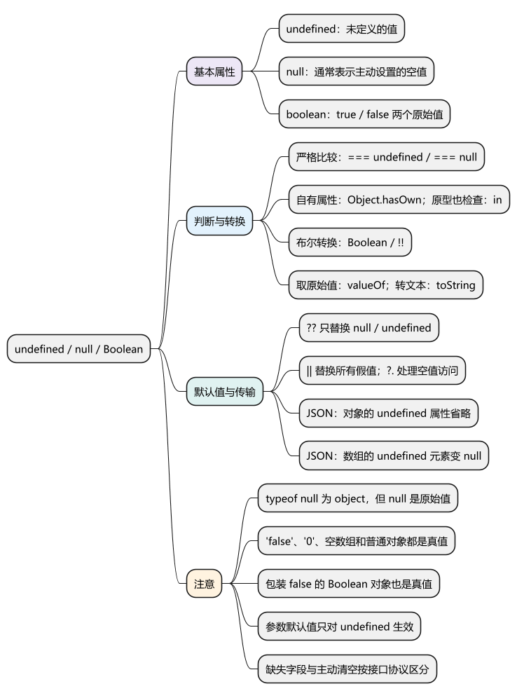
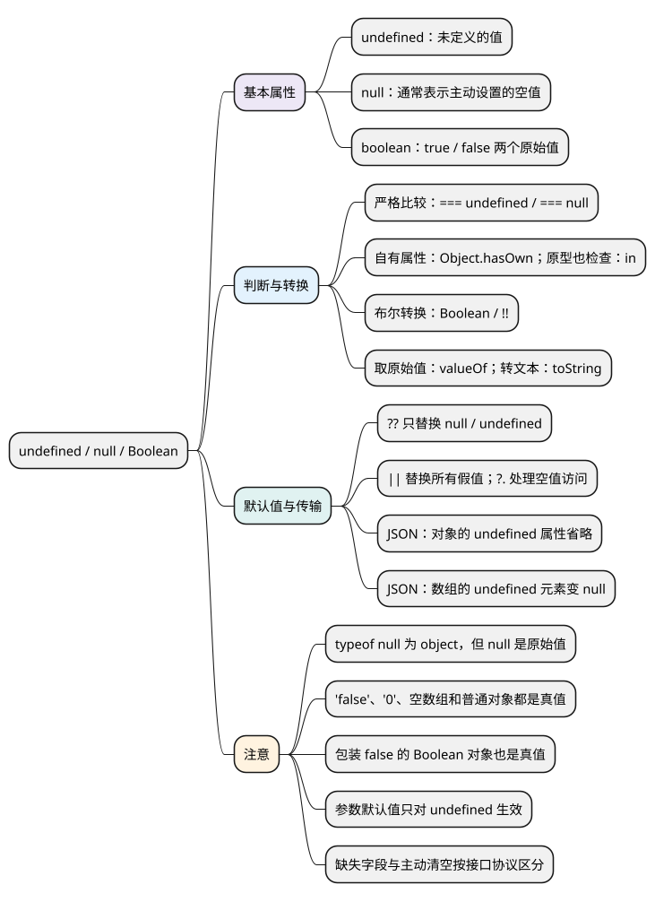

# undefined、null 与 Boolean

[](examples/nullish-boolean-mindmap.svg)

<details>
<summary>PlantUML 源码</summary>



</details>

<a id="k01"></a>

## 基本属性

- **undefined：** 表示未定义的值。声明但未赋值的变量、读取不存在的属性、函数没有明确返回值时，通常得到 undefined。
- **null：** 通常由代码主动赋值，表示这里明确没有对象或结果；具体含义由接口或业务约定。
- **boolean：** 只有 true 和 false 两个原始值，用于表示判断结果。

undefined 和 null 没有可直接调用的实例方法；Boolean 常用的是转换函数，通常不创建包装对象。各代码示例分别运行。

<!-- example: d21-basic -->
```js
let value;
function run() {}

console.log(value, ({}).missing, run()); // undefined undefined undefined
console.log(typeof undefined, typeof null, typeof false); // undefined object boolean
console.log(null === undefined); // false
```

**注意：** typeof null 返回 'object' 是历史兼容行为，null 仍然是原始值。未声明变量与值为 undefined 的变量不同，直接读取未声明变量会报错。

## API

<a id="k02"></a>

### 判断空值与字段存在：严格比较、Object.hasOwn()、in

- `value === undefined` / `value === null`：分别检查这两个值。
- `value === null || value === undefined`：同时检查两种空值。
- `Object.hasOwn(object, key)`：检查对象是否具有这个自有属性，不关心属性值。
- `key in object`：检查自身或原型链上是否存在属性；右侧必须是对象。

<!-- example: d21-presence -->
```js
const user = { nickname: undefined, avatar: null };

console.log(user.nickname === undefined, user.missing === undefined); // true true
console.log(Object.hasOwn(user, 'nickname')); // true
console.log(Object.hasOwn(user, 'missing')); // false
console.log(user.avatar === null); // true
console.log('toString' in user, Object.hasOwn(user, 'toString')); // true false
```

**注意：** “属性不存在”和“属性存在但值为 undefined”不是同一回事。接口的缺省字段、主动清空和保留原值，应该按业务协议区分。

<a id="k03"></a>

### 转换为布尔值：Boolean()、!!

`Boolean(value)` 与 `!!value` 都按真假规则返回布尔原始值。if、条件运算符等也使用这套规则。

常用假值是 false、0、-0、0n、空字符串、null、undefined 和 NaN。非空字符串、数组和普通对象都是真值；字符串 'false' 和 '0' 也不例外。

<!-- example: d21-boolean -->
```js
console.log(Boolean(''), Boolean(0), Boolean(null)); // false false false
console.log(Boolean('false'), Boolean('0')); // true true
console.log(Boolean([]), Boolean({})); // true true
console.log(!!'hello', !!undefined); // true false
```

**注意：** 真值不代表业务有效：空数组也是真值，检查是否有元素要看 length。把接口字符串 'false' 转为布尔值，应按接口约定解析，不能直接 Boolean('false')。浏览器的 document.all 是历史遗留的特殊假值，业务代码不依赖它。

<a id="k04"></a>

### 设置默认值与安全读取：??、||、?.

- `value ?? fallback`：只在 value 为 null 或 undefined 时使用默认值。
- `value || fallback`：value 是任何假值时都使用默认值，包括 0、false、空字符串。
- `object?.property`：object 为 null 或 undefined 时停止这次属性访问，得到 undefined。
- `??` 和 `||` 返回选中的操作数，不一定返回布尔值；右侧只在需要时求值。

<!-- example: d21-defaults -->
```js
console.log(0 ?? 10, 0 || 10); // 0 10
console.log(false ?? true, false || true); // false true
console.log(JSON.stringify('' ?? '默认'), JSON.stringify('' || '默认'));
// "" "默认"

const user = null;
console.log(user?.name ?? '访客'); // 访客

function greet(name = '访客') {
  return name;
}
console.log(greet(undefined), greet(null)); // 访客 null
```

**注意：** 参数和解构的默认值只在值为 undefined 时生效，null 不会触发。可选链不负责校验类型，也不会吞掉 getter 或函数内部抛出的异常；完全未声明的根变量仍会报错。

<a id="k05"></a>

### 读取布尔原始值与文本：valueOf()、toString()

- `Boolean.prototype.valueOf()`：返回接收者对应的布尔原始值。
- `Boolean.prototype.toString()`：返回 'true' 或 'false'。
- `new Boolean(value)`：创建包装对象，日常用 Boolean(value) 即可。

<!-- example: d21-wrapper -->
```js
console.log(true.toString(), false.valueOf()); // true false

const wrapped = new Boolean(false);
console.log(typeof wrapped); // object
console.log(Boolean(wrapped)); // true
console.log(wrapped.valueOf()); // false
console.log(wrapped === false); // false
```

**注意：** 包装对象即使包装的是 false，放进 if 中仍按对象判为真。不要用 new Boolean 表示业务开关。

<a id="k06"></a>

### 序列化空值：JSON.stringify()

JSON 可以表示 null 和布尔值，不能表示 undefined。序列化时要区分对象属性、数组元素和顶层输入。

<!-- example: d21-json -->
```js
console.log(JSON.stringify({ a: undefined, b: null, c: false }));
// {"b":null,"c":false}
console.log(JSON.stringify([undefined, null, false])); // [null,null,false]
console.log(JSON.stringify(undefined)); // undefined
console.log(typeof JSON.stringify(undefined)); // undefined
```

**注意：** 对象中的 undefined 属性被省略，数组中的 undefined 变成 null，顶层 undefined 得到的是 undefined 值而非 JSON 字符串。需要表达“清空”时，应按协议明确发送 null 等约定值。

<a id="interview"></a>

## 试题与答案

<a id="d21-01"></a>

### D21-01 [P0·基础] null 和 undefined 有什么区别？

**回答：** 它们是两个不同的原始值。undefined 常见于未赋值、缺失属性或没有返回值；null 通常表示主动声明的空值。严格比较不相等，typeof null 为 'object' 是历史兼容行为。接口中的语义要由协议确定。

<a id="d21-02"></a>

### D21-02 [P0·基础] 为什么 Boolean('false')、Boolean([]) 都是 true？

**回答：** Boolean 按语言的真假规则转换，不理解字符串的业务含义。非空字符串和普通对象都是真值；数组也是对象。解析布尔字符串应明确接受哪些文本，判断空数组应检查 length。

<a id="d21-03"></a>

### D21-03 [P0·原理] ?? 和 || 设置默认值有什么区别？

**回答：** ?? 只替换 null、undefined，|| 会替换所有假值。当 0、false、空字符串是合法输入时，通常使用 ??。二者返回操作数而非固定返回布尔值，且只在需要时计算右侧。

<a id="d21-04"></a>

### D21-04 [P0·原理] 属性值为 undefined，能说明属性不存在吗？

**回答：** 不能，已有属性也可以保存 undefined。检查自有属性用 Object.hasOwn，检查自身及原型链用 in；读取属性值回答的是另一个问题。

<a id="d21-05"></a>

### D21-05 [P0·基础] new Boolean(false) 放在 if 中为什么会进入分支？

**回答：** new Boolean 创建的是包装对象，条件判断把这个对象视为真，不会先调用 valueOf 取出 false。业务布尔转换使用 Boolean(value) 或 !!value。

<a id="d21-06"></a>

### D21-06 [P1·工程取舍] 接口中的 null、undefined 和缺失字段能混用吗？

**回答：** 不能直接混用。对象里的 undefined 序列化后通常被省略，null 可以保留；服务端也可能把缺失字段解释为不修改，把 null 解释为清空。提交前要按接口协议处理，避免默认值或序列化改变业务含义。
