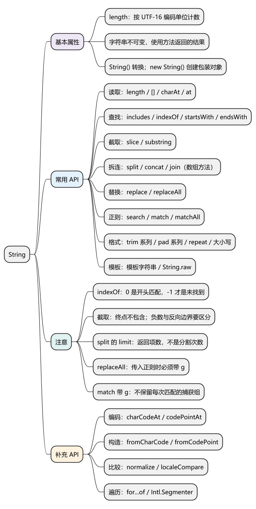
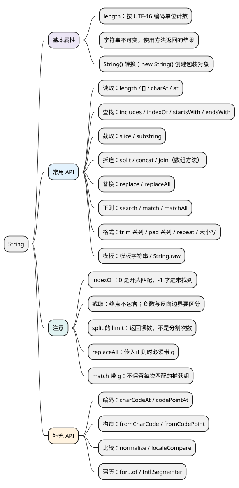

# String

[](examples/string-mindmap.svg)

<details>
<summary>PlantUML 源码</summary>



</details>

<a id="k01"></a>
<a id="unicode"></a>

## 基本属性

**字符串是不可变的原始值。** 方法不会修改原字符串，处理后要使用返回结果。

**length：** 返回 UTF-16 编码单位的数量。普通英文通常一个字符占一个单位，部分 emoji 占两个，所以不一定等于看到的字符数。

<!-- example: string-basic -->
```js
const text = 'hello';

console.log(text.length); // 5
console.log('😀'.length); // 2
console.log(text.toUpperCase()); // HELLO
console.log(text); // hello
```

String(value) 用于转换为字符串；new String(value) 创建包装对象，日常通常不需要。各代码示例分别运行。

<a id="common"></a>
<a id="versions"></a>

## API

<a id="k02"></a>

### 读取指定位置：charAt()、at()、下标

- `charAt(index = 0)`：返回指定位置的字符串，越界返回空字符串。
- `at(index)`：支持负索引，-1 表示最后一个位置；越界返回 undefined。
- `text[index]`：从 0 开始读取，越界返回 undefined，不支持负索引含义。

<!-- example: string-position -->
```js
const text = 'hello';
console.log(text.charAt(1)); // e
console.log(text.at(-1)); // o
console.log(text[99]); // undefined
console.log(JSON.stringify(text.charAt(99))); // ""
```

<a id="k03"></a>

### 查找内容与判断首尾：includes()、indexOf()、lastIndexOf()、startsWith()、endsWith()

- `includes(search, position = 0)`：从 position 向后查找，返回是否包含。
- `indexOf(search, position = 0)`：返回首次匹配位置，未找到为 -1。
- `lastIndexOf(search, position)`：从给定位置向前找，返回匹配位置，未找到为 -1；省略位置时从尾部附近开始。
- `startsWith(search, position = 0)`：返回指定位置是否以 search 开头。
- `endsWith(search, endPosition = text.length)`：返回 endPosition 之前的文本是否以 search 结尾。

<!-- example: string-search -->
```js
const text = 'abcabc';

console.log(text.includes('ab', 1)); // true
console.log(text.indexOf('ab', 1)); // 3
console.log(text.lastIndexOf('ab')); // 3
console.log(text.startsWith('ab', 3)); // true
console.log(text.endsWith('ab', 5)); // true
console.log(text.indexOf('z')); // -1
```

**注意：** indexOf 找到开头时返回 0，未找到返回 -1，不能直接用它的结果作为 if 条件。查找默认区分大小写；includes、startsWith、endsWith 不接受普通正则模式。endsWith 的第二参数是结束位置，不是开始位置。

<a id="k04"></a>

### 截取字符串：slice()、substring()、substr()

- `slice(start = 0, end = text.length)`：返回起点到终点之前的子串；支持负索引；起止位置不会交换。
- `substring(start = 0, end = text.length)`：同样不含终点；负数按 0 处理，起点大于终点时交换。
- `substr(start, length)`：从 start 取 length 个编码单位，是历史兼容方法，新代码通常用 slice。

<!-- example: string-slice -->
```js
const text = '12345678';

console.log(text.slice(1, 4)); // 234
console.log(text.slice(-3)); // 678
console.log(JSON.stringify(text.slice(4, 1))); // ""
console.log(text.substring(4, 1)); // 234
console.log(text.substring(-2, 3)); // 123

console.log('How are you'.slice(8, 11)); // you
```

**记忆：** slice 支持负数、不交换；substring 负数归零、可以交换；substr 第二参数是数量。

### 拆分与连接字符串：split()、concat()

- `split(separator, limit)`：按字符串或正则分隔，返回数组；limit 是最多返回的项数。
- `concat(...values)`：连接文本，返回新字符串，也可以使用 + 或模板字符串。
- 数组的 `join(separator)` 可以把拆分结果连接回字符串；它属于 Array，默认分隔符为逗号。

<!-- example: string-split -->
```js
console.log(JSON.stringify('a,b,c'.split(','))); // ["a","b","c"]
console.log(JSON.stringify('a,b,c'.split(',', 2))); // ["a","b"]
console.log('hello'.concat(' ', 'world')); // hello world
console.log(['a', 'b', 'c'].join('-')); // a-b-c
```

**注意：** limit 不是分割次数，剩余内容不会自动合入最后一项；正则捕获组可能进入结果。split('') 按编码单位拆分，可能拆开 emoji。

<a id="k05"></a>

### 替换字符串内容：replace()、replaceAll()

- `replace(pattern, replacement)`：返回替换结果；字符串模式只替换第一处，正则加 g 可以替换全部。
- `replaceAll(pattern, replacement)`：替换全部；传入正则时必须带 g。
- replacement 可以是字符串，也可以是返回替换内容的函数。

<!-- example: string-replace -->
```js
const text = 'cat-cat';

console.log(text.replace('cat', 'dog')); // dog-cat
console.log(text.replaceAll('cat', 'dog')); // dog-dog
console.log(text.replace(/cat/g, 'dog')); // dog-dog
console.log(text); // cat-cat

try {
  text.replaceAll(/cat/, 'dog');
} catch (error) {
  console.log(error.name); // TypeError
}
```

**注意：** 替换字符串中的 $&、$1 等会被解释。需要原样插入文本时，使用 `() => replacement`。

<a id="k06"></a>

### 正则查找与提取：search()、match()、matchAll()

- `search(regexp)`：返回第一次匹配的位置，未找到为 -1。
- `match(regexp)`：无 g 时返回一次匹配及捕获组；有 g 时返回所有完整匹配文本；未找到为 null。
- `matchAll(regexp)`：返回包含各次匹配、捕获组和位置的迭代器；参数是正则时必须带 g。

<!-- example: string-match -->
```js
const text = 'a=1 b=2';

console.log(text.search(/\d/)); // 2
console.log(JSON.stringify(text.match(/([a-z])=(\d)/).slice(0, 3)));
// ["a=1","a","1"]
console.log(JSON.stringify(text.match(/([a-z])=(\d)/g)));
// ["a=1","b=2"]
console.log(JSON.stringify(
  [...text.matchAll(/([a-z])=(\d)/g)].map(item => [item[1], item[2], item.index])
));
// [["a","1",0],["b","2",4]]
console.log(text.match(/z/)); // null
```

**注意：** match 的常规参数只有一个；matchAll 返回迭代器，可以用 for...of 遍历或展开为数组。正则写法见[RegExp 篇](16_RegExp.md)。

<a id="k07"></a>

### 清理空白、补齐与格式转换：trim()、padStart()、repeat() 等

- `trim()`、`trimStart()`、`trimEnd()`：分别删除两端、开头、结尾规定的空白字符，不删除中间空白。
- `padStart(targetLength, padString = ' ')`、`padEnd(...)`：从头或尾补齐到目标总长度；原串够长时不截断。
- `repeat(count)`：返回重复后的文本；次数先按整数语义转换，结果为负数或无穷大时抛错，过大结果也受运行时限制。
- `toLowerCase()`、`toUpperCase()`：返回大小写转换结果。

<!-- example: string-format -->
```js
console.log(JSON.stringify('  hello world  '.trim())); // "hello world"
console.log(JSON.stringify('  hi  '.trimStart())); // "hi  "
console.log(JSON.stringify('  hi  '.trimEnd())); // "  hi"
console.log('7'.padStart(3, '0')); // 007
console.log('h'.padEnd(5, 'o')); // hoooo
console.log('abcdef'.padStart(3, '0')); // abcdef
console.log('ha'.repeat(2)); // haha
console.log('Hello'.toLowerCase(), 'Hello'.toUpperCase()); // hello HELLO
```

**注意：** 以上都返回新字符串；pad 的目标是总长度，填充内容可能被截短。

### 插值与保留模板反斜杠：模板字符串、String.raw()

模板字符串用反引号，支持插值和多行文本。String.raw 作为模板标签时，保留模板文本中的原始反斜杠，插值仍会求值。

<!-- example: string-template -->
```js
const name = 'Mike';
const age = 27;

console.log(`My name is ${name}, next year I am ${age + 1}.`);
// My name is Mike, next year I am 28.

const ordinary = 'a\nb';
const raw = String.raw`a\nb`;
console.log(ordinary.length, raw.length); // 3 4
console.log(raw === 'a\\nb'); // true
```

**注意：** String.raw 不会给任意输入自动做安全转义，也不负责清洗 HTML。

### 遍历与编码转换：for...of、codePointAt() 等

- 普通下标循环按 UTF-16 编码单位推进；for...of 和展开按 Unicode 码点推进。
- `charCodeAt(index = 0)`：返回码元数值，越界为 NaN。
- `codePointAt(index = 0)`：返回从该码元位置开始的码点，越界为 undefined；参数仍是码元索引。
- `String.fromCharCode(...units)`、`String.fromCodePoint(...points)`：分别根据码元或码点构造字符串。

<!-- example: string-iterate-codepoint -->
```js
const text = 'A😀B';
console.log(text.length); // 4
console.log([...text].length); // 3
console.log('😀'.codePointAt(0).toString(16)); // 1f600
console.log(String.fromCodePoint(0x1f600)); // 😀
```

**注意：** 一个用户看到的字符还可能由多个码点组成，需要完整字符分段可用 Intl.Segmenter 的 grapheme 模式；UTF-8 字节数可用 TextEncoder 计算。这些数量不等于页面显示宽度。

<a id="k08"></a>

### 文本规范化与语言比较：normalize()、localeCompare() 等

- `normalize(form = 'NFC')`：返回 Unicode 规范化后的文本。
- `localeCompare(other, locales, options)`：按语言规则比较，返回负数、0 或正数；大量排序可复用 Intl.Collator。
- `toLocaleLowerCase()`、`toLocaleUpperCase()`：按语言相关规则转换大小写。
- `isWellFormed()`：检查是否没有孤立代理码元；`toWellFormed()` 用替换字符处理孤立代理码元，返回新串。

<!-- example: string-normalize -->
```js
const a = 'é';
const b = 'e\u0301';

console.log(a === b); // false
console.log(a.normalize() === b.normalize()); // true
console.log('a'.localeCompare('b') < 0); // true
console.log('ß'.toUpperCase()); // SS
```

**注意：** normalize 不统一所有外观相似字符；大小写转换可能改变长度；localeCompare 不保证非零结果只有 -1 或 1。较新的 API 需确认目标环境支持。

<a id="summary"></a>

<a id="interview"></a>

## 试题与答案

<a id="d04-01"></a>

### D04-01 [P0·原理] 字符串不可变，为什么 name += 'x' 可以执行？

**回答：** += 计算拼接结果，再给变量重新赋值；没有修改原字符串本身。若绑定是 const 则重新赋值失败。String 方法也返回结果而不改原值，应根据返回类型使用它。


<a id="d04-02"></a>

### D04-02 [P1·原理] length、展开数组与用户看到的字符数为何不同？

**回答：** length 按 UTF-16 码元；字符串迭代器按码点，所以展开能合并代理对；一个用户看到的字符仍可能由多个码点组成，按这种单位计数可用 Intl.Segmenter 的 grapheme 模式。UTF-8 字节数又是编码层的数量，不能用任一字符计数代替。


<a id="d04-03"></a>

### D04-03 [P0·基础] slice、substring、substr 怎样区分？

**回答：** slice 和 substring 都按左闭右开区间截取；slice 支持负索引且不交换反向起止，substring 把负数按0处理并交换反向边界。substr 第二参数是长度，属于历史兼容方法，新代码优先 slice。


<a id="d04-04"></a>

### D04-04 [P0·基础] includes 与 indexOf 怎么选，endsWith 第二参数是什么？

**回答：** 只判断存在用 includes；需要位置用 indexOf 并判断是否为 -1。startsWith 的第二参数是候选起点，endsWith 的第二参数是候选结束位置，且不包含该位置的字符。


<a id="d04-05"></a>

### D04-05 [P0·原理] replaceAll 就是 replace 加一个 g 吗？

**回答：** 它解决全量替换，但字符串模式与正则模式的传参规则仍不同。replace 的字符串模式只替换第一处，replaceAll 的字符串模式匹配全部；replaceAll 收到正则必须有 g。替换字符串还会解释 $&/$1 等模式，原样插入用户文本适合使用替换函数。


<a id="d04-06"></a>

### D04-06 [P1·原理] match 有 g 为什么丢了捕获组？

**回答：** 全局 match 的结果是各次完整匹配文本，不保留每次捕获组结构。无 g 的 match 取得一次匹配及其捕获；需要全量匹配并保留捕获和位置，用 matchAll 的迭代器或谨慎使用 exec 循环。


<a id="d04-07"></a>

### D04-07 [P1·原理] split 的 limit 是分割次数吗？

**回答：** 不是，是最多返回的数组项数，达到上限后的余下文本不自动合并为最后一项。正则捕获组还可能作为独立项进入结果；split('') 按码元切分，可能拆断代理对。


<a id="d04-08"></a>

### D04-08 [P1·工程取舍] 统一转小写就能实现国际化搜索和排序吗？

**回答：** 不能。语言相关大小写、重音与规范等价是不同问题。可以按需求使用 normalize、locale 相关转换和 Intl.Collator；还要确定是否忽略大小写和重音。视觉相似和安全标识规则又需额外设计。


<a id="d04-09"></a>

### D04-09 [P1·基础] padStart 会截断长字符串吗？String.raw 会清洗 HTML 吗？

**回答：** padStart 在原串已达目标长度时保持原内容，只为短串补齐；String.raw 保留模板原始片段中的反斜杠，不负责 HTML 清洗或用户数据安全。它们的名字不能替代对具体契约的理解。
