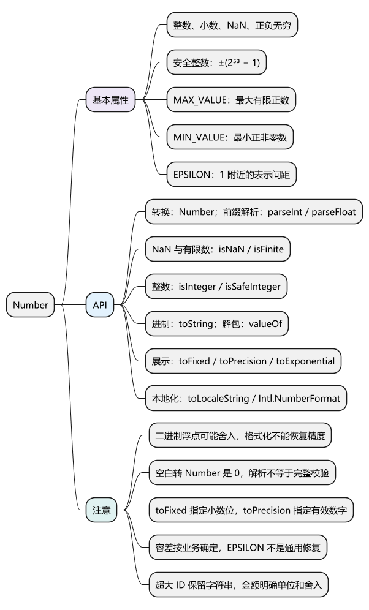
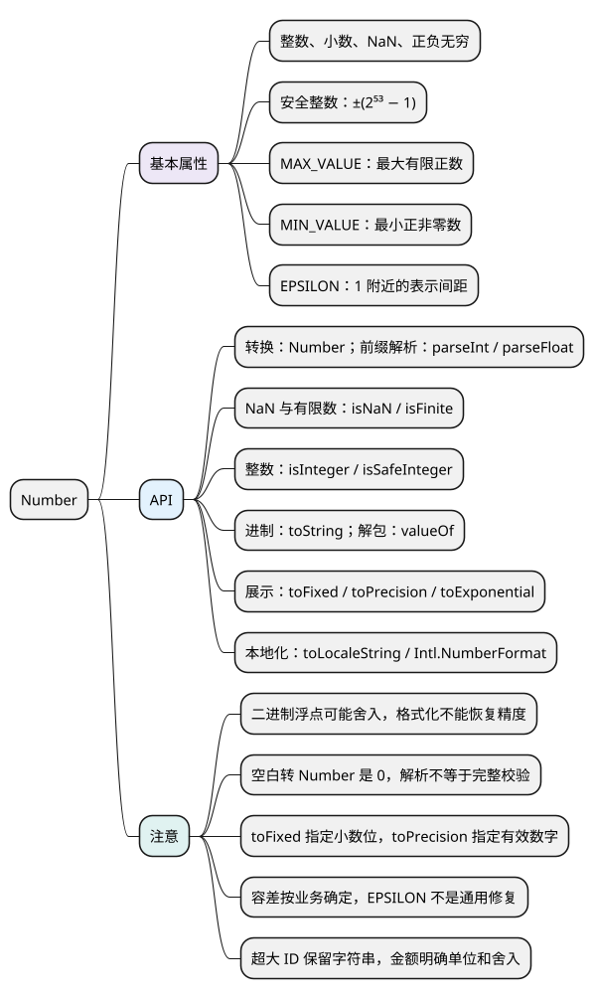

# Number

[](examples/number-mindmap.svg)

<details>
<summary>PlantUML 源码</summary>



</details>

<a id="k01"></a>
<a id="k02"></a>

## 基本属性

**Number 是表示整数和小数的原始类型，也包括 NaN、Infinity 和 -Infinity。** 使用双精度浮点数语义，整数和小数都存在精度边界。各代码示例分别运行。

- `Number.MAX_SAFE_INTEGER` / `MIN_SAFE_INTEGER`：安全整数上下界，分别为 ±9007199254740991。
- `Number.MAX_VALUE`：最大有限正数，不是最大安全整数。
- `Number.MIN_VALUE`：最小正非零数，不是最负数。
- `Number.EPSILON`：1 附近相邻可表示数的间距，不是所有场景通用的误差标准。
- `Number.NaN`：无效数值结果；`POSITIVE_INFINITY` / `NEGATIVE_INFINITY`：正负无穷。

<!-- example: d05-precision -->
```js
console.log(0.1 + 0.2); // 0.30000000000000004
console.log(0.1 + 0.2 === 0.3); // false
console.log(2 ** 53 === 2 ** 53 + 1); // true
console.log(typeof NaN, NaN === NaN); // number false
console.log(0 === -0, Object.is(0, -0)); // true false
console.log(1 / 0, 1 / -0); // Infinity -Infinity
```

**注意：** 0.1 等十进制小数不能用有限位二进制准确表示，计算会舍入。超过安全整数范围后，并非每个整数都不准确，而是不能保证相邻整数都能区分。已经丢失的精度不能靠转字符串或 BigInt 恢复。

## API

<a id="k03"></a>

### 转换为数值：Number()

`Number(value)` 转换整个输入，得到 Number 原始值；无法转换时通常返回 NaN。它不是前缀解析。

<!-- example: d05-convert -->
```js
console.log(Number('12.5'), Number('12px')); // 12.5 NaN
console.log(Number('  '), Number(null), Number(false)); // 0 0 0
console.log(Number(undefined)); // NaN
console.log(Number(12n)); // 12

const wrapped = new Number(0);
console.log(typeof wrapped, Boolean(wrapped)); // object true
console.log(wrapped.valueOf()); // 0
```

**注意：** 空字符串和空白字符串会转成 0，表单空值应先处理。Symbol 转 Number 会抛 TypeError；BigInt 转 Number 可能失精度。`new Number()` 创建包装对象，日常通常不需要。

### 解析数字前缀：Number.parseInt()、Number.parseFloat()

- `Number.parseInt(text, radix)`：按指定进制解析整数前缀，返回 Number 或 NaN；十进制输入建议明确传 10。
- `Number.parseFloat(text)`：解析浮点数前缀，支持小数和指数；遇到不合法部分停止。
- 与对应的全局 `parseInt`、`parseFloat` 是同一组函数。

<!-- example: d05-parse -->
```js
console.log(Number.parseInt('12px', 10)); // 12
console.log(Number.parseInt('ff', 16)); // 255
console.log(Number.parseInt('1e3', 10)); // 1
console.log(Number.parseFloat('1.5e2px')); // 150
console.log(Number('1e3')); // 1000
console.log(Number.parseInt('px12', 10)); // NaN
```

**注意：** 前缀解析不等于完整格式校验；`parseInt` 不是通用取整函数，大数仍可能丢精度。数组回调不要直接写 `array.map(parseInt)`，索引会被传成进制参数。

### 校验数字：Number.isNaN()、isFinite()、isInteger()、isSafeInteger()

- `Number.isNaN(value)`：只有值是 Number 类型的 NaN 才为 true。
- `Number.isFinite(value)`：只有有限 Number 才为 true，排除 NaN 和正负无穷。
- `Number.isInteger(value)`：检查当前数值是否为有限整数。
- `Number.isSafeInteger(value)`：检查是否为安全整数。

<!-- example: d05-validate -->
```js
console.log(isNaN('x'), Number.isNaN('x')); // true false
console.log(isFinite('3'), Number.isFinite('3')); // true false
console.log(Number.isInteger(2.0), Number.isInteger(2.5)); // true false
console.log(Number.isInteger(2 ** 53), Number.isSafeInteger(2 ** 53));
// true false
```

**注意：** 全局 `isNaN`、`isFinite` 会先转换输入，Number 上的同名方法不会。整数判断无法修复调用前已经发生的舍入；业务上还要检查范围，例如页码必须 ≥ 1。

<a id="k04"></a>

### 转换进制与格式化：toString()、toFixed()、toPrecision()、toExponential()

- `toString(radix = 10)`：返回指定进制的字符串，进制为 2～36，不自动添加 0x 等前缀。
- `toFixed(digits = 0)`：返回指定小数位数的字符串，digits 为 0～100。
- `toPrecision(precision)`：返回指定有效数字数的字符串，precision 为 1～100；省略时使用普通表示。
- `toExponential(fractionDigits)`：返回指数表示字符串；可指定小数位数。

<!-- example: d05-format -->
```js
console.log((255).toString(16)); // ff
console.log((12.345).toFixed(2)); // 12.35
console.log((1234).toPrecision(3)); // 1.23e+3
console.log((1234).toExponential(2)); // 1.23e+3
console.log(typeof (12.345).toFixed(2)); // string
console.log((2.55).toFixed(1)); // 2.5
```

**注意：** 这些方法用于展示，不修改原数值，也不能恢复计算精度。2.55 的实际二进制表示略小于精确的 2.55，所以舍入可能不同于十进制直觉。toFixed 在绝对值 ≥ 10²¹ 时可能使用指数表示。

### 本地化数字展示：toLocaleString()、Intl.NumberFormat

`value.toLocaleString(locales, options)` 按指定语言和选项返回字符串，可用于千分位、货币和百分比。大量格式化时可复用一个 `Intl.NumberFormat` 实例。

<!-- example: d05-locale -->
```js
console.log((1234.5).toLocaleString('en-US')); // 1,234.5
const percent = new Intl.NumberFormat('en-US', {
  style: 'percent',
  maximumFractionDigits: 1
});
console.log(percent.format(0.125)); // 12.5%
```

**注意：** 展示结果可能有分组符号、不换行空格或语言差异，不能当作稳定接口协议，也不能直接依赖 parseFloat 还原。

<a id="k05"></a>

### 设置误差容限：Number.EPSILON 与近似比较

比较允许误差的计算结果，应按数据单位和数量级确定容差。绝对容差限制差值，相对容差随数值大小变化；没有适用所有业务的固定阈值。

<!-- example: d05-tolerance -->
```js
function nearlyEqual(a, b, absTolerance, relTolerance) {
  if (a === b) return true;
  if (!Number.isFinite(a) || !Number.isFinite(b)) return false;
  return Math.abs(a - b) <= Math.max(
    absTolerance,
    relTolerance * Math.max(Math.abs(a), Math.abs(b))
  );
}

console.log(nearlyEqual(0.1 + 0.2, 0.3, 1e-12, 1e-12)); // true
```

**注意：** 本例假设容差是有限非负数。金额可约定最小货币单位并在安全整数范围内计算，或选用十进制库；还要明确输入解析和舍入规则。订单 ID 不适合用近似比较，超大 ID 通常保留字符串。

<a id="summary"></a>
<a id="interview"></a>

## 试题与答案

<a id="d05-01"></a>

### D05-01 [P0·原理] 0.1+0.2 为什么不等于 0.3？

**回答：** 十进制小数转换成有限位二进制时可能舍入，运算后再次舍入，因此 0.1 + 0.2 与 0.3 的表示不同。toFixed 只控制展示；金额应明确单位、精度和舍入规则。

<a id="d05-02"></a>

### D05-02 [P0·基础] MAX_VALUE 和 MAX_SAFE_INTEGER 为什么不同？

**回答：** MAX_VALUE 是最大有限正数，MAX_SAFE_INTEGER 是整数能可靠精确区分的安全上界。数值很大但仍有限，不代表还能准确区分相邻整数。

<a id="d05-03"></a>

### D05-03 [P0·基础] 判断数字合法，typeof 足够吗？

**回答：** 不够，NaN 和 Infinity 的 typeof 也是 number。先明确是否允许字符串，再检查有限性、整数、安全范围和业务上下界；不要把 Number 转换与业务校验混为一谈。

<a id="d05-04"></a>

### D05-04 [P1·原理] Number.EPSILON 能修复所有浮点比较吗？

**回答：** 不能，它只表示 1 附近的数值间距。应根据数据单位和数量级选择绝对、相对容差；要求精确的数据则应采用整数单位或合适的十进制方案。

<a id="d05-05"></a>

### D05-05 [P0·基础] toFixed、toPrecision 和 Math.round 有何区别？

**回答：** toFixed 指定小数位，toPrecision 指定有效数字，二者返回字符串；Math.round 返回最接近的整数 Number，正好在中点时向正无穷方向取。它们都不能恢复此前丢失的精度。
