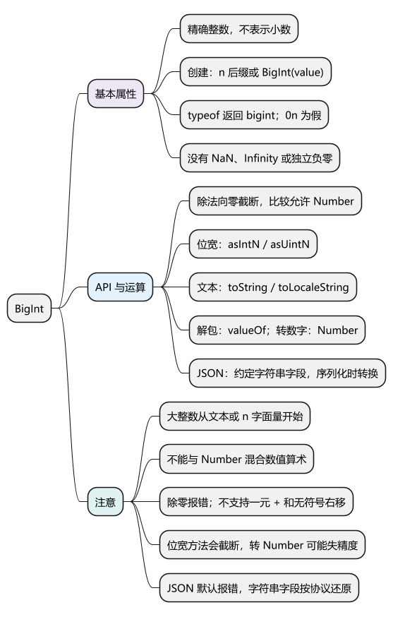
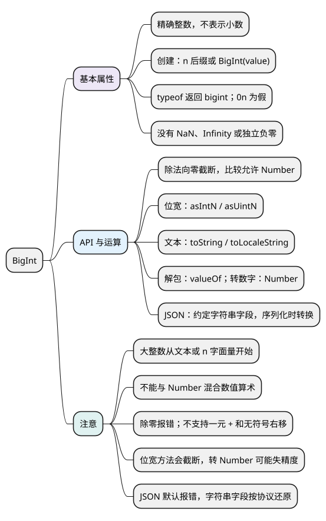

# BigInt

[](examples/bigint-mindmap.svg)

<details>
<summary>PlantUML 源码</summary>



</details>

<a id="k01"></a>

## 基本属性

**BigInt 是 ES2020 新增的原始类型，用于精确表示和计算整数，不表示小数。** 可用于超过 Number 安全范围的整数运算；实际大小仍受内存和运行时限制。各代码示例分别运行。

- 字面量使用 `n` 后缀，例如 `123n`。
- `typeof 1n` 返回 `'bigint'`。
- 不存在对应的 NaN、Infinity 或独立的负零。
- `0n` 在布尔判断中为 false，其他 BigInt 为 true。
- BigInt 不能使用 new；`Object(1n)` 可以创建包装对象，日常通常不需要。

<!-- example: d06-basic -->
```js
console.log(typeof 1n); // bigint
console.log(Boolean(0n), Boolean(1n)); // false true
console.log(-0n === 0n); // true
console.log(9007199254740993n + 1n); // 9007199254740994n
```

**注意：** BigInt 适合整数计算，不能替代所有 Number。手机号、订单编码等只用于标识时，通常保留字符串更直接，也能保留前导零。

## API

### 创建精确整数：BigInt()

`BigInt(value)` 接受整数 Number、合法整数文本或布尔值，返回 BigInt。大整数应从原始文本或 n 字面量开始，避免先经过 Number 舍入。

<!-- example: d06-create -->
```js
console.log(BigInt('9007199254740993')); // 9007199254740993n
console.log(BigInt(9007199254740993)); // 9007199254740992n
console.log(BigInt('0xff'), BigInt(true)); // 255n 1n

for (const value of [1.5, '1.5']) {
  try {
    BigInt(value);
  } catch (error) {
    console.log(error.name); // RangeError，然后 SyntaxError
  }
}
```

**注意：** 小数 Number 会抛 RangeError，非法整数文本会抛 SyntaxError。转换不是取整；已经舍入的 Number 转 BigInt 也无法恢复原值。

<a id="k02"></a>

### 整数计算与比较：算术运算符、比较运算符

- 支持 `+`、`-`、`*`、`/`、`%`、`**` 和多数位运算。
- 除法向零截断；余数与左操作数同号或为零；指数必须是非负 BigInt。
- Number 和 BigInt 不能直接混合做数值算术；关系比较可以比较二者。
- 不支持一元 `+` 和无符号右移 `>>>`；Math 方法不能直接接收 BigInt。

<!-- example: d06-operators -->
```js
console.log(7n / 3n, -7n / 3n); // 2n -2n
console.log(-7n % 3n, 2n ** 3n); // -1n 8n
console.log(1n == 1, 1n === 1); // true false
console.log(2n > 1, 2n < 3); // true true
console.log('id=' + 12n); // id=12

try {
  console.log(1n + 1);
} catch (error) {
  console.log(error.name); // TypeError
}
try {
  console.log(1n / 0n);
} catch (error) {
  console.log(error.name); // RangeError
}
```

**注意：** 字符串拼接是例外，不能概括成“BigInt 所有混合操作都报错”。混合数值数组排序也不要用 `(a, b) => a - b`；先统一输入类型，或使用返回 Number 的比较逻辑。

<a id="k03"></a>

### 按位宽截断：BigInt.asIntN()、BigInt.asUintN()

- `BigInt.asIntN(bits, value)`：按 bits 位有符号整数解释结果。
- `BigInt.asUintN(bits, value)`：按 bits 位无符号整数解释结果。
- bits 为位数，value 为需要处理的 BigInt。

<!-- example: d06-width -->
```js
console.log(BigInt.asIntN(8, 255n)); // -1n
console.log(BigInt.asUintN(8, -1n)); // 255n
console.log(BigInt.asUintN(8, 256n)); // 0n
```

**注意：** 它们会截断，不会因为数据超出位宽就替你拒绝输入；业务要求禁止溢出时，应先判断范围。

### 文本展示与数值转换：toString()、toLocaleString()、valueOf()、Number()

- `toString(radix = 10)`：返回字符串，进制为 2～36，结果不带 n 后缀。
- `toLocaleString(locales, options)`：按语言规则返回展示字符串。
- `valueOf()`：从 BigInt 值或包装对象取得 BigInt 原始值。
- `Number(value)`：显式转成 Number，可能丢失精度。

<!-- example: d06-format -->
```js
console.log((255n).toString(16)); // ff
console.log((1234567n).toLocaleString('en-US')); // 1,234,567
console.log(Object(12n).valueOf()); // 12n
console.log(Number(9007199254740993n)); // 9007199254740992
```

**注意：** 转 Number 前应判断是否满足业务精度要求，尤其是安全整数边界。本地化结果可能有分隔符，不适合直接作为接口数据。

<a id="k04"></a>

### 编码为 JSON：JSON.stringify() 的 replacer

JSON 没有 BigInt 字面量，默认序列化遇到 BigInt 会抛 TypeError。常见方案是在协议中约定大整数使用十进制字符串。

<!-- example: d06-json -->
```js
const data = { id: 9007199254740993n };

try {
  JSON.stringify(data);
} catch (error) {
  console.log(error.name); // TypeError
}

const json = JSON.stringify(data, (_key, value) =>
  typeof value === 'bigint' ? value.toString() : value
);
console.log(json); // {"id":"9007199254740993"}

const parsed = JSON.parse(json);
console.log(BigInt(parsed.id)); // 9007199254740993n
```

**注意：** 服务端应在传输时就保留完整文本，不能先发不安全数字再要求前端恢复。解析时按约定字段转 BigInt，不要把所有数字字符串都转换；还应限制输入长度。

<a id="summary"></a>
<a id="interview"></a>

## 试题与答案

<a id="d06-01"></a>

### D06-01 [P0·基础] BigInt 比 Number 精确，是否可以全部替换？

**回答：** 不适合。它只处理整数，混合算术、Math 和 JSON 都有边界。大整数计算可用 BigInt，小数计算根据精度需求选 Number 或十进制方案；只用于标识的数据通常用字符串。

<a id="d06-02"></a>

### D06-02 [P1·原理] BigInt(超大数字字面量) 为什么仍然不准？

**回答：** 参数先按 Number 求值，可能已经舍入；BigInt 只能转换该结果，不能恢复原文本。应使用 n 字面量或从原始整数字符串构造。

<a id="d06-03"></a>

### D06-03 [P1·基础] -7n/3n 的结果是什么？与 Number 有什么区别？

**回答：** 结果是 -2n，BigInt 除法向零截断，不产生小数。Number 除法可以产生近似小数；向零截断也不同于 Math.floor 的向负无穷取整。

<a id="d06-04"></a>

### D06-04 [P1·工程取舍] 大整数往返接口怎样保证一致？

**回答：** 协议明确哪些字段是大整数并使用字符串传输，前端按字段需要转换成 BigInt，提交时再编码成字符串。全程避免先经过不安全 Number，也不要全局猜测数字字符串的类型。
