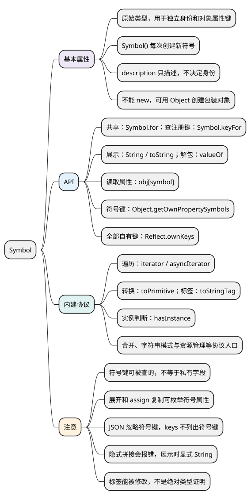

# Symbol

[](examples/symbol-mindmap.svg)

<details>
<summary>PlantUML 源码</summary>



</details>

## 基本属性

**Symbol 是 ES2015 新增的原始类型，常用于避免对象属性键冲突，以及参与语言内建协议。** 对象属性键可以是字符串或 Symbol。各代码示例分别运行。

- `typeof Symbol()` 返回 `'symbol'`。
- `description` 返回创建时的描述字符串，未提供描述时为 undefined。
- 描述只用于识别和调试，不决定符号身份。
- Symbol 不能使用 new；`Object(symbol)` 可以创建包装对象，日常通常不需要。

<a id="k01"></a>

## API

### 创建独立符号：Symbol()

`Symbol(description)` 每次创建一个新符号，即使描述相同也不相等。拿到同一份符号值才能准确访问对应属性。

<!-- example: d07-create -->
```js
const first = Symbol('id');
const second = Symbol('id');

console.log(typeof first); // symbol
console.log(first === second); // false
console.log(first.description); // id
console.log(Symbol().description); // undefined
```

**注意：** 字符串 'id' 只是描述，不是符号的唯一编号。需要在模块之间共享某个键时，可以统一导出同一个 Symbol。

### 按注册键共享符号：Symbol.for()、Symbol.keyFor()

- `Symbol.for(key)`：按键在符号注册表中获取符号；不存在时创建并登记。
- `Symbol.keyFor(symbol)`：返回已注册符号的注册键；普通 Symbol 返回 undefined，非 Symbol 参数会抛错。

<!-- example: d07-registry -->
```js
const first = Symbol.for('app.id');
const second = Symbol.for('app.id');
const local = Symbol('app.id');

console.log(first === second); // true
console.log(first === local); // false
console.log(Symbol.keyFor(first)); // app.id
console.log(Symbol.keyFor(local)); // undefined
```

**注意：** 注册表不是跨进程或跨 Worker 自动同步的数据仓库。只有需要按约定名称复用键时才使用 for；创建独立键用 Symbol 即可。

### 显示描述与取得原始值：toString()、valueOf()、String()

- `symbol.toString()`：返回形如 'Symbol(id)' 的文本。
- `String(symbol)`：显式把 Symbol 原始值转成文本。
- `valueOf()`：返回 Symbol 原始值，可用于包装对象解包。

<!-- example: d07-display -->
```js
const token = Symbol('id');

console.log(token.toString()); // Symbol(id)
console.log(String(token)); // Symbol(id)
console.log(Object(token).valueOf() === token); // true

try {
  console.log('token=' + token);
} catch (error) {
  console.log(error.name); // TypeError
}
```

**注意：** 隐式字符串拼接、直接模板插值以及转换为 Number 会抛错；需要展示时显式调用 String。不同符号可能有相同文本，不能把 toString 的结果当作唯一 ID。

<a id="k02"></a>

### 用作属性键与查询：方括号、Object.getOwnPropertySymbols()、Reflect.ownKeys()

- 使用 `{ [symbol]: value }` 创建属性，通过 `obj[symbol]` 读取。
- `Object.keys()`、`for...in` 不列出符号键。
- `Object.getOwnPropertySymbols(obj)`：返回所有自有 Symbol 键，包括不可枚举的。
- `Reflect.ownKeys(obj)`：返回所有自有字符串键和 Symbol 键，包括不可枚举的。

<!-- example: d07-keys -->
```js
const token = Symbol('token');
const obj = { name: 'Alice', [token]: 123 };

console.log(obj[token]); // 123
console.log(JSON.stringify(Object.keys(obj))); // ["name"]
console.log(Object.getOwnPropertySymbols(obj)[0] === token); // true
console.log(Reflect.ownKeys(obj).length); // 2
console.log({ ...obj }[token]); // 123
console.log(Object.assign({}, obj)[token]); // 123
console.log(JSON.stringify(obj)); // {"name":"Alice"}
```

**注意：** 展开和 Object.assign 会复制自有可枚举 Symbol 属性，JSON.stringify 会忽略符号键。保存在字符串键下的 Symbol 值也会被 JSON 省略，数组中的 Symbol 值则变为 null。

<a id="k04"></a>

**Symbol 属性不是私有属性。** 上例能通过 Object.getOwnPropertySymbols 找到 token，拿到键后即可访问 obj[token]。需要语言级私有成员时使用类的 #字段，或由闭包控制访问；前端封装不等于保护已发送到浏览器的业务秘密。

<a id="k03"></a>

### 提供遍历能力：Symbol.iterator、Symbol.asyncIterator

`Symbol.iterator` 是同步迭代协议的入口。对象提供这个方法，返回符合协议的迭代器后，就能被 for...of、展开等操作使用。

<!-- example: d07-iterator -->
```js
const range = {
  start: 1,
  end: 3,
  *[Symbol.iterator]() {
    for (let value = this.start; value <= this.end; value++) {
      yield value;
    }
  }
};

console.log(JSON.stringify([...range])); // [1,2,3]
```

**注意：** 关键是约定的符号键和正确的迭代行为，普通名为 iterator 的属性不会自动生效。异步迭代使用 Symbol.asyncIterator，通常由 for await...of 消费。

### 定制转换与类型标签：Symbol.toPrimitive、Symbol.toStringTag

- `Symbol.toPrimitive`：提供转成原始值的方法，接收 number、string 或 default 提示；返回值必须是原始值。
- `Symbol.toStringTag`：提供 Object.prototype.toString 使用的标签，不会改变对象的真实内建身份。

<!-- example: d07-protocol -->
```js
const amount = {
  value: 10,
  [Symbol.toPrimitive](hint) {
    return hint === 'string' ? '10元' : this.value;
  }
};
console.log(Number(amount), String(amount), amount + 1); // 10 10元 11

const fake = { [Symbol.toStringTag]: 'Array' };
console.log(Object.prototype.toString.call(fake)); // [object Array]
console.log(Array.isArray(fake)); // false
```

**注意：** 内建符号是语言操作的约定入口，使用时看该操作的具体规则。toStringTag 可以改标签，所以类型判断不能只信标签。

### 其他协议入口：Symbol.hasInstance、isConcatSpreadable 等

- `Symbol.hasInstance`：定制 instanceof 判断。
- `Symbol.isConcatSpreadable`：控制 concat 是否展开该对象。
- `Symbol.match`、`matchAll`、`replace`、`search`、`split`：参与对应 String 方法的模式处理。
- `Symbol.species`：影响部分派生操作选用的构造器。
- `Symbol.unscopables`：控制 with 的名称暴露，属于历史兼容，新代码避免 with。
- `Symbol.dispose`、`asyncDispose`：显式资源管理协议，配合 using / await using；需确认目标运行时支持。

<a id="summary"></a>
<a id="interview"></a>

## 试题与答案

<a id="d07-01"></a>

### D07-01 [P0·基础] Symbol('x') 与 Symbol.for('x') 有何不同？

**回答：** Symbol 每次创建新符号，描述相同也不相等；for 按注册键获取或复用符号。keyFor 只返回已注册符号的键。描述、注册键和符号身份不能混为一谈。

<a id="d07-02"></a>

### D07-02 [P1·原理] Symbol 属性能被复制、遍历或 JSON 序列化吗？

**回答：** 要看方法。keys 和 for...in 不列出符号键；getOwnPropertySymbols 和 Reflect.ownKeys 能取得；展开和 assign 复制自有可枚举符号属性；JSON.stringify 忽略符号键。

<a id="d07-03"></a>

### D07-03 [P1·基础] 为什么 Symbol 不能代替私有字段？

**回答：** Symbol 键能被反射 API 发现，拿到键就能访问属性。它适合避免意外冲突；类的 #私有字段有语言层面的访问限制，二者用途不同。

<a id="d07-04"></a>

### D07-04 [P1·原理] Symbol.iterator 让对象获得了什么能力？

**回答：** for...of 等消费者调用这个方法取得迭代器，再调用 next 读取值。对象必须提供符合协议的行为，只有一个名字包含 iterator 的普通属性并不够。
