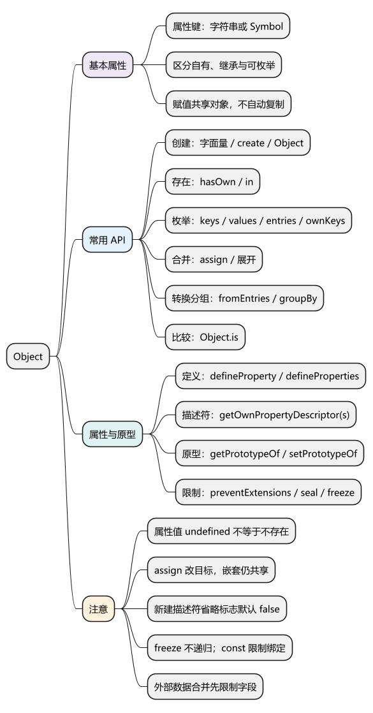
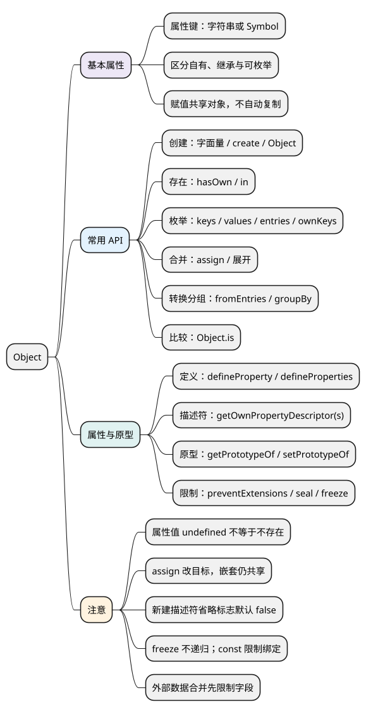

# Object

[](examples/object-mindmap.svg)

<details>
<summary>PlantUML 源码</summary>



</details>

## 基本属性

**对象用于组织一组属性，属性键只能是字符串或 Symbol。** 数字键会转成字符串；对象赋值复制引用值，不会自动复制对象。

- `obj.name`：按固定名字访问；`obj[key]`：根据表达式取得属性键。
- `obj?.name`：obj 为 null 或 undefined 时返回 undefined，不继续访问。
- **自有属性**属于对象自身；**继承属性**来自原型；**可枚举**决定属性是否参与某些遍历和复制操作。

各代码示例分别运行。较新 API 需确认目标环境支持。

## API

<a id="k01"></a>

### 创建对象：对象字面量、Object.create()、Object()

- `{ key: value }`：创建普通对象，日常记录数据优先使用。
- `Object.create(proto, descriptors?)`：创建指定原型的新对象，可同时定义属性。
- `Object(value)`：非空原始值转为包装对象；传入对象通常返回原对象；null 或 undefined 得到新普通对象。

<!-- example: d08-create -->
```js
const user = { 1: 'one', ['user' + 'Name']: 'Alice' };
console.log(user[1] === user['1'], user.userName); // true Alice

const dictionary = Object.create(null);
dictionary.name = 'Alice';
console.log(Object.getPrototypeOf(dictionary)); // null
console.log(dictionary.toString); // undefined
console.log(Object(user) === user); // true
```

**注意：** 无原型对象不继承 toString、hasOwnProperty 等方法；对象的 constructor 属性也可能被修改或不存在，不能作为可靠类型判断。

<a id="k03"></a>

### 判断属性是否存在：Object.hasOwn()、in

- `Object.hasOwn(obj, key)`：返回是否有该自有属性，支持字符串和 Symbol 键。
- `key in obj`：返回对象自身或原型链上是否存在该属性。
- 两者只判断存在，不修改对象。

<!-- example: d08-existence -->
```js
const user = Object.create({ role: 'reader' });
user.name = undefined;

console.log(user.name, user.missing); // undefined undefined
console.log(Object.hasOwn(user, 'name')); // true
console.log(Object.hasOwn(user, 'role'), 'role' in user); // false true
```

**注意：** 属性值为 undefined 不等于属性不存在。优先使用 Object.hasOwn，避免对象自己的 hasOwnProperty 被遮蔽。

### 遍历属性：keys()、values()、entries()、Reflect.ownKeys()

- `Object.keys/values/entries(obj)`：分别返回键、值、键值对的新数组；只取**自有、可枚举、字符串键**。
- `Object.getOwnPropertyNames(obj)`：返回全部自有字符串键，包含不可枚举属性。
- `Object.getOwnPropertySymbols(obj)`：返回全部自有 Symbol 键。
- `Reflect.ownKeys(obj)`：返回全部自有字符串键和 Symbol 键。
- `for...in`：遍历可枚举字符串键，**还包括继承属性**。

<!-- example: d08-keys -->
```js
const id = Symbol('id');
const user = Object.create({ inherited: true });
user.name = 'Alice';
user[id] = 7;
Object.defineProperty(user, 'hidden', { value: 1 });

console.log(JSON.stringify(Object.keys(user))); // ["name"]
console.log(JSON.stringify(Object.values(user))); // ["Alice"]
console.log(JSON.stringify(Object.entries(user))); // [["name","Alice"]]
console.log(JSON.stringify(Object.getOwnPropertyNames(user))); // ["name","hidden"]
console.log(Object.getOwnPropertySymbols(user)[0] === id); // true
console.log(Reflect.ownKeys(user).length); // 3

const keys = [];
for (const key in user) keys.push(key);
console.log(JSON.stringify(keys)); // ["name","inherited"]
```

**注意：** 这些 API 本身不写回对象，但读取 values、entries 时可能执行 getter。普通对象的自有键通常按“数组索引字符串升序 → 其他字符串插入顺序 → Symbol 插入顺序”组织。

<a id="k04"></a>

### 合并与浅拷贝：Object.assign()、对象展开

- `Object.assign(target, ...sources)`：把来源的自有可枚举属性值写入 target，**修改并返回 target**；字符串键和 Symbol 键都参与。
- `{ ...source }`：创建新普通对象，浅复制来源的自有可枚举属性值。
- 同名属性以后出现的值为准，嵌套对象仍可能共享。

<!-- example: d08-copy -->
```js
const source = { name: 'Alice', profile: { age: 18 } };
const copy = Object.assign({}, source, { name: 'Bob' });
console.log(copy === source, copy.profile === source.profile); // false true
copy.profile.age = 20;
console.log(source.name, source.profile.age); // Alice 20

const target = {};
console.log(Object.assign(target, { enabled: true }) === target); // true
console.log(JSON.stringify({ ...source, name: 'Carol' }));
// {"name":"Carol","profile":{"age":20}}
```

**注意：** 两种复制都会读取源 getter，不保留源描述符和原型。assign 写目标时可能触发 setter，异常前已写入的属性也不会自动回滚；对象展开是在新对象上创建属性。

### 转换与分组：Object.fromEntries()、Object.groupBy()

- `Object.fromEntries(iterable)`：把键值对转成新普通对象；支持 Symbol 键，重复键以后者覆盖。
- `Object.groupBy(items, callback)`：回调按 `(item, index)` 返回分组键，键转为字符串或 Symbol；返回**无原型对象**，每个分组的值是数组。
- 两者不直接修改输入；groupBy 的分组元素仍是原元素，并未深拷贝。

<!-- example: d08-convert-group -->
```js
console.log(JSON.stringify(Object.fromEntries([['x', 1], ['x', 2]]))); // {"x":2}

const users = [
  { name: 'Alice', role: 'admin' },
  { name: 'Bob', role: 'reader' }
];
const groups = Object.groupBy(users, user => user.role);
console.log(Object.getPrototypeOf(groups)); // null
console.log(groups.admin[0] === users[0]); // true
console.log(JSON.stringify(Object.keys(groups))); // ["admin","reader"]
```

**注意：** 分组键需要保留对象身份时使用 Map.groupBy；Object.groupBy 是静态方法，不是数组实例方法。

<a id="k02"></a>

### 定义与读取属性规则：defineProperty()、getOwnPropertyDescriptor() 等

- `Object.defineProperty(obj, key, descriptor)`：定义或修改属性，返回 obj。
- `Object.defineProperties(obj, descriptors)`：一次定义多个属性，返回 obj。
- `Object.getOwnPropertyDescriptor(obj, key)`：返回该自有属性的描述符；不存在返回 undefined。
- `Object.getOwnPropertyDescriptors(obj)`：返回全部自有属性的描述符，不修改源对象。

数据属性使用 `value` 和 `writable`；访问器属性使用 `get` 和 `set`。两类都可以设置 `enumerable`（是否可枚举）和 `configurable`（能否删除及进行多数重新定义）。

<!-- example: d08-descriptors -->
```js
const user = {};
Object.defineProperty(user, 'id', { value: 1 });

console.log(user.id); // 1
console.log(JSON.stringify(Object.keys(user))); // []
console.log(JSON.stringify(Object.getOwnPropertyDescriptor(user, 'id')));
// {"value":1,"writable":false,"enumerable":false,"configurable":false}

Object.defineProperties(user, {
  name: { value: 'Alice', writable: true, enumerable: true, configurable: true },
  label: { get() { return this.name.toUpperCase(); }, enumerable: true }
});
console.log(user.label); // ALICE

const copy = Object.create(
  Object.getPrototypeOf(user),
  Object.getOwnPropertyDescriptors(user)
);
console.log(copy.label, Object.hasOwn(copy, 'id')); // ALICE true
```

**注意：** defineProperty **新建**属性时，省略的三个布尔标志默认 false；修改已有属性时，未提供的字段通常保留。不能混用 value/writable 与 get/set。复制描述符能保留属性规则，但仍不是深拷贝。

<a id="k05"></a>

### 查询与设置原型：getPrototypeOf()、setPrototypeOf()

- `Object.getPrototypeOf(obj)`：返回对象当前的原型。
- `Object.setPrototypeOf(obj, proto)`：修改原型并返回 obj；proto 为对象或 null。
- 优先在创建时通过 Object.create 确定原型，避免运行中反复修改。

<!-- example: d08-prototype -->
```js
const parent = { role: 'reader' };
const user = Object.create(parent);
console.log(Object.getPrototypeOf(user) === parent); // true
console.log(Object.prototype.isPrototypeOf.call(parent, user)); // true

Object.setPrototypeOf(user, null);
console.log(user.role, Object.getPrototypeOf(user)); // undefined null
```

### 限制对象修改：preventExtensions()、seal()、freeze()

- `Object.preventExtensions(obj)`：禁止新增自有属性。
- `Object.seal(obj)`：禁止新增、删除属性，并使自有属性不可配置；可写的数据属性仍可赋值。
- `Object.freeze(obj)`：在 seal 的基础上，使自有数据属性不可写。
- 以上方法都**修改并返回原对象**；`isExtensible/isSealed/isFrozen` 返回相应布尔判断。

<!-- example: d08-freeze -->
```js
'use strict';
const user = Object.freeze({ name: 'Alice', profile: { age: 18 } });
console.log(Object.isFrozen(user), Object.isSealed(user), Object.isExtensible(user));
// true true false

user.profile.age = 20;
console.log(user.profile.age); // 20

try {
  user.name = 'Bob';
} catch (error) {
  console.log(error.name); // TypeError
}
```

**注意：** 这些限制不递归作用于嵌套对象；freeze 也不等于冻结 Map 内部条目或阻止访问器执行。const 只限制变量重新赋值。严格模式中的非法写入可能报错，非严格模式可能静默失败。

### 比较两个值：Object.is()

`Object.is(a, b)` 返回布尔值，不修改参数。与严格相等最明显的区别是：它认为 NaN 与 NaN 相同，正零与负零不同；比较对象仍看身份。

<!-- example: d08-is -->
```js
console.log(Object.is(NaN, NaN), NaN === NaN); // true false
console.log(Object.is(0, -0), 0 === -0); // false true
console.log(Object.is({}, {})); // false
```

<a id="k06"></a>

### 使用原型方法：hasOwnProperty()、propertyIsEnumerable()、toString() 等

- `hasOwnProperty(key)`：判断自有属性，日常优先用 Object.hasOwn。
- `propertyIsEnumerable(key)`：判断自有且可枚举，返回布尔值。
- `isPrototypeOf(obj)`：判断接收者是否在 obj 的原型链中。
- `toString()`：生成文本，子类型可能重写；借用 Object.prototype.toString 可取得类型标签。
- `valueOf()`：普通对象的默认实现返回接收者对象；`toLocaleString()` 默认调用其 toString。

<!-- example: d08-prototype-methods -->
```js
const user = { name: 'Alice', hasOwnProperty: false };
console.log(Object.hasOwn(user, 'name')); // true
console.log(Object.prototype.propertyIsEnumerable.call(user, 'name')); // true
console.log(Object.prototype.toString.call(user)); // [object Object]
console.log(Object.prototype.valueOf.call(user) === user); // true
```

**注意：** 实例方法可能被遮蔽，类型标签也可被 Symbol.toStringTag 改变。合并外部数据时应限制允许字段和层级，避免可控的 __proto__、constructor.prototype 等路径修改不该修改的原型；只检查最外层键不充分。freeze 不能替代字段校验或权限检查。

<a id="summary"></a>

参考：[MDN Object](https://developer.mozilla.org/en-US/docs/Web/JavaScript/Reference/Global_Objects/Object)。

<a id="interview"></a>

## 试题与答案

<a id="d08-01"></a>

### D08-01 [P0·原理] 属性值是 undefined，代表属性不存在吗？

**回答：** 不代表。读取缺失属性和读取值为undefined的属性都可能得到undefined。Object.hasOwn检查自有存在，in检查自身加原型链；先确定你关心的是哪种存在关系。

对应讲解：[自有、继承、可枚举与 Symbol](#k03)。

<a id="d08-02"></a>

### D08-02 [P0·基础] defineProperty 默认标志为什么容易踩坑？

**回答：** 新建属性时writable/enumerable/configurable默认false，和对象字面量普通属性不同。结果可能能直接读取却不出现在Object.keys里，也不能直接修改或删除。定义已有属性时，省略字段的行为又要按原描述符处理。

对应讲解：[数据属性与访问器属性](#k02)。

<a id="d08-03"></a>

### D08-03 [P0·原理] assign 与展开有什么共同点和区别？

**回答：** 两者常用于浅复制自有可枚举属性，嵌套对象共享，getter会被读取。assign写入指定目标且可能触发其setter；展开在新对象上创建属性，不保留来源原型和描述符。错误时assign还可能留下已写入部分。

对应讲解：[合并、转换与分组 API](#k04)。

<a id="d08-04"></a>

### D08-04 [P1·基础] keys、for...in、Reflect.ownKeys 的范围如何区别？

**回答：** keys仅自有可枚举字符串键，for...in还可能包含原型链上的可枚举字符串键，Reflect.ownKeys包括全部自有字符串和Symbol键。选择前应明确继承、枚举性和键种类三维条件。

对应讲解：[自有、继承、可枚举与 Symbol](#k03)。

<a id="d08-05"></a>

### D08-05 [P1·原理] freeze 和 const 能保证对象深度不可变吗？

**回答：** 不能。const限制绑定，freeze限制对象自身的属性定义和写入，两者都不递归冻结嵌套对象。访问器、共享引用和特殊容器还有额外语义，深不可变需要明确支持范围。

对应讲解：[属性定义、原型与对象完整性 API](#k05)。

<a id="d08-06"></a>

### D08-06 [P1·工程取舍] 原型污染如何进入业务？

**回答：** 常见入口是把用户可控路径或深层对象无约束合并到共享配置，危险键路径可能修改原型。应校验允许字段、限制深度、选择安全的数据结构和合并实现，并测试嵌套constructor/prototype等路径。

对应讲解：[实例方法、原型污染与安全边界](#k06)。
