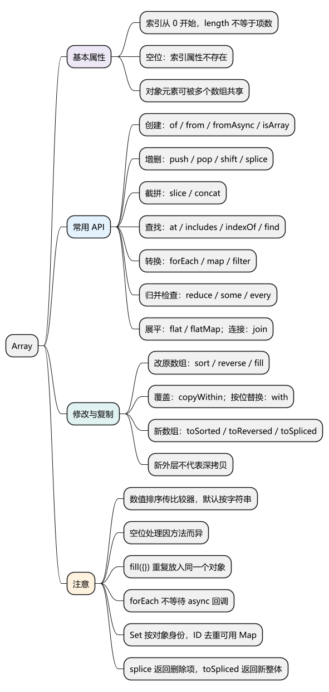
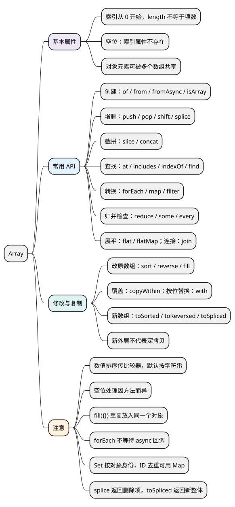

# Array

[](examples/array-mindmap.svg)

<details>
<summary>PlantUML 源码</summary>



</details>

<a id="k01"></a>

## 基本属性

**数组是带有索引和 length 特殊行为的对象。** 索引从 0 开始，元素可以是任意类型；复制数组不一定复制其中的对象。

**length：** 表示数组长度，不一定等于实际存在的元素数量。增大 length 会产生空位，缩短它会删除超出长度的索引属性。

<!-- example: d09-length -->
```js
const values = [10, 20];
values.length = 4;
console.log(values.length, Object.hasOwn(values, 2)); // 4 false

values.length = 1;
console.log(JSON.stringify(values)); // [10]

const sparse = new Array(2);
console.log(sparse.length, Object.hasOwn(sparse, 0)); // 2 false
console.log(Object.hasOwn([undefined], 0)); // true
```

**注意：** 空位表示这个索引属性不存在，不等于存了 undefined。`delete values[0]` 删除属性但不减少 length，按位置删除并让后续元素前移通常使用 splice。

各代码示例分别运行，含顶层 await 的示例使用 ES 模块。较新 API 需确认目标环境支持。

## API

### 创建与判断数组：Array.of()、Array.from()、Array.isArray()

- `[]`：直接创建数组；`new Array(3)` 创建长度为 3 的稀疏数组。
- `Array.of(...items)`：把参数作为元素，Array.of(3) 得到 [3]。
- `Array.from(source, mapFn?, thisArg?)`：将可迭代对象或类数组转成新数组，可用 `mapFn(value, index)` 同步处理。
- `Array.isArray(value)`：返回是否为真正的数组。
- `Array.fromAsync(source, mapFn?, thisArg?)`：异步版本，返回 Promise，通常按顺序迭代并等待。

<!-- example: d09-create -->
```js
console.log(JSON.stringify(Array.of(3))); // [3]
console.log(JSON.stringify(Array.from(new Set([1, 1, 2])))); // [1,2]
console.log(JSON.stringify(Array.from({ length: 3 }, (_, i) => i + 1))); // [1,2,3]
console.log(Array.isArray([]), Array.isArray({ length: 0 })); // true false

const doubled = await Array.fromAsync(
  [Promise.resolve(1), Promise.resolve(2)],
  async value => value * 2
);
console.log(JSON.stringify(doubled)); // [2,4]
```

**注意：** 这些创建方法不直接修改来源，但不自动深拷贝元素。Array.fromAsync 不等同于并发启动任务的 Promise.all；已经启动的 Promise 也不会因此变成顺序启动。

<a id="k02"></a>

### 头尾增删元素：push()、pop()、unshift()、shift()

- `push(...items)`：尾部添加，返回新长度。
- `unshift(...items)`：头部添加，返回新长度。
- `pop()`：尾部删除，返回删除的元素；空数组返回 undefined。
- `shift()`：头部删除，返回删除的元素；空数组返回 undefined。
- 四个方法都会修改原数组。

<!-- example: d09-ends -->
```js
const values = [2];
console.log(values.push(3), values.unshift(1)); // 2 3
console.log(values.pop(), values.shift()); // 3 1
console.log(JSON.stringify(values)); // [2]
```

### 按位置增删替换：splice()、toSpliced()

- `splice(start, deleteCount?, ...items)`：从 start 删除指定数量并插入元素；支持负起点；**修改原数组，返回删除项数组**。
- `toSpliced(start, deleteCount?, ...items)`：类似的编辑参数；**不修改原数组，返回编辑后的整个新数组**。

<!-- example: d09-splice -->
```js
const values = [1, 2, 3];
console.log(JSON.stringify(values.splice(1, 1, 9))); // [2]
console.log(JSON.stringify(values)); // [1,9,3]

const edited = values.toSpliced(1, 1, 8);
console.log(JSON.stringify(edited), JSON.stringify(values)); // [1,8,3] [1,9,3]
console.log(JSON.stringify([1, 2, 3].splice(1))); // [2,3]
console.log(JSON.stringify([1, 2, 3].splice(1, undefined))); // []
```

**注意：** 省略 deleteCount 表示删除到末尾，显式传 undefined 则按 0 处理。toSpliced 不修改外层，不代表嵌套对象也被复制。

### 截取与拼接数组：slice()、concat()

- `slice(start = 0, end = length)`：按左闭右开区间返回新数组，支持负索引。
- `concat(...values)`：返回拼接后的新数组，普通数组参数展开一层。
- 两者不修改原数组，都是浅拷贝。

<!-- example: d09-slice-concat -->
```js
const values = [1, 2, 3, 4];
console.log(JSON.stringify(values.slice(1, 3))); // [2,3]
console.log(JSON.stringify(values.slice(-2))); // [3,4]
console.log(JSON.stringify([1].concat([2], [[3]]))); // [1,2,[3]]

const source = [{ count: 1 }];
const copy = source.slice();
copy[0].count = 2;
console.log(copy === source, source[0].count); // false 2
```

**注意：** concat 的展开可受 Symbol.isConcatSpreadable 影响；空位在普通数组的 slice、concat 结果中通常仍保留。

### 按位置或值查找：at()、includes()、indexOf()、lastIndexOf()

- `at(index)`：返回元素，支持负索引，越界返回 undefined。
- `includes(value, fromIndex = 0)`：返回是否包含，能够查到 NaN。
- `indexOf(value, fromIndex = 0)`：向后查找，返回索引或 -1。
- `lastIndexOf(value, fromIndex?)`：向前查找，省略起点时从末尾开始，返回索引或 -1。
- 以上方法不修改数组。

<!-- example: d09-search -->
```js
const values = [10, 20, 10];
console.log(values.at(-1)); // 10
console.log(values.includes(20), values.indexOf(10), values.lastIndexOf(10)); // true 0 2
console.log([NaN].includes(NaN), [NaN].indexOf(NaN)); // true -1
console.log([,].includes(undefined), [,].indexOf(undefined)); // true -1
```

**注意：** includes 使用 SameValueZero 比较，把 NaN 视为相同、正负零也视为相同；indexOf/lastIndexOf 使用严格相等判断并跳过空位。找到索引 0 与未找到的 -1 都不能直接当作真假判断；对象比较看身份。

### 按条件查找：find()、findIndex()、findLast()、findLastIndex()

- `find(predicate, thisArg?)`：从头查找，返回首个符合条件的元素或 undefined。
- `findLast(predicate, thisArg?)`：从尾查找，返回首个符合条件的元素或 undefined。
- `findIndex/findLastIndex(predicate, thisArg?)`：返回相应索引，未找到为 -1。
- 回调接收 `(value, index, array)`，方法本身不修改数组。

<!-- example: d09-find -->
```js
const values = [1, 4, 7, 8];
console.log(values.find(n => n > 3), values.findLast(n => n > 3)); // 4 8
console.log(values.findIndex(n => n > 3), values.findLastIndex(n => n > 3)); // 1 3

const optional = [undefined];
console.log(optional.find(value => value === undefined)); // undefined
console.log(optional.findIndex(value => value === undefined)); // 0
```

**注意：** 找到的元素本身也可能是 undefined，需要区分“找到”与“没找到”时看索引。这一组方法会访问空位，对通常没有对应原型索引的数组读到 undefined。

<a id="k03"></a>

### 遍历、转换与筛选：forEach()、map()、filter()

- `forEach(callback, thisArg?)`：逐项执行副作用，返回 undefined；不能用 break，return 只结束当前回调。
- `map(callback, thisArg?)`：逐项转换，返回新数组。
- `filter(callback, thisArg?)`：保留回调结果为真的元素，返回新数组。
- 回调接收 `(value, index, array)`。方法本身不修改原数组，但回调可能修改元素对象。

<!-- example: d09-transform -->
```js
const values = [1, 2, 3];
const visited = [];
const result = values.forEach(value => visited.push(value));
console.log(result, JSON.stringify(visited)); // undefined [1,2,3]
console.log(JSON.stringify(values.map(n => n * 2))); // [2,4,6]
console.log(JSON.stringify(values.filter(n => n > 1))); // [2,3]

const sparse = [, 2];
const mapped = sparse.map(n => n * 2);
console.log(mapped.length, Object.hasOwn(mapped, 0)); // 2 false
console.log(JSON.stringify(sparse.filter(() => true))); // [2]
```

**注意：** 通常跳过不存在的索引，map 保留对应空位，filter 的结果更紧凑。多数这类回调方法开始时确定遍历长度，访问时再读取当前值，避免边遍历边增删。箭头函数的 this 不会被 thisArg 改变。

### 检查与累积结果：some()、every()、reduce()、reduceRight()

- `some(predicate, thisArg?)`：有一项满足即返回 true。
- `every(predicate, thisArg?)`：有一项不满足即返回 false。
- `reduce(callback, initialValue?)`：从左向右累积；回调接收 `(accumulator, value, index, array)`。
- `reduceRight(...)`：从右向左累积，返回最终结果。
- 方法本身不修改原数组；some/every 可以短路，reduce 系列没有 thisArg。

<!-- example: d09-reduce-check -->
```js
console.log([1, 2, 3].some(n => n > 2)); // true
console.log([1, 2, 3].every(n => n > 0)); // true
console.log([].some(() => true), [].every(() => false)); // false true
console.log([1, 2, 3].reduce((sum, n) => sum + n, 0)); // 6
console.log(['a', 'b', 'c'].reduceRight((text, part) => text + part, '')); // cba
```

**注意：** 这些方法通常跳过空位；every 不能单独保证每个索引都存在。reduce 不给初值且没有可用元素会抛 TypeError，业务代码通常明确初值。

### 展平数组：flat()、flatMap()

- `flat(depth = 1)`：按指定深度展开数组，返回新数组。
- `flatMap(callback, thisArg?)`：先逐项转换，再展平一层，返回新数组。
- 两者不修改原数组，也不会自动深拷贝剩余的对象元素。

<!-- example: d09-flat -->
```js
console.log(JSON.stringify([1, [2, [3]]].flat())); // [1,2,[3]]
console.log(JSON.stringify([1, [2, [3]]].flat(2))); // [1,2,3]
console.log(JSON.stringify([1, 2].flatMap(n => [n, n * 10]))); // [1,10,2,20]
```

**注意：** flat 在处理到的数组层级跳过空位；flatMap 只展平一层，回调返回普通对象不会被当作数组展开。

<a id="k04"></a>

### 排序与反转：sort()、toSorted()、reverse()、toReversed()

- `sort(compareFn?)`：排序，修改并返回原数组。
- `toSorted(compareFn?)`：排序后返回新数组，不改原数组。
- `reverse()`：反转顺序，修改并返回原数组。
- `toReversed()`：反转后返回新数组，不改原数组。

<!-- example: d09-sort -->
```js
const values = [2, 10, 1];
console.log(JSON.stringify(values.toSorted())); // [1,10,2]
console.log(JSON.stringify(values.toSorted((a, b) => a - b))); // [1,2,10]
console.log(JSON.stringify(values)); // [2,10,1]
console.log(JSON.stringify(values.toReversed())); // [1,10,2]
console.log(values.sort((a, b) => a - b) === values); // true
console.log(JSON.stringify(values.reverse())); // [10,2,1]
```

**注意：** 默认排序按字符串形式比较。有限数值升序通常用 `(a, b) => a - b`，比较器按负数、0、正数表达顺序，应该保持一致。现代标准要求稳定排序，即比较为 0 时保留原相对顺序。

### 填充、覆盖与替换元素：fill()、copyWithin()、with()

- `fill(value, start = 0, end = length)`：填充左闭右开区间，修改并返回原数组。
- `copyWithin(target, start = 0, end = length)`：把数组内部区间复制到 target 起点，覆盖元素；修改并返回原数组，不改变长度。
- `with(index, value)`：替换指定位置并返回新数组，不修改原数组；支持负索引，越界抛 RangeError。

<!-- example: d09-fill-copy -->
```js
console.log(JSON.stringify([0, 0, 0].fill(7, 1, 3))); // [0,7,7]
console.log(JSON.stringify([1, 2, 3, 4].copyWithin(0, 2))); // [3,4,3,4]
console.log(JSON.stringify([1, 2, 3].with(-1, 9))); // [1,2,9]

const shared = new Array(2).fill({ count: 0 });
shared[0].count++;
console.log(shared[1].count); // 1

const independent = Array.from({ length: 2 }, () => ({ count: 0 }));
independent[0].count++;
console.log(independent[1].count); // 0
```

**注意：** fill 反复填入同一个值，不会为每个位置创建对象。toSorted、toReversed、toSpliced、with 都只创建新外层；读取到的空位通常变成明确的 undefined 元素，区别于 slice/map 保留空位的行为。

### 迭代与连接文本：keys()、values()、entries()、join()

- `keys/values/entries()`：分别返回索引、值、键值对迭代器，不修改数组。
- `for...of`：默认按 values 的方式遍历，支持 break。
- `join(separator = ',')`：返回元素连接成的字符串；null、undefined 和空位通常产生空字段。
- `toString()`：普通数组通常按逗号连接；`toLocaleString(locales?, options?)`：按元素的区域格式方法生成文本。

<!-- example: d09-iterate-join -->
```js
const values = ['a', 'b'];
console.log(JSON.stringify([...values.keys()])); // [0,1]
console.log(JSON.stringify([...values.values()])); // ["a","b"]
console.log(JSON.stringify([...values.entries()])); // [[0,"a"],[1,"b"]]
console.log(values.join('-')); // a-b
console.log([1, null, undefined, , 5].join('|')); // 1||||5
console.log(Object.hasOwn([...[,]], 0)); // true
```

**注意：** values 和 for...of 会访问空位，不能笼统说“数组遍历都跳过空位”。join、toString 适合展示，不是保留完整类型信息的序列化协议。

<a id="k05"></a>

### 去重与分组：Set、Map、Object.groupBy()、Map.groupBy()

- `[...new Set(values)]`：按值去重，返回新数组；对象按身份比较。
- `Map`：可以把业务 ID 作为键，自行确定保留第一条还是最后一条。
- `Object.groupBy(items, callback)`：按属性键分组，返回无原型对象。
- `Map.groupBy(items, callback)`：返回 Map，可保留任意分组键的身份。
- 上述处理不直接修改原数组，也不深拷贝元素。

<!-- example: d09-dedup-group -->
```js
const users = [
  { id: 1, name: 'Alice', role: 'admin' },
  { id: 2, name: 'Bob', role: 'reader' },
  { id: 1, name: 'Carol', role: 'admin' }
];
const latest = [...new Map(users.map(user => [user.id, user])).values()];
console.log(JSON.stringify(latest.map(user => user.name))); // ["Carol","Bob"]
console.log(new Set(users).size); // 3
console.log(Object.groupBy(users, user => user.role).admin.length); // 2
console.log(Map.groupBy(users, user => user.role).get('reader').length); // 1
```

**注意：** Map 覆盖值不改变已有键的迭代位置，上例保留最后一条的值、第一次出现的位置。groupBy 是 Object/Map 的静态方法，不是 Array 实例方法。

<a id="k06"></a>

### 等待数组中的异步任务：Promise.all()、for...of 配合 await

- `array.map(async ...)`：得到 Promise 数组，使用 `Promise.all(...)` 等待全部成功或首个失败。
- `Promise.allSettled(...)`：等待全部任务结束并收集每项成功或失败状态。
- `for...of` 配合 await：适合有顺序依赖的逐项执行。
- `forEach(async ...)` 忽略回调返回的 Promise，不能等待整批任务。

<!-- example: d09-async -->
```js
const values = [1, 2, 3];
async function double(value) {
  return value * 2;
}

console.log(JSON.stringify(await Promise.all(values.map(double)))); // [2,4,6]

const sequential = [];
for (const value of values) {
  sequential.push(await double(value));
}
console.log(JSON.stringify(sequential)); // [2,4,6]
```

**注意：** 大量任务要限制启动并发，Promise.all 失败不会自动取消其他任务；停止遍历也不等于取消已经启动的请求。大型数组还要避免把所有元素展开成函数实参，例如 Math.max(...values) 可能超出参数数量限制，可用循环累积。

<a id="summary"></a>

参考：[MDN Array](https://developer.mozilla.org/en-US/docs/Web/JavaScript/Reference/Global_Objects/Array)。

<a id="interview"></a>

## 试题与答案

<a id="d09-01"></a>

### D09-01 [P0·基础] slice 和 splice 的参数与返回有何不同？

**回答：** slice按左闭右开区间返回浅复制，不改原数组；splice从start开始删除指定数量并插入元素，修改原数组，返回被删除项。toSpliced是不改原数组的编辑方法，返回编辑后的整个新数组，不是删除项。

对应讲解：[增删、截取、拼接与查找](#k02)。

<a id="d09-02"></a>

### D09-02 [P0·原理] map、forEach、filter、reduce 怎么选？

**回答：** map表达逐项转换，filter表达筛选，reduce表达累积归并，forEach用于同步副作用。它们返回值不同，不能因为都能循环就随便互换。reduce最好明确初值；forEach不会收集或等待async回调。

对应讲解：[遍历、映射、筛选与归并](#k03)。

<a id="d09-03"></a>

### D09-03 [P1·原理] 空位与 undefined 有什么区别？

**回答：** 空位是索引属性不存在，undefined可以是已存在索引的值。length可能相同，但in和自有检查不同；map等会跳过空位，而values/find等可将它读作undefined，所以不同方法输出不同。

对应讲解：[创建、length 与稀疏数组](#k01)。

<a id="d09-04"></a>

### D09-04 [P0·编码] 数组数值排序为什么要比较器？

**回答：** 默认sort按字符串比较，10会排在2之前。有限数值可用(a,b)=>a-b，比较器的负/零/正定义先后而非要求只返回-1/0/1。sort修改原数组；要保留原数组可用toSorted或先浅复制。

对应讲解：[排序、反转与复制修改](#k04)。

<a id="d09-05"></a>

### D09-05 [P0·原理] fill({}) 为何导致每行一起变化？

**回答：** fill把同一个对象引用放入每个位置，没有为各位置构造对象。修改其中一项属性时其他位置访问的仍是同一对象。用工厂回调逐项创建，例如Array.from({length:n},()=>({}))。

对应讲解：[排序、反转与复制修改](#k04)。

<a id="d09-06"></a>

### D09-06 [P0·编码] 怎么按用户ID去重？Set(users)行吗？

**回答：** Set按对象身份比较，两个不同对象即使id相同也不会合并。用Map以id为键，并先定义保留第一条还是最后一条，以及结果顺序。Map覆盖值不自动把已有键移到末尾。

对应讲解：[分组、去重与数据结构选择](#k05)。

<a id="d09-07"></a>

### D09-07 [P0·原理] await array.forEach(async ...) 为什么没等完？

**回答：** forEach立即返回undefined，且忽略各回调返回的Promise。外层await等的是undefined，不是任务集合。并发处理用Promise.all(array.map(...))并处理错误，大量任务用并发池，顺序处理用for...of。

对应讲解：[数组里的异步、复制与实战边界](#k06)。

<a id="d09-08"></a>

### D09-08 [P1·基础] find返回undefined，如何判断是不是没找到？

**回答：** 匹配到的元素本身也可能是undefined。需要索引时用findIndex/findLastIndex判断是否为-1；查索引属性存在时可用自有检查。不能只依赖返回值真假。

对应讲解：[增删、截取、拼接与查找](#k02)。

<a id="d09-09"></a>

### D09-09 [P1·原理] 数组新复制方法是否实现深拷贝？

**回答：** 没有。新外层数组与旧数组不同，但元素中的对象引用仍可共享；空位处理也可能和旧的slice/map不同。不可变状态更新仍应针对需要改变的对象层创建新结构。

对应讲解：[排序、反转与复制修改](#k04)。
