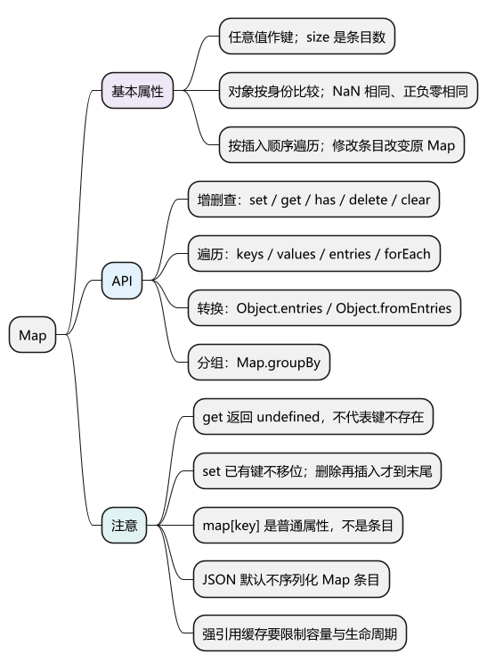
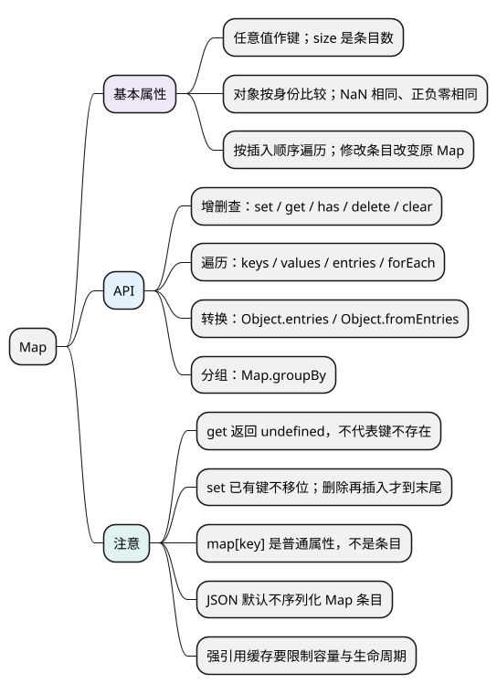

# Map

[](examples/map-mindmap.svg)

<details>
<summary>PlantUML 源码</summary>



</details>

<a id="k01"></a>

## 基本属性

**Map 保存键值对，键可以是任意值，遍历按插入顺序。** 它是对象，增删条目会修改原 Map。

- `size`：条目数量，是属性，不是方法。
- 键使用 SameValueZero 比较：`NaN` 与 `NaN` 相同，`+0` 与 `-0` 相同；对象比较身份。
- 覆盖已有键的值不改变位置；删除后重新插入，会排到末尾。

<!-- example: d10-basic -->
```js
const key = { id: 1 };
const map = new Map([[key, 'Alice'], [NaN, 'A']]);

console.log(map.size); // 2
console.log(map.get(key), map.get({ id: 1 })); // Alice undefined
map.set(NaN, 'B');
console.log(map.size, map.get(NaN)); // 2 B
```

各示例分别运行。`map[key] = value` 写的是普通属性，不是 Map 条目，操作条目要用下列 API。

## API

<a id="k02"></a>

### 创建与增删查：new Map()、set()、get()、has()、delete()、clear()

- `new Map(iterable)`：从可迭代的键值对创建 Map；重复键保留最后写入的值。
- `set(key, value)`：新增或更新条目，修改原 Map，返回当前 Map，可链式调用。
- `get(key)`：返回对应值，不存在时返回 `undefined`。
- `has(key)`：返回键是否存在。
- `delete(key)`：删除条目，返回是否成功删除。
- `clear()`：清空所有条目，返回 `undefined`。

<!-- example: d10-crud -->
```js
const map = new Map();
console.log(map.set('name', 'Alice') === map); // true
map.set('empty', undefined);

console.log(map.get('empty'), map.get('missing')); // undefined undefined
console.log(map.has('empty'), map.has('missing')); // true false
console.log(map.delete('name'), map.delete('missing')); // true false
console.log(map.clear(), map.size); // undefined 0
```

**注意：** 判断存在用 `has`。`get(key) ?? defaultValue` 会把“已存在但值为 null/undefined”也当作需要默认值，语义不同。

### 遍历键值对：keys()、values()、entries()、forEach()

- `keys()`、`values()`、`entries()`：分别返回键、值、键值对的迭代器，不修改原 Map。
- `for...of map`：默认遍历键值对，与 `entries()` 一致。
- `forEach(callback, thisArg)`：依次调用 `callback(value, key, map)`，返回 `undefined`。

<!-- example: d10-order -->
```js
const map = new Map([['a', 1], ['b', 2]]);
map.set('a', 3);
console.log(JSON.stringify([...map])); // [["a",3],["b",2]]

map.delete('a');
map.set('a', 4);
console.log(JSON.stringify([...map.keys()])); // ["b","a"]
console.log(JSON.stringify([...map.values()])); // [2,4]
map.forEach((value, key) => console.log(key, value)); // b 2，然后 a 4
```

**注意：** `forEach` 的回调先值后键；按键读取不会自动把条目移到末尾。遍历期间增删集合会影响后续访问，若要固定本轮成员，可先复制条目数组。

<a id="k03"></a>

### 转换对象与序列化：Object.entries()、Object.fromEntries()、JSON.stringify()

- `new Map(Object.entries(record))`：把对象的自有可枚举字符串键属性转成条目。
- `Object.fromEntries(map)`：创建普通对象；非 Symbol 键会转换为字符串。
- Map 没有默认 JSON 条目序列化规则，通常先转成条目数组。

<!-- example: d10-convert -->
```js
const map = new Map([['name', 'Alice'], ['age', 20]]);
const record = Object.fromEntries(map);

console.log(record.name); // Alice
console.log(new Map(Object.entries(record)).get('age')); // 20
console.log(JSON.stringify(map)); // {}
console.log(JSON.stringify([...map])); // [["name","Alice"],["age",20]]
```

**注意：** 对象键转成普通对象键后可能冲突；JSON 往返也不会自动保留对象键的原始身份。固定字段记录常用 Object，动态条目、对象键和集合操作常用 Map。

### 按指定键分组：Map.groupBy()

`Map.groupBy(items, callback)` 按 `callback(item, index)` 返回的键分组，返回新的 Map；值是各组的数组。不会复制组内对象，也不会自动修改输入集合。

<!-- example: d10-group -->
```js
const items = [
  { type: 'book', name: 'A' },
  { type: 'pen', name: 'B' },
  { type: 'book', name: 'C' }
];
const groups = Map.groupBy(items, item => item.type);

console.log(groups.get('book').length); // 2
console.log(groups.get('book')[0] === items[0]); // true
```

**注意：** `groupBy` 是静态方法。较新的 `getOrInsert`、`getOrInsertComputed` 用于“存在则读取，不存在才插入”；使用前确认目标支持。兼容写法先用 `has` 判断，不要只用真假值判断缓存是否命中。

<a id="k04"></a>

### 刷新缓存顺序：delete() 配合 set()

先删除再插入，可以把指定键移动到末尾。下面只演示刷新顺序，不是完整 LRU 实现。

<!-- example: d10-cache -->
```js
const cache = new Map([['a', 1], ['b', 2]]);
if (cache.has('a')) {
  const value = cache.get('a');
  cache.delete('a');
  cache.set('a', value);
}
console.log(JSON.stringify([...cache.keys()])); // ["b","a"]
```

**注意：** Map 对键和值维持强引用。缓存还要定义容量、过期时间、失败处理和用户隔离，不能把数据放进去后无限保留。

<a id="summary"></a>
<a id="interview"></a>

## 试题与答案

<a id="d10-01"></a>

### D10-01 [P0·基础] get返回undefined为什么还需要has？

**回答：** 键可能存在但保存 undefined。get 无法区分这种情况和键缺失，has 检查键是否存在。设置默认值或判断缓存命中时，应按需要选择。

<a id="d10-02"></a>

### D10-02 [P1·原理] Map键是对象时怎么比较？

**回答：** 比较对象身份，不比较字段内容。用一个对象存入后，另一个内容相同的对象取不到它的值。原始键使用 SameValueZero，NaN 与 NaN 视为相同，正负零也相同。

<a id="d10-03"></a>

### D10-03 [P1·基础] 覆盖Map条目会移动顺序吗？

**回答：** set 已有键只更新值，不改变位置。删除再 set 才移到末尾；LRU 可以利用这一行为，但容量、淘汰和访问刷新仍需自己实现。

<a id="d10-04"></a>

### D10-04 [P1·工程取舍] Map是否比Object更好？

**回答：** 固定字段的业务记录适合 Object；动态条目、对象键、条目计数和明确集合操作适合 Map。序列化、内存保留和性能要按实际场景评估，不能说某个类型永远更好。

参考：[MDN Map](https://developer.mozilla.org/en-US/docs/Web/JavaScript/Reference/Global_Objects/Map)。
