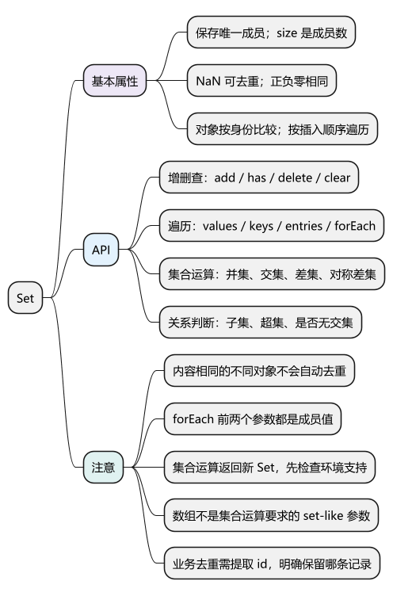
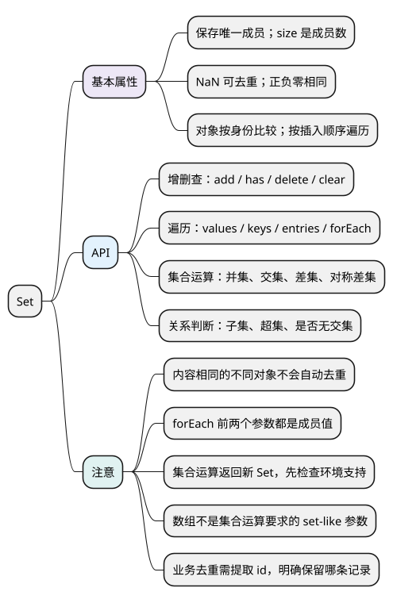

# Set

[](examples/set-mindmap.svg)

<details>
<summary>PlantUML 源码</summary>



</details>

<a id="k01"></a>

## 基本属性

**Set 保存不重复的值，按插入顺序遍历，不会自动排序。** 增删成员会修改原 Set。

- `size`：成员数量，是属性，不是方法。
- 使用 SameValueZero 比较：`NaN` 可以去重，`+0` 与 `-0` 是同一个成员。
- 对象按身份比较，内容相同的两个对象仍是不同成员。

<!-- example: d11-basic -->
```js
const set = new Set([1, 1, NaN, NaN, -0, 0]);
console.log(set.size, set.has(NaN)); // 3 true
console.log(new Set([{ id: 1 }, { id: 1 }]).size); // 2
const item = { id: 1 };
console.log(new Set([item, item]).size); // 1
```

各示例分别运行。数组空位在迭代时会被读作 undefined，因此 `new Set(new Array(3)).size` 为 1。

## API

<a id="k02"></a>

### 创建与增删查：new Set()、add()、has()、delete()、clear()

- `new Set(iterable)`：从可迭代值创建集合；可用 `[...set]` 转回数组。
- `add(value)`：添加成员，返回当前 Set，可链式调用；已有成员不重复插入。
- `has(value)`：返回是否包含成员，不修改 Set。
- `delete(value)`：删除成员，返回是否成功删除。
- `clear()`：清空所有成员，返回 undefined。

<!-- example: d11-crud -->
```js
const set = new Set();
console.log(set.add('a').add('b') === set); // true
set.add('a');
console.log(set.size, set.has('a')); // 2 true
console.log(set.delete('a'), set.delete('missing')); // true false
console.log(set.clear(), set.size); // undefined 0
```

**注意：** 重新 add 已有值不改变顺序；删除后再 add 才排到末尾。修改成员对象的字段，不会改变成员身份，也不会自动与其他对象合并。

### 遍历成员：values()、keys()、entries()、forEach()

- `values()` 和 `keys()`：都返回成员值的迭代器。
- `entries()`：返回 `[value, value]` 形式的迭代器。
- `for...of set`：默认遍历成员值。
- `forEach(callback, thisArg)`：回调参数是 `(value, value, set)`，返回 undefined。

<!-- example: d11-iterate -->
```js
const set = new Set(['a', 'b']);

console.log(JSON.stringify([...set.keys()])); // ["a","b"]
console.log(JSON.stringify([...set.values()])); // ["a","b"]
console.log(JSON.stringify([...set.entries()])); // [["a","a"],["b","b"]]
set.forEach((value, key) => console.log(value === key)); // true，然后 true
```

**注意：** Set 没有另一份独立的键，重复传值是为了保持接口形式一致。遍历期间增删会影响后续访问，处理通知等场景时先决定是否需要复制成员快照。

<a id="k03"></a>

### 计算集合与判断关系：union()、intersection()、difference() 等

- `union(other)`：并集，包含两边所有成员。
- `intersection(other)`：交集，包含两边共有成员。
- `difference(other)`：差集，保留当前 Set 有、other 没有的成员。
- `symmetricDifference(other)`：对称差集，保留只出现在其中一边的成员。
- 以上返回新 Set，不修改原集合。
- `isSubsetOf(other)`、`isSupersetOf(other)`、`isDisjointFrom(other)`：分别判断子集、超集、是否没有交集，返回布尔值。

<!-- example: d11-algebra -->
```js
const a = new Set([1, 2]);
const b = new Set([2, 3]);

console.log(JSON.stringify([...a.union(b)])); // [1,2,3]
console.log(JSON.stringify([...a.intersection(b)])); // [2]
console.log(JSON.stringify([...a.difference(b)])); // [1]
console.log(JSON.stringify([...a.symmetricDifference(b)])); // [1,3]
console.log(new Set([2]).isSubsetOf(a)); // true
console.log(a.isSupersetOf(new Set([1]))); // true
console.log(a.isDisjointFrom(b)); // false
console.log(a.size, b.size); // 2 2
```

**注意：** 这些是较新的 API，使用前确认目标环境支持。other 需要 size、has、keys 等集合接口，不能直接把普通数组当作参数。交集的输出顺序还可能与两边集合大小有关，不要只凭数学成员关系假定顺序。

旧环境可按 Set 参数约定实现常用运算：

<!-- example: d11-algebra-fallback -->
```js
const a = new Set([1, 2]);
const b = new Set([2, 3]);
const union = new Set([...a, ...b]);
const intersection = new Set([...a].filter(value => b.has(value)));
const difference = new Set([...a].filter(value => !b.has(value)));

console.log(JSON.stringify([...union])); // [1,2,3]
console.log(JSON.stringify([...intersection])); // [2]
console.log(JSON.stringify([...difference])); // [1]
```

<a id="k04"></a>

### 按业务字段去重：filter() 配合 has()、add()

Set 能直接去重原始值和重复对象引用。按 id 去重时，保存 id，并明确保留第一条还是最后一条。下面保留第一条，不修改原数组：

<!-- example: d11-deduplicate -->
```js
const rows = [{ id: 1, name: 'A' }, { id: 1, name: 'B' }, { id: 2, name: 'C' }];
const seen = new Set();
const unique = rows.filter(row => {
  if (seen.has(row.id)) return false;
  seen.add(row.id);
  return true;
});

console.log(JSON.stringify(unique.map(row => row.name))); // ["A","C"]
console.log(unique[0] === rows[0]); // true
```

**注意：** filter 只创建新数组，组内对象仍共享。记录事件 ID 的 Set 只在本实例及记录保留期间去重，不能替代后端幂等；长时间运行还要限制保留数量和生命周期。

<a id="summary"></a>
<a id="interview"></a>

## 试题与答案

<a id="d11-01"></a>

### D11-01 [P0·原理] Set为什么不能按对象内容去重？

**回答：** 原生规则比较对象身份。两个不同对象即使属性一样也不会合并；按业务 id 去重要提取 id，再用 Set 或 Map 记录。内容深比较还需额外定义规则。

<a id="d11-02"></a>

### D11-02 [P1·基础] Set的keys、values、entries有何不同？

**回答：** keys 和 values 都迭代成员值，entries 产生 [value, value]，默认迭代也是值。forEach 的前两个参数也相同，Set 没有另一份独立键。

<a id="d11-03"></a>

### D11-03 [P1·编码] 并集、交集、差集如何实现？

**回答：** 并集加入两边全部成员；交集用另一边 has 过滤；差集保留另一边没有的成员。支持时可以用原生集合方法，还要区分成员内容与迭代顺序。

<a id="d11-04"></a>

### D11-04 [P1·工程取舍] 用Set记录事件ID就实现了幂等吗？

**回答：** 只在当前作用域、记录仍存在时阻止重复处理。它不能保证服务端副作用只执行一次，还需稳定事件 ID、容量和隔离策略；跨刷新与跨端的一致性依赖后端幂等协议。

参考：[MDN Set](https://developer.mozilla.org/en-US/docs/Web/JavaScript/Reference/Global_Objects/Set)。
