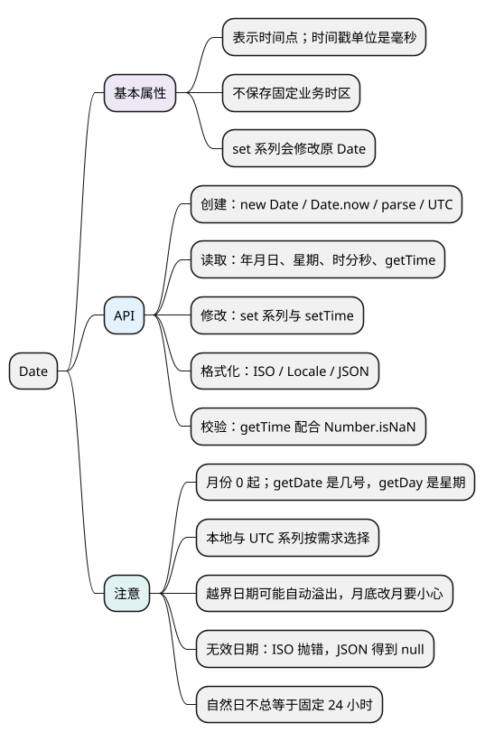

# Date

[](examples/date-mindmap.svg)

<details>
<summary>PlantUML 源码</summary>



</details>

<a id="k01"></a>

## 基本属性

**Date 对象表示一个时间点，内部时间值是从 1970-01-01T00:00:00Z 起算的毫秒数，也可能是无效值。** 它不保存固定业务时区；读取和格式化时，才按本地、UTC 或指定时区解释。

- 时间戳的单位是**毫秒**；秒级时间戳传给 Date 前需要换算。
- Date 是可变对象，`set...` 方法会修改原对象。
- “时间点”“某地的日历日期”“持续时长”是不同需求，处理前先确定含义。

各示例分别运行。下面用 UTC 或明确时区保证输出可预测。

## API

### 创建时间点与获取时间戳：new Date()、Date.now()、Date.parse()、Date.UTC()

- `new Date()`：创建当前时间的 Date 对象。
- `new Date(milliseconds)`：根据毫秒时间戳创建。
- `new Date(text)`：解析日期文本，优先使用带 Z 或明确偏移的标准形式。
- `new Date(year, monthIndex, day = 1, ...)`：按本地日历字段构造，月份从 0 起。
- `Date.now()`：返回当前毫秒时间戳，不创建 Date 对象。
- `Date.parse(text)`：返回解析得到的时间戳，失败返回 NaN。
- `Date.UTC(year, monthIndex, day = 1, ...)`：按 UTC 字段计算时间戳，返回 Number。

<!-- example: d14-create -->
```js
const date = new Date('2026-01-01T08:00:00+08:00');
const timestamp = Date.UTC(2026, 0, 1);

console.log(date.toISOString()); // 2026-01-01T00:00:00.000Z
console.log(date.getTime() === timestamp); // true
console.log(Date.parse('2026-01-01T00:00:00Z') === timestamp); // true
console.log(new Date(timestamp).toISOString()); // 2026-01-01T00:00:00.000Z
```

**注意：** 标准日期文本 `'2026-01-01'` 按 UTC 解释；不带偏移的日期时间 `'2026-01-01T00:00:00'` 按本地时间解释。不要依赖非标准文本在不同浏览器中解析一致。多参数构造和 Date.UTC 对 0—99 年份有映射到 1900—1999 年的历史行为；`Date()` 不加 new 返回当前时间字符串。

<a id="k02"></a>

### 读取年月日与星期：getFullYear()、getMonth()、getDate()、getDay()

- `getFullYear()`：本地年份，旧方法 getYear 不适合读取完整年份。
- `getMonth()`：本地月份索引，0—11；显示月份通常加 1。
- `getDate()`：本地月内日期，1—31。
- `getDay()`：本地星期，0—6，周日为 0。
- `getHours()`、`getMinutes()`、`getSeconds()`、`getMilliseconds()`：本地时间字段。
- 对应 UTC 方法在 get 后加 UTC，例如 `getUTCMonth()`。
- `getTime()`、`valueOf()`：返回毫秒时间戳，不修改对象。
- `getTimezoneOffset()`：返回该时间点“UTC 减本地时间”的分钟差，可能随夏令时变化。

<!-- example: d14-read -->
```js
const date = new Date('2026-01-04T08:09:10.011Z');
console.log(date.getUTCFullYear(), date.getUTCMonth(), date.getUTCDate());
// 2026 0 4
console.log(date.getUTCDay()); // 0，周日
console.log(date.getUTCHours(), date.getUTCMinutes(), date.getUTCSeconds());
// 8 9 10
console.log(date.getUTCMilliseconds()); // 11
```

**记忆：** Month 是月份索引，Date 是几号，Day 是星期；UTC 系列与本地系列不要混用。

### 修改时间字段：setFullYear()、setMonth()、setDate()、setTime() 等

`setFullYear`、`setMonth`、`setDate` 及小时、分钟等 setter 会修改原 Date，返回修改后的毫秒时间戳；也有对应 UTC 方法。`setTime(milliseconds)` 直接设置时间值。

<!-- example: d14-modify -->
```js
const date = new Date('2026-01-31T00:00:00Z');
const result = date.setUTCMonth(1);
console.log(typeof result); // number
console.log(date.toISOString()); // 2026-03-03T00:00:00.000Z

const copy = new Date(date.getTime());
copy.setUTCDate(1);
console.log(copy.toISOString()); // 2026-03-01T00:00:00.000Z
console.log(date.toISOString()); // 2026-03-03T00:00:00.000Z
```

**注意：** 改成二月仍保留 31 日，会自动向后溢出到三月；“下月同日”和“下月月末”需要不同规则。直接赋值只共享 Date，要独立修改可先按时间戳创建副本。不要写 `date = date.setMonth(...)` 后还把 date 当 Date 使用。

<a id="k03"></a>

### 格式化与序列化：toISOString()、toLocaleString()、toJSON()

- `toISOString()`：返回 UTC 的 ISO 文本，以 Z 结尾。
- `toUTCString()`：返回 UTC 展示文本。
- `toString()`、`toDateString()`、`toTimeString()`：按宿主本地时间展示，不适合当稳定机器协议。
- `toLocaleString(locales, options)`、`toLocaleDateString(...)`、`toLocaleTimeString(...)`：按语言规则展示，可指定 timeZone。
- `toJSON()`：有效日期通常返回 ISO 文本，供 JSON.stringify 使用；格式化不会修改原时间点。

<!-- example: d14-format -->
```js
const date = new Date('2026-01-01T00:00:00Z');
console.log(date.toISOString()); // 2026-01-01T00:00:00.000Z
console.log(JSON.stringify({ date })); // {"date":"2026-01-01T00:00:00.000Z"}

const formatter = new Intl.DateTimeFormat('en-GB', {
  timeZone: 'Asia/Shanghai',
  hour: '2-digit',
  minute: '2-digit',
  hourCycle: 'h23'
});
const parts = formatter.formatToParts(date);
console.log(parts.find(part => part.type === 'hour').value); // 08
console.log(parts.find(part => part.type === 'minute').value); // 00
console.log(typeof JSON.parse(JSON.stringify({ date })).date); // string
```

**注意：** JSON.parse 不会自动把日期文本还原成 Date。本地化结果的分隔符等可能随环境变化，不适合按固定字符位置拆解；需要字段可用 formatToParts。

### 判断无效时间：getTime() 配合 Number.isNaN()

创建成功的 Date 对象也可能包含无效时间，不能只看 typeof 或 instanceof。

<!-- example: d14-invalid -->
```js
const invalid = new Date('not a date');

console.log(invalid instanceof Date); // true
console.log(Number.isNaN(invalid.getTime())); // true
console.log(JSON.stringify({ date: invalid })); // {"date":null}
try {
  invalid.toISOString();
} catch (error) {
  console.log(error.name); // RangeError
}
```

**注意：** 对可信 Date 实例，可以用 getTime 是否为 NaN 判断有效性；严格日期输入还要检查原始字段范围，因为越界日期可能被自动规范化，而不是变成 Invalid Date。

<a id="k04"></a>

### 计算时间差与增加时长：getTime()、时间戳运算

时间戳相减得到毫秒差；加 `24 * 60 * 60 * 1000` 表示固定 24 小时。

<!-- example: d14-duration -->
```js
const start = new Date('2026-01-01T00:00:00Z');
const end = new Date('2026-01-02T01:30:00Z');
console.log((end.getTime() - start.getTime()) / 3_600_000); // 25.5

const after24Hours = new Date(start.getTime() + 86_400_000);
console.log(after24Hours.toISOString()); // 2026-01-02T00:00:00.000Z
```

**注意：** 有夏令时的地区，“明天同一钟点”不一定相隔 24 小时。生日、账期等纯日期应明确保存日期字段或日期文本；日志通常保存确定时间点，再按用户时区展示。复杂日历运算可选合适的日期库，使用 Temporal 前确认目标环境支持。

<a id="summary"></a>
<a id="interview"></a>

## 试题与答案

<a id="d14-01"></a>

### D14-01 [P0·基础] getDate、getDay、getMonth分别是什么？

**回答：** 分别是月内日期、星期（周日为 0）和月份索引（0—11）。按需要选本地或 UTC 系列，完整年份用 getFullYear 或 getUTCFullYear。

<a id="d14-02"></a>

### D14-02 [P1·原理] Date保存时区吗？

**回答：** Date 保存时间值，不保存固定业务时区。同一时间点可以按不同地区展示；本地 getter 使用宿主时区，UTC getter 使用 UTC。

<a id="d14-03"></a>

### D14-03 [P1·原理] 一月31日加一个月为何变成三月？

**回答：** setMonth 保留月内日期，二月不存在 31 日时按溢出规则进入三月。若希望落在目标月最后一天，需要明确月末规则，不能直接等同于 setMonth。

<a id="d14-04"></a>

### D14-04 [P1·基础] Invalid Date怎样判断，JSON会怎样？

**回答：** 对可信 Date 实例判断 getTime 是否为 NaN。无效 Date 的 toISOString 会抛 RangeError，toJSON 返回 null，所以 JSON.stringify 可能把它序列化为 null。

<a id="d14-05"></a>

### D14-05 [P1·工程取舍] 明天同一时间等于当前时间加24小时吗？

**回答：** 未必。跨夏令时切换时，自然日可能不是 24 小时。先区分固定持续时长与某个时区的日历操作，再选择对应算法。

参考：[MDN Date](https://developer.mozilla.org/en-US/docs/Web/JavaScript/Reference/Global_Objects/Date)。
