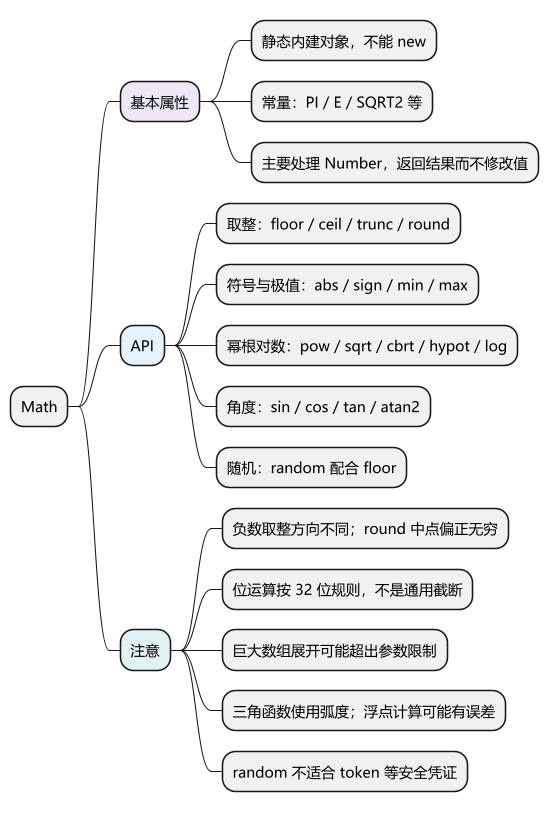
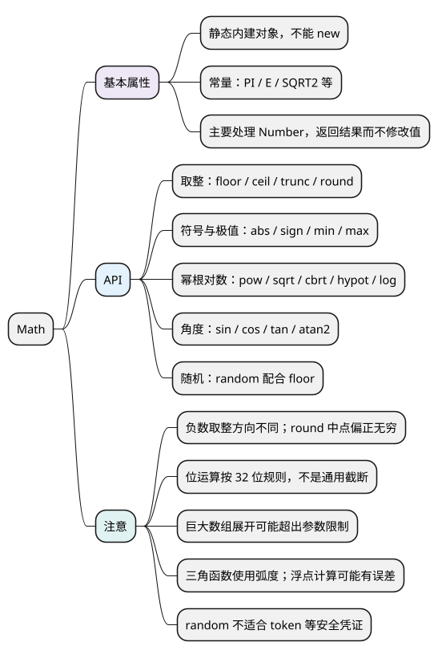

# Math

[](examples/math-mindmap.svg)

<details>
<summary>PlantUML 源码</summary>



</details>

## 基本属性

**Math 是提供数学常量和静态方法的内建对象，不是构造函数。** 直接写 `Math.floor(...)`，不用也不能 `new Math()`。

- `Math.PI`：圆周率；`Math.E`：自然对数的底。
- 常量还有 `LN2`、`LN10`、`LOG2E`、`LOG10E`、`SQRT2`、`SQRT1_2`。
- 方法主要处理 Number，返回计算结果，不修改传入的数值；不接受 BigInt 作为数值输入。

各代码示例分别运行。

## API

<a id="k01"></a>

### 按不同方向取整：floor()、ceil()、trunc()、round()

- `Math.floor(x)`：向负无穷取整。
- `Math.ceil(x)`：向正无穷取整。
- `Math.trunc(x)`：去掉小数部分，趋向 0。
- `Math.round(x)`：取最近整数，恰在中点时偏向正无穷。

<!-- example: d13-round -->
```js
console.log(Math.floor(1.5), Math.ceil(1.5), Math.trunc(1.5), Math.round(1.5));
// 1 2 1 2
console.log(Math.floor(-1.5), Math.ceil(-1.5), Math.trunc(-1.5), Math.round(-1.5));
// -2 -1 -1 -1
console.log(Object.is(Math.round(-0.5), -0)); // true
console.log(2147483648 | 0, Math.trunc(2147483648)); // -2147483648 2147483648
```

**注意：** round 对负数不能简单套“绝对值四舍五入”。`| 0` 或 `~~` 会转成 32 位有符号整数，不是 trunc 的通用替代。

### 取绝对值、符号和极值：abs()、sign()、min()、max()

- `Math.abs(x)`：返回绝对值。
- `Math.sign(x)`：通常返回 -1、0、1；保留负零，对 NaN 返回 NaN。
- `Math.min(...values)`、`Math.max(...values)`：返回最小或最大值；参数中有 NaN 时返回 NaN。

<!-- example: d13-extrema -->
```js
console.log(Math.abs(-8), Math.sign(-8)); // 8 -1
console.log(Math.min(3, 1, 5), Math.max(3, 1, 5)); // 1 5
console.log(Math.min(), Math.max()); // Infinity -Infinity
console.log(Number.isNaN(Math.max(1, NaN))); // true

const values = [3, 1, 5];
let largest = -Infinity;
for (const value of values) largest = Math.max(largest, value);
console.log(largest); // 5
```

**注意：** `Math.max(...array)` 适用于规模合适的数组；超大数组展开可能超过实参数量限制，可循环求极值。空数组和 NaN 如何处理，需要按业务明确。

<a id="k02"></a>

### 计算幂、根和对数：pow()、sqrt()、cbrt()、hypot() 等

- `Math.pow(x, y)`：返回 x 的 y 次幂，也可写 `x ** y`。
- `Math.sqrt(x)`：平方根，负数返回 NaN；`Math.cbrt(x)`：立方根，支持负数。
- `Math.hypot(...values)`：返回各值平方和的平方根，可计算距离。
- `Math.exp(x)`、`Math.expm1(x)`：计算 e 的 x 次幂及其减 1；后者在 x 很接近 0 时更合适。
- `Math.log(x)`、`log10(x)`、`log2(x)`：分别是自然、十进制、二进制对数。
- `Math.log1p(x)`：计算 ln(1+x)，适合 x 接近 0 的情况。

<!-- example: d13-power -->
```js
console.log(Math.pow(2, 3), 2 ** 3); // 8 8
console.log(Math.sqrt(9), Math.cbrt(-8), Math.hypot(3, 4)); // 3 -2 5
console.log(Math.log2(8), Math.log10(100)); // 3 2
console.log(Number.isNaN(Math.sqrt(-1)), Math.log(0)); // true -Infinity
```

**注意：** 超出定义域或数值范围，可能返回 NaN 或 Infinity，不会自动给出业务错误提示。Math 也不能解决所有十进制浮点精度问题。

### 按特定精度计算：imul()、clz32()、fround() 等

- `Math.imul(a, b)`：按 32 位整数乘法计算，返回有符号结果。
- `Math.clz32(x)`：转为 32 位无符号整数后，统计前导零。
- `Math.fround(x)`：舍入到单精度可表示的值，再以 Number 返回。
- 较新的 `Math.f16round(x)` 类似，但目标是半精度；`Math.sumPrecise(iterable)` 减少求和过程中的中间舍入损失。

<!-- example: d13-precision -->
```js
console.log(Math.imul(0xffffffff, 5)); // -5
console.log(Math.clz32(1)); // 31
console.log(Math.fround(1.5)); // 1.5
```

**注意：** 新方法要检查目标环境支持；这些 API 不提供任意精度十进制计算，也不能恢复输入此前丢失的精度。

<a id="k03"></a>

### 计算角度与三角函数：sin()、cos()、tan()、atan2() 等

- `sin(x)`、`cos(x)`、`tan(x)` 的输入单位是弧度，角度转弧度为 `degrees * Math.PI / 180`。
- `asin(x)`、`acos(x)`、`atan(x)` 返回反三角函数结果，单位也是弧度。
- `atan2(y, x)`：结合坐标所在象限计算角度，参数先 y 后 x。
- 双曲函数有 `sinh`、`cosh`、`tanh`，反双曲函数有 `asinh`、`acosh`、`atanh`，按实际需求查用。

<!-- example: d13-trigonometry -->
```js
const radians = 90 * Math.PI / 180;
console.log(Math.abs(Math.sin(radians) - 1) < 1e-12); // true
console.log(Math.atan2(1, 0) === Math.PI / 2); // true
```

**注意：** 三角计算存在浮点误差，判断结果时按数值范围与业务误差选容差，不依赖任意计算都能精确相等。

<a id="k04"></a>

### 生成区间随机数：random() 配合 floor()

`Math.random()` 返回大于等于 0、小于 1 的伪随机数。对于骰子等普通小整数区间，可用 `Math.floor(Math.random() * (max - min + 1)) + min` 包含两端。

<!-- example: d13-random -->
```js
const dice = Math.floor(Math.random() * 6) + 1;
console.log(Number.isInteger(dice) && dice >= 1 && dice <= 6); // true
```

**注意：** Math.random 不适合登录 token、密码或安全验证码，应使用安全随机源。大数范围要另外检查精度和边界；`sort(() => Math.random() - 0.5)` 也不能实现可靠均匀洗牌，应使用 Fisher–Yates 等算法。

<a id="summary"></a>
<a id="interview"></a>

## 试题与答案

<a id="d13-01"></a>

### D13-01 [P0·基础] floor、ceil、trunc、round对负数如何不同？

**回答：** floor 向负无穷，ceil 向正无穷，trunc 趋向 0，round 取最近整数且中点偏正无穷。以 -1.5 为例分别得到 -2、-1、-1、-1。

<a id="d13-02"></a>

### D13-02 [P1·原理] 为什么|0不能普遍代替Math.trunc？

**回答：** 位运算会按 32 位整数规则转换，超范围数字会截断或改变符号，例如 2147483648 | 0 得到 -2147483648。trunc 只是按 Number 语义去掉小数部分，支持范围不同。

<a id="d13-03"></a>

### D13-03 [P1·工程取舍] Math.random能生成登录token吗？

**回答：** 不应使用，它不是密码学安全随机源。应使用 Web Crypto 或服务端安全随机，并结合认证协议处理长度、编码和存储。

<a id="d13-04"></a>

### D13-04 [P1·基础] 为什么Math.max(...大数组)可能报错？

**回答：** 展开把每个元素变成一个实参，可能超过运行时限制。可以用循环或分块求极值，同时定义空输入与 NaN 的处理规则。

参考：[MDN Math](https://developer.mozilla.org/en-US/docs/Web/JavaScript/Reference/Global_Objects/Math)。
