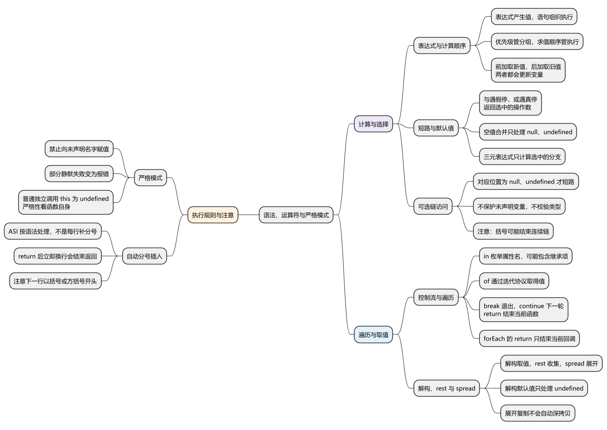
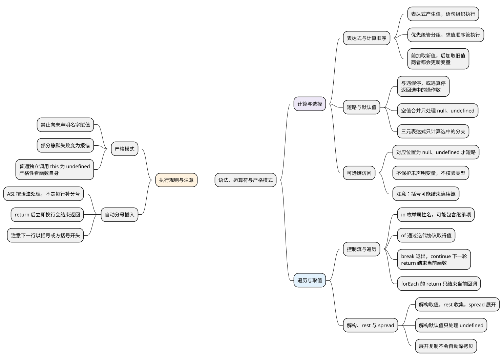

# 语法、运算符与严格模式
<!-- core-mindmap:start -->
[](examples/c01-mindmap.svg)

<details>
<summary>PlantUML 源码</summary>



</details>

<!-- core-mindmap:end -->

**口述总览：** JavaScript 代码由表达式和语句组成：表达式算出值，语句安排执行。读代码时先确定语法怎样分组，再顺着求值顺序观察短路、赋值和函数调用。严格模式与运行环境还会影响错误和 this，但不会改变这条分析主线。

<!-- recall-route:start -->
**记忆线：** 计算 → 短路 → 访问 → 遍历 → 解构 → 严格模式 → 换行。读输出题时再按“分组 → 求值 → 短路 → 副作用 → 环境”推导。

本篇按 7 个主要知识点复习：[先自查](#self-check) · [口述与答案](#interview)。每次先遮住答案回忆，再用正文中的短例核对。
<!-- recall-route:end -->

本篇按用途查语法；类型转换细节见[类型转换与比较](../01_数据类型、内建对象与内存管理/03_类型转换与比较.md)。各示例可在现代 Node.js 的 ES 模块中独立运行。

<a id="k01"></a>

## 表达式产生值，语句组织执行

**口述：** 表达式回答“算出什么”，语句回答“接下来执行什么”。优先级决定计算的结合方式，求值顺序决定子表达式何时产生值；两者要分开判断。

`1 + 2`、`user.name`、`read()` 都是表达式。赋值也是表达式，会产生赋进去的值。`if`、`for`、`return` 则是组织控制流的语句。

### 优先级与求值顺序

`a() + b() * c()` 按 `a() + (b() * c())` 分组，但通常依次调用 a、b、c。乘法要等两个操作数求得后才能完成。

<!-- example: c01-evaluation-order -->
```js
const order = [];
function read(name, value) {
  order.push(name);
  return value;
}
const result = read('a', 1) + read('b', 2) * read('c', 3);
console.log(order.join(','), result); // a,b,c 7
```

这里先求到 1，再求到 2 和 3，最后算出 `1 + 6`。调用期间的记录属于**副作用**：除了返回值，还改变了外部能观察到的状态。

常用分组顺序可记为：成员访问与调用优先于多数运算；乘除优先于加减；比较先于逻辑组合；赋值通常更靠后。复杂表达式直接加括号，比依赖记忆更清楚。

### 递增与赋值

- `++n`：更新 n，表达式得到更新后的值。
- `n++`：更新 n，表达式得到更新前的值。
- `n += x`：读取旧值、计算、再赋值；对对象属性还可能触发 getter/setter。
- `a, b`：依次求值，得到 b；逗号运算符不等同于参数分隔符。

<!-- example: c01-increment -->
```js
let count = 1;
const before = count++;
const after = ++count;
console.log(before, after, count); // 1 3 3
```

**注意：** 算术运算不会修改数字值本身，更新的是变量绑定或属性。不要在同一表达式里反复修改同一个变量，输出虽能推导，维护成本却很高。

<a id="k02"></a>

## 按用途选择运算符

**口述：** 运算符的关键是接收什么值、返回什么结果、是否产生副作用。逻辑运算常返回原操作数，可选链只处理 null 和 undefined，不能当作完整输入校验。

### 计算、比较与属性判断

- `+ - * / % **`：算术运算；`+` 也可能拼接字符串，`%` 是余数而非数学意义上的非负取模。
- `===`、`!==`：不做类型转换的相等比较；`==`、`!=` 有转换规则。
- `< <= > >=`：关系比较，字符串比较与数值比较可能走不同路径。
- `key in object`：检查自有或继承属性是否存在，返回布尔值。
- `value instanceof Constructor`：通常检查原型关系，也可能由自定义协议决定。
- `typeof value`：返回类型标签字符串；`void expression`：执行表达式后得到 undefined。
- `delete object.key`：尝试删除属性，不能用来释放任意变量的内存。
- Number 的位运算通常先转为 32 位整数；`>>>` 是无符号右移，BigInt 不支持它。

<!-- example: c01-numeric-property -->
```js
const record = Object.create({ inherited: 1 });
record.own = 2;
console.log(1 + '2', 5 % 2, -5 % 2); // 12 1 -1
console.log('inherited' in record, Object.hasOwn(record, 'inherited')); // true false
console.log(delete record.own, Object.hasOwn(record, 'own')); // true false
console.log((2 ** 32) | 0); // 0
```

**注意：** 位运算会丢掉超出位宽的信息，不适合不加分析地替代取整。BigInt 与 Number 的混合运算另见对应数据类型篇。

### 短路选择：&&、||、?? 与条件表达式

- `left && right`：left 为假值时返回 left，否则求值并返回 right。
- `left || right`：left 为真值时返回 left，否则求值并返回 right。
- `left ?? right`：只有 left 为 null 或 undefined 时才求值 right。
- `!value`：转成布尔判断后取反；`!!value` 或 `Boolean(value)` 得到布尔值。
- `condition ? yes : no`：只求值被选中的分支。
- `&&=`、`||=`、`??=`：符合对应短路条件时才写入，左侧引用只求值一次。

<!-- example: c01-short-circuit -->
```js
let calls = 0;
function fallback() { calls += 1; return 10; }
console.log(0 || fallback(), 0 ?? fallback()); // 10 0
console.log(calls); // 1
let value = null;
value ??= 5;
value ??= 9;
console.log(value); // 5
```

第一个表达式把 0 当假值，调用 fallback；第二个把 0 当有效值，完全跳过 fallback。默认分页页码、价格、开关值时，要先确定 0、空串和 false 是否应该保留。

**注意：** `??` 与 `&&`、`||` 混用必须加括号。它们的结果不保证是 Boolean。

### 安全访问：可选链 ?.

`obj?.field`、`obj?.[key]`、`fn?.()` 在对应接收值为空时返回 undefined。它们不创建默认对象，不校验字段类型，也不保证一个非空值一定可调用。

<!-- example: c01-optional-chain -->
```js
const absent = null;
console.log(absent?.profile.name); // undefined
const present = { profile: null };
console.log(present.profile?.name); // undefined
try { console.log(present?.profile.name); }
catch (error) { console.log(error.name); } // TypeError
try { console.log((absent?.profile).name); }
catch (error) { console.log(error.name); } // TypeError
```

第一行的连续链在 absent 处短路。第三次访问中 present 存在，继续读取 null.name 才失败。最后一行括号结束了连续链，括号外仍会访问 undefined.name。

**注意：** 未声明的名字不能通过 `missing?.x` 保护；可选链也不能作为普通赋值目标。

<a id="k03"></a>

## 控制流与遍历：选择路径、重复执行和提前结束

**口述：** 控制流决定语句按什么路径执行。选择循环方式时，要同时考虑遍历的是属性还是值、是否要提前结束、是否需要等待异步结果。

`if` 按真假值分支。`switch` 按严格相等语义匹配 case，匹配后若不 break 会继续执行后续 case 的语句。

`for`、`while` 先判断再循环；`do...while` 至少执行一次。`break` 退出目标循环或 switch，`continue` 开始下一轮，`return` 结束当前函数。

### for...in 与 for...of

- `for...in`：枚举可枚举字符串属性名，可能包含继承属性，不包含 Symbol 键。
- `for...of`：从可迭代对象逐个取得值，适合数组、字符串、Map、Set。
- `Object.entries(obj)`：得到自有可枚举字符串键值对，再交给 for...of。

<!-- example: c01-iteration -->
```js
const record = Object.create({ inherited: 1 });
record.own = 2;
const keys = [];
for (const key in record) keys.push(key);
console.log(keys.join(',')); // own,inherited
for (const [key, value] of Object.entries(record)) {
  console.log(key, value); // own 2
}
const selected = [];
for (const number of [1, 2, 3]) {
  if (number === 3) break;
  selected.push(number);
}
console.log(selected.join(',')); // 1,2
```

**注意：** `forEach` 是方法调用，回调里的 return 只结束该次回调，不能退出外层函数，也不能从回调里 break 到外层循环。需要顺序 await 时使用明确的循环，详见 [async 与 await](../04_异步机制/03_async与await.md)。

<a id="k04"></a>

## 解构取值，rest 收集，spread 展开

**口述：** 解构按结构提取值，rest 收集剩余内容，spread 把已有内容展开到新位置。默认值只处理 undefined；这些语法不会自动深拷贝，也不负责校验输入结构。

对象解构读取属性，可能触发 getter；数组解构读取迭代器，因此 Set 也能被数组形式的模式解构。

- 函数 `(...args)`：rest 收集实参，得到真数组，必须位于最后。
- 数组或调用中的 `...value`：spread 消费可迭代对象。
- 对象中的 `...value`：复制自有可枚举字符串与 Symbol 属性值，只有外层被复制。

<!-- example: c01-destructure-spread -->
```js
const { name = 'guest', ...rest } = { name: null, id: 1 };
console.log(name, rest.id); // null 1
const [head, ...tail] = new Set([1, 2, 3]);
console.log(head, tail.join(',')); // 1 2,3
const source = { profile: { score: 1 } };
const copy = { ...source };
copy.profile.score = 9;
console.log(copy === source, source.profile.score); // false 9
```

name 为 null，所以不会使用 guest。copy 是新对象，但 profile 仍访问同一个嵌套对象，所以外部观察到 score 变化。

**注意：** 直接解构 null 或 undefined 会抛 TypeError；函数参数的默认 `{}` 只处理缺省或 undefined。深浅复制的完整范围见[浅拷贝与深拷贝](../01_数据类型、内建对象与内存管理/20_浅拷贝与深拷贝.md)。

<a id="k05"></a>

## 严格模式与自动分号插入

**口述：** 严格模式让部分容易隐藏问题的写法直接报错；自动分号插入则按语法处理换行。两者解决不同问题，分析前要明确代码是经典脚本、ES 模块还是某个函数体。

ES 模块和 class 内部默认严格。经典脚本或使用简单形参的函数，可以在开头写 `'use strict'`。严格模式禁止向未声明名字赋值，让部分无法写入的操作抛错，并让普通独立调用的 this 保持 undefined。

<!-- example: c01-strict-mode -->
```js
function inspect() {
  'use strict';
  const frozen = Object.freeze({ value: 1 });
  try { frozen.value = 2; }
  catch (error) { console.log(error.name); } // TypeError
  return this;
}
console.log(inspect()); // undefined
```

是否严格看函数自身代码，不能仅凭调用方判断。带默认参数、解构或 rest 的函数不能直接在函数体写严格指令，但可以定义在已经严格的 ES 模块中。

### return 后换行为什么丢失结果

自动分号插入（ASI）不是“每次换行补分号”。return 后不能跨换行继续读取返回表达式，因此下面实际先结束 return。

<!-- example: c01-asi -->
```js
function broken() {
  return
  { value: 1 };
}
function correct() {
  return { value: 1 };
}
console.log(broken(), correct().value); // undefined 1
```

**注意：** 下一行以 `(`、`[` 等开头时，可能与上一行组成同一表达式。保持统一分号风格、使用格式化与静态检查，可以减少此类问题。

新语法能被构建器解析，不代表目标浏览器支持相关 API。语法转译、API 补充与宿主能力应分别核对。

<a id="summary"></a>

读复杂表达式时，按“分组 → 求值 → 短路 → 副作用 → 环境”逐项记录；写业务代码时尽量让这几件事显式可见。

<a id="self-check"></a>

## 自查问题

先尝试口述，再点击问题查看对应归纳；卡住时回到正文运行例子。

1. [表达式与语句有什么区别？优先级高是否代表对应函数先调用？前置和后置自增分别取什么值？](#recall-01)
2. [&&、||、?? 在什么条件下短路？返回的一定是布尔值吗？默认值需要保留 0、false、空字符串时怎样选？](#recall-02)
3. [可选链能避免所有属性访问错误吗？未声明变量、非函数值和被括号断开的链分别有什么限制？](#recall-03)
4. [for...in 与 for...of 分别遍历什么？break、continue、return 有什么区别？forEach 的 return 能退出外层函数吗？](#recall-04)
5. [解构、rest、spread 分别做什么？解构默认值是否处理 null？展开后的嵌套对象是否独立？](#recall-05)
6. [严格模式限制哪些行为？函数的严格性由谁决定？它与自动分号插入分别影响什么？](#recall-06)
7. [为什么 return 后立即换行会丢失返回值？ASI 是每次换行都补分号吗？](#recall-07)

<a id="interview"></a>

## 试题与答案

按上方知识点顺序复述，每点先说结论，再说明规则和边界，最后用一句记忆提示检查遗漏。

<a id="recall-01"></a>

<a id="c01-01"></a>

### C01-01 [P0·原理] 优先级高是不是先调用对应函数？

**回答：** 表达式产生值，语句组织执行。优先级决定表达式怎样分组，求值顺序决定何时取得操作数。例如 `a() + b() * c()` 在正常执行时依次调用 a、b、c，再完成乘法和加法。有副作用时要逐步记录；`++n` 取得更新后的值，`n++` 取得更新前的值，两者都会更新变量。

**记忆：** 表达式算值，语句安排执行；优先级管分组，求值顺序管执行。

<a id="recall-02"></a>

<a id="c01-02"></a>

### C01-02 [P0·基础] &&、||、??都返回Boolean吗？

**回答：** 它们都会短路，并返回选中的操作数。与运算遇到假值停止，或运算遇到真值停止；空值合并只在左边是 null 或 undefined 时采用右边。比如 `0 || 10` 得到 10，`0 ?? 10` 得到 0。需要布尔值时再显式转换；`??` 与 `&&`、`||` 混用必须加括号。

**记忆：** 与遇假停，或遇真停，空值才补缺；结果不一定是布尔值。

<a id="recall-03"></a>

### 可选链：在可能为空的位置停止访问

**自查：** 可选链能避免所有属性访问错误吗？未声明变量、非函数值和被括号断开的链分别有什么限制？

**回答：** 可选链只在对应接收值为 null 或 undefined 时短路并返回 undefined。它不能保护未声明的变量，也不保证非空值一定可以调用。多层访问要在可能为空的位置设置保护；括号结束连续链后，括号外的普通访问仍可能报错。

**记忆：** 可选链处理空值，不能代替声明、类型检查和完整结构校验。

<a id="recall-04"></a>

<a id="c01-03"></a>

### C01-03 [P0·基础] for...in和for...of的本质区别是什么？

**回答：** for...in 枚举可枚举字符串属性名，可能包含继承属性，不包含 Symbol 键；for...of 通过迭代协议取得值。普通对象自身的键值对可用 Object.entries 配合 for...of。break 退出目标循环或 switch，continue 开始下一轮，return 结束当前函数；forEach 回调中的 return 只结束本次回调。

**记忆：** in 看属性名，of 取迭代值；退出谁，要看当前控制结构。

<a id="recall-05"></a>

<a id="c01-04"></a>

### C01-04 [P0·原理] rest和spread有什么区别，是否都是深拷贝？

**回答：** 解构按结构提取值，rest 收集剩余内容，spread 把已有内容展开到新位置。具体规则由语法位置决定：数组和调用展开使用迭代协议，对象展开复制自有可枚举属性值。默认值只处理 undefined，不处理 null；展开复制不会自动深拷贝，嵌套对象仍可能共享。

**记忆：** 解构取、rest 收、spread 展；默认只补 undefined，展开复制是浅的。

<a id="recall-06"></a>

<a id="c01-05"></a>

### C01-05 [P1·原理] 严格模式与ASI会怎样改变结果？

**回答：** 严格模式禁止向未声明名字赋值，让部分原本静默失败的操作抛错，并让严格普通函数独立调用时的 this 保持 undefined。ES 模块和 class 内部默认严格，函数严格性看自身代码。ASI 处理的是语法分句，例如 return 后立即换行会结束返回；它与严格模式是不同规则。

**记忆：** 严格模式管执行约束，ASI 管语法分句。

<a id="recall-07"></a>

### 自动分号插入：判断换行是否改变语句

**自查：** 为什么 return 后立即换行会丢失返回值？ASI 是每次换行都补分号吗？

**回答：** return 的语法不允许跨换行继续读取返回表达式，自动分号插入会让返回语句在这里结束，因此普通函数得到 undefined。ASI 不是每次换行都补分号；下一行以 `(`、`[` 等开头时，可能继续组成同一个表达式。返回表达式的开头应与 return 写在同一行。

**记忆：** return 后不直接换行，其他换行仍要按语法判断。

参考：[MDN：表达式与运算符](https://developer.mozilla.org/en-US/docs/Web/JavaScript/Guide/Expressions_and_operators)、[MDN：严格模式](https://developer.mozilla.org/en-US/docs/Web/JavaScript/Reference/Strict_mode)。
