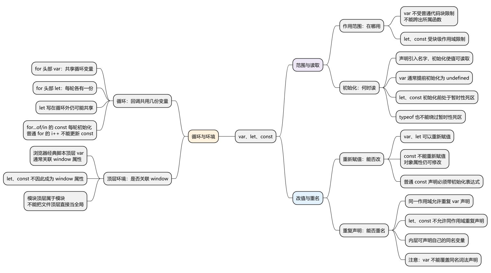
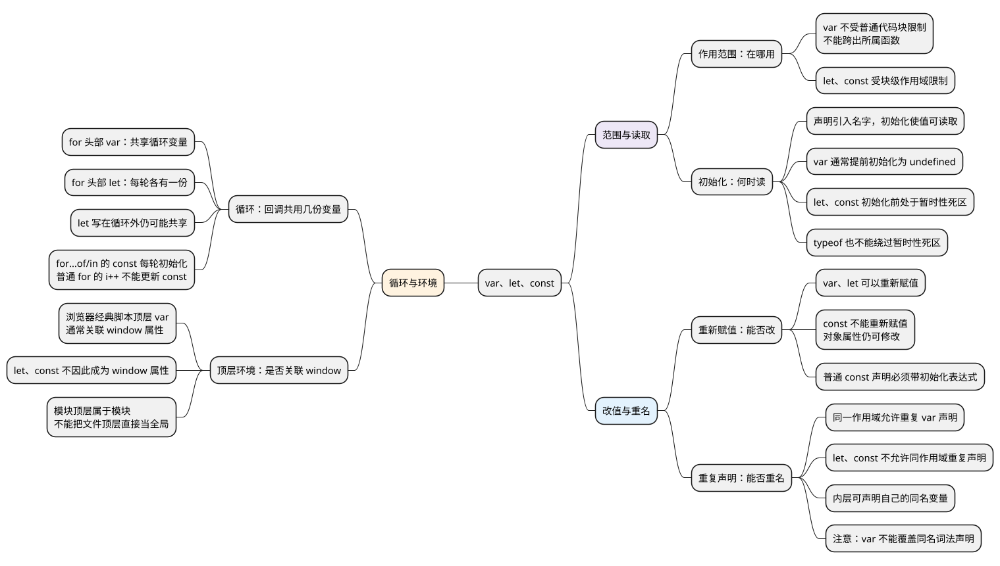

# var、let、const

<!-- core-mindmap:start -->
[](examples/c02-mindmap.svg)

<details>
<summary>PlantUML 源码</summary>



</details>

<!-- core-mindmap:end -->

**口述总览：** var、let、const 主要看变量在哪里能访问、什么时候能读取，以及能否重新赋值。var 不受普通代码块限制，通常可以在声明语句前读到 undefined；let、const 在所在块内有效，初始化完成前不能访问，这段阶段叫暂时性死区。const 不能重新赋值，但对象属性仍可以修改。分析循环时，再看各个回调使用的是同一个变量，还是每轮各自的变量。

<!-- recall-route:start -->
**记忆线：** 范围 → 读取 → 改值 → 重名 → 循环 → 环境。先记“在哪用、何时读、能否改”，再补重复声明、循环和顶层环境。

本篇按 6 个主要知识点复习：[先自查](#self-check) · [口述与答案](#interview)。每次先遮住答案回忆，再用正文中的短例核对。
<!-- recall-route:end -->

本篇集中讲变量声明与使用规则。读完[函数](03_函数.md)后，再分别学习[作用域与作用域链](04_作用域与作用域链.md)、[执行上下文与调用栈](05_执行上下文与调用栈.md)。

除明确标记为浏览器经典脚本的例子外，各示例可在现代 Node.js ES 模块中独立运行。

## 六种常见声明方式：分别声明什么

**口述：** var、let、const 声明变量，function 声明函数，class 声明类，import 引入其他模块导出的变量、函数等。它们都能引入名称，但用途和使用规则不同。

- var、function：ES5 已有的常见声明方式。
- let、const、class、import：ES2015（ES6）引入的相关声明语法。
- import 声明用于模块顶层，不能直接给导入的名字重新赋值；如果导出方更新了导出的变量，导入方读取时能看到更新后的值。

这里列的是六种常见语法，函数参数、catch 参数等也会引入可使用的名字。本篇先讲清 var、let、const，函数、类和模块分别在后续文章展开。

<a id="k01"></a>

## 声明、初始化与赋值是三个动作

**口述：** 声明引入变量名，初始化让变量第一次获得可读取的值，重新赋值则改变已有变量的值。理解这三个动作，就能分清“还不能访问”和“已经可以访问，但值是 undefined”。

例如，`let count = 1` 声明了 count，并把它初始化为 1；随后执行 `count = 2`，是给已有变量重新赋值。执行 `let count;` 时，也会完成初始化，只是初始值为 undefined。

技术资料把“变量名与值之间的关联”称为**绑定**。先理解“变量现在关联哪个值”即可，不需要用这个术语替换所有日常表达。

### 为什么 var 可以提前读到 undefined，而 let、const 会报错

- `var`：在所在函数或相应顶层范围内有效，普通代码块不限制它；正文执行前通常已初始化为 undefined，之后可以重新赋值。
- `let`：在所在块内有效；进入这个范围时，变量名已经属于这里，但初始化完成前不能读取，初始化后可以重新赋值。
- `const`：与 let 一样受块级范围和初始化规则限制，初始化后不能重新赋值。
- 普通函数声明：通常在所属作用域的正文执行前已经初始化为函数，因此可以提前调用。
- `class` 声明：初始化前也不能访问，不能照搬普通函数声明的提前调用规则。

<!-- example: c02-binding-phases -->
```js
console.log(total); // undefined
var total = 1;
total = 2;
console.log(total); // 2
console.log(ready()); // ready
function ready() { return 'ready'; }
try { console.log(pending); }
catch (error) { console.log(error.name); } // ReferenceError
let pending = 3;
console.log(pending); // 3
```

total 在第一行已经可以读取，只是值为 undefined。pending 还没有完成初始化，因此读取失败。ready 已经可以作为函数调用。

这些正文执行前的准备行为，通常会用**提升**来讨论。代码没有真的被搬到顶部；面试时直接说明“变量名是否已经属于这里、是否已经初始化”，比只背“有提升／没提升”更清楚。

### 作用范围：var 不受普通块限制，let、const 受块限制

**作用域**规定一个名字能在哪里被访问。函数体提供函数作用域，if、循环体等普通代码块能限制其中 let、const 声明的变量。

<!-- example: c02-block-scope -->
```js
function inspect() {
  if (true) {
    var visible = 1;
    let local = 2;
    const fixed = 3;
    console.log(local, fixed); // 2 3
  }
  console.log(visible); // 1
  try { console.log(local); }
  catch (error) { console.log(error.name); } // ReferenceError
}
inspect();
try { console.log(visible); }
catch (error) { console.log(error.name); } // ReferenceError
```

visible 属于 inspect 这次函数调用，可以在 if 外访问，但函数外访问不到。local 和 fixed 只在对应块内可用。let、const 声明的变量受所在块限制，不需要把声明关键字本身理解成“新建一层花括号”。

历史上 ES5 的 catch 异常参数已经有局部作用范围，所以不要概括成“ES5 完全没有局部块作用域”；常规 var 不受普通块隔离，才是这里需要掌握的区别。

### 重复声明与重新赋值不是一回事

**口述：** 重复声明是再次写声明语句使用同一个变量名；重新赋值是修改已有变量的值。var 允许重复 var 声明，let、const 不允许在同一作用域重复声明，但内层块可以声明自己的同名变量。

<!-- example: c02-redeclaration -->
```js
var total = 1;
var total;
console.log(total); // 1：无初始化器的 var 不会重置已有值
var total = 2;
console.log(total); // 2：这一行执行了赋值

let count = 1;
count = 2;
{
  let count = 3;
  console.log(count); // 3：内层是另一个绑定
}
console.log(count); // 2
```

如果把第二个 let count 写在外层同一作用域，就会在解析阶段产生 SyntaxError。var 与同名 let/const 的声明冲突也不允许，不能把“var 可以重复声明”理解成能覆盖任意声明。

### const 不能重新赋值，但对象属性可以修改

<!-- example: c02-const-object -->
```js
const user = { name: 'A' };
user.name = 'B';
console.log(user.name); // B
try { user = { name: 'C' }; }
catch (error) { console.log(error.name); } // TypeError
```

第一次操作修改 user 对象的 name 属性，第二次试图让 user 改为使用另一个对象。const 禁止第二种操作；要限制对象属性修改，还需考虑对象冻结等机制。

普通 let 声明可以不写初值，执行到声明时初始化为 undefined；普通 const 声明必须带初始化表达式，否则是 SyntaxError。

<!-- example: c02-let-initialization -->
```js
let pending;
console.log(pending); // undefined：声明已经执行完成
pending = 10;
console.log(pending); // 10
const limit = 20;
console.log(limit); // 20
```

const 的 for...of/in 声明由每次迭代提供初始值，后面的循环一节单独说明。日常优先使用 const；确定需要重新赋值时使用 let。维护旧代码时理解 var 的语义，再决定是否迁移。

<a id="k03"></a>

## 暂时性死区：初始化完成前不能访问变量

**口述：** let 和 const 声明的变量，在所在作用域内、初始化完成之前不能访问，否则会抛出 ReferenceError。这段阶段称为暂时性死区，typeof 也不能绕过这个限制。

**TDZ 是 Temporal Dead Zone 的缩写，中文就是“暂时性死区”**，是 JavaScript 文档中的常用术语。它和旧笔记里的“声明之前不能使用”描述的是同一类现象；更准确的结束时间是初始化完成。

例如，正常执行完 `let count = 1` 后就可以读取 count；如果在它初始化完成之前读取，就会报错。先记住这个规则，再看下面内外层变量同名时的例子。

<!-- example: c02-tdz-shadowing -->
```js
const value = 'outside';
{
  try { console.log(value); }
  catch (error) { console.log(error.name); } // ReferenceError
  let value = 'inside';
  console.log(value); // inside
}
console.log(typeof neverDeclaredForScopeExample); // undefined
```

进入块后，里面的 value 已经属于这个块。第一行读取的是内层 value，但它还没有初始化，所以报错。执行完 `let value = 'inside'` 后，才能读取到 inside。

`typeof` 对完全未声明的变量名有特殊处理，返回 `'undefined'`；对暂时性死区中的变量仍会报错。

暂时性死区到**初始化完成**才结束。执行到声明这一行时，还需要先计算右侧表达式；如果右侧读取尚未初始化的变量自身，也会报错：

<!-- example: c02-tdz-initializer -->
```js
try {
  let value = value;
} catch (error) {
  console.log(error.name); // ReferenceError
}

try {
  console.log(typeof value);
  let value = 1;
} catch (error) {
  console.log(error.name); // ReferenceError
}
```

### 函数表达式要等赋值或初始化完成

<!-- example: c02-function-expression -->
```js
try { fromVar(); }
catch (error) { console.log(error.name); } // TypeError
var fromVar = function() { return 'var ready'; };
try { fromConst(); }
catch (error) { console.log(error.name); } // ReferenceError
const fromConst = () => 'const ready';
console.log(fromVar(), fromConst()); // var ready const ready
```

fromVar 已经是 undefined，对它调用才报 TypeError；fromConst 尚未初始化，读取名字时就报 ReferenceError。差异来自变量声明和初始化，不是箭头语法天然“不提升”。

**注意：** 非严格经典脚本中的块级函数声明存在历史兼容规则。新代码使用明确的模块和块级声明，不依赖这些特殊行为。

<a id="k05"></a>

## 循环回调读取的是同一个变量，还是每轮各自的变量

**口述：** 循环回调的关键是多个函数以后读取哪一份变量。for 头部用 var 声明时，回调通常共享一个循环变量；用 let 声明时，每轮使用各自的变量。const 可以用于 for...of/in，因为每轮都会建立新变量并提供初始值，但不能通过 i++ 给同一个 const 重新赋值。

<!-- example: c02-loop-bindings -->
```js
const shared = [];
for (var i = 0; i < 3; i++) shared.push(() => i);
const separate = [];
for (let j = 0; j < 3; j++) separate.push(() => j);
console.log(JSON.stringify(shared.map(fn => fn()))); // [3,3,3]
console.log(JSON.stringify(separate.map(fn => fn()))); // [0,1,2]
```

三个 shared 函数都读取同一个 i。调用它们时循环结束，i 已经是 3。separate 的函数各自关联当轮的 j，所以分别得到 0、1、2。

例子没有异步操作，仍能复现结果。这证明核心是变量共享关系；setTimeout 只是常见的延后读取方式。

### let 声明在循环外，仍可能共享同一个变量

<!-- example: c02-loop-outer-let -->
```js
const callbacks = [];
let i = 0;
for (; i < 3; i++) callbacks.push(() => i);
console.log(JSON.stringify(callbacks.map(fn => fn()))); // [3,3,3]
```

这里没有在循环头声明 let i，各个函数读取的都是外部同一个 i。区别不能只背成“看到 let 就会输出 0、1、2”，还要看声明位置。

### const 在 for...of 中每轮使用新变量

<!-- example: c02-loop-const -->
```js
const callbacks = [];
for (const item of ['a', 'b']) {
  callbacks.push(() => item);
}
console.log(JSON.stringify(callbacks.map(fn => fn()))); // ["a","b"]

try {
  for (const i = 0; i < 2; i++) {
    console.log(i); // 0
  }
} catch (error) {
  console.log(error.name); // TypeError：i++ 试图重新赋值
}
```

for...of 的每次迭代都会建立一个新的 item，并用当轮的值初始化。普通 for 的 i++ 则需要给同一个 i 重新赋值，所以遇到 const 会失败。技术资料会把“每轮各自有一份变量”称为“每次迭代创建新的绑定”。

如果必须使用 var，也可以在每轮调用辅助函数，把当前值传进去，利用每次调用各自的参数保存它。选择方案前先确定业务要“当时的值”还是“最新的共享值”。

## 顶层声明与 window：先区分脚本和模块

**口述：** 在浏览器经典脚本顶层，var 通常与 window 属性关联，let、const 不会因此成为 window 属性。但浏览器模块和 Node.js 模块的顶层声明属于各自模块，不能照搬经典脚本的结论。

下面只在全新的浏览器页面、普通 script 标签中运行，不要放进函数或 type="module" 脚本：

<!-- example: c02-browser-global -->
```js
// browser-only: 经典脚本顶层
var reviewVar = 1;
let reviewLet = 2;
const reviewConst = 3;
console.log(window.reviewVar); // 1
console.log(Object.hasOwn(window, 'reviewLet')); // false
console.log(Object.hasOwn(window, 'reviewConst')); // false
console.log(reviewLet, reviewConst); // 2 3
```

let、const 没有成为 window 属性，不代表它们不属于这个经典脚本的全局作用域。浏览器 ES 模块的顶层声明属于模块，顶层 this 为 undefined；开发工具控制台也可能有自己的重复声明处理，不宜直接代替页面脚本验证规则。

Node CommonJS 使用模块包装函数，顶层 var 不会直接成为全局属性；Node ES 模块的顶层声明同样属于模块。分析“全局变量”题前先明确脚本、模块与宿主。

<a id="summary"></a>

复述这篇时按“作用范围 → 初始化与暂时性死区 → 重新赋值 → 重复声明 → 循环 → 顶层环境”展开。日常优先使用 const，确实需要重新赋值时使用 let。

## 相关机制分别在哪里讲

<a id="k02"></a>

- [作用域与作用域链：函数到哪里查找变量](04_作用域与作用域链.md#k02)。

<a id="k04"></a>

- [执行上下文与调用栈：函数怎样准备、执行和返回](05_执行上下文与调用栈.md#k03)。

<a id="k06"></a>

- [参数从左到右初始化，以及默认表达式能访问哪些变量](05_执行上下文与调用栈.md#parameters)。

<a id="self-check"></a>

## 自查问题

先尝试口述，再点击问题查看对应归纳；卡住时回到正文运行例子。

1. [var、let、const 在哪里有效？为什么 if 外可能读到 var，却读不到其中的 let、const？](#recall-01)
2. [声明、初始化、重新赋值有什么区别？let 是否提前属于当前作用域？typeof 能绕过暂时性死区吗？](#recall-02)
3. [const 为什么可以修改对象属性，却不能换成另一个对象？普通 const 声明可以不写初值吗？](#recall-03)
4. [重复声明与重新赋值有什么区别？内层可以声明同名 let 吗？重复 var 会重置旧值吗？](#recall-04)
5. [循环回调为何会输出相同结果？let 写在循环头与循环外有什么区别？const 为什么能用于 for...of？](#recall-05)
6. [顶层 var、let、const 是否都是 window 属性？浏览器模块与 Node.js 文件能照搬经典脚本结论吗？](#recall-06)

<a id="interview"></a>

## 试题与答案

按上方知识点顺序复述，每点先说结论，再说明规则和边界，最后用一句记忆提示检查遗漏。

<a id="recall-01"></a>

<a id="c02-01"></a>

### C02-01 [P0·基础] var、let、const最重要的区别是什么？

**回答：** 主要从作用范围、初始化、重新赋值和重复声明区分。var 不受普通代码块限制，在函数中声明时属于函数作用域，通常提前初始化为 undefined，并允许重复 var 声明。let、const 受块级作用域限制，初始化前不能读取，同一作用域不能重复声明。let 可以重新赋值，const 不可以，但 const 对象的属性仍可以修改。

**记忆：** 先问在哪用，再问何时读、能否改；var 跨普通块，let、const 受块限制。

<a id="recall-02"></a>

<a id="c02-02"></a>

### C02-02 [P0·原理] let究竟有没有提升？

**回答：** 声明引入名字，初始化让变量第一次获得可读取的值，重新赋值改变已有变量的值。进入作用域时，let、const 声明的名字已经属于这里，但尚未初始化，不能像 var 那样提前读取 undefined，也不会转而读取外层同名变量。这段阶段叫暂时性死区，typeof 也不能绕过；执行完 `let count;` 后，count 才能被读取为 undefined。

**记忆：** 名字已经属于这里，不代表已经能读；初始化完成才离开暂时性死区。

<a id="recall-03"></a>

### 重新赋值：区分更换变量的值与修改对象属性

**自查：** const 为什么可以修改对象属性，却不能换成另一个对象？普通 const 声明可以不写初值吗？

**回答：** const 限制的是变量重新赋值，不会冻结它关联的对象。修改对象属性仍是在操作原对象，让变量改为使用另一个对象则属于重新赋值，会抛出 TypeError。普通 const 声明必须带初始化表达式；for...of/in 的 const 由每次迭代提供初始值。

**记忆：** const 不能换值，对象属性可以改；普通声明要初值。

<a id="recall-04"></a>

### 重复声明：同一作用域重名与内层遮蔽不同

**自查：** 重复声明与重新赋值有什么区别？内层可以声明同名 let 吗？重复 var 会重置旧值吗？

**回答：** 重复声明是再次写声明语句使用同一个名字，重新赋值是改变已有变量的值。同一作用域允许重复 var 声明，不允许重复 let、const 声明，var 与同名词法声明也不能冲突。内层块可以声明另一份同名变量。没有初始化表达式的重复 var 声明，不会重置已有值。

**记忆：** 同层检查声明冲突，内层可以另有一份；重复 var 不等于重新赋值。

<a id="recall-05"></a>

<a id="c02-04"></a>

### C02-04 [P0·原理] 循环里的var为何输出三个3？

**回答：** 多个回调共享同一个循环变量时，延后调用会读取那份变量当时的值。for 头部的 var 让示例中的三个函数共享 i，循环结束后都读到 3；头部的 let 每轮有各自的变量。如果 let 声明在循环外，仍可能共享。for...of/in 的 const 每轮建立新变量并初始化，普通 for 中的 i++ 则需要重新赋值，不能用于更新 const。

**记忆：** 看共享几份变量，也看何时读取；let 是否分轮，要看声明位置。

<a id="recall-06"></a>

### 顶层环境：经典脚本与模块分别判断

**自查：** 顶层 var、let、const 是否都是 window 属性？浏览器模块与 Node.js 文件能照搬经典脚本结论吗？

**回答：** 浏览器经典脚本顶层的 var 通常与 window 属性关联；let、const 不会因此成为 window 属性，但仍可属于全局作用域。浏览器 ES 模块的顶层声明属于模块。Node.js 的 CommonJS 顶层声明受模块包装函数隔离，ES 模块同样具有模块范围，因此不能把文件顶层一概视为全局。

**记忆：** 先确定脚本、模块与宿主，再判断顶层变量和全局对象。

### 原合篇题目的新位置

<a id="c02-03"></a>

- [函数查变量为什么不看谁调用它？](04_作用域与作用域链.md#c04-01)

<a id="c02-05"></a>

- [函数返回后执行上下文退出，闭包为何还能访问变量？](05_执行上下文与调用栈.md#c05-01)

<a id="c02-06"></a>

- [function f(a=b,b=1){} 为什么可能抛错？](05_执行上下文与调用栈.md#c05-02)

参考：[MDN：let](https://developer.mozilla.org/zh-CN/docs/Web/JavaScript/Reference/Statements/let)、[MDN：const](https://developer.mozilla.org/zh-CN/docs/Web/JavaScript/Reference/Statements/const)、[MDN：var](https://developer.mozilla.org/zh-CN/docs/Web/JavaScript/Reference/Statements/var)。
