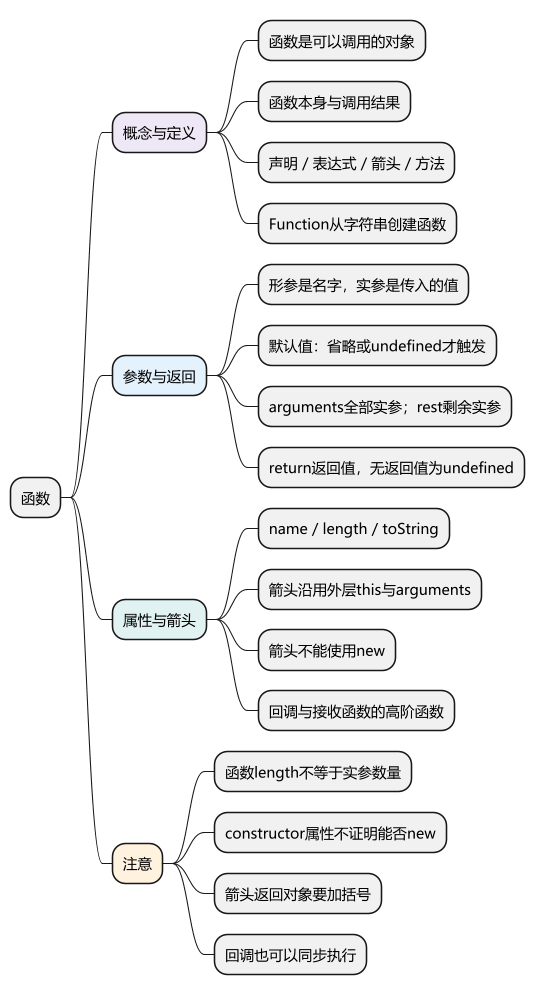
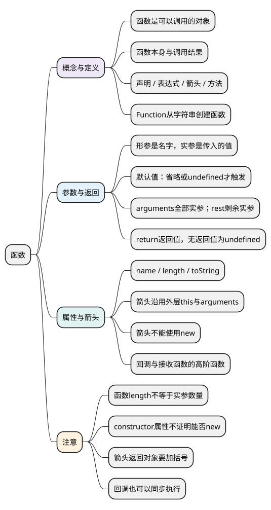

# 函数

<!-- core-mindmap:start -->
[](examples/c03-mindmap.svg)

<details>
<summary>PlantUML 源码</summary>



</details>

<!-- core-mindmap:end -->

**口述总览：** 函数把一段操作组织起来，通过参数接收输入，通过 return 返回结果。函数本身也是值，可以赋给变量、作为参数传递，或者从另一个函数中返回。理解函数先看怎么定义、怎么调用、传入和返回什么，再区分普通函数与箭头函数的 this 和使用限制。

各代码示例独立运行，默认使用现代 Node.js 的 ES 模块环境。this、闭包和异步分别有独立文章，本篇先讲函数本身的规则。

<a id="k01"></a>

## 函数是什么：既能调用，也能当作值传递

**口述：** 函数是可以调用的对象。除了执行，它还能赋给变量、放进对象、作为参数或返回值。这种像其他值一样被使用的能力，称为函数是“第一等公民”，也常叫“一等值”。

先区分保存函数与调用函数：

<!-- example: c03-first-class -->
```js
function add(a, b) {
  return a + b;
}
const calculate = add;       // 保存同一个函数
const result = add(1, 2);    // 调用函数，保存返回结果

console.log(calculate === add); // true
console.log(calculate(2, 3)); // 5
console.log(result); // 3
console.log(typeof calculate, typeof result); // function number
```

add 没有括号时表示函数这个值；add(1, 2) 表示执行一次调用。把函数交给其他代码，由对方调用，就是后面要讲的回调。

函数是对象，所以也可以有属性。但函数自己的属性与函数调用时产生的局部变量，是不同的东西。

<a id="k02"></a>

## 定义函数：声明、表达式、箭头与对象方法

**口述：** 常见写法有函数声明、函数表达式、箭头函数和对象方法简写。它们都能组织操作，但提前调用、this 和能否使用 new 的规则可能不同，不能只看语法长短。

### 四种常见写法

<!-- example: c03-definition-forms -->
```js
function add(a, b) { return a + b; }         // 函数声明

const subtract = function (a, b) {          // 函数表达式
  return a - b;
};

const multiply = (a, b) => a * b;           // 箭头函数

const calculator = {
  divide(a, b) { return a / b; }             // 对象方法简写
};

console.log(add(3, 2), subtract(3, 2)); // 5 1
console.log(multiply(3, 2), calculator.divide(6, 2)); // 6 3
```

函数表达式也可以写名字，例如 const fn = function inner() {}。inner 这个名字只在该函数自身内部可见，常用于递归调用；表达式并不一定匿名。

函数表达式也可以创建后立即调用，例如 (() => 1)()。这叫立即调用函数表达式，是调用写法，不是另一种独立的数据类型。

### 提前调用：先看函数是否已经可以使用

<!-- example: c03-declaration-initialization -->
```js
console.log(declared()); // ready
function declared() { return 'ready'; }

try { variable(); }
catch (error) { console.log(error.name); } // TypeError
var variable = function () { return 'later'; };

try { lexical(); }
catch (error) { console.log(error.name); } // ReferenceError
const lexical = () => 'later';
```

这里有三个不同原因：

- declared 已经可以作为函数使用，所以普通函数声明可以在声明语句前调用。
- variable 此时的值是 undefined，对它调用会报 TypeError。
- lexical 尚未初始化，读取这个变量就会报 ReferenceError。

把最后一个箭头改为普通函数表达式，const 初始化前仍不能调用。关键是[变量什么时候能读取](02_var、let、const.md#k03)，不是箭头语法单独决定“能否提前调用”。

### 从字符串创建函数：Function()

Function('a', 'b', 'return a + b') 根据字符串创建函数，写成 new Function(...) 也可以。这与用 new User() 创建业务对象是不同用途。

它不能直接读取创建位置的局部变量：

<!-- example: c03-dynamic-scope -->
```js
function createReaders() {
  const functionNoteLocal = 'inside';
  return [
    () => functionNoteLocal,
    new Function('return typeof functionNoteLocal')
  ];
}
const [normal, generated] = createReaders();
console.log(normal()); // inside
console.log(generated()); // undefined
```

普通定义可以沿定义位置访问外层变量；Function 创建出的函数使用其所属环境的全局作用域。日常优先用普通定义，动态执行字符串还需要明确允许的代码范围。

<a id="k05"></a>

## 参数与返回值：函数接收什么、交回什么

**口述：** 形参是定义函数时写出的参数名，实参是调用时真正传入的值。没有收到值的参数通常是 undefined；return 决定本次调用的返回值，并结束函数体的正常执行。

### 形参、实参与 return

<!-- example: c03-parameter-basics -->
```js
function describe(name, age) {
  return [name, age];
}
console.log(JSON.stringify(describe('Alice', 18))); // ["Alice",18]
console.log(describe('Alice')[1]); // undefined

function logOnly() { console.log('done'); }
const result = logOnly(); // done
console.log(result); // undefined
```

name、age 是形参，'Alice'、18 是实参。定义两个形参，不代表 JavaScript 会强制要求调用方传两个值；是否必填、类型是否正确，要按业务检查。

console.log 只是输出信息，不等于把值返回给调用方。没有 return，或只写 return 而不带值，结果都是 undefined。

<a id="k03"></a>

### return 的换行会影响结果

<!-- example: c03-return-newline -->
```js
function wrong() {
  return
  { value: 1 };
}
function correct() {
  return { value: 1 };
}
console.log(wrong()); // undefined
console.log(correct().value); // 1
```

return 后立即换行，JavaScript 会把它当作不带返回值的 return。返回对象时把对象放在同一行；需要跨行时，可以把左括号紧跟 return 写在同一行，再在括号内换行。try/finally 还可能影响最终返回结果，详见[错误处理](../04_异步机制/05_错误处理.md)。

### 默认参数：只有省略或 undefined 才使用默认值

<!-- example: c03-default-values -->
```js
function greet(name = '访客') { return name; }
console.log(greet(), greet(undefined), greet(null)); // 访客 访客 null

function read({ name = '访客' } = {}) { return name; }
console.log(read(), read({}), read({ name: undefined })); // 访客 访客 访客
console.log(read({ name: null })); // null
try { read(null); }
catch (error) { console.log(error.name); } // TypeError
```

read 使用了两层默认值：外面的 {} 处理整个参数缺省或为 undefined；里面的 name 默认值处理该属性缺失或值为 undefined。null 都不会触发相应默认值。

默认表达式在每次需要它的调用中重新计算。参数从左到右初始化，涉及前后参数引用时见[默认参数的初始化顺序](05_执行上下文与调用栈.md#parameters)。

### 读取全部或剩余实参：arguments 与 rest

arguments 是普通函数内部提供的参数对象；有数字索引和 length，但不是数组。剩余参数 ...rest 把当前位置之后的实参收集为真正的数组。

<!-- example: c03-arguments-rest -->
```js
function inspect(first, ...rest) {
  console.log(first); // 10
  console.log(arguments.length, arguments[2]); // 3 30
  console.log(Array.isArray(arguments)); // false
  console.log(JSON.stringify(rest)); // [20,30]
  console.log(Array.isArray(rest)); // true
}
inspect(10, 20, 30);
```

arguments 表示本次调用的全部实参；rest 只收集剩余部分。rest 只能放在参数列表末尾，后面不能再声明其他参数。日常需要不定数量参数时，通常优先使用 rest。

**注意：** 非严格模式下，仅有普通参数名、没有默认值或解构等写法的普通函数，arguments 的部分元素可能与形参同步变化。严格模式、默认参数、解构或 rest 不按这条历史规则处理。不要依赖修改 arguments 来修改形参。

参数含默认值、解构或 rest 时，不能在函数体内直接增加 'use strict' 指令，但可以把函数定义在本来就严格的 ES 模块中。

### 对象参数：改属性与重新赋值不同

<!-- example: c03-parameter-values -->
```js
function update(number, record) {
  number = 99;
  record.age = 20;
  record = { age: 30 };
  return record.age;
}
const count = 1;
const user = { age: 10 };
console.log(update(count, user)); // 30
console.log(count, user.age); // 1 20
```

参数仍然按值传递。record 最初与 user 访问同一个对象，所以修改 age 会影响外部对象；随后给 record 重新赋值，只改变函数内部这个参数。具体模型见[数据类型与参数传递](../01_数据类型、内建对象与内存管理/01_数据类型、对象身份与参数传递.md)。

<a id="k06"></a>

## 常用属性与方法：name、length、toString()

**口述：** name 用于查看函数名称，length 反映声明中的部分参数数量，toString 用于取得函数的文本表示。它们适合查看和调试，不负责检查这次调用是否传够参数、参数类型是否正确。

### 查看名称与形参数量：name、length

- name：可能来自显式函数名，也可能根据变量名等上下文推断。
- length：统计第一个默认参数之前的形参，rest 不计入；一个没有整体默认值的解构参数算一个位置。
- arguments.length：普通函数本次调用真正收到的实参数量，与 fn.length 不同。

<!-- example: c03-function-metadata -->
```js
const inferred = function () {};
function demo(a, b = 1, ...rest) {
  console.log(arguments.length);
}
function unpack({ x }, [y], ...rest) {}

console.log(inferred.name); // inferred
console.log(demo.length, unpack.length); // 1 2
demo(10, 20, 30); // 3

const bound = demo.bind(null, 10);
console.log(bound.name, bound.length); // bound demo 0
```

demo 有默认参数 b，所以 length 在 b 前停止计数。调用时传入三个值，arguments.length 才是 3。bind 预先提供参数后，返回函数的 length 还可能减少。

**注意：** 没有显式函数名的表达式，也可能根据变量名推断出 name。函数名还可能受包装和压缩影响，不宜作为稳定业务标识。

### 查看函数文本：toString()

<!-- example: c03-function-source -->
```js
function add(a, b) { return a + b; }
console.log(add.toString().includes('return a + b')); // true
console.log(Math.max.toString().includes('[native code]')); // true
console.log(add.bind(null, 1).toString().includes('[native code]')); // true
```

对于能够提供源文本的普通函数，toString 返回源文本；内建函数或原生绑定函数等可能返回含 [native code] 的形式，不能据此读到完整实现。

源码文本也不包含函数原来能访问的外层变量。把文本交给 Function 重新创建，不会恢复原来的变量关系。

<a id="k04"></a>

## 箭头函数：简洁写法，以及与普通函数的区别

**口述：** 箭头函数适合简短计算和需要沿用外层 this 的回调。它没有自己的 this 和 arguments，不能使用 new，也不能直接写成 Generator。选它之前，先确定函数是否需要根据调用方式改变 this。

### this 来自外层，call、apply、bind 不能替换它

普通函数的 this 要看本次怎样调用：obj.method()、独立调用、call 或 new 都可能不同。不能只背“谁调用就指向谁”。

箭头函数使用定义位置外层的 this；它写在哪个对象的花括号里，并不意味着 this 就是那个对象。

<!-- example: c03-arrow-this -->
```js
function make() {
  return {
    name: 'object',
    method() { return this?.name; },
    arrow: () => this.name
  };
}
const item = make.call({ name: 'outer' });
const detached = item.method;

console.log(item.method(), detached()); // object undefined
console.log(item.arrow(), item.arrow.call({ name: 'other' })); // outer outer
console.log(item.arrow.bind({ name: 'another' })()); // outer
```

按顺序理解：

1. make 被 call 指定使用 name 为 outer 的对象作为 this。
2. item.method() 通过 item 调用普通方法，因此读取 item.name。
3. 箭头创建在 make 内部，读取 make 那次调用的 this，所以得到 outer。
4. 对象字面量没有另设一份 this；后来使用 call 或 bind，也不能替换箭头读取的外层 this。

这里 detached() 返回 undefined，是因为普通方法在严格模式下独立调用，this 为 undefined，代码又使用了可选链。

call、apply 仍然可以给箭头传参，bind 也可以预先提供参数；受到限制的是替换 this。指向判断见[this 指向](06_this指向.md#k03)，三个方法的用法见[call、apply、bind](07_call、apply、bind.md#k01)。

### 没有自己的 arguments：要读自己的实参就用 rest

<!-- example: c03-arrow-arguments -->
```js
function outer(first, second) {
  const outerArgs = arguments;
  const arrow = (...values) => [
    arguments === outerArgs,
    arguments.length,
    values
  ];
  return arrow('x');
}
console.log(JSON.stringify(outer(10, 20))); // [true,2,["x"]]
```

箭头读取的 arguments 属于 outer，里面是 10、20；values 才是箭头自己的剩余参数数组，里面只有 'x'。

如果外层也找不到 arguments，读取它会报错。浏览器脚本、ES 模块和 Node.js 的传统模块（CommonJS）的外层环境可能不同，不能把某一种顶层表现推广到所有环境。

### 不能 new，不是因为“没有 constructor”

箭头函数没有通过 new 创建实例的能力，这与有没有显式函数名、constructor 属性值是什么，并不是同一件事。

<!-- example: c03-arrow-construction -->
```js
const arrow = () => {};
console.log(arrow.name); // arrow
console.log(arrow.constructor === Function); // true
console.log(Object.hasOwn(arrow, 'prototype')); // false
console.log(Object.getPrototypeOf(arrow) === Function.prototype); // true

try { new arrow(); }
catch (error) { console.log(error.name); } // TypeError

const Ordinary = function () { this.value = 1; };
console.log(new Ordinary().value); // 1
```

箭头默认没有自己的 prototype 属性，但仍然有原型链，通常也能从原型上读取 constructor。普通匿名 function 表达式则可以作为构造函数使用。

对象方法简写、async 函数、Generator 等也不能当作普通构造函数。是否能 new，不能只看函数名字或某个普通属性。

### 简短语法与使用场景

<!-- example: c03-arrow-syntax -->
```js
const double = value => value * 2;
const makeUser = name => ({ name });
const noReturn = () => { value: 1 };
const existingHandler = null;
const handler = existingHandler || (() => 'default');

console.log(double(3)); // 6
console.log(JSON.stringify(makeUser('Alice'))); // {"name":"Alice"}
console.log(noReturn()); // undefined
console.log(handler()); // default
```

- 表达式体会直接返回结果；使用函数体花括号时，需要自己写 return。
- 直接返回对象字面量要加括号，否则花括号可能被当作函数体。
- 参数列表与 => 之间不能换行；与 || 等运算符组合时，给箭头表达式加括号。
- 箭头不允许重复参数名。普通函数也只有非严格模式、简单参数列表等特定条件下才允许。
- 箭头可以写成 async 箭头，但没有对应的生成器箭头语法；生成器使用 function* 和 yield。

在用 new 调用的普通构造函数内部创建箭头时，箭头沿用那次调用的实例 this；如果同一函数用其他方式调用，外层 this 可能不同，不能一概说“箭头永远指向实例”。

逐项转换等简短计算、需要保留外层 this 的回调适合箭头。需要让 this 随 obj.method() 等调用方式变化的对象方法，通常使用普通方法；需要创建实例时用支持构造调用的函数或 class。

<a id="k07"></a>

## 常见应用：回调、高阶函数与函数包装

**口述：** 把函数交给其他代码，由对方调用，就是回调。接收函数或返回函数的函数，称为高阶函数。这些名称描述用法，并不是需要重新学习的一套函数语法。

### 回调可以同步执行，高阶函数也可以返回函数

<!-- example: c03-callbacks -->
```js
function double(value) { return value * 2; }
console.log(JSON.stringify([1, 2].map(double))); // [2,4]

function createAdder(base) {
  return value => base + value;
}
const addTen = createAdder(10);
console.log(addTen(2)); // 12
```

double 是交给 map 的回调，map 在本次调用中同步执行它；所以回调不等于异步。createAdder 返回另一个函数，也属于高阶函数。返回后仍能使用 base 的原因，在[闭包篇](08_闭包与函数应用.md)展开。

纯函数强调相同输入得到相同输出，且不修改外部可观察状态；柯里化是把 add(a, b) 改成 add(a)(b) 这样的分步接收；偏应用是先固定部分参数，例如 add.bind(null, 10)。先理解这些用途，需要手写时再看文末题目。

<a id="k09"></a>

### 包装函数时保留 this、参数、返回值和错误

给函数增加计数或日志时，调用方通常仍希望得到原来的结果。这就要求包装层正确转交参数和 this，并返回原结果。

<!-- example: c03-call-wrapper -->
```js
function countCalls(fn, stats) {
  return function (...args) {
    stats.calls += 1;
    return fn.apply(this, args);
  };
}
const stats = { calls: 0 };
const wrapped = countCalls(function (n) { return this.base + n; }, stats);
console.log(wrapped.call({ base: 10 }, 2), stats.calls); // 12 1

const failure = new Error('business');
const failing = countCalls(() => { throw failure; }, stats);
try { failing(); }
catch (error) { console.log(error === failure); } // true
```

apply 把本次 this 和参数交给 fn；return 把结果交给调用方。目标抛错时，错误继续向外传播。本例只包装普通调用，不支持替代原函数的 new 调用。

<a id="k10"></a>

### 事件解绑需要保存同一个回调

bind 每次调用都会创建新函数。注册监听时保存一次，移除监听时使用同一个函数，不能重新 bind 再期待它匹配之前的监听。

<!-- example: c03-listener-identity -->
```js
const target = new EventTarget();
const owner = { count: 0, handle() { this.count += 1; } };
const listener = owner.handle.bind(owner);
target.addEventListener('change', listener);
target.dispatchEvent(new Event('change'));

target.removeEventListener('change', owner.handle.bind(owner));
target.dispatchEvent(new Event('change'));
console.log(owner.count); // 2：新生成的函数没有移除旧监听

target.removeEventListener('change', listener);
target.dispatchEvent(new Event('change'));
console.log(owner.count); // 2
```

本例使用现代 Node.js 或浏览器的 EventTarget。DOM 移除监听还要匹配事件类型与捕获选项，详见[DOM 事件](../05_模块化与浏览器实践/02_DOM操作与DOM事件.md)。

<a id="k08"></a>

## 注意与后续衔接

**口述：** 选函数写法时，先确认参数、返回值和 this 是否符合需要。遇到异步、递归或多次调用，再检查执行顺序、是否重复进入以及何时清理，不能仅凭语法更短就判断更合适。

- **普通、async 与 Generator：** async 函数返回 Promise；Generator 调用后得到可逐步执行的迭代器。执行过程分别见[async/await](../04_异步机制/03_async与await.md)和[迭代器与生成器](../06_选读扩展/01_迭代器与生成器.md)。
- **递归：** 函数调用自身，要有结束条件；调用太深仍可能栈溢出，见[堆栈内存](../01_数据类型、内建对象与内存管理/21_堆栈内存.md#overflow)。
- **重复进入：** 一次调用还没结束，又进入同一段逻辑，称为重入。一次性回调应先标记已执行，再调用目标，文末有实现。
- **动态执行：** Function 创建的函数不自动构成安全隔离，不能随意执行不可信字符串。

<a id="summary"></a>

复述本篇时按“是什么 → 怎么定义 → 参数和返回 → 常用属性 → 箭头区别 → 回调应用”展开。this、闭包、异步和防抖节流沿各自文章继续学习。

<a id="interview"></a>

## 试题与答案

<a id="c03-01"></a>

### C03-01 [P0·基础] 函数是什么，为什么说它是一等值？

**回答：** 函数是可调用对象，也能像其他值一样赋值、存储、传参和返回。传递函数与调用函数不同：前者把函数本身交给其他代码，后者执行调用并取得返回结果。

<a id="c03-02"></a>

### C03-02 [P0·基础] 函数有哪些类型？

**回答：** 分维度说明：定义形式有声明、表达式、方法、箭头；执行形态有普通、async、Generator 和 async Generator；回调、高阶函数、构造用途则描述角色。这些分类不互斥，一个 async 箭头也能作为回调。

<a id="c03-03"></a>

### C03-03 [P0·原理] 箭头函数与普通函数的主要区别是什么？

**回答：** 箭头不建立自己的 this 和 arguments，读取外层环境，不能 new，也不能写成 Generator。call、apply、bind 仍然可以传参，但不能替换箭头使用的外层 this。需要 this 随调用方式变化时用普通方法，需要沿用外层 this 的回调可以用箭头。

<a id="c03-04"></a>

### C03-04 [P0·原理] 函数声明与函数表达式提前调用有何不同？

**回答：** 普通声明通常已初始化为函数；var 保存的表达式在赋值前是 undefined，调用报 TypeError；let/const 初始化前读取就报 ReferenceError。先看变量是否已经初始化，再看它当前的值是否能调用。

<a id="c03-05"></a>

### C03-05 [P0·基础] arguments、rest、fn.length分别是什么？

**回答：** arguments 是普通函数的类数组实参对象；rest 是收集剩余实参的真数组；fn.length 是第一个默认参数之前的形参数量，不计 rest。实际传入多少个值看 arguments.length 或自己收集的数组，不能看 fn.length。

<a id="c03-06"></a>

### C03-06 [P1·原理] 回调一定异步吗？匿名函数一定不能new吗？

**回答：** 都不是。map 的回调同步执行；匿名的一般 function 表达式可以构造。是否异步看接收方调用机制，能否 new 看目标的构造能力，与有没有名字无直接关系。

<a id="c03-07"></a>

### C03-07 [P1·基础] 柯里化与偏应用的区别是什么？

**回答：** 柯里化把多参数接收改成分步接收，如 add(a)(b)；偏应用先固定一部分参数，如 add.bind(null, 10)。两者都可能使用闭包；实现时要说明收集到多少参数才执行，以及 this、额外参数和返回值如何处理。

<a id="c03-08"></a>

### C03-08 [P1·工程取舍] 递归为什么会溢出，重入为什么会破坏once？

**回答：** 递归让未结束调用不断叠加，深度可能先超过运行时上限。重入则是在一次调用尚未结束时再次进入，如果 once 等到目标返回后才标记已执行，内部再次调用时仍会执行目标。应在调用前标记，失败后能否重试另行约定。

<a id="c03-09"></a>

### C03-09 [P1·编码] 实现参数个数明确的柯里化。

**回答：** 显式传入需要收集的参数个数 arity，不从 length 猜测。本例收集到足够参数时执行，保留额外参数，this 取最后一次调用；每个分支使用新数组，互不污染。

<!-- example: c03-curry -->
```js
function curry(fn, arity) {
  if (typeof fn !== 'function' || !Number.isInteger(arity) || arity < 0) {
    throw new TypeError('function and non-negative integer required');
  }
  function collect(previous) {
    return function(...next) {
      const args = [...previous, ...next];
      return args.length >= arity
        ? Reflect.apply(fn, this, args)
        : collect(args);
    };
  }
  return collect([]);
}
const sum = curry(function(a, b) { return this.base + a + b; }, 2);
const addOne = sum(1);
console.log(addOne.call({ base: 10 }, 2)); // 13
console.log(addOne.call({ base: 20 }, 3)); // 24
```

<a id="c03-10"></a>

### C03-10 [P1·原理] new Function 与普通函数的作用域有何不同，能用 toString 恢复闭包吗？

**回答：** new Function 使用其所属环境的全局作用域，不能直接读取创建位置的局部变量。toString 只有源码文本，重新创建函数不会恢复原来的外层变量。浏览器的内容安全策略还可能限制这种字符串执行。

<a id="c03-11"></a>

### C03-11 [P1·原理] 默认参数、解构和 rest 如何影响 length、arguments 与严格模式？

**回答：** length 只数第一个默认参数之前的位置，不计 rest；没有整体默认值的解构参数算一个。参数包含默认值、解构或 rest 时，arguments 不会按历史规则与形参同步修改，函数体也不能直接加入 'use strict'，但函数仍可定义在严格的模块中。默认值在每次需要时计算，参数从左到右初始化。

<a id="c03-12"></a>

### C03-12 [P1·原理] 没有 prototype 的函数一定不能 new 吗，constructor 属性能证明什么？

**回答：** 都不能只看普通属性判断。可构造目标的原生绑定函数没有自有 prototype 也能 new；Generator 有 prototype 却不能 new；constructor 也能被覆盖。真正决定因素是内部构造能力，普通属性不是证据。

<a id="c03-13"></a>

### C03-13 [P1·工程取舍] 对象方法传给回调后 this 丢失，如何修复并保证可以解绑？

**回答：** 保存一次 bind 结果，或保存一个显式调用对象方法的箭头包装。注册和解绑使用同一引用，DOM 还要匹配事件类型与 capture。验证触发一次、解绑后不触发，以及反复挂载没有重复注册。

<a id="c03-14"></a>

### C03-14 [P1·工程取舍] 类方法统一改成箭头字段，会带来哪些行为和成本变化？

**回答：** 原型方法共享，箭头字段每实例创建自有函数并固定实例 this。变化涉及函数身份、分配、原型拦截与继承覆盖。只在需要固定实例的入口选择它，并按实际实例规模测量，不能仅凭语法断言性能。

<a id="c03-15"></a>

### C03-15 [P1·工程取舍] 日志或埋点包装函数，如何保留 this、返回值与错误行为？

**回答：** 普通 function 接收动态 this，Reflect.apply 转发参数，直接 return 原结果，不吞异常，不在 finally 改变返回。无条件 async 会改变同步异常与 Promise 身份；日志自身失败也要有明确策略。至少验证同一错误对象、同一返回对象、this 和目标调用次数。

<a id="c03-16"></a>

### C03-16 [P1·工程取舍] 根据函数 length 自动校验参数或做依赖注入，可靠吗？

**回答：** 不可靠。length 不表达类型与必填关系，源码参数名还受默认值、解构、包装和压缩影响。输入按明确的字段、类型和范围检查；依赖注入通过约定的标识查找对象，避免猜测源码中的参数名。TypeScript 类型也不会自动校验外部运行时数据。

<a id="c03-17"></a>

### C03-17 [P1·编码] 如何实现可取消、可防重入的一次性回调？

**回答：** 调用目标前先标记已经使用，保留首次调用的 this、参数和返回值。之后调用返回 undefined；cancel 返回是否取消了尚未使用的机会。本例约定目标抛错也算已经使用，不自动重试。

<!-- example: c03-once-cancel -->
```js
function onceCancelable(fn) {
  if (typeof fn !== 'function') throw new TypeError('function required');
  let target = fn;
  function wrapped(...args) {
    if (target === undefined) return undefined;
    const current = target;
    target = undefined;
    return Reflect.apply(current, this, args);
  }
  wrapped.cancel = () => {
    if (target === undefined) return false;
    target = undefined;
    return true;
  };
  return wrapped;
}
const once = onceCancelable(function(n) {
  console.log(once()); // undefined，重入被阻止
  return this.base + n;
});
console.log(once.call({ base: 10 }, 2)); // 12
console.log(once(), once.cancel()); // undefined false
const canceled = onceCancelable(() => 1);
console.log(canceled.cancel(), canceled.cancel(), canceled()); // true false undefined
const failure = new Error('business');
const failing = onceCancelable(() => { throw failure; });
try { failing(); }
catch (error) { console.log(error === failure); } // true
console.log(failing()); // undefined
```

取消机会不等于中止请求；包装被事件目标持有时也仍要解绑。防抖与节流的多次调用状态见[独立实践篇](../05_模块化与浏览器实践/03_防抖与节流.md)。

<a id="c03-18"></a>

### C03-18 [P1·工程取舍] 配置中的字符串表达式需要执行，如何设计能力与隔离边界？

**回答：** 先确定允许的运算符、变量和函数，有限表达式可以交给专门的解析器处理。若允许执行任意 JavaScript，还要设计真正的权限隔离、超时和资源限制。new Function、只传入部分参数或使用 Worker，都不自动保证代码安全。

参考：[MDN：函数](https://developer.mozilla.org/zh-CN/docs/Web/JavaScript/Guide/Functions)、[MDN：箭头函数](https://developer.mozilla.org/zh-CN/docs/Web/JavaScript/Reference/Functions/Arrow_functions)。
