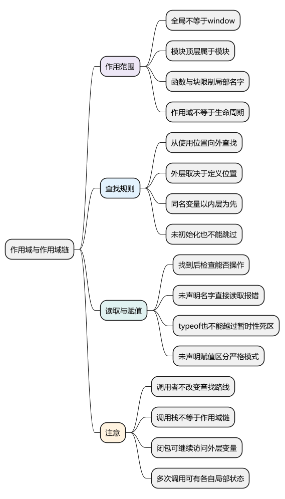
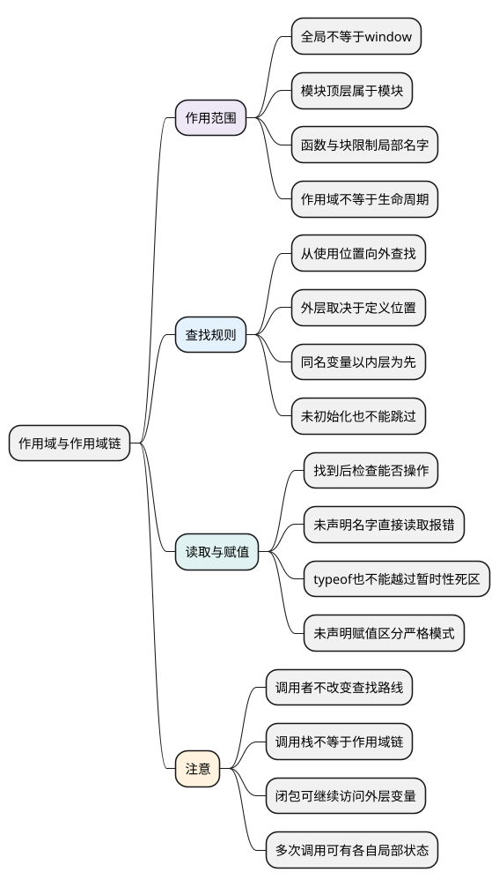

# 作用域与作用域链
<!-- core-mindmap:start -->
[](examples/c04-mindmap.svg)

<details>
<summary>PlantUML 源码</summary>



</details>

<!-- core-mindmap:end -->

**口述总览：** 作用域决定代码能使用哪些名字。函数查找变量时，先看自己内部，再沿着定义位置的外层一层层找；找到同名变量就停下，不会因为换了调用者而改变路线。分析时还要区分两件事：到底找到了哪个变量，以及这个变量现在能不能读取或修改。

除单独标明的非严格示例外，各 JavaScript 示例可分别保存为 `.mjs` 文件，用现代 Node.js 执行 `node 文件名.mjs`，不要把多个示例拼在一起运行。ES 模块自动采用严格模式。

建议复习顺序：[var、let、const](02_var、let、const.md) → [函数](03_函数.md) → 本篇 → [执行上下文与调用栈](05_执行上下文与调用栈.md) → [this 指向](06_this指向.md) → [call、apply、bind](07_call、apply、bind.md) → [闭包](08_闭包与函数应用.md)。

<a id="k01"></a>

## 作用域回答的是：这段代码能使用哪些名字

**口述：** 在函数里声明的局部变量，通常只能由这个函数及其内部的代码使用；外面的代码不能直接拿来用。作用域说的就是这种访问范围。这里的名字既包括普通变量，也包括函数参数、函数名、类名等。

先看声明写在哪里，再看使用名字的代码写在哪里。内层代码可以沿外层查找，外层代码不能反过来钻进某个函数，直接读取它的局部变量。

### 全局作用域：最外层可查找的范围

在浏览器经典脚本中，顶层声明可以进入全局作用域。同一页面中的经典脚本能够共享这个范围，但仍要遵守声明和初始化规则。

**全局作用域不等于 window。** window 是浏览器页面提供的全局对象入口；全局作用域则描述名字的访问关系。经典脚本顶层的 var 通常与 window 属性关联，let、const 不会因此成为 window 属性，但仍可属于全局作用域。

不同运行环境提供的全局对象也不同：浏览器页面有 window，Worker 和 Node.js 没有同样的 window。globalThis 提供访问当前环境全局对象的统一入口，也不能把它理解成“所有变量的集合”。

经典脚本顶层声明的完整示例，见 [var、let、const](02_var、let、const.md)。

### 模块作用域：模块顶层有自己的范围

ES 模块的顶层声明属于当前模块，不会仅因写在文件顶层就变成全局变量。其他模块需要通过 export、import 共享这些名字，不能直接读取另一个模块的局部声明。

模块仍可以使用环境提供的全局名字，例如 console。模块隔离的是它自己的顶层声明，并不是切断对全局名字的正常查找。

Node.js 的 CommonJS 文件也会隔离顶层局部声明，不过它使用模块包装函数；不能据此推断“所有 JavaScript 文件的顶层都是全局作用域”。具体模块语法见 [模块化](../05_模块化与浏览器实践/01_模块化.md)。

### 函数作用域和块作用域：在内部继续划分范围

函数参数和函数内部的局部声明供这次调用使用；普通代码块中的 let、const 等声明，又可以限制在对应块内。var 与 let、const 的详细差异在变量篇展开，这里重点看各个名字归属哪里。

<!-- example: c26-scope-boundaries -->
```js
const prefix = 'Hello';
function greet(name) {
  const suffix = '!';
  if (name) {
    const message = `${prefix}, ${name}${suffix}`;
    console.log(message); // Hello, Ada!
  }
  try { console.log(message); }
  catch (error) { console.log(error.name); } // ReferenceError
}
greet('Ada');
console.log(prefix); // Hello
try { console.log(suffix); }
catch (error) { console.log(error.name); } // ReferenceError
```

这个例子按 ES 模块运行：prefix 属于模块；name 是函数参数，suffix 是函数内部的局部变量；message 属于 if 里面的块。

块中的代码可以读到这几层的名字。离开块后不能直接读取 message，函数外不能直接读取 suffix。不是“名字执行过一次就到处可用”，而是使用位置必须能沿外层关系找到它。

也不要把作用域解释成变量的生命周期。作用域讨论哪里可以访问；变量何时不再被需要、相关内存何时能够回收，是另外的问题。后面的闭包会把这个区别表现得更明显。

<a id="k02"></a>

## 函数到哪里查找变量：看定义位置

**口述：** 函数先找自己内部的名字，没有就到定义它的外层继续找。函数传给别人、由别人调用，都不会让调用者的局部变量自动变成它的外层变量。

这种按代码定义位置确定查找关系的规则，叫**词法作用域**。“词法”在这里先理解成看代码写在哪里；不要把它和运行时谁调用谁混为一谈。

<!-- example: c02-lexical-lookup -->
```js
const label = 'outer';
function read() { return label; }
function caller() {
  const label = 'caller';
  return read();
}
console.log(caller()); // outer
```

read 定义在模块顶层，和 caller 是并列关系。read 内部没有 label，就到它定义位置的外层找到 outer；caller 里的 label 不在这条查找路径上。

```text
调用顺序：模块顶层 → caller → read
变量查找：read 内部 → 定义它的模块范围
```

**作用域链**就是这条从当前范围到外层范围的查找路径。它可以经过多层函数或代码块，直到全局范围；沿整条路径都找不到时，再按当前操作决定结果。

这里确定的是“到哪里找”，不是提前把变量的值复制一份。函数稍后执行时，读取的是找到的那份变量当时的值。外层值发生合法修改，之后读取就会看到修改后的值。

把 read 当作回调传入 caller，也遵守同一条规则。call、apply、bind 改变普通函数的 this 时，同样不会把调用者的局部变量接到它的外层查找路径上。

上述分析面向普通声明和表达式创建的函数。`new Function` 从字符串创建函数时不捕获创建位置的局部变量，是另有规则的动态构造方式，见 [函数](03_函数.md)。

<a id="k03"></a>

## 内层同名变量会挡住外层名字

**口述：** 从内向外找名字，找到第一份同名变量就停下。内外层各声明一份同名变量时，内层代码优先使用自己这份，这叫**遮蔽**。

<!-- example: c02-shadowing -->
```js
const message = 'outside';
{
  const message = 'inside';
  console.log(message); // inside
}
console.log(message); // outside
```

这里有两份不同的 message。块内声明没有修改外层变量；块外仍读到 outside。判断是否是同一份变量，不能只看名字拼写，还要看声明属于哪个范围。

### 内层还没初始化，也不能跳过它

进入有 let、const 声明的范围后，内层同名变量就会影响查找。即使还没有执行完它的初始化，也不能绕过去读取外层变量。

例如，把上面块内的 console.log 移到内层 const 声明之前，读取就会抛出 ReferenceError，而不是得到 outside。原因是已经找到了内层 message，但它尚未初始化。

这段初始化前不能访问的阶段称为**暂时性死区**，英文是 Temporal Dead Zone，简称 TDZ。详细的初始化顺序、声明右侧读取自身等情况，见 [变量篇的暂时性死区](02_var、let、const.md#k03)。

所以查找时要分清：“这一层没有这个名字”才继续向外；“这一层有这个名字，但现在不能访问”会直接报错。

<a id="k04"></a>

## 读取与赋值：先找名字，再决定能否操作

**口述：** 读取和给已有变量赋值，都先沿作用域链找名字。找到后，读取要检查是否已初始化，赋值还要检查是否允许修改；整条链都没找到时，读取和赋值的结果需要分开说。

### 找到哪个变量，就读取或修改哪一份

没有局部同名声明时，函数可以修改外层允许重新赋值的变量；有局部同名声明时，修改的是内层变量。

<!-- example: c26-assignment-target -->
```js
let count = 1;
function increaseOuter() {
  count += 1;
}
function increaseLocal() {
  let count = 10;
  count += 1;
  console.log(count); // 11
}
increaseOuter();
console.log(count); // 2
increaseLocal();
console.log(count); // 2
```

increaseOuter 没有自己的 count，所以找到并修改模块里的 count。increaseLocal 有自己的 count，赋值就停在这一层，外层值不会跟着变化。

如果找到的是 const，重新赋值会抛出 TypeError；如果找到的是尚未初始化的 let、const，读取或赋值都会抛出 ReferenceError。不会因为这一层不允许操作，就继续寻找外层可修改的同名变量。

### 完全找不到名字：直接读取会报错

<!-- example: c26-unresolved-read -->
```js
try { console.log(__c26_missing_read_20261015__); }
catch (error) { console.log(error.name); } // ReferenceError
console.log(typeof __c26_missing_read_20261015__); // undefined
```

直接读取不存在的变量名，会抛出 ReferenceError，严格与非严格模式都一样。

`typeof 未声明名字` 是一个例外，会返回字符串 `'undefined'`。但它不表示名字存在，更不能绕过暂时性死区：如果已经找到同名变量，只是还没有初始化，typeof 仍会报错。

还要区分变量查找和属性读取：`object.missing` 在 object 已经存在、只是没有这个属性时，通常得到 undefined；直接写一个不存在的变量名则是另一回事。

### 完全找不到名字：严格模式赋值也会报错

下面仍按 `.mjs` 模块独立运行：

<!-- example: c26-unresolved-write -->
```js
try { __c26_missing_write_20261015__ = 7; }
catch (error) { console.log(error.name); } // ReferenceError
console.log(Object.hasOwn(globalThis, '__c26_missing_write_20261015__')); // false
```

模块自动采用严格模式，所以给未声明名字赋值会直接抛出 ReferenceError，不会替你补上声明。

### 非严格模式下，可能创建全局对象属性

旧式非严格代码给未声明名字赋值，可能在全局对象上创建同名属性。它不是正常的变量声明，不应依靠这种方式共享数据；遗漏声明还可能意外污染全局。

这个示例专门保存为 `c26-sloppy-write.cjs`，用 `node c26-sloppy-write.cjs` 运行。文件不要加 `'use strict'`，也不要改成 `.mjs`。它先检查示例名未被占用，结束时删除自己创建的属性。

<!-- example: c26-sloppy-write -->
```js
const propertyName = '__c26_sloppy_write_20261015__';
if (propertyName in globalThis) {
  throw new Error('示例名称已存在，请换一个全新进程运行');
}
try {
  __c26_sloppy_write_20261015__ = 7;
  console.log(globalThis[propertyName]); // 7
  console.log(Object.hasOwn(globalThis, propertyName)); // true
} finally {
  delete globalThis[propertyName];
}
console.log(Object.hasOwn(globalThis, propertyName)); // false
```

CommonJS 文件自身的顶层 const 仍属于模块局部范围；这里出现全局属性，是非严格代码给未声明名字赋值造成的，不能推导成“CommonJS 顶层声明都会成为全局属性”。

这里用“可能”，是因为是否能成功创建属性还受全局对象的属性规则等条件影响。正常工程代码应明确声明变量，并使用模块传递需要共享的数据。

## 与调用栈和闭包的联系：分清查找关系与执行顺序

**口述：** 作用域链说明变量去哪里找，调用栈说明当前有哪些调用尚未结束、返回后继续谁。两者有关联，但回答的是不同问题。

回到前面的 caller 和 read：caller 调用 read 时，caller 确实还在调用栈上，但它的局部 label 不会因此进入 read 的查找路径。把作用域链说成“当前执行上下文的集合”，就容易在这里判断错。

规范用**环境记录**描述一个范围中的名字，以及读取、修改这些名字的规则；查找还会沿外层关联继续。执行上下文会使用这些环境来执行代码，但作用域链并不是把调用栈里的执行上下文依次串起来。

外层函数返回后，它的调用会退出调用栈。如果它创建的内部函数仍被保存，内部函数以后仍可能访问原来那次调用的局部变量。这就是理解闭包的起点，不需要让外层调用一直留在栈上。

同一个外层函数调用两次，通常会产生两份局部变量。两次创建的内部函数可以遵守同一条词法规则，却各自访问不同调用留下的变量。不能把“定义位置一样”理解成“所有调用共享一份局部状态”。

调用如何开始、暂停和返回，继续看 [执行上下文与调用栈](05_执行上下文与调用栈.md)；返回后的变量访问、多个函数是否共享状态，继续看 [闭包](08_闭包与函数应用.md)。

<a id="summary"></a>

## 分析一段代码时，按这个顺序判断

1. **先确定环境。** 这是浏览器经典脚本、ES 模块，还是 CommonJS？不要把“文件顶层”直接当成“全局”。
2. **找使用位置。** 当前要读取或修改哪个名字，这行代码位于哪个函数或块内？
3. **沿定义关系向外找。** 当前范围没有才继续向外；调用者是谁不改变这条路径。
4. **找到后检查状态。** 变量是否已初始化，当前操作是否允许？内层受限制时不能改找外层。
5. **始终找不到时区分操作。** 直接读取报错；typeof 有未声明名字的例外；赋值还要区分严格与非严格模式。

口述时可以收成一句：先看名字属于哪里，再沿函数定义位置向外找；找到就检查能否操作，找不到再按读取、typeof 或赋值分别判断。

<a id="interview"></a>

## 试题与答案

<a id="c04-01"></a>

### C04-01 [P0·原理] 函数查变量为什么不看谁调用它？

**回答：** 函数先查自己内部，再沿定义位置的外层范围查找，这就是词法作用域。调用者即使有同名变量，也不会自动进入这条路径。调用栈说明谁调用谁，作用域链说明到哪里找变量；把函数传给其他代码调用，并不会改变它原来的外层关系。

**用例说明：** 本文的 read 定义在模块顶层，因此读取模块里的 label。caller 只是调用了它，caller 自己的 label 对 read 不可见。

<a id="c04-02"></a>

### C04-02 [P0·基础] 全局作用域就是 window 吗？

**回答：** 不是。全局作用域描述最外层名字的访问范围，window 是浏览器页面提供的全局对象入口。经典脚本顶层 var 通常与 window 属性关联，let、const 不会因此成为 window 属性，但仍可处于全局作用域。ES 模块的顶层声明属于模块，Node.js、Worker 等环境也不能照搬页面的 window 规则。

**补充：** globalThis 是访问当前环境全局对象的统一入口，也不等于所有变量组成的集合。回答全局变量问题前，应先说清运行环境和脚本类型。

<a id="c04-03"></a>

### C04-03 [P0·原理] 读取和赋值时找不到变量，分别会怎样？

**回答：** 沿整条作用域链都找不到名字时，直接读取会抛出 ReferenceError；typeof 对未声明名字会返回字符串 `'undefined'`。赋值则需要区分模式：严格模式抛出 ReferenceError，非严格模式可能在全局对象上创建属性。工程代码应明确声明，不能依赖漏写声明后的行为。

**补充：** 这些结论针对真正没有找到名字的情况。如果已找到变量，但它尚未初始化，读取、typeof 和赋值都会受到暂时性死区限制，不属于“未声明”的例外。

<a id="c04-04"></a>

### C04-04 [P0·原理] 内层同名变量尚未初始化，会继续读外层吗？

**回答：** 不会。查找已经找到了内层变量，就不会跳过它继续寻找外层同名变量。内层 let、const 尚未初始化时，读取会抛出 ReferenceError，typeof 也不能绕过。只有当前层没有这个名字，才继续沿外层查找。

**用例说明：** 把本文块内读取 message 的语句移到内层 const 初始化之前，会报错，不会读到外层的 outside。

参考：[MDN：作用域](https://developer.mozilla.org/zh-CN/docs/Glossary/Scope)、[MDN：全局对象](https://developer.mozilla.org/zh-CN/docs/Glossary/Global_object)、[MDN：严格模式](https://developer.mozilla.org/zh-CN/docs/Web/JavaScript/Reference/Strict_mode)、[MDN：typeof](https://developer.mozilla.org/zh-CN/docs/Web/JavaScript/Reference/Operators/typeof)。
