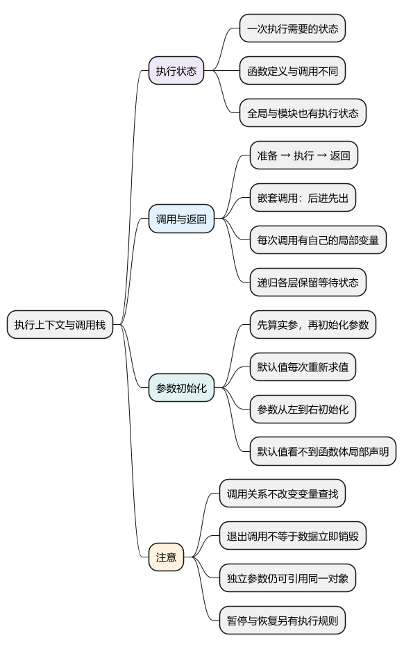
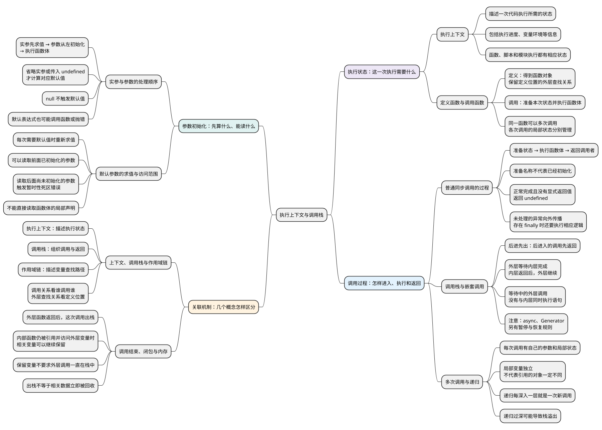

# 执行上下文与调用栈

<!-- core-mindmap:start -->
[](examples/c05-mindmap.svg)

<details>
<summary>PlantUML 源码</summary>



</details>

<!-- core-mindmap:end -->

**口述总览：** 代码执行时，需要保存当前执行到哪里、这次使用哪些变量，以及结束后回到哪里继续。这些运行状态用执行上下文描述。普通同步函数每调用一次，就有一次独立的执行过程；调用栈负责组织这些调用的进入和退出。它回答“现在执行谁、结束后继续谁”，变量到哪里查找则由作用域链决定。

**记忆线：** 一次执行的状态 → 准备、执行、返回 → 参数从左初始化 → 区分调用、查找和内存。先记“状态、调用、参数、关联”四条主线；上下文记状态，调用栈排调用，作用域链查变量。

本篇归纳 **9 个核心知识点**，导图与[知识点归纳及自查](#self-check)按同一顺序对应。先尝试口述，再用每点末尾的记忆提示核对；[试题与答案](#interview)单独用于分级练习。

本篇只沿着执行顺序理解这些概念。变量声明和初始化规则见[变量声明](02_var、let、const.md)，查找外层变量见[作用域与作用域链](04_作用域与作用域链.md)。各 JavaScript 示例可在现代 Node.js ES 模块中独立运行。

<a id="k01"></a>

## 执行上下文是什么：保存一次执行所需的状态

**口述：** 同一段代码可能执行很多次，每次接收的参数、局部变量和执行进度都可能不同。引擎需要区分“这一次正在执行什么”，执行上下文就是描述这些状态的模型。它不只是局部变量列表，也不只用于函数；全局脚本和模块的执行同样需要相应状态。

先想一个普通函数正在工作时需要知道的事情：

- 当前运行哪段代码，暂停调用者后应从哪里继续。
- 这次调用收到哪些参数，局部变量属于哪一次调用。
- 当前使用哪个变量环境，找不到名称时沿哪条外层关系继续找。
- 执行的是哪个脚本或模块，以及适用的相关执行规则。

规范用**执行上下文**组织这些信息，用**环境记录**管理变量名与值之间的关联，以及能否读取、修改等规则。环境记录之间的外层关联参与变量查找。可以先理解用途，不必把这些术语想象成业务代码可以直接拿到的普通对象。

也不要把执行上下文理解成“创建一个对象，把所有局部变量复制进去”。这是解释语言行为的模型；引擎如何分配内存、保存状态、优化函数，有具体实现差异。

### 定义函数与调用函数发生的事情不同

定义函数时，程序获得一个可以调用的函数对象，并保留它所需的定义位置关系；仅仅保存或传递这个函数，不会因此执行它的函数体。

调用函数时，才开始本次执行：准备参数和局部环境，执行函数体，并把返回结果交还给调用者。一个函数对象可以被调用很多次，各次调用的局部状态需要区分开。

<!-- example: c27-definition-vs-call -->
```js
function greet(name) {
  console.log('body', name);
  return `hello ${name}`;
}
const saved = greet;
console.log('saved');
console.log(saved('A'));
console.log(saved('B'));
// saved
// body A
// hello A
// body B
// hello B
```

保存函数时没有打印 body。之后两次调用使用同一个函数对象，但分别接收 A 和 B，得到各自的返回结果。普通函数声明通常会在相应正文执行前完成准备；这一点不等于提前执行函数体。

函数会沿定义它的外层关系查变量，不会在调用时改为沿调用者的局部环境查找，具体见[定义位置决定查找路径](04_作用域与作用域链.md#k02)。

<a id="k02"></a>

## 一次普通调用怎样完成：准备、执行、返回

**口述：** 可以把一次普通同步调用分成三个教学步骤：先准备这次调用使用的状态，再执行函数体，最后把结果交给调用者。准备不意味着所有变量都已经有可读取的值；返回也不意味着相关数据立刻全部从内存中消失。

这里的三个步骤是便于推导代码的流程，不是要求死记一套规范章节名称。完整调用还包括确定目标函数、计算实参等细节，默认参数表达式也可能执行其他函数。

### 进入函数体之前，先让本次调用有自己的环境

调用者先计算要传入的实参表达式，随后被调用函数才能据此初始化参数。函数体开始执行前，还要按声明种类完成必要准备，使后面的语句能按语言规则访问名称。

“准备了名称”与“已经能读取它”是两回事：var 通常已经初始化为 undefined；let、const 仍需等执行到相应声明并完成初始化；普通函数声明又有自己的初始化规则。完整差异见[声明、初始化与赋值](02_var、let、const.md#k01)。

不能由此总结成“所有函数的 this 都在统一的准备阶段绑定完成”。普通调用、箭头函数和派生类构造器有不同规则；例如箭头函数沿用外层 this，派生类构造器通常要成功调用父类构造器后才能使用 this。具体规则见[this 指向](06_this指向.md)。

### 执行语句时，遇到另一次同步调用就先等它结束

执行函数体时，会读取变量、计算表达式、修改数据，也可能调用其他函数。遇到嵌套的同步调用，当前函数要等待被调用函数完成，才能继续依赖其结果的计算。

例如，为局部变量初始化时需要另一个函数的返回值，就必须先拿到这个值，当前声明才能完成。调用栈帮助我们记录这些尚未完成的调用，以及恢复执行的顺序。

### 正常返回后，调用者继续完成原来的表达式

return 先计算后面的表达式，再把结果作为本次调用的值交给调用者。如果表达式中还有函数调用，要先完成它。没有显式返回值的普通函数，正常完成时返回 undefined。

如果抛出的异常没有在当前调用中被处理，本次调用会异常结束，错误沿调用关系向外传播，直到被捕获或继续交给宿主处理。存在 finally 时，还需要按 finally 的规则执行，不能只凭看见 return 就认定已经离开函数。

下面主要推导正常完成的同步调用。生成器和 async 函数还可能暂停、恢复，不能把它们一概理解成“进入后一直占着栈直到最终结果产生”；边界见[迭代器与生成器](../06_选读扩展/01_迭代器与生成器.md)、[async 与 await](../04_异步机制/03_async与await.md)。

<a id="k03"></a>

## 调用栈怎样组织嵌套调用

**口述：** 一个同步函数调用另一个函数时，自己通常还没结束。程序先执行后进入的调用；它返回后，再恢复上一层。把这些尚未结束的调用按顺序叠放起来，就是理解调用栈的方式，最后进入的调用先退出。

用一段代码逐步看进入和返回过程：

<!-- example: c02-call-stack -->
```js
function inner(value) {
  console.log('inner', value);
  return value + 1;
}
function outer() {
  console.log('outer start');
  const result = inner(2);
  console.log('outer end');
  return result;
}
console.log(outer());
// outer start
// inner 2
// outer end
// 3
```

从顶层开始看：

1. 顶层要把外层函数的结果交给 console.log，因此先调用外层函数。此时还没有可以打印的最终结果。
2. 外层函数先打印 outer start，随后需要调用内层函数，才能完成 result 的初始化。外层调用暂时等待。
3. 内层调用接收参数 2，打印 inner 2，再计算并返回 3。这次内层调用结束。
4. 外层调用从等待处继续，得到 3，完成 result 的初始化，然后打印 outer end 并返回 3。
5. 顶层得到外层调用的结果，最终打印 3。

只画本例的业务函数，省略日志函数等内部调用，可以得到下面的教学示意；右侧是当前正在执行的一层：

```text
顶层
顶层 → 外层调用
顶层 → 外层调用 → 内层调用
顶层 → 外层调用
顶层
```

外层调用在等待时不能丢失自己的执行进度，否则内层返回后就不知道该从哪里继续。调用栈记录的是这种执行与恢复关系；外层尚未结束，不代表它与内层同时执行 JavaScript 语句。

这张图也不是变量查找图。内层函数即使由外层函数调用，也不会自动获得调用者的全部局部变量。变量查找仍要回到函数的定义位置判断。

<a id="k04"></a>

## 同一函数调用多次，为什么局部数据可以独立

**口述：** 函数定义描述要执行哪些操作，每次调用则提供这次操作需要的局部状态。因此，同一个函数调用两次，可以各有自己的参数和局部变量；递归也一样，每深入一层，就是另一次尚未完成的调用。

### 重复调用不会默认沿用上一次的局部变量

<!-- example: c27-independent-calls -->
```js
function accumulate(step) {
  let total = 0;
  total += step;
  return total;
}
console.log(accumulate(3)); // 3
console.log(accumulate(3)); // 3
```

每次进入函数，都会执行自己的局部声明，并把自己的 total 初始化为 0。第二次调用没有继续使用第一次的 total，所以结果仍然是 3。

“局部变量各自独立”不等于“传入的数据自动深拷贝”。两次调用若接收同一个对象，各自的参数仍可能指向同一个对象；读取模块变量或外层变量，也可能访问共享数据。先分清变量属于哪次调用，再判断它引用的对象是否共享。

### 递归调用时，上一层还在等待自己的结果

<!-- example: c27-recursive-calls -->
```js
function sumTo(n) {
  console.log('enter', n);
  if (n === 0) {
    console.log('leave', n, 0);
    return 0;
  }
  const subtotal = sumTo(n - 1);
  const total = n + subtotal;
  console.log('leave', n, total);
  return total;
}
console.log('result', sumTo(2));
// enter 2
// enter 1
// enter 0
// leave 0 0
// leave 1 1
// leave 2 3
// result 3
```

最外层的参数是 2，它等待参数为 1 的那次调用；中间层又等待参数为 0 的调用。三层都来自同一个函数定义，但不会互相覆盖各自的参数。

最内层返回 0 后，中间层才得到自己的 subtotal，并计算出 1；中间层返回后，最外层才计算出 3。这里还说明：声明写在代码里，不代表每层都已经执行到该声明并完成初始化。

普通递归如果持续深入，尚未完成的调用会不断增加，可能超过引擎的调用栈限制。不能假定所有运行环境都能把尾调用优化掉；需要处理很深的数据时，应结合实际环境考虑循环或自行管理待处理项。

<a id="parameters"></a>

## 参数初始化发生在函数体之前

**口述：** 调用者先算出实参，再开始初始化被调用函数的参数。默认参数从左到右处理；只有省略实参或传入 undefined 才计算默认值。函数体尚未开始，也可能已经执行默认值表达式，甚至在这个阶段抛错。

### 先计算实参，再处理缺省参数，最后进入函数体

<!-- example: c27-argument-order -->
```js
function mark(label, value) {
  console.log(label);
  return value;
}
function run(first, second = mark('default second', 2)) {
  console.log('body', first, second);
}
run(mark('argument', 1));
// argument
// default second
// body 1 2
```

先计算传入的第一个值，所以打印 argument。第二个实参被省略，初始化第二个参数时才计算其默认表达式。参数准备完成后，函数体开始执行，最后打印 body 1 2。

默认表达式里也有函数调用。这说明“进入函数体前准备”不等于“这一阶段完全不执行代码”，默认值的副作用和异常都可能发生在函数体之前。

### 默认值每次调用重新求值，参数按从左到右初始化

<!-- example: c02-parameter-initialization -->
```js
let next = 0;
function create(id = ++next, options = {}) { return { id, options }; }
const first = create();
const second = create();
console.log(first.id, second.id, first.options === second.options); // 1 2 false
function valid(a = 1, b = a + 1) { return b; }
function invalid(a = b, b = 1) { return a; }
console.log(valid()); // 2
try { invalid(); }
catch (error) { console.log(error.name); } // ReferenceError
```

两次创建时都需要默认值，因此计数分别增加到 1 和 2，也分别创建新的 options 对象。这里的不共享来自每次重新执行对象表达式；如果默认表达式返回外部已有对象，仍可能共享那个对象。

后面的参数可以读取前面已初始化的参数，所以 valid 返回 2。invalid 初始化第一个参数时，第二个参数的名称已经属于这次参数环境，但尚未初始化，读取它触发 ReferenceError。这仍是[暂时性死区](02_var、let、const.md#k03)规则。

<!-- example: c27-parameter-skip -->
```js
function f(a = b, b = 1) { return [a, b]; }
console.log(JSON.stringify(f(2))); // [2,1]
try { f(undefined, 2); }
catch (error) { console.log(error.name); } // ReferenceError
```

传入第一个参数 2 时，无需计算它的默认表达式，因此不会读取未初始化的第二个参数。反过来，即使调用者传了第二个值 2，也不能绕过从左到右的初始化顺序；初始化第一个参数时，第二个仍不能读取。

### 默认表达式不能直接读取函数体的局部声明

<!-- example: c02-parameter-environment -->
```js
const label = 'outside';
function read(value = label) {
  const label = 'body';
  return value;
}
console.log(read()); // outside
console.log(read(null)); // null
```

默认表达式在函数体开始前计算，函数体内声明的 label 不在它向外查找的路径上，所以第一次调用读取到外部的 outside。第二次传入 null，它是明确提供的值，不触发默认表达式。

这里既有执行顺序，也有查找边界：不能把默认参数机械移动到函数体第一行，再认为行为一定相同。更复杂的参数、arguments 和剩余参数规则见[函数](03_函数.md)。

## 执行上下文、作用域链、闭包和内存分别回答什么

**口述：** 执行上下文描述一次执行所需的状态，调用栈组织正在进行的同步调用，作用域链决定变量到哪里查找。函数结束后，调用顺序可以恢复到外层，但其他函数仍可能继续使用它原来的局部变量。这种访问关系与相关数据何时释放，要分开判断。

复习时可以连续问三个问题：当前执行哪一次调用；这次调用返回后继续谁；当前名称从哪里开始、沿哪些外层环境查找。前两个问题沿调用过程分析，第三个问题沿代码定义位置分析。

### 调用结束，不要求所有相关数据立刻消失

例如外层函数创建了一个内部函数，再把它返回并保存下来。外层调用已经结束，调用者可以继续执行；之后调用这个内部函数，仍可以访问它原来关联的外层变量。这就是[闭包](08_闭包与函数应用.md)要解释的关系。

保留这些变量，不要求外层调用一直停留在调用栈中。反过来，也不能说“执行上下文退出，所以它涉及的数据已经立即物理销毁”。程序还能否通过现有引用使用相关数据、引擎采用怎样的表示与优化，都需要分开考虑。

调用栈在本篇是执行顺序模型，不宜直接等同于“所有基本类型都在栈、所有对象都在堆”的存储口号。数据与引用如何理解见[数据存储与内存模型](../01_数据类型、内建对象与内存管理/21_堆栈内存.md)，对象何时不再被程序使用及垃圾回收原理见[内存与资源生命周期](../01_数据类型、内建对象与内存管理/22_垃圾回收机制、内存泄漏与资源清理.md)。

<a id="summary"></a>

分析执行过程时依次判断：函数是否已经被调用 → 实参与参数如何准备 → 当前执行哪一层 → 等待哪个返回值 → 返回后从哪里继续。遇到变量访问，再单独检查定义位置、初始化状态以及是否仍被其他函数使用。

<a id="self-check"></a>

## 知识点归纳与自查

本节按 9 个知识点回忆和归纳。先用自查问题检查理解，再顺序阅读各点口述与记忆提示；分级试题在后面的独立章节。

### 自查问题

1. **执行上下文是什么？** 它描述哪些运行状态，为什么不能只理解成局部变量的集合？[核对口述](#recall-01)
2. **定义函数与调用函数有什么区别？** 保存或传递函数时，会立即执行函数体吗？[核对口述](#recall-02)
3. **一次普通同步调用经历什么过程？** 准备名称是否代表变量都能读取？没有显式返回值、抛出异常或存在 finally 时怎样处理？[核对口述](#recall-03)
4. **调用栈为什么是后进先出？** 外层调用内层时在做什么，内层返回后外层从哪里继续？[核对口述](#recall-04)
5. **同一函数多次调用，局部变量为什么可以独立？** 引用的对象一定不同吗？递归如何保存每层状态，为什么可能栈溢出？[核对口述](#recall-05)
6. **实参求值、参数初始化、函数体执行，顺序是什么？** 缺省、undefined、null 分别是否触发默认值？[核对口述](#recall-06)
7. **默认参数何时计算，可以访问哪些变量？** 为什么本文 f()、f(2)、f(undefined, 2) 的结果不同？[核对口述](#recall-07)
8. **执行上下文、调用栈、作用域链分别负责什么？** 调用者的局部变量会进入被调用函数的查找路径吗？[核对口述](#recall-08)
9. **外层函数返回后，闭包为什么还能访问局部变量？** 保留变量是否意味着调用仍在栈中？出栈是否代表立即回收？[核对口述](#recall-09)

<a id="recall-01"></a>

### 执行上下文：描述一次代码执行所需的状态

**自查：** 执行上下文是什么？为什么不能只理解成局部变量的集合？

**口述：** 执行上下文是描述一次代码执行状态的模型，包括执行进度、使用的变量环境等信息。它帮助引擎区分不同的执行过程，不只是局部变量的集合。函数、全局脚本和模块的执行都需要相应状态。

**记忆：** 执行上下文描述“这一次执行”的状态。

<a id="recall-02"></a>

### 定义与调用：区分获得函数和开始执行

**自查：** 定义函数与调用函数有什么区别？

**口述：** 定义函数时，程序获得一个可调用的函数对象，并保留它所需的外层查找关系，此时不会执行函数体。调用函数时，才开始本次执行，准备参数和局部环境，再执行函数体。同一个函数对象可以多次调用，每次调用的局部状态需要分别管理。

**记忆：** 定义得到函数，调用开始执行。

<a id="recall-03"></a>

### 普通同步调用：准备状态、执行函数体并返回

**自查：** 一次普通同步调用经历什么过程？

**口述：** 一次普通同步调用，可以按准备、执行、返回三个步骤理解。先准备本次调用的参数和局部环境，再执行函数体，最后把结果交给调用者。准备名称不代表所有变量都已经初始化；正常完成但没有显式返回值时，返回 undefined。

**补充：** 未在当前调用中处理的异常会沿调用关系向外传播；存在 finally 时，还要执行相应的 finally 逻辑，不能一看见 return 就认定已经离开函数。

**记忆：** 先准备，再执行，返回后调用者继续。

<a id="recall-04"></a>

### 调用栈：按后进先出的顺序组织调用与返回

**自查：** 为什么内层函数先返回？外层从哪里继续？

**口述：** 调用栈用于组织尚未结束的同步调用，遵循后进先出的规则。一个函数调用另一个同步函数时，当前调用暂时等待，先执行被调用的函数。内层函数返回后，外层函数从原来的等待位置继续执行。外层尚未结束，不代表它与内层同时执行 JavaScript 语句。

**补充：** 这里描述普通同步调用，async 和 Generator 的暂停、恢复需要结合各自机制分析。

**记忆：** 后进入，先返回；内层结束，外层继续。

<a id="recall-05"></a>

### 多次调用与递归

**口述：** 函数对象保存可重复执行的代码，每次调用都会准备自己的参数和局部环境，因此可以使用不同的局部变量状态；递归的各层调用同样如此。但独立的是各次调用的局部变量，不代表它们引用的对象一定不同。多次调用仍可能读取同一个外层变量，或接收同一个对象。

**补充：** 递归每深入一层，上一层都会等待其返回结果。持续增加尚未完成的调用，可能超过引擎限制而导致调用栈溢出，不能假定运行环境总能进行尾调用优化。

**记忆：** 调用各有状态，对象可能共享；递归太深，可能栈溢出。

<a id="recall-06"></a>

### 实参与参数：先求值，再从左到右初始化

**自查：** 实参、默认参数和函数体按照什么顺序执行？

**口述：** 调用函数时，先计算实参表达式，再从左到右初始化被调用函数的参数，之后才执行函数体。只有省略实参或传入 undefined，才会计算对应的默认值，传入 null 不会触发默认值。默认参数表达式也可能调用函数或抛出异常，所以函数体尚未开始，不代表完全没有执行代码。

**记忆：** 实参先求值，参数从左排，最后执行函数体。

<a id="recall-07"></a>

### 默认参数的求值与访问范围

**口述：** 调用 f() 时先初始化第一个参数，其默认表达式读取尚未初始化的第二个参数，触发 ReferenceError。若调用 f(2)，第一个参数无需计算默认表达式，就不会因该读取而失败。即使调用 f(undefined, 2)，第二个实参已经计算出来，也要等轮到第二个参数时才初始化它，所以仍然报错。

**补充：** 默认参数在每次需要默认值时重新求值，可以读取前面已初始化的参数；默认表达式不能直接读取函数体内的局部声明，不能机械地把它当作移到函数体第一行的赋值语句。

**记忆：** 默认值按需计算，参数从左初始化；函数体局部声明不能提前拿来用。

<a id="recall-08"></a>

### 上下文、调用栈与作用域链

**口述：** 执行上下文描述一次代码执行所需的状态，包括使用的环境及执行进度等；作用域链说明从当前环境向哪些外层环境查找变量；调用栈组织尚未结束的同步调用，决定当前执行谁、返回后继续谁。函数由谁调用会改变调用关系，但不会把变量查找路径改成调用者的局部环境。

**记忆：** 上下文记状态，调用栈排调用，作用域链查变量。

<a id="recall-09"></a>

### 调用结束、闭包与内存

**口述：** 外层函数返回后，这次调用就结束了。如果它创建的内部函数仍被保存、之后还会调用，内部函数仍能访问原来使用的外层变量。保存这些变量，不要求外层调用一直留在调用栈上。调用结束与相关变量是否仍被使用是两件事，也不能据此断言数据已经立即从内存中销毁。

**记忆：** 调用可以结束，闭包引用的变量仍可能保留。

<a id="interview"></a>

## 试题与答案

<a id="c05-04"></a>

### C05-04 [P0·原理] 函数定义一次、调用多次，为什么局部变量可以各自独立？

**回答：** 函数对象保存可重复执行的代码，每次调用都会准备自己的参数和局部环境，因此可以使用不同的局部变量状态；递归的各层调用同样如此。但独立的是各次调用的局部变量，不代表它们引用的对象一定不同。多次调用仍可能读取同一个外层变量，或接收同一个对象。

**补充：** 递归每深入一层，上一层都会等待其返回结果。持续增加尚未完成的调用，可能超过引擎限制而导致调用栈溢出，不能假定运行环境总能进行尾调用优化。

<a id="c05-02"></a>

### C05-02 [P1·原理] function f(a=b,b=1){}为什么可能抛错？

**回答：** 调用 f() 时先初始化第一个参数，其默认表达式读取尚未初始化的第二个参数，触发 ReferenceError。若调用 f(2)，第一个参数无需计算默认表达式，就不会因该读取而失败。即使调用 f(undefined, 2)，第二个实参已经计算出来，也要等轮到第二个参数时才初始化它，所以仍然报错。

**补充：** 默认参数在每次需要默认值时重新求值，可以读取前面已初始化的参数；默认表达式不能直接读取函数体内的局部声明，不能机械地把它当作移到函数体第一行的赋值语句。

<a id="c05-03"></a>

### C05-03 [P0·原理] 执行上下文、作用域链和调用栈有什么区别？

**回答：** 执行上下文描述一次代码执行所需的状态，包括使用的环境及执行进度等；作用域链说明从当前环境向哪些外层环境查找变量；调用栈组织尚未结束的同步调用，决定当前执行谁、返回后继续谁。函数由谁调用会改变调用关系，但不会把变量查找路径改成调用者的局部环境。

<a id="c05-01"></a>

### C05-01 [P1·原理] 函数返回后执行上下文退出，闭包为何还能访问变量？

**回答：** 外层函数返回后，这次调用就结束了。如果它创建的内部函数仍被保存、之后还会调用，内部函数仍能访问原来使用的外层变量。保存这些变量，不要求外层调用一直留在调用栈上。调用结束与相关变量是否仍被使用是两件事，也不能据此断言数据已经立即从内存中销毁。

参考：[MDN：执行模型](https://developer.mozilla.org/zh-CN/docs/Web/JavaScript/Reference/Execution_model)、[MDN：默认参数](https://developer.mozilla.org/zh-CN/docs/Web/JavaScript/Reference/Functions/Default_parameters)、[MDN：闭包](https://developer.mozilla.org/zh-CN/docs/Web/JavaScript/Guide/Closures)。
