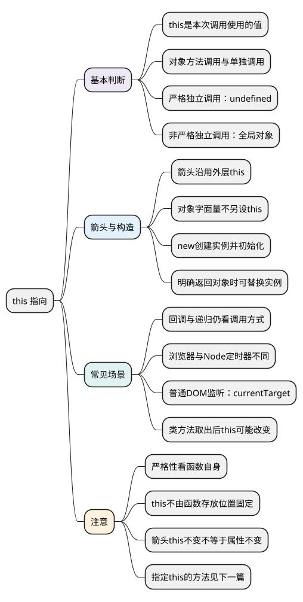

# this 指向

<!-- core-mindmap:start -->
[](examples/c06-mindmap.svg)

<details>
<summary>PlantUML 源码</summary>



</details>

<!-- core-mindmap:end -->

**口述总览：** this 的指向主要看函数类型和调用方式。普通函数作为对象的方法调用时，this 通常指向这个对象；单独调用时，严格模式下是 undefined，非严格模式下是全局对象。使用 new 调用普通构造函数时，this 指向新创建的实例。箭头函数没有自己的 this，会沿用定义位置外层的 this。函数交给定时器或事件监听执行时，还要看运行环境和具体调用规则。

本篇先回答“this 是谁，为什么是它”。需要主动指定 this 或比较三个调用方法时，接着读[call、apply、bind](07_call、apply、bind.md)。

除标注浏览器或 Node.js 专用的示例外，代码块分别在现代 Node.js ES 模块中运行。模块中的普通函数默认处于严格模式。

## this 是什么：函数执行时使用的一个值

**口述：** this 是函数执行时可以使用的一个特殊值，常用来访问当前这次调用关联的对象。它不固定指向函数自身，也不只由函数写在哪里决定；同一个普通函数，换一种调用方式，this 就可能不同。

例如执行 user.say() 时，say 中的 this 通常是 user。技术资料有时称 user 为这次调用的“接收者”，理解为“这次函数用哪个对象作为 this”即可。

this 也不保证一定是对象：严格模式下，它可以是 undefined、null 或数字等原始值。判断时先看函数种类和调用写法，再确定具体结果。

<a id="k01"></a>

## 普通调用与方法调用：看本次调用的写法

**口述：** 普通函数作为对象的方法调用时，this 通常指向这个对象。如果把方法取出来，再作为普通函数单独调用，就不会自动记住原来的对象，需要按独立调用的规则判断。

<!-- example: c04-receiver -->
```js
function read() { return this?.name; }
const first = { name: 'A', read };
const second = { name: 'B', read: first.read };
const detached = first.read;

console.log(first.read(), second.read(), detached()); // A B undefined
console.log(first.read === second.read); // true
```

两个对象保存的是同一个函数，但 first.read() 与 second.read() 分别通过不同对象调用，所以结果不同。detached() 是独立调用，在本例的严格模式下 this 为 undefined，代码中的可选链让读取结果也是 undefined。

window.fn() 也是通过对象属性调用函数。因此不能用这个例子证明“所有普通函数的 this 都是 window”。

### 严格模式：独立调用与显式传值怎样处理

- 严格普通函数独立调用时，this 为 undefined；通过 call 等方式提供的 null、数字等值也原样保留。
- 非严格普通函数收到 null 或 undefined 作为 this 时，会使用其所属环境的全局对象；其他原始值会转换为对应的包装对象。
- 浏览器页面的全局对象通常通过 window 访问；不能把所有 JavaScript 环境都称为 window。

<!-- example: c04-strict-receiver -->
```js
function strictRead() { return this; }
const legacyRead = new Function('return this');

console.log(strictRead()); // undefined
console.log(strictRead.call(null)); // null
console.log(strictRead.call(3)); // 3
console.log(legacyRead() === globalThis); // true
console.log(legacyRead.call(null) === globalThis); // true

const wrapped = legacyRead.call(3);
console.log(typeof wrapped, wrapped.valueOf()); // object 3
```

strictRead 定义在 ES 模块中，所以是严格函数。Function 创建的字符串函数没有声明严格模式，用于演示非严格行为；示例中的 call 用于提供这次调用的 this，完整用法见[call、apply、bind 篇](07_call、apply、bind.md#k01)。

**注意：** 严格性看函数自身。严格代码调用一个已经存在的非严格函数，不会让那个函数自动变成严格函数。

### 立即执行函数：仍然按调用方式判断

<!-- example: c04-iife -->
```js
(function () {
  'use strict';
  console.log(this); // undefined
})();
```

这只是创建函数后立即独立调用，所以按严格的独立调用处理。非严格普通函数会使用全局对象；立即执行的是箭头函数时，则使用外层 this。不能只凭“立即执行”就判断是 window。

<a id="k03"></a>

## 箭头函数：沿用定义位置外层的 this

**口述：** 箭头函数不建立自己的 this，而是使用定义它的外层 this。对象字面量的花括号不会额外提供 this，call、apply、bind 也不能替换箭头使用的外层 this。

<!-- example: c04-arrow-environment -->
```js
function make() {
  return {
    value: 'object',
    arrow: () => this.value,
    method() { return this.value; }
  };
}
const outer = { value: 'outer' };
const item = make.call(outer);

console.log(item.arrow(), item.method()); // outer object
console.log(item.arrow.call({ value: 'other' })); // outer
outer.value = 'changed';
console.log(item.arrow()); // changed
```

按顺序看：

1. make.call(outer) 让这次 make 调用的 this 是 outer。
2. 箭头创建在 make 内部，因此使用这次调用的外层 this。
3. item.method() 是普通方法调用，this 使用 item。
4. 对箭头使用 call，不能把 outer 换成另一个对象。
5. outer 的属性仍然能修改，所以箭头后来读取到 changed。

“箭头 this 不变”不代表对象内容不变。不同外层调用创建的箭头，也可以使用不同的外层 this。箭头的参数和构造限制见[函数篇](03_函数.md#k04)。

## 回调、递归和浏览器场景：看谁怎样执行函数

**口述：** 回调只是把函数交给其他代码使用；this 的结果取决于对方怎样调用它。递归也没有额外的 this 规则。浏览器和 Node.js 提供的现成接口（通常称为 API）可能采用不同的调用方式，因此示例必须注明环境。

### 普通回调与 `arguments[0]()` 的区别

<!-- example: c04-callback-forms -->
```js
function readThis() { return this; }
function invoke(callback) {
  console.log(callback() === undefined); // true
  console.log(arguments[0]() === arguments); // true

  const holder = { callback };
  console.log(holder.callback() === holder); // true
}
invoke(readThis);
```

callback() 是独立调用；`arguments[0]()` 是通过 arguments 对象的第 0 个属性调用；holder.callback() 是通过 holder 调用。因此同一个普通函数会得到不同的 this。

如果传入的是箭头函数或 bind 返回的函数，则继续按它们自己的规则判断，不会因为放进 arguments 就改用这个对象。

### 递归：再次调用也要看调用写法

<!-- example: c04-recursion -->
```js
function repeat(count) {
  console.log(this?.name ?? '没有对象');
  if (count > 0) repeat(count - 1);
}
const owner = { name: 'A', repeat };
owner.repeat(1);
// A
// 没有对象
```

第一次通过 owner.repeat(1) 调用，this 是 owner；内部写 repeat(0)，已经变成独立调用。当前是严格模式，所以第二次的 this 为 undefined。

若业务希望继续通过同一个对象调用，可以使用 this.repeat(...) 等明确写法。是否递归、递归几次，都不能代替对调用方式的判断。

### 定时器：浏览器与 Node.js 要分别说明

下面在浏览器页面运行：

<!-- example: c04-browser-timer -->
```js
// browser-only
window.setTimeout(function () {
  'use strict';
  console.log(this === window); // true
}, 0);
```

浏览器页面的 setTimeout、setInterval 执行普通、未绑定的函数回调时，会提供 window 作为 this。因此即使回调自身是严格函数，this 也不会自动变成 undefined。

下面仅在 Node.js 运行：

<!-- example: c04-node-timer -->
```js
// node-only
const timer = setTimeout(function () {
  'use strict';
  console.log(this === timer); // true
}, 0);
```

Node.js 普通定时器回调通常使用返回的 Timeout 对象作为 this。箭头回调仍然沿用外层 this，bind 后的回调则在普通调用时使用绑定值。

**注意：** setTimeout(fn, 0) 是把函数交给定时器稍后执行，不等于现在直接写 fn()。业务需要某个对象时，可以用箭头调用该对象的方法，或保存一次 bind 的结果。

### 页面元素事件（DOM 事件）：this 与 currentTarget、target

下面在浏览器页面运行：

<!-- example: c04-dom-listener -->
```js
// browser-only
const button = document.createElement('button');
const icon = document.createElement('span');
button.append(icon);
document.body.append(button);

button.addEventListener('click', function (event) {
  console.log(this === button); // true
  console.log(this === event.currentTarget); // true
  console.log(event.target === icon); // true
});
icon.click();
button.remove();
```

监听注册在 button，实际点击目标是内部 icon：

- currentTarget 表示当前正在执行监听的对象，这里是 button。
- target 表示事件目标，这里是 icon。
- 普通、未绑定的函数监听器中，this 与执行期间的 currentTarget 一致。

button.onclick = function (...) {} 的普通函数写法也按相应事件调用规则处理。箭头监听器使用外层 this，bind 后的函数使用指定的 this，不能再直接等同于 currentTarget。

### class：普通方法随调用变化，箭头字段保留实例 this

<!-- example: c04-class-methods -->
```js
class User {
  constructor(name) { this.name = name; }
  read() { return this?.name; }
  arrow = () => this.name;
  static who() { return this; }
}
class Admin extends User {}

const user = new User('Alice');
const read = user.read;
const arrow = user.arrow;
console.log(user.read(), read(), arrow()); // Alice undefined Alice
console.log(User.who() === User, Admin.who() === Admin); // true true

const who = User.who;
console.log(who()); // undefined
```

类方法默认严格。普通实例方法取出后独立调用，不会永久记住 user；实例箭头字段使用初始化时的实例 this，所以取出后仍读取 Alice。

静态方法也看本次通过谁调用：User.who() 使用 User，继承后通过 Admin.who() 调用则使用 Admin。普通静态方法也可以用 call 指定其他对象，涉及私有字段时还有额外限制，见[class 篇](../03_对象机制/05_class与私有成员.md)。

原型上的普通方法同样按调用方式判断。方法不是因为“写在原型上”，就固定使用某个实例作为 this。

<a id="k04"></a>

## new 调用：this 使用新创建的实例

**口述：** 使用 new 调用普通构造函数时，会创建一个新实例，构造函数中的 this 就指向这个新实例。调用通常返回该实例；如果构造函数明确返回另一个对象，则采用那个对象。

这里关注构造调用中的 this；完整创建过程与实现边界见[构造函数与 new](../03_对象机制/02_构造函数与new.md)。

<!-- example: c04-constructor-return -->
```js
function User(name) { this.name = name; return 7; }
function Replacement() { this.value = 1; return { value: 9 }; }

const user = new User('Alice');
console.log(user.name); // Alice
console.log(Object.getPrototypeOf(user) === User.prototype); // true
console.log(new Replacement().value); // 9
```

new User 的数字返回值被忽略。new Replacement 则返回 value 为 9 的另一个对象，原先 this 对象上的 value = 1 不是最终结果。

<a id="k05"></a>

## 综合判断：先确定函数类型，再看本次调用

**口述：** 先区分普通函数和箭头函数，再看它是作为对象方法调用、单独调用，还是用于创建实例。如果函数交给其他代码执行，还要确认对方怎样调用它。使用 bind 固定过 this 的函数，需要继续应用绑定函数的规则。

- 普通方法调用：看本次通过哪个对象调用。
- 独立调用：看函数自身是否严格。
- 箭头函数：到定义位置的外层找 this。
- new 调用普通构造函数：先使用新实例，再看构造函数是否明确返回其他对象。
- 定时器、事件和其他回调：确认运行环境与调用形式。
- call、apply、bind：主动提供 this，详细区别和特殊情况见[call、apply、bind 篇](07_call、apply、bind.md)。

<a id="k06"></a>

构造过程与受限手写实现已独立放在[构造函数与 new](../03_对象机制/02_构造函数与new.md#c10-01)。

<a id="summary"></a>

本篇的重点是根据调用方式解释结果。能说明方法取出后为什么变化、箭头为什么沿用外层 this，以及构造调用如何初始化实例，就能把常见场景串起来。

<a id="k02"></a>

继续阅读：[call、apply、bind：指定 this、传参和调用时机](07_call、apply、bind.md#k01)。其中的[绑定函数与 new](07_call、apply、bind.md#k02)说明构造调用的特殊情况。

<a id="interview"></a>

## 试题与答案

<a id="c06-01"></a>

### C06-01 [P0·原理] this由定义位置还是调用位置决定？

**回答：** 先区分函数类型。普通函数主要看调用方式：作为对象方法调用时通常指向该对象，单独调用时再区分严格模式。箭头函数沿用定义位置外层的 this。bind 后的函数普通调用时使用指定的 this，new 调用普通构造函数则使用新创建的实例。所以不能只用定义位置或“谁调用就是谁”概括全部情况。

<a id="c06-03"></a>

### C06-03 [P0·原理] 对象方法传给回调后为什么this变了？

**回答：** 传出去的是函数本身，不会自动记住原来的对象。对方单独调用、作为另一个对象的方法调用，或交给浏览器执行，都可能得到不同的 this。可以保存一次 bind 结果，或用箭头明确调用原对象的方法；事件注册和移除要复用同一个函数。

### 原合篇题目的新位置

<a id="c06-02"></a>

- [call、apply、bind 怎么比较？](07_call、apply、bind.md#c07-01)

<a id="c06-05"></a>

- [bind 教学实现如何区分普通调用和 new？](07_call、apply、bind.md#c07-02)

<a id="c06-06"></a>

- [不借 call/apply，怎样演示“指定对象调用”？](07_call、apply、bind.md#c07-03)

参考：[MDN：this](https://developer.mozilla.org/zh-CN/docs/Web/JavaScript/Reference/Operators/this)、[MDN：new](https://developer.mozilla.org/zh-CN/docs/Web/JavaScript/Reference/Operators/new)。
