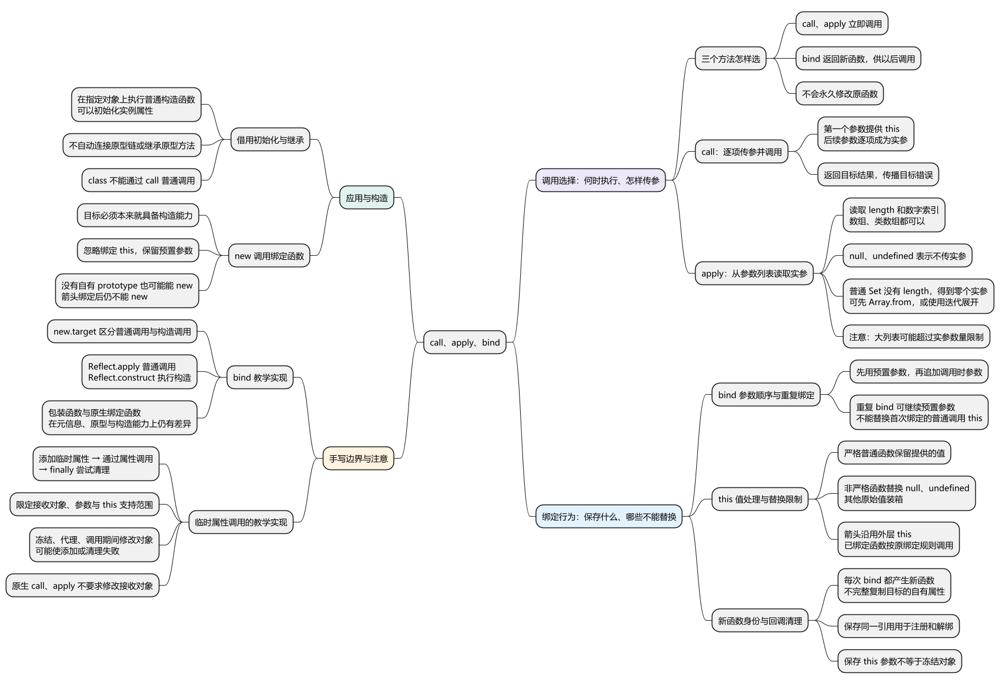
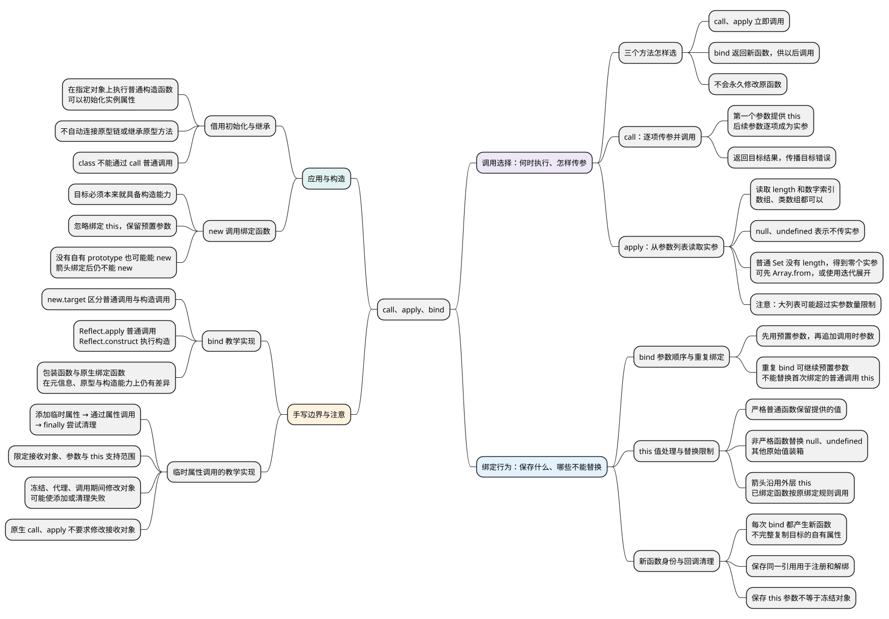

# call、apply、bind

<!-- core-mindmap:start -->
[](examples/c07-mindmap.svg)

<details>
<summary>PlantUML 源码</summary>



</details>

<!-- core-mindmap:end -->

**口述总览：** call 和 apply 都会立即调用函数，并为这次调用提供 this，区别主要在参数怎么传：call 逐项传参，apply 从数组或类数组对象中读取参数。bind 不立即执行，而是返回一个记住 this 和部分参数的新函数，供以后调用。它们不会永久修改原函数；箭头函数和 new 调用绑定函数还有各自的限制。

<!-- recall-route:start -->
**记忆线：** 执行时机 → 参数形式 → this 处理 → 函数身份 → 构造与手写边界。先问“现在调用还是以后调用”，再判断参数、this 和返回结果。

本篇按 10 个主要知识点复习：[知识点归纳与自查](#self-check) · [试题与答案](#interview)。先尝试回答，再用正文示例验证；两个手写示例仍按各自限定范围理解。
<!-- recall-route:end -->

本篇回答“怎样指定 this、怎样传参、什么时候执行”。默认指向和箭头外层 this 的判断，先看[this 指向](06_this指向.md)。

除特别说明外，各代码块在现代 Node.js ES 模块中独立运行。先读常用 API 与例子，再看使用边界和文末实现。

## 为什么需要主动指定 this

把对象的方法交给其他代码后，对方可能把它单独调用，方法不会自动记住原来的对象。例如事件回调、定时任务或方法借用中，希望明确让函数使用某个对象，就可以考虑这些方法。

选择时先问两件事：现在是否需要执行，以及参数是逐项提供还是已经放在列表里。立即执行用 call 或 apply；需要生成一个以后执行的函数，则使用 bind。

<a id="k01"></a>

## call、apply、bind：立即调用与返回新函数

**口述：** call 和 apply 立即调用目标函数，为这次调用提供 this 和参数。bind 暂不执行，返回一个新函数，记住目标函数、指定的 this 和预先提供的参数。它们不会永久修改原函数。

这三个方法通常从 Function.prototype 继承。对于普通、未绑定的函数，call/apply 提供的 this 按[上一篇的严格或非严格规则](06_this指向.md#k01)处理；箭头和已绑定函数有自己的限制。

### 逐项传参并调用：call(thisArg, ...args)

第一个参数是本次希望提供的 this，后面的参数逐项传给函数。返回目标函数的返回值，目标抛错则继续向外抛出。

### 从参数列表取值并调用：apply(thisArg, argsArray)

第二个参数可以是数组，也可以是有 length 和数字索引的类数组对象；其中每一项分别成为一个实参。传 null 或 undefined，表示不提供实参。

### 固定 this 和部分参数：bind(thisArg, ...prefix)

返回一个新函数，之后普通调用时向目标函数提供指定的 this，目标仍按自身的严格或非严格规则处理这个值。先使用 bind 时提供的参数，再追加后续调用的参数；返回值仍由目标函数决定。

<!-- example: c04-call-apply-bind -->
```js
function sum(a, b) { return this.base + a + b; }
const owner = { base: 10 };

console.log(sum.call(owner, 1, 2)); // 13
console.log(sum.apply(owner, [1, 2])); // 13
console.log(sum.apply(owner, { 0: 1, 1: 2, length: 2 })); // 13

const addOne = sum.bind(owner, 1);
console.log(addOne(2)); // 13
console.log(addOne.call({ base: 100 }, 2)); // 13
console.log(sum.call({ base: 100 }, 1, 2)); // 103
```

addOne 保存了 owner 和参数 1，所以再用 call 也不能换掉它普通调用时的 this；原来的 sum 没有被改写，仍可通过 call 使用其他对象。

再次 bind 也不能替换第一次已经固定的普通调用 this，但可以继续提供参数。箭头的 this 不能被这三个方法替换，但它们仍然可以传递参数。

### apply 是展开参数列表，不是把整个数组传进去

<!-- example: c04-apply-arguments -->
```js
function inspect(first, second) {
  console.log(JSON.stringify(first), second);
}
inspect.apply(null, ['pink', 'blue']); // "pink" blue
inspect.call(null, ['pink', 'blue']); // ["pink","blue"] undefined
```

第一种调用产生两个实参，第二种调用只产生一个数组实参。apply 不会把列表本身自动作为一个参数交给目标。

普通 Set 能被遍历，但没有供 apply 读取的 length，不能直接当作它的参数列表：

<!-- example: c04-apply-iterable -->
```js
function count(...args) { return args.length; }
const values = new Set([1, 2]);
console.log(count.apply(null, values)); // 0
console.log(count(...values)); // 2
console.log(count.apply(null, Array.from(values))); // 2
```

Math.max.apply(null, valuesArray) 可以逐项传入数组中的数值；Math.max 的计算不依赖 this，改传 Math 不会因此改变最大值。超大数组展开成实参可能超过引擎限制，应改用循环等方式。

### bind 返回的是新函数，不是完整复制原函数

每次调用 bind 都会创建不同的函数。它记住要执行的目标，并不会把目标的源代码和全部自有属性复制一遍。

<!-- example: c04-bind-identity -->
```js
function handle() { return this.name; }
handle.label = 'original';
const owner = { name: 'Alice' };
const first = handle.bind(owner);
const second = handle.bind(owner);

console.log(first === second); // false
console.log(first()); // Alice
console.log(first.label); // undefined
```

事件注册与移除要保存同一个绑定函数，不能在移除时重新 bind。bind 只固定 this 使用哪个值，不冻结对象的属性。

### Father.call(this) 只借用初始化，不自动建立继承

<!-- example: c04-borrow-initialization -->
```js
function Father(name) { this.name = name; }
Father.prototype.say = function () { return this.name; };

function Son(name) {
  Father.call(this, name);
}
const son = new Son('Alice');
console.log(son.name); // Alice
console.log(typeof son.say); // undefined
console.log(son instanceof Father); // false
```

Father 在 Son 正在初始化的对象上写入了 name，所以属性存在。但 Son 的原型链没有因此连接到 Father.prototype，原型方法不会自动继承。

真正的原型关系要另外建立，见[原型与继承](../03_对象机制/03_原型与原型链.md)。如果 Father 是 class，则不能通过 Father.call(this) 普通调用，应按 class 的继承和 super 规则处理。

<a id="k02"></a>

## new 调用绑定函数：忽略指定的 this，保留参数

<!-- example: c04-bound-construction -->
```js
function User(name) { this.name = name; }
const owner = { name: 'unchanged' };
const BoundUser = User.bind(owner, 'Alice');
const user = new BoundUser();

console.log(user.name, owner.name); // Alice unchanged
console.log(user instanceof User, user instanceof BoundUser); // true true
console.log(Object.hasOwn(BoundUser, 'prototype')); // false
```

目标函数可以被 new 调用时，它经原生 bind 得到的函数也能构造。这里 Alice 仍作为参数使用，但初始化的是新对象，不是 owner。

因此不能把“bind 的 this 永远不变”推广到构造调用，也不能只凭函数有没有自己的 prototype 属性判断能否 new。

箭头函数绑定后仍不能 new。class 必须按构造方式调用，继承类还有 super 等规则，构造的基础过程和返回值规则见[this 指向篇](06_this指向.md#k04)。

<a id="k03"></a>

## 与普通调用放在一起，怎样判断优先使用哪个 this

**口述：** 判断 this 时，先区分普通函数、箭头函数和绑定后的函数，再看它是作为对象方法调用、单独调用，还是用于创建实例。如果函数是交给别人执行的回调，还要看对方怎样调用它。

可以按下面的顺序分析：

- 箭头：使用定义位置外层的 this，不能通过调用方式替换，也不能 new。
- new：先确认目标能构造；原生绑定函数的指定 this 在此时被忽略。
- bind 返回的函数被普通调用：继续使用已经指定的 this，仍按目标函数的严格性处理。
- 其他普通函数：call/apply 提供 this；obj.fn() 使用 obj；独立调用再区分严格模式。
- 定时器、事件等：明确浏览器或 Node.js，以及 API 怎样调用回调，不仅凭“回调”这个名称判断。

<!-- example: c04-mixed-calls -->
```js
const item = { n: 1, read() { return this.n; } };
const bound = item.read.bind({ n: 2 });

console.log(bound.call({ n: 3 })); // 2
console.log(item.read.call({ n: 3 })); // 3
try { new item.read(); }
catch (error) { console.log(error.name); } // TypeError
```

read 是对象方法简写，能正常调用，但不支持 new。分析完 this 后，还要看函数具体读取什么属性、返回什么值或在哪里抛错。

<a id="k04"></a>

### 手写实现：说明哪些情况支持，哪些没有模拟

手写 call、bind 或 new 可以帮助解释规则，但不能只通过几个对象例子，就说与原生完全等价。

- 临时把函数放到对象属性上再调用，会修改对象，遇到冻结对象或代理可能失败；原生 call/apply 不要求这样修改对象。
- 普通包装函数可能改变 name、length、prototype 和 instanceof 的表现。
- 使用 new.target 可以区分普通调用和构造调用；真正的构造步骤可交给 Reflect.construct，但这也不自动补齐原生 bind 的全部行为。

文末实现分别注明支持范围。实际业务通常直接使用原生方法。

<a id="summary"></a>

复述时按“是否立即调用 → 参数怎样提供 → 返回什么 → 哪些情况不能替换 this”展开。绑定用于保存调用安排，不等于复制函数、冻结对象或自动建立继承。

<a id="self-check"></a>

## 知识点归纳与自查

本节按 10 个知识点回忆和归纳。先用自查问题检查理解，再顺序阅读各点口述与记忆提示；分级试题在后面的独立章节。

### 自查问题

1. [call、apply、bind 怎样选择？什么时候调用，怎样传参，分别返回什么？会永久修改原函数吗？](#recall-01)
2. [call 的第一个参数与后续参数分别做什么？目标返回或抛错时，调用方得到什么？](#recall-02)
3. [apply 会把数组整体作为一个参数吗？数组、类数组、Set、null 和 undefined 分别怎样处理？](#recall-03)
4. [bind 保存哪些信息？预置参数与后续参数是什么顺序？再次 bind 能改变 this 或继续添加参数吗？](#recall-04)
5. [传入 null、undefined、数字时，严格与非严格函数怎样处理？箭头和已经绑定的函数能重新指定 this 吗？](#recall-05)
6. [两次 bind 得到的是同一个函数吗？它会复制原函数全部属性或冻结对象吗？为什么解绑时不能重新 bind？](#recall-06)
7. [Father.call(this) 为什么能初始化属性，却不会自动继承原型方法？父类是 class 时还能这样调用吗？](#recall-07)
8. [原生 bind 返回的函数能被 new 调用吗？构造时是否还使用绑定对象？没有自有 prototype 能否构造？](#recall-08)
9. [手写 bind 怎样区分普通调用与构造调用？为什么调用 Reflect.construct 后仍不能宣称完全等价于原生 bind？](#recall-09)
10. [临时属性方案怎样实现指定对象调用？为什么使用 Symbol 和 finally，冻结对象或代理又会带来什么限制？](#recall-10)

<a id="recall-01"></a>

### 三个方法怎样选

**自查：** call、apply、bind 怎样选择？什么时候调用，怎样传参，分别返回什么？会永久修改原函数吗？

**口述：** call、apply 都立即调用目标函数，call 逐项传参，apply 从数组或类数组对象读取参数列表，返回目标函数的结果。bind 暂不执行目标，而是返回记住目标、this 参数和预置参数的新函数，供以后调用。它们不会永久修改原函数；箭头和构造调用还要遵守各自的规则。

**记忆：** 现在调用选 call、apply；保存以后调用的函数选 bind。

<a id="recall-02"></a>

### call：逐项传参，并取得本次调用结果

**自查：** call 的第一个参数与后续参数分别做什么？目标返回或抛错时，调用方得到什么？

**口述：** call 的第一个参数用于提供本次调用的 this，后续参数逐项成为目标函数的实参。它会立即调用目标，并返回目标的返回值；目标抛出的错误也会继续向外传播。实际使用的 this 还取决于目标是严格普通函数、非严格普通函数、箭头还是绑定函数。

**记忆：** 前面给 this，后面逐项给参数，立即调用并交回结果。

<a id="recall-03"></a>

### apply：读取参数列表，不直接采用迭代协议

**自查：** apply 会把数组整体作为一个参数吗？数组、类数组、Set、null 和 undefined 分别怎样处理？

**口述：** apply 从第二个参数的 length 和数字索引读取参数列表，每一项分别成为一个实参。数组和类数组对象都可以；null、undefined 表示不提供实参。普通 Set 虽然可迭代，但没有供 apply 读取的 length，因此示例中得到零个实参；可以先用 Array.from 转成数组，或使用迭代展开。apply 与展开都可能遇到实参数量限制，大列表可以改用循环。

**记忆：** apply 按 length 和索引取参数；能迭代，不等于能直接当参数列表。

<a id="recall-04"></a>

### bind：预置参数在前，后续参数在后

**自查：** bind 保存哪些信息？预置参数与后续参数是什么顺序？再次 bind 能改变 this 或继续添加参数吗？

**口述：** bind 返回的新函数保存目标函数、this 参数和预置参数。普通调用时，先使用预置参数，再追加调用时的参数。再次 bind 可以继续预置参数，顺序为首次预置、再次预置、实际调用参数；但后一次绑定不能替换首次绑定提供给原目标的 this。目标仍按自身严格性处理这个值。

**记忆：** 参数按绑定先后追加，首次绑定的普通调用 this 不被后续绑定替换。

<a id="recall-05"></a>

### this 处理：显式提供值后仍要看函数自身规则

**自查：** 传入 null、undefined、数字时，严格与非严格函数怎样处理？箭头和已经绑定的函数能重新指定 this 吗？

**口述：** 严格普通函数保留提供的 this 值；非严格普通函数会把 null、undefined 替换为其所属环境的全局对象，把其他原始值转为包装对象。箭头函数沿用外层 this，已经绑定的函数在普通调用时继续向目标提供原绑定值，call、apply 或再次 bind 都不能替换这些规则。判断时先看函数类型，再区分普通调用与构造调用。

**记忆：** 提供 this 不等于所有函数都直接采用；先分类型，再看严格性与调用方式。

<a id="recall-06"></a>

### 绑定函数的身份：保存一次，注册与解绑使用同一份

**自查：** 两次 bind 得到的是同一个函数吗？它会复制原函数全部属性或冻结对象吗？为什么解绑时不能重新 bind？

**口述：** 每次 bind 都会创建不同的函数，它保存调用所需的信息，不会完整复制目标的源码和全部自有属性，也不会冻结 this 所指对象。事件注册和移除需要使用同一个函数引用，因此应保存一次 bind 的结果；重新 bind 得到的新函数不能匹配原监听。DOM 解绑还需要匹配事件类型和 capture。

**记忆：** bind 每次产生新函数，解绑复用同一引用；绑定不等于复制或冻结。

<a id="recall-07"></a>

### 借用初始化：写入属性不等于建立继承

**自查：** Father.call(this) 为什么能初始化属性，却不会自动继承原型方法？父类是 class 时还能这样调用吗？

**口述：** 调用父构造函数并提供当前对象作为 this，可以让它在该对象上写入属性。但这次函数调用不会自动把子类原型连接到父类原型，因此不会自动获得父类原型方法或建立相应的 instanceof 关系。原型继承需要另行建立；如果父类是 class，不能通过 call 普通调用，应遵守 extends 和 super 的构造规则。

**记忆：** call 可以借用初始化，继承还要建立原型关系。

<a id="recall-08"></a>

### 构造绑定函数：忽略绑定 this，保留预置参数

**自查：** 原生 bind 返回的函数能被 new 调用吗？构造时是否还使用绑定对象？没有自有 prototype 能否构造？

**口述：** 目标本来就具备构造能力时，原生 bind 得到的函数也可以被 new 调用。构造时会忽略预先绑定的 this，保留预置参数，并执行目标的构造过程。绑定函数即使没有自有 prototype 属性，也可能可以构造；箭头函数绑定后仍不能 new。构造能力不能只凭普通属性判断。

**记忆：** 目标能构造才谈 new；构造忽略绑定 this，预置参数仍保留。

<a id="recall-09"></a>

### bind 教学实现

**自查：** 手写 bind 怎样区分普通调用与构造调用？为什么调用 Reflect.construct 后仍不能宣称完全等价于原生 bind？

**口述：** new.target 可以区分普通调用和构造调用。普通调用把指定的 this 和参数交给目标，构造调用借助 Reflect.construct 执行。本例没有完整模拟原生 bind 的函数名称、参数数量、prototype 与 instanceof 等行为。

**记忆：** new.target 分路径，Reflect 执行调用或构造，包装模型仍要说明范围。

实现代码与调用示例见后文[对应试题](#c07-02)。

<a id="recall-10"></a>

### 临时属性调用的教学实现

**自查：** 临时属性方案怎样实现指定对象调用？为什么使用 Symbol 和 finally，冻结对象或代理又会带来什么限制？

**口述：** 临时添加函数属性，通过属性形式调用，并在 finally 删除。本例仅支持非空可扩展普通对象和数组实参；不模拟 null、原始值、严格 this 或 Proxy 的全部行为。

**记忆：** 临时属性只演示对象调用，finally 尝试清理；原生调用不要求修改接收对象。

**注意：** finally 会尝试删除临时属性，但清理本身也可能失败。例如目标函数执行期间冻结接收对象，临时属性会变得不可配置，删除就可能抛错。这个方案会修改接收对象，不能视为原生 call/apply 的完整替代。

实现代码与调用示例见后文[对应试题](#c07-03)。

<a id="interview"></a>

## 试题与答案

<a id="c07-01"></a>

### C07-01 [P0·基础] call、apply、bind怎么比较？

**回答：** call、apply 都立即调用目标函数，call 逐项传参，apply 从数组或类数组对象读取参数列表，返回目标函数的结果。bind 暂不执行目标，而是返回记住目标、this 参数和预置参数的新函数，供以后调用。它们不会永久修改原函数；箭头和构造调用还要遵守各自的规则。

<a id="c07-02"></a>

### C07-02 [P1·编码] bind教学实现如何区分普通调用和new？

**回答：** new.target 可以区分普通调用和构造调用。普通调用把指定的 this 和参数交给目标，构造调用借助 Reflect.construct 执行。本例没有完整模拟原生 bind 的函数名称、参数数量、prototype 与 instanceof 等行为。

<!-- example: c04-bind-demo -->
```js
function bindDemo(target, receiver, ...prefix) {
  if (typeof target !== 'function') throw new TypeError('function required');
  function bound(...rest) {
    const args = [...prefix, ...rest];
    if (new.target) {
      return Reflect.construct(target, args, new.target === bound ? target : new.target);
    }
    return Reflect.apply(target, receiver, args);
  }
  return bound;
}
function User(name) { this.name = name; }
const receiver = { base: 10 };
const add = bindDemo(function(a, b) { return this.base + a + b; }, receiver, 1);
console.log(add.call({ base: 100 }, 2)); // 13
const Bound = bindDemo(User, receiver, 'A');
console.log(new Bound().name, Object.hasOwn(receiver, 'name')); // A false
```

<a id="c07-03"></a>

### C07-03 [P1·编码] 不借 call/apply，怎样演示“指定对象调用”？

**回答：** 临时添加函数属性，通过属性形式调用，并在 finally 删除。本例仅支持非空可扩展普通对象和数组实参；不模拟 null、原始值、严格 this 或 Proxy 的全部行为。

<!-- example: c04-object-call-demo -->
```js
function applyOnObject(fn, receiver, args = []) {
  if (typeof fn !== 'function' || receiver === null ||
      typeof receiver !== 'object' || !Array.isArray(args)) {
    throw new TypeError('object receiver and array arguments required');
  }
  const key = Symbol('temporary');
  Object.defineProperty(receiver, key, { value: fn, configurable: true });
  try { return receiver[key](...args); }
  finally { delete receiver[key]; }
}
const receiver = { name: 'A' };
console.log(applyOnObject(function(suffix) { return this.name + suffix; }, receiver, ['!'])); // A!
try { applyOnObject(() => { throw new Error('failed'); }, receiver); }
catch (error) { console.log(error.message); } // failed
console.log(Reflect.ownKeys(receiver).join(',')); // name
try { applyOnObject(() => 1, Object.freeze({})); }
catch (error) { console.log(error.name); } // TypeError
```

**注意：** finally 会尝试删除临时属性，但清理本身也可能失败。例如目标函数执行期间冻结接收对象，临时属性会变得不可配置，删除就可能抛错。这个方案会修改接收对象，不能视为原生 call/apply 的完整替代。

参考：[MDN：call](https://developer.mozilla.org/zh-CN/docs/Web/JavaScript/Reference/Global_Objects/Function/call)、[MDN：apply](https://developer.mozilla.org/zh-CN/docs/Web/JavaScript/Reference/Global_Objects/Function/apply)、[MDN：bind](https://developer.mozilla.org/zh-CN/docs/Web/JavaScript/Reference/Global_Objects/Function/bind)。
