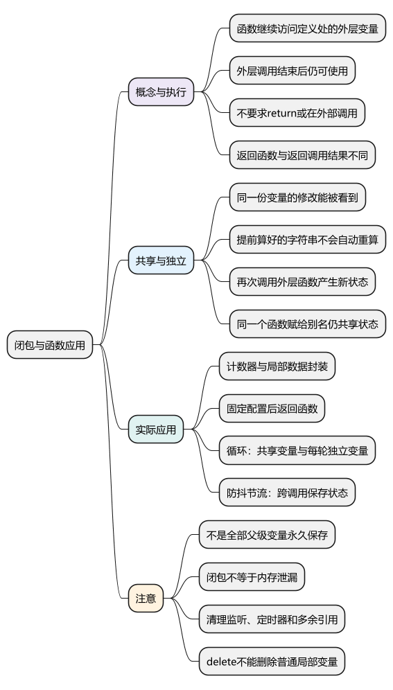
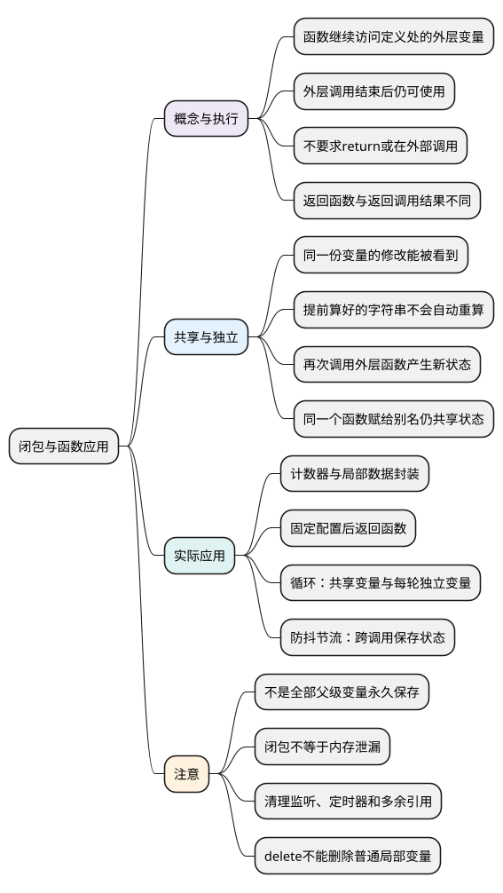

# 闭包与函数应用

<!-- core-mindmap:start -->
[](examples/c08-mindmap.svg)

<details>
<summary>PlantUML 源码</summary>



</details>

<!-- core-mindmap:end -->

**口述总览：** 闭包是函数与它能访问的外层变量之间保留的联系。函数之后仍能使用定义位置外层的变量，即使外层函数已经执行结束。它常用来保存状态、封装数据和生成带配置的函数。闭包本身不等于内存泄漏，业务结束后要清理不再需要的监听、定时器和引用。

本篇按“是什么 → 计数器的执行过程 → 共享与独立状态 → 循环应用 → 用途 → 内存与清理”展开。示例分别在现代 Node.js ES 模块中独立运行。

<a id="k01"></a>

## 闭包是什么：函数可以继续访问外层变量

**口述：** 一个函数能访问哪些外层变量，主要由它定义在哪里决定。函数被交给其他代码以后，仍然可以访问原来的外层变量，这种联系不会因为外层函数返回就自动消失。

这里说的是**定义位置外层的变量**，不是任意其他函数的局部变量。外层也可能是代码块或模块，不能把闭包限定为“必须有两层函数嵌套”。

先看最常见的例子：创建一个计数器，再调用它两次。

<!-- example: c05-counter-basic -->
```js
function createCounter() {
  let count = 0;

  return function next() {
    count += 1;
    return count;
  };
}

const next = createCounter();
console.log(next()); // 1
console.log(next()); // 2
```

### 为什么第二次得到 2，而不是重新从 1 开始

把上面的过程拆开：

1. 调用 createCounter，创建局部变量 count，初始值为 0。
2. 创建内部函数 next。因为它定义在里面，所以可以访问这次调用中的 count。
3. 返回内部函数，由外面的变量 next 保存；createCounter 这次调用结束。
4. 第一次调用外面的 next，原来的 count 从 0 改成 1。
5. 第二次调用 next，继续使用同一份 count，把 1 改成 2。

```text
外部变量 next
      ↓ 保存函数
内部函数 next
      ↓ 可以继续访问
这次 createCounter 调用中的 count
```

两次执行的是返回的内部函数，没有再次执行 createCounter，所以也没有重新执行 let count = 0。

**外层函数返回结束的是这次调用，不代表后续函数需要使用的数据必须立即消失。** 也不需要让外层函数一直停留在调用栈上。执行过程与内存存活的区别见[堆栈内存](../01_数据类型、内建对象与内存管理/21_堆栈内存.md)。

### 返回函数，与返回调用结果不同

上面写 return function next() {...}，返回的是函数本身。也可以先用 function next() {...} 声明内部函数，再写 return next，把函数交出去。

但 return next() 会先调用它，再返回这次调用的结果。如果内部函数只打印信息、没有 return，外层得到的返回值就是 undefined。

因此，return getDate 和 return getDate('今天是：') 表达的是两件事：前者交出函数，后者执行函数后交出结果。这与[函数篇](03_函数.md#k01)的“函数值与调用结果”是一条规则。

### 不需要 return，也不要求等外层函数结束

内部函数在外层执行期间就可以访问外层变量。把它返回出去，是演示“外层结束后仍能访问”的一种方式，不是形成闭包的必要条件。

还可以把内部函数放进数组、对象，或交给事件监听器：

<!-- example: c05-no-return-needed -->
```js
const callbacks = [];
function register(prefix) {
  callbacks.push(value => prefix + ': ' + value);
}
register('ERROR');
console.log(callbacks[0]('network')); // ERROR: network
callbacks.length = 0;
```

register 没有返回函数，但 callbacks 保存了它创建的函数。register 调用结束后，这个函数仍能读取当时那次调用的 prefix。

“在外部调用”也不是必要条件。如果内部函数直接在 register 执行期间被调用，同样可以使用外层变量。

<a id="k02"></a>

## 读取与修改：多个函数可以使用同一份变量

**口述：** 同一次外层调用里创建的多个函数，可以共同访问一份局部变量。一个函数修改后，另一个读取时就能看到新值。闭包不会为每个内部函数自动复制一份创建时的值。

<!-- example: c05-binding-and-snapshot -->
```js
function createState() {
  let count = 0;
  const label = 'count=' + count;
  return {
    increment() { count += 1; },
    current() { return count; },
    snapshot() { return label; },
    liveLabel() { return 'count=' + count; }
  };
}
const state = createState();
state.increment();
console.log(state.current()); // 1
console.log(state.snapshot(), state.liveLabel()); // count=0 count=1
```

这里分别看两个问题：

- increment 和 current 都访问同一个 count。前者改成 1，后者读到的就是 1。
- label 在创建时已经计算成字符串 'count=0'。count 变化，不会让之前算好的字符串自动重算。
- liveLabel 在每次调用时重新拼接字符串，所以得到 'count=1'。

snapshot 这个方法名只是表示“读取先前算好的结果”。区别来自调用时读取哪个变量、是否重新计算表达式，不是闭包换了一套保存规则。

**注意：** 能访问外层变量，不代表可以无视原来的限制。外层用 const 声明的变量，内部函数也不能给它重新赋值。

## 独立状态：再次调用外层函数，会创建新的局部变量

**口述：** 多次调用同一个返回函数，会继续使用它原来的局部状态；再次调用创建它的外层函数，才会产生另一份局部变量。把同一个函数赋给另一个变量，不会复制这份状态。

<!-- example: c05-counter-environments -->
```js
function createCounter() {
  let count = 0;
  return function next() {
    count += 1;
    return count;
  };
}

const first = createCounter();
const same = first;
const second = createCounter();

console.log(first === same); // true
console.log(first(), same(), second()); // 1 2 1
```

first 和 same 保存同一个函数，所以使用同一份 count。second 来自第二次 createCounter 调用，使用另一份从 0 开始的 count。

```text
first ──┐
        ├── 第一个内部函数 → 第一份 count
same  ──┘

second ──── 第二个内部函数 → 第二份 count
```

### 新创建的函数，不会自动替换旧函数使用的变量

<!-- example: c05-old-invocation -->
```js
function createView(count) {
  return () => 'count=' + count;
}
const oldHandler = createView(0);
const newHandler = createView(1);
console.log(oldHandler(), newHandler()); // count=0 count=1
```

两次 createView 调用的参数 count 是两份变量。创建 newHandler，没有修改 oldHandler 原来使用的那份参数。

如果监听器或异步任务仍保存着旧函数，它就可能继续使用旧输入。处理这类问题前，先确定业务需要的是“创建时这次输入”，还是“执行时最新的状态”，再决定是否更新回调或调整状态保存位置。

## 循环中的闭包：共享一个变量，还是每轮各有一份

**口述：** var 循环里创建的多个回调，常常访问同一个循环变量，等循环结束再读时，就都得到最后的值。每轮调用一个辅助函数，可以用各自的参数保存当轮值；在循环头使用 let，也可以让每轮有自己的变量。

下面把回调先保存起来，等循环结束后统一调用。没有定时器，也能直接观察差异：

<!-- example: c05-loop-captures -->
```js
const shared = [];
for (var i = 0; i <= 5; i++) {
  shared.push(() => i);
}

const separate = [];
for (var j = 0; j <= 5; j++) {
  (function (current) {
    separate.push(() => current);
  })(j);
}

const perRound = [];
for (let k = 0; k <= 5; k++) {
  perRound.push(() => k);
}

console.log(JSON.stringify(shared.map(fn => fn()))); // [6,6,6,6,6,6]
console.log(JSON.stringify(separate.map(fn => fn()))); // [0,1,2,3,4,5]
console.log(JSON.stringify(perRound.map(fn => fn()))); // [0,1,2,3,4,5]
```

三段代码依次解释：

1. 第一段的回调共享 i。循环结束时 i 已经是 6，所以都读到 6。
2. 第二段每轮立即调用一次普通函数，每次调用都有自己的参数 current。回调访问各自的 current。
3. 第三段在循环头用 let 声明，回调分别访问对应那一轮的 k。

**三种写法都利用了函数访问外层变量的能力，区别在于这些函数访问的是同一份变量，还是不同的变量。**

在 setTimeout 的常见例子中，回调稍后执行时循环已经结束，因此共享 var 的回调也会读到 6。传给定时器的延迟表达式则在安排任务时计算，不会等到回调执行时才计算。

本例统一从 0 循环到 5，所以应有六个结果。循环若写成从 1 到 5，逐轮保存后的结果就是 1、2、3、4、5。

**注意：** let 要看声明位置。在循环外只声明一次 let 变量，然后每轮修改它，回调仍可能共享这同一个变量。更完整的声明规则见[变量与循环](02_var、let、const.md#k05)。

<a id="k03"></a>

## 为什么使用闭包：保存状态、封装数据与固定配置

**口述：** 闭包可以让多次调用共用一份状态，同时把变量留在局部范围内。外部通过提供的方法读取和修改，也可以先确定配置，再返回以后使用的函数，减少重复传参。

### 封装数据：通过提供的方法操作内部变量

<!-- example: c05-private-state -->
```js
function createCounter(initial = 0) {
  if (!Number.isSafeInteger(initial)) throw new TypeError('safe integer required');
  let count = initial;
  return {
    increment() {
      if (count === Number.MAX_SAFE_INTEGER) throw new RangeError('counter overflow');
      return ++count;
    },
    read() { return count; }
  };
}
const first = createCounter(10);
const second = createCounter(0);
console.log(first.increment(), first.read(), second.read()); // 11 11 0
console.log(Object.hasOwn(first, 'count')); // false
```

count 是局部变量，不是返回对象的属性。外部通过 read 读取、通过 increment 递增，可以把数值检查集中在这些方法里。

这并没有让外部任意代码都能直接访问 count，也没有扩大变量名原本的作用范围。外部只是通过保存的函数，间接使用内部数据。

前面的计数器展示“保存”，这里通过公开方法控制操作展示“封装”；都不需要把状态放进全局变量。

### 固定配置：先确定前缀，再生成格式化函数

<!-- example: c05-function-factory -->
```js
function createFormatter(prefix) {
  return value => prefix + ': ' + value;
}
const formatError = createFormatter('ERROR');
const formatInfo = createFormatter('INFO');
console.log(formatError('network')); // ERROR: network
console.log(formatInfo('ready')); // INFO: ready
```

每次 createFormatter 调用使用自己的 prefix。后续格式化时，只需要传要处理的内容。这种“返回配置好的函数”的写法，常被叫作函数工厂。

<a id="k04"></a>

### 防抖与节流：在多次调用之间保存状态

防抖需要记住上一轮的计时器和最近一次输入，才能取消旧计划并重新等待；节流需要记住当前是否允许执行。返回的包装函数可以通过闭包继续访问这些信息。

如果每次事件到来时都重新创建包装函数，就会产生多份互不关联的状态，无法按同一套规则合并调用。应先创建一次，再在多次事件中复用。

完整实现和时间边界见[防抖与节流](../05_模块化与浏览器实践/03_防抖与节流.md)，本篇只解释为什么它们会用到闭包。闭包也可以封装缓存，但缓存仍需规定容量、过期和清空时机。

<a id="k05"></a>

## 内存与清理：闭包不等于永久保存，也不等于泄漏

**口述：** 闭包本身不会必然造成内存泄漏，但它可能延长相关数据的存活时间。如果业务结束后，事件监听、定时器或缓存仍然保存着闭包，不再需要的数据就可能无法回收。所以使用时要明确清理时机，移除监听、清除定时器、清理缓存，并解除多余引用。

### 为什么会有“使用闭包容易造成内存泄漏”的说法

这句话省略了条件。闭包允许外层函数结束后继续使用相关数据；如果本来已经不用的回调仍被其他地方保存，就可能连带保留旧数据。可以分三步理解：

1. **闭包会访问外层变量。** 外层调用结束后，后续函数仍可能需要这些数据。
2. **其他地方保存着这个闭包。** 例如长期存在的事件目标、定时器或缓存。
3. **业务已经不需要数据，但引用关系没有清理。** 程序仍能通过这条关系找到数据，垃圾回收不会因为业务已经结束就自动把它删除。

**垃圾回收主要检查程序是否还能通过引用找到对象，不知道你在业务上是否已经不需要它。**

### 页面切换后，旧监听仍然保存页面数据

以单页应用为例，页面在 window 上注册一个事件监听，回调使用当前页面的数据：

```text
window → 监听函数 → 页面数据
```

切换到其他页面或卸载组件后，window 仍然存在。如果没有移除监听，这条关系就可能继续保留旧页面数据；每次进入又注册一份新的监听，就可能不断积累。这里讨论的是同一个页面应用中的切换，不是说关闭整个浏览器页面后这条路径一定还在。

而计数器通过闭包保存计数，是业务仍然需要的正常状态。**数据被保留不等于发生泄漏，关键是“不再需要，却仍然被保留”。**

外层函数的调用已经结束，也不代表它必须一直停留在调用栈上。不能据此认为全部父级和祖先变量都会被完整复制、永久保存；实际存储和优化由引擎决定。

当程序无法再通过引用找到相关对象后，它们才具备回收条件，具体时机不确定。给一个变量赋 null 只解除这一处引用，还要检查监听、缓存或其他位置是否仍保存着它。

### 用移除监听验证清理行为

<!-- example: c05-listener-cleanup -->
```js
function mount(target) {
  const rows = ['a', 'b', 'c'];
  let calls = 0;
  const handler = () => { calls += rows.length; };
  target.addEventListener('change', handler);
  return {
    read() { return calls; },
    stop() { target.removeEventListener('change', handler); }
  };
}
const target = new EventTarget();
const view = mount(target);
target.dispatchEvent(new Event('change'));
console.log(view.read()); // 3
view.stop();
view.stop();
target.dispatchEvent(new Event('change'));
console.log(view.read()); // 3
```

本例可在支持 EventTarget 的现代 Node.js 或浏览器中运行。第一次事件让 calls 增加 3；停止后再次派发事件，值没有继续增加，证明监听已移除。重复 stop 也不会重新注册监听。

view 本身仍保存方法，程序还可能存在其他引用，因此不能根据这个输出判断所有相关对象已经回收。这里验证的是功能停止与监听解绑，垃圾回收时机不能由这段输出证明。

### 清理的是不再需要的入口

- 事件与订阅：移除监听、取消订阅。
- 定时任务：清除后续计划；已经开始的工作还需要自己的取消机制。
- 缓存：删除不再需要的条目，限制容量或设置过期策略。
- 保存的函数或对象：结束使用后解除多余引用，并检查是否还有其他位置保存它们。

普通局部变量不能像对象属性那样通过 delete 删除。也不应在函数退出前把变量一律清空，否则后续闭包可能正需要这些数据。

JavaScript 垃圾回收（GC）负责内存管理，不会替业务决定何时停止仍然有效的监听或任务。算法与排查方法见[垃圾回收、内存泄漏与资源清理](../01_数据类型、内建对象与内存管理/22_垃圾回收机制、内存泄漏与资源清理.md)。

<a id="summary"></a>

分析闭包时依次看：哪个函数访问外层变量 → 访问的是哪次调用中的变量 → 多个函数是否共享它 → 调用时重新计算还是读取旧结果 → 功能结束后谁负责清理。

<a id="interview"></a>

## 试题与答案

<a id="c08-01"></a>

### C08-01 [P0·原理] 什么是闭包，必须return函数吗？

**回答：** 闭包是函数与它能访问的外层变量之间保留的联系。函数之后仍能使用定义位置外层的变量，即使外层函数已经执行结束。它不要求 return，也不要求一定在外部调用；把函数放进数组、对象或注册为回调，同样可以继续使用这些变量。

<a id="c08-02"></a>

### C08-02 [P0·原理] 闭包保存变量还是值？

**回答：** 函数可以继续访问原来那份变量，并不是为每个内部函数复制一份创建时的值。多个函数使用同一变量时，后续修改可以被看到。提前计算并保存的字符串是另一个结果，不会随其他变量自动重算；再次调用外层函数，也会产生另一份局部变量。

<a id="c08-03"></a>

### C08-03 [P0·编码] 实现尾部防抖并支持取消。

**回答：** 用返回的函数保存最近一次参数、this 和计时器。每次调用取消旧计划并重新等待，时间到后执行最后一次；执行目标前清空旧状态，以便目标内部再次调用时能正确安排新计划。cancel 取消尚未执行的计划，不自动取消已经开始的请求。代码见[尾部防抖实现](../05_模块化与浏览器实践/03_防抖与节流.md#debounce)。

<a id="c08-04"></a>

### C08-04 [P0·编码] 实现首部节流，如何说明边界？

**回答：** 第一次调用立即执行，在接下来的一段时间内忽略新调用，到期后重新允许执行。先标记进入等待阶段，再调用目标，避免目标内部再次调用时重复执行。cancel 可以重置等待状态，不能撤销已完成的调用。本例没有末尾补执行，详见[首部节流实现](../05_模块化与浏览器实践/03_防抖与节流.md#throttle)。

<a id="c08-05"></a>

### C08-05 [P1·工程取舍] 闭包一定造成内存泄漏吗？

**回答：** 不一定。闭包可能让相关数据在外层调用结束后继续保留；如果业务已经不再需要这些数据，但事件监听、定时器或缓存仍保存着闭包，就可能造成内存泄漏。垃圾回收能判断程序是否还能找到数据，不能替业务判断是否还需要它。所以要在功能结束时移除监听、清除定时器、清理缓存并解除多余引用。记住“不再需要，却仍然被保留”，不要把正常保存状态也当成泄漏。

参考：[MDN：闭包](https://developer.mozilla.org/zh-CN/docs/Web/JavaScript/Guide/Closures)。
