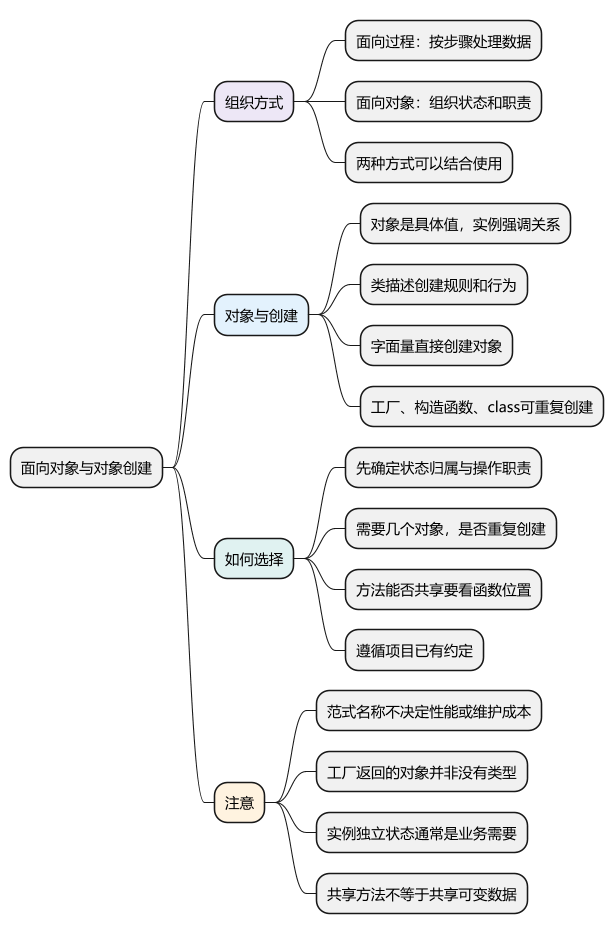
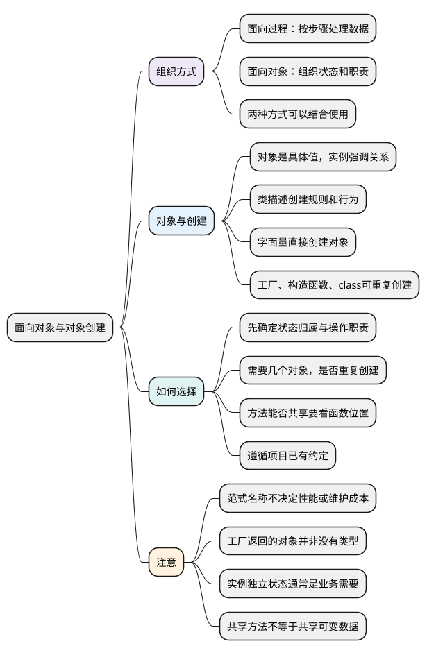

# 面向对象与对象创建

<!-- core-mindmap:start -->
[](examples/c09-mindmap.svg)

<details>
<summary>PlantUML 源码</summary>



</details>

<!-- core-mindmap:end -->

**口述总览：** 写程序可以先想“按哪些步骤完成事情”，也可以先想“哪些对象保存数据、负责哪些操作”。前者通常称为面向过程，后者通常称为面向对象。JavaScript 可以把这两种组织方式结合使用。只有一个对象时，对象字面量往往已经够用；需要反复创建相似对象时，再考虑工厂函数、构造函数或 class。选择依据是数据和行为怎样组织，而不是哪种写法名字更高级。

本篇先用同一个待办需求比较两种组织方式，再区分对象、类与实例，最后选择创建方式。各 JavaScript 代码块分别在现代 Node.js ES 模块中独立运行。

<a id="k01"></a>

## 同一个需求：先安排步骤，或先安排对象的职责

**口述：** 面向过程通常围绕任务步骤组织函数，再把数据传给函数处理。面向对象通常把相关状态和操作放在对象附近，通过对象之间的协作完成任务。它们关注的组织角度不同，并不互相排斥。

假设需要保存两条待办，把指定待办标记为完成，然后统计已完成数量。

### 按步骤组织：把待办数据传给处理函数

<!-- example: c09-procedural -->
```js
const tasks = [
  { id: 1, title: '读文档', done: false },
  { id: 2, title: '写示例', done: false }
];
function completeTask(list, id) {
  const task = list.find(item => item.id === id);
  if (task) task.done = true;
}
function countCompleted(list) {
  return list.filter(task => task.done).length;
}

completeTask(tasks, 1);
console.log(countCompleted(tasks)); // 1
```

阅读顺序是“准备数据 → 修改指定记录 → 统计结果”。两个函数都接收待办列表，哪些数据参与操作，从参数就能看出来。

数据用对象保存，不代表整个程序就一定按面向对象组织。这里的重点仍然是独立函数怎样依次处理数据。

### 按职责组织：让待办板保存列表并提供操作

<!-- example: c09-object -->
```js
const board = {
  tasks: [
    { id: 1, title: '读文档', done: false },
    { id: 2, title: '写示例', done: false }
  ],
  complete(id) {
    const task = this.tasks.find(item => item.id === id);
    if (task) task.done = true;
  },
  countCompleted() {
    return this.tasks.filter(task => task.done).length;
  }
};

board.complete(1);
console.log(board.countCompleted()); // 1
```

这次先认出一个“待办板”：它保存自己的列表，并提供完成和统计操作。调用处只需表达“让这个待办板完成一条待办”。this 的具体判断见[this 指向](../02_运行基础/06_this指向.md)。

两段代码的业务结果相同，第二段的操作内部也仍然由一系列步骤组成。一个项目可以让对象管理状态，再用独立函数完成格式化、计算等工作。

### 比较时看修改是否方便，不凭名称判断优劣

如果需求只是一次数据转换，几个输入输出清楚的函数可能更直接。如果会同时存在多个待办板，而且每个板都有自己的状态和操作，对象可能更容易表达这种关系。

面向过程不保证执行更快，面向对象也不保证更好维护。性能要看实际算法、分配和运行环境；维护成本要看职责是否清楚、依赖是否过多，以及修改影响能否控制。

<a id="k02"></a>

## 对象、类与实例：具体值、创建规则和关系中的称呼

**口述：** 对象是程序中实际存在的值，可以保存属性；属性值是函数时，通常称为方法。类用于描述一组对象的创建规则和行为。按照某个类或构造函数创建出来的对象，在这层关系里称为实例。

用待办来理解：

- 一条具体待办，保存“读文档”和完成状态，是对象。
- 描述每条待办需要什么数据、能执行什么操作，可以写成 Task 类。
- 通过 new Task 创建的某条待办，通常称为 Task 的实例。

“对象”和“实例”不是两个互斥种类。实例通常也是对象；“实例”强调它与哪套创建规则有关。

JavaScript 不要求先声明一个类才能创建对象。前面的 board 就直接用对象字面量创建；class 也是组织对象的一种语法，底层关系会在后续篇章展开。

这里说“创建规则”，不意味着 class 是 TypeScript 那样的静态类型声明。普通 JavaScript 对象的属性和值依然可以在运行时变化；业务需要校验哪些字段，应另外明确。

<a id="k03"></a>

## 四种创建方式：从一个具体对象，到重复创建

**口述：** 对象字面量直接写出一个对象。工厂函数把创建过程放进函数并返回对象。构造函数配合 new 初始化实例。class 把构造和方法写在同一套语法中。先看需要怎样使用对象，再选择表达方式。

### 对象字面量：直接描述当前这个对象

前面的 board 使用 `{ ... }` 写出属性和方法，这种写法称为对象字面量。它适合配置、一次性数据、少量明确对象等场景。

<!-- example: c06-object-literal -->
```js
const user = {
  name: 'Alice',
  say() { return this.name; }
};
console.log(user.say()); // Alice
console.log(Object.hasOwn(user, 'name')); // true
console.log(Object.hasOwn(user, 'say')); // true
```

name 和 say 都直接属于 user，称为自有属性。方法也是属性，只是保存的值是函数。

对象字面量每求值一次，就会创建一个对象。如果需要很多结构相同的待办，不必反复复制相同文本，可以把创建步骤提取出来。

### 工厂函数：普通调用，把创建结果返回给调用方

<!-- example: c09-factory -->
```js
function createTask(title) {
  return { kind: 'task', title, done: false };
}
function createQueue() {
  return [];
}
const task = createTask('读文档');
const queue = createQueue();

console.log(task.title, task.done); // 读文档 false
console.log(typeof task, task instanceof Object); // object true
console.log(task instanceof createTask); // false
console.log(Array.isArray(queue)); // true
```

createTask 是一个普通函数，负责创建并返回待办对象。这种职责通常称为工厂；它没有要求调用方使用 new。

**工厂创建的对象不是“没有类型”。** 例中的 task 是普通对象，queue 是数组。工厂也可以返回某个类的实例，具体结果取决于函数返回什么。

task 没有因为被 createTask 返回，就自动成为默认 instanceof 判断下的 createTask 实例。kind 只是本例约定的业务标记，也不是语言自动保证的类型校验。

### 构造函数：通过 new 创建并初始化实例

<!-- example: c06-create-instances -->
```js
function User(name) {
  this.name = name;
}
User.prototype.say = function () {
  return this.name;
};

const first = new User('Alice');
const second = new User('Bob');
console.log(first.name, second.name); // Alice Bob
console.log(first.say(), second.say()); // Alice Bob
console.log(first.say === second.say); // true
console.log(Object.hasOwn(first, 'say')); // false
```

每次 new 都创建并初始化一个实例，这里两个用户各自保存 name。say 放在 User.prototype 上供它们共享，调用时仍然读取各自的名字；具体如何找到方法留到原型篇解释。首字母大写只是常见命名约定，不会赋予函数新的能力。

这一方式适合阅读传统 JavaScript 代码，也能明确表达重复创建实例。new 的步骤、返回值规则和构造限制见[构造函数与 new](02_构造函数与new.md)。

### class：集中描述构造和实例行为

<!-- example: c09-class -->
```js
class Task {
  constructor(title) {
    this.title = title;
    this.done = false;
  }
  complete() {
    this.done = true;
  }
}
const task = new Task('读文档');
task.complete();

console.log(task.title, task.done); // 读文档 true
console.log(task instanceof Task); // true
```

constructor 负责初始化，complete 表达实例能做的操作。class 在语法上把这些内容放在一起，并要求按构造方式调用；它也有字段、私有成员等专门规则。

本篇只用它理解创建方式。成员放在哪里、如何初始化和使用私有成员，见[class 与私有成员](05_class与私有成员.md)。

<a id="k04"></a>

## 怎样选择：先看状态和职责，再看方法是否需要共享

**口述：** 只有一个明确对象时，优先考虑字面量；需要封装创建步骤、灵活返回结果时，可以用工厂函数；需要一组有明确实例行为的对象时，可以考虑构造函数或 class。现有项目采用的约定也很重要，不必为了形式统一改写全部代码。

可以按下面的顺序判断：

1. 需要保存哪些数据，这些数据属于谁？
2. 是一个对象，还是会反复创建很多相似对象？
3. 哪些操作只依赖输入，哪些操作要使用对象当前的状态？
4. 创建结果需要满足什么约定，调用方是否需要知道具体的类？

继承是后续的复用选择，不是创建对象的前提。需要连接父子类型时再看[JavaScript 继承方式](04_JavaScript继承方式.md)，不必为了使用面向对象先建立复杂层级。

### 方法是否重复创建，取决于函数写在哪里

<!-- example: c09-method-identity -->
```js
function createWithOwnMethod(title) {
  return { title, read() { return this.title; } };
}
function readTitle() { return this.title; }
function createWithSharedMethod(title) {
  return { title, read: readTitle };
}
const first = createWithOwnMethod('A');
const second = createWithOwnMethod('B');
const third = createWithSharedMethod('C');
const fourth = createWithSharedMethod('D');

console.log(first.read === second.read); // false
console.log(third.read === fourth.read); // true
console.log(third.read(), fourth.read()); // C D
```

两种写法都是工厂函数。第一种每次执行都创建新方法，第二种保存的是同一个外部函数，因此“工厂”这个名称不能决定方法是否共享。

构造函数体内每次创建函数，也会得到不同的方法；class 的普通实例方法通常共享，实例箭头字段则通常每个实例各有一个函数。通过原型共享方法的过程，见[原型与原型链](03_原型与原型链.md)。

每个实例有自己的状态通常是业务需要，不是浪费。方法能否共享要看是否依赖每次创建时的局部变量、是否需要固定接收者等条件；也不应把本该独立修改的数组移到共享位置，只为减少创建次数。

<a id="summary"></a>

复述时先讲同一个需求如何按步骤或按对象职责组织，再区分对象、类和实例。选择创建方式时说明为何需要重复创建、怎样组织状态和行为，以及方法是否真正共享，就比只背四个名称更完整。

<a id="interview"></a>

## 试题与答案

<a id="c09-01"></a>

### C09-01 [P0·基础] 面向过程与面向对象怎样比较？

**回答：** 面向过程通常围绕步骤组织函数，把数据传入处理；面向对象通常围绕对象的状态和职责组织操作。例如完成待办，可以调用 completeTask(list, id)，也可以让 board.complete(id) 操作自己的列表。两者可以混用，不能由范式名称直接推出性能或维护成本。

<a id="c09-02"></a>

### C09-02 [P0·应用] 字面量、工厂、构造函数和class怎样选择？

**回答：** 一个明确对象通常可用字面量；需要封装创建步骤或灵活返回结果时可以用工厂；需要反复创建带实例行为的对象时可以考虑构造函数或 class。还要看项目现有约定、状态归属和调用方需要的接口。对象不要求先有类，使用 class 也不要求必须继承。

<a id="c09-03"></a>

### C09-03 [P0·原理] 工厂函数创建的对象没有类型吗？

**回答：** 不是。工厂可以返回普通对象、数组或某个类的实例，具体类型和行为由返回值决定。普通调用一个工厂，不会自动把结果与工厂的 prototype 关联；因此不能只用 result instanceof createTask 判断创建结果是否有效。业务字段和接口约定也要单独检查。

<a id="c09-04"></a>

### C09-04 [P1·原理] 方法是否共享由创建模式决定吗？

**回答：** 不是，要看函数在哪里创建、对象保存哪个函数。创建函数内部每次求值的方法通常会产生新函数，引用外部同一个函数则可以共享；构造函数也有同样区别。实例独立状态通常应分别初始化，共享方法不意味着共享可变数据。

参考：[MDN：使用对象](https://developer.mozilla.org/zh-CN/docs/Web/JavaScript/Guide/Working_with_objects)、[MDN：类](https://developer.mozilla.org/zh-CN/docs/Web/JavaScript/Reference/Classes)。
