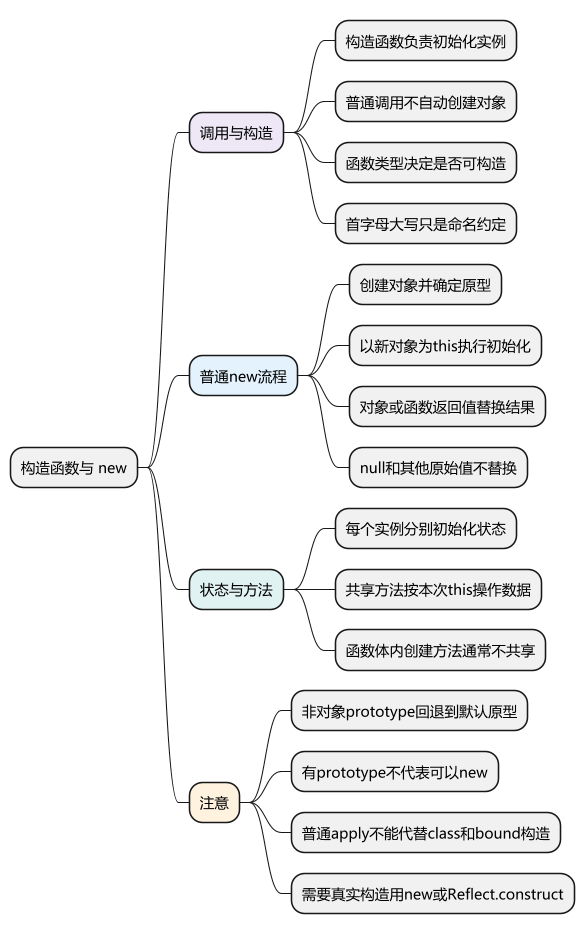
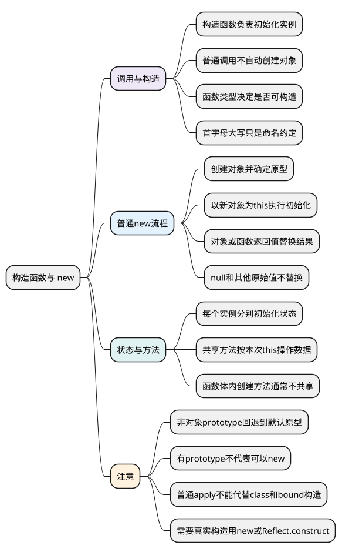

# 构造函数与 new

<!-- core-mindmap:start -->
[](examples/c10-mindmap.svg)

<details>
<summary>PlantUML 源码</summary>



</details>

<!-- core-mindmap:end -->

**口述总览：** 构造函数用于初始化新实例，new 则负责启动构造过程。对于一般的 function 构造函数，可以先理解为：创建对象、确定原型、用新对象作为 this 执行初始化，再根据返回值确定最终结果。显式返回对象或函数时，采用那个返回值；返回 null 或其他原始值时，采用新实例。并不是所有函数都能 new，手写普通调用也不能代替 class、绑定函数等完整构造行为。

本篇接着[面向对象与对象创建](01_面向对象与对象创建.md)，解释创建实例的具体过程。各 JavaScript 代码块分别在现代 Node.js ES 模块中独立运行；模块里的函数默认处于严格模式。

<a id="k01"></a>

## 构造函数负责初始化，普通调用不会自动创建实例

**口述：** 当普通函数被用于初始化新实例时，它承担构造函数的职责。函数体可以把传入的数据写到 this 上；使用 new 调用时，this 通常是这次创建的新对象。直接写函数名加括号，则是普通调用，不会因为名称大写就自动创建对象。

<!-- example: c10-call-vs-new -->
```js
function User(name) {
  this.name = name;
}
const user = new User('Lin');
console.log(user.name); // Lin

try {
  User('Bo');
} catch (error) {
  console.log(error.name); // TypeError
}
```

new User('Lin') 创建对象，并让 User 初始化它。User('Bo') 是严格模式下的独立调用，this 为 undefined，因此写 this.name 抛出 TypeError。

如果在非严格环境独立调用同样的普通函数，this 可能是全局对象，错误就可能变成意外改写全局属性。因此不能靠“忘写 new 后没有报错”判断代码正确。

用 User.call(existing, name) 可以让普通函数初始化已有对象，但这不会创建新对象，也不会自动建立实例关系。详见[call、apply、bind](../02_运行基础/07_call、apply、bind.md)。

### 哪些函数可以 new：名称和 typeof 都不够

“能像函数一样调用”和“能通过 new 构造”是两种不同能力。普通的 function 声明或表达式通常具备构造能力；箭头、方法简写、异步函数和生成器函数没有这项能力。

<!-- example: c10-constructible -->
```js
function Ordinary() {}
const arrow = () => {};
const methods = { run() {} };
async function work() {}
function* sequence() {}
class User {}
const Bound = Ordinary.bind(null);

const candidates = [
  ['普通函数', Ordinary], ['箭头', arrow], ['方法简写', methods.run],
  ['异步函数', work], ['生成器', sequence], ['class', User], ['绑定函数', Bound]
];
for (const [label, candidate] of candidates) {
  try { new candidate(); console.log(label, true); }
  catch (error) { console.log(label, error.name); }
}
// 普通函数 true
// 箭头 TypeError
// 方法简写 TypeError
// 异步函数 TypeError
// 生成器 TypeError
// class true
// 绑定函数 true
```

class 支持构造，却不能像普通函数那样直接调用。原生 bind 得到的函数，只有目标本来能构造时才可以 new；给箭头函数 bind 不会补上构造能力。

首字母大写是约定，typeof 值为 function 也不能证明能 new。仅凭有没有 prototype 属性同样不可靠：可构造的绑定函数通常没有自己的 prototype，生成器函数有 prototype 却不能 new。

上例尝试执行的是我们自己定义的空构造函数，只用于展示结果；实际构造可能有副作用或因业务代码抛错，不能把“尝试执行是否报错”当成通用的能力检测工具。

<a id="k02"></a>
<a id="new-process"></a>

## 普通 new 的四步：创建、关联、初始化、选定返回值

**口述：** 先把讨论范围限定为一般 function 构造函数。new 会准备一个新对象，让它使用构造函数提供的原型，再以这个对象作为 this 执行函数。函数执行结束后，还要看它有没有明确返回另一个对象，才能确定整个 new 表达式的结果。

理解 `new User('Lin')` 时，可以分四步：

1. 创建一个新对象。
2. 读取 User.prototype；它是对象或函数时，用它作为新对象的原型。
3. 以新对象作为 this，把 'Lin' 传入 User，执行初始化。
4. 如果返回非 null 的对象或函数，采用该返回值；否则采用新对象。

这里的原型关联决定后续去哪里查找共享属性；它不是把原型上的内容复制到实例。具体查找过程见[原型与原型链](03_原型与原型链.md)。

### prototype 不是对象时，使用默认原型

<!-- example: c10-prototype-fallback -->
```js
function User(name) { this.name = name; }
const first = new User('Lin');
console.log(Object.getPrototypeOf(first) === User.prototype); // true

User.prototype = 7;
const second = new User('Bo');
console.log(second.name); // Bo
console.log(Object.getPrototypeOf(second) === Object.prototype); // true
```

User.prototype 被改成数字，不会让数字成为实例的原型，也不会让普通 new 因此失效。本例回退到 Object.prototype；更准确地说，默认值来自相应构造函数所属运行环境。

把 prototype 改成 null，也走这种非对象回退规则。要创建原型直接为 null 的对象，应使用 Object.create(null)，不能用 User.prototype = null 代替。

这些步骤是理解普通构造函数的模型。class 的派生构造、私有成员、内建对象和代理构造还有其他规则，不能据此认定所有构造只需普通函数调用。

### 返回值：对象或函数替换结果，原始值不替换

<!-- example: c10-return-values -->
```js
function Item(result) {
  this.kind = 'instance';
  this.created = true;
  return result;
}
const ignored = [undefined, null, 0, false, 'text', 1n, Symbol('x')];
console.log(ignored.every(value => new Item(value).kind === 'instance')); // true

const replacement = { kind: 'replacement' };
const result = new Item(replacement);
console.log(result === replacement, result.kind); // true replacement
console.log(Object.hasOwn(result, 'created')); // false

function replacementFunction() { return 'callable'; }
const callable = new Item(replacementFunction);
console.log(callable === replacementFunction, callable()); // true callable
```

没有写 return，相当于返回 undefined，因此通常得到初始化后的实例。数字、字符串、布尔值、BigInt、Symbol 和 null 都不会替换它。

对象和函数则会替换最终结果。第二段返回 replacement 后，结果就是那个对象，原先 this 上初始化的内容不会自动搬到 replacement 上。

**注意：** 虽然 typeof null 是 object，null 仍是原始值，不能只检查 typeof 是否等于 object。函数虽然 typeof 是 function，也属于这里可以替换实例的对象值。

上述规则针对一般 function 构造函数。派生 class 返回原始值等情况有专门限制，见[class 与私有成员](05_class与私有成员.md)。构造体抛错时，new 也会向调用方抛出该错误。

<a id="k03"></a>

## 每个实例保存自己的状态，相同方法可以共享

**口述：** 构造函数常见的职责，是给每个实例初始化自己的数据。多个实例执行相同行为时，可以共享一个方法；调用共享方法时，this 仍由本次调用决定，所以方法可以操作不同实例的数据。

<!-- example: c10-state-and-method -->
```js
function Notebook(name) {
  this.name = name;
  this.notes = [];
}
Notebook.prototype.add = function (text) {
  this.notes.push(text);
};
const first = new Notebook('A');
const second = new Notebook('B');
first.add('读文档');

console.log(first.notes.join(','), second.notes.length); // 读文档 0
console.log(first.notes === second.notes); // false
console.log(first.add === second.add); // true
console.log(Object.hasOwn(first, 'add')); // false
```

每次初始化都会执行 this.notes = []，所以两本笔记本拥有不同数组。add 只在 Notebook.prototype 上创建一次，两次读取获得同一个函数；first.add(...) 中的 this 仍然是 first。

实例独立数据是隔离状态的需要。把 notes 数组放到共享原型上，会让实例可能修改同一个数组，并不等于更合理地节省内存。

如果在构造函数体内写 this.add = function (...) { ... }，每次执行通常会创建不同的函数。是否需要这么做，要看闭包、回调接收者和实际分配成本；不能只凭“构造函数模式”判断方法一定共享。

本节只解释状态与行为的分工。共享属性如何查找、赋值何时遮蔽原型，在[原型与原型链](03_原型与原型链.md)继续；如何复用父级初始化，在[JavaScript 继承方式](04_JavaScript继承方式.md)继续。

<a id="k04"></a>
<a id="manual-new"></a>

## 手写 new 是限定范围的演示，真实构造使用语言能力

**口述：** 对一般 function 构造函数，可以先创建对象，再用 apply 一类调用方法执行初始化，最后处理返回值。这能解释常见流程，但普通调用没有构造调用的全部能力，不能冒充完整的 new。

文末 [C10-01](#c10-01) 保留一份教学实现。它回退非对象 prototype，并同时处理对象、函数与原始值返回；使用前提是一般、未绑定、可普通调用的 function 构造器，且不依赖 new.target 等特殊构造语义。

### 为什么不能拿 apply 调用替代所有构造

- class 不允许普通调用，因此 Reflect.apply 不能执行它的构造流程，也不会完成类字段和私有成员初始化。
- 对绑定函数做普通 apply 调用，会沿用绑定的 this；原生 new 调用可构造的绑定函数则忽略这个 this，规则不同。
- 普通调用中的 new.target 为 undefined；原生构造调用会提供相应的构造目标。
- 数组、日期等内建对象可能需要专门的内部状态，创建普通对象再调用函数不能完整模拟。
- 只检查 typeof 为 function，无法排除箭头、生成器等没有构造能力的函数。

这些区别不仅影响写法，也可能影响初始化、返回结果和实例关系。通过几个普通对象例子，不足以说明实现与原生完全等价。

### Reflect.construct：用参数列表执行真实构造

<!-- example: c10-reflect-construct -->
```js
class Box {
  constructor(value) { this.value = value; }
}
const boundReceiver = { value: 0 };
const BoundBox = Box.bind(boundReceiver, 9);
const first = Reflect.construct(Box, [7]);
const second = Reflect.construct(BoundBox, []);

console.log(first.value, first instanceof Box); // 7 true
console.log(second.value, second instanceof Box); // 9 true
console.log(boundReceiver.value); // 0
```

Reflect.construct(target, args) 接收可构造的目标和参数列表，执行真实的构造操作。本例分别构造 class 与可构造的绑定函数；绑定的参数 9 保留，boundReceiver 没有成为新实例的 this。

需要动态提供参数时，可以使用 new Ctor(...args) 或 Reflect.construct(Ctor, args)。Reflect.construct 的第三个参数还可以指定构造目标，但需要单独理解 new.target 和原型选择，不应在入门手写模型中悄悄省略这些差异。

<a id="summary"></a>

复述时按“能否构造 → 普通 new 四步 → 返回值分流 → 实例状态与共享方法 → 手写范围”展开。原型关系、初始化是否执行、最终返回哪个值是相互关联但不同的问题。

<a id="interview"></a>

## 试题与答案

<a id="c10-01"></a>

### C10-01 [P1·编码] 怎样演示普通构造函数的new流程？

**回答：** 下例仅演示一般 function 构造器，不模拟 class、派生类、私有字段、new.target 或完整的构造能力检查。要求标准构造语义时使用 new 或 Reflect.construct。

<!-- example: c04-new-demo -->
```js
function createInstance(Ctor, ...args) {
  const proto = Ctor.prototype;
  const isObject = value => value !== null &&
    (typeof value === 'object' || typeof value === 'function');
  const instance = Object.create(isObject(proto) ? proto : Object.prototype);
  const returned = Reflect.apply(Ctor, instance, args);
  return isObject(returned) ? returned : instance;
}
function User(name) { this.name = name; return 3; }
function Other() { return { name: 'B' }; }
const user = createInstance(User, 'A');
console.log(user.name, user instanceof User); // A true
console.log(createInstance(Other).name); // B
```

<a id="c10-02"></a>

### C10-02 [P0·原理] 普通构造函数返回不同值时，new得到什么？

**回答：** 显式返回非 null 对象或函数时，new 采用该返回值；返回 undefined、null、数字等原始值时，采用初始化的新实例。不能只写 typeof result === 'object'，因为 null 应排除、函数应包含。返回替代对象时，原实例的属性不会自动复制过去；派生 class 有额外规则。

<a id="c10-03"></a>

### C10-03 [P0·原理] 怎样判断函数是否具备构造能力？

**回答：** 要看函数种类和语言规则，不能靠首字母、typeof 或 prototype 属性。一般 function 声明或表达式能构造；箭头、方法简写、异步函数和生成器不能。class 可以构造但不能普通调用；原生绑定函数是否可构造取决于目标。真正执行 new 或 Reflect.construct 时，语言会检查构造能力。

<a id="c10-04"></a>

### C10-04 [P1·原理] 实例数据为什么独立，方法又怎样共享？

**回答：** 构造函数每次在新实例上初始化字段，数组等可变状态也应按需要分别创建。相同行为可以放在原型上共享，同一个方法通过不同实例调用时，this 仍不同。在构造函数体内创建的方法通常每次不同；共享方法不要求把各实例的可变状态也共享。

参考：[MDN：new](https://developer.mozilla.org/zh-CN/docs/Web/JavaScript/Reference/Operators/new)、[MDN：Reflect.construct](https://developer.mozilla.org/zh-CN/docs/Web/JavaScript/Reference/Global_Objects/Reflect/construct)。
