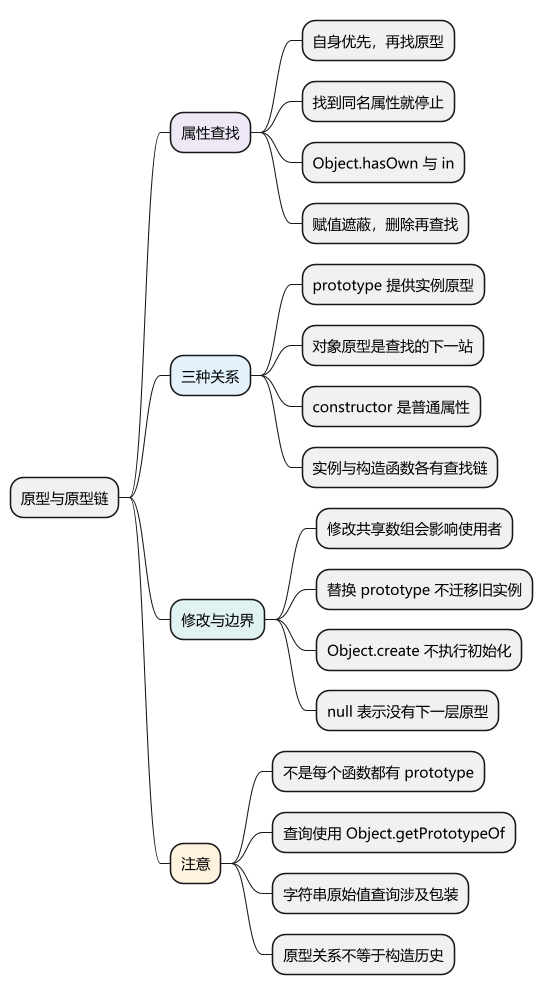
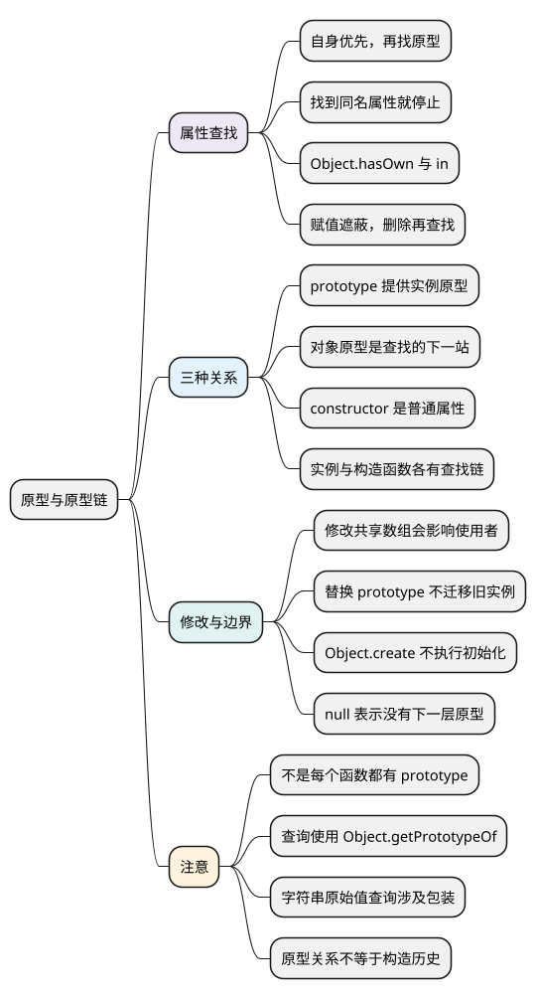
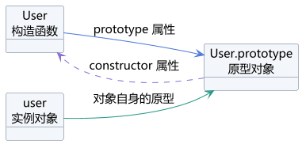
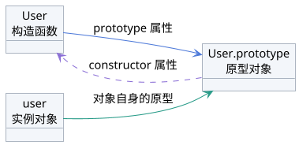

# 原型与原型链

<!-- core-mindmap:start -->
[](examples/c11-mindmap.svg)

<details>
<summary>PlantUML 源码</summary>



</details>

<!-- core-mindmap:end -->

**口述总览：** 原型是对象查找属性时的下一站。读取属性时先找对象自身，没有再沿原型逐层查找，直到找到属性或走到 null。普通构造函数的 prototype 属性，通常提供实例使用的原型对象；实例与原型建立的是查找关系，并不会复制原型上的方法。constructor 则是可修改的普通属性，不能决定对象真正的原型关系。

本篇按“属性怎样找到 → 三种关系怎样区分 → 修改后会怎样”展开。对象怎样创建见[面向对象与对象创建](01_面向对象与对象创建.md)，构造过程见[构造函数与 new](02_构造函数与new.md)。代码块分别在现代 Node.js ES 模块中独立运行。

<a id="k02"></a>

## 属性查找：先看自身，没有再找原型

**口述：** 每个普通对象都有一个原型关联，告诉程序“自身找不到属性时，继续到哪个对象上找”。原型本身也可以有原型，这些关联连起来就形成原型链。读到同名属性就停止，一直找到 null 仍没有，结果才是 undefined。

Object.create(base) 创建一个新对象，并让它以 base 为原型。Object.getPrototypeOf(object) 可以读取对象当前的原型。

<!-- example: prototype-lookup -->
```js
const base = { role: 'reader' };
const user = Object.create(base);
user.name = 'Lin';

console.log(user.name); // Lin
console.log(user.role); // reader
console.log(Object.hasOwn(user, 'role')); // false
console.log('role' in user); // true
console.log(Object.getPrototypeOf(user) === base); // true
```

user 自身有 name，但没有 role。读取 role 时，程序顺着原型关联到 base，找到了 reader。

```text
user：自身有 name
  ↓ 对象的原型
base：自身有 role
  ↓ 对象的原型
Object.prototype
  ↓ 对象的原型
null
```

Object.hasOwn 只检查对象自身；in 还会检查原型链。能读到 role，不代表 user 自己保存了一份 role。

**注意：** 自身属性即使保存 undefined，也已经算“找到了”，不会再向原型寻找同名属性。对象属性不存在时通常返回 undefined，这与直接读取未声明变量抛错是不同的操作。

### 赋值、删除与修改共享对象，要分别分析

<!-- example: prototype-shadow -->
```js
const base = { level: 1, tags: [] };
const child = Object.create(base);

child.level = 2;
console.log(child.level, base.level); // 2 1
console.log(Object.hasOwn(child, 'level')); // true

delete child.level;
console.log(child.level); // 1

child.tags.push('new');
console.log(base.tags.join(',')); // new
console.log(Object.hasOwn(child, 'tags')); // false
```

这里发生了三件事：

1. 给继承来的可写数据属性 level 赋值，在这个可扩展的 child 上创建同名自有属性，base.level 仍是 1。这叫自有属性**遮蔽**原型属性。
2. 删除 child 自己的 level 后，下一次读取又沿原型找到 1。
3. child.tags.push 先找到原型上的数组，再修改这个共享数组；它没有给 child 新建一份 tags 属性。

所以，实例各自需要修改的数组、对象等状态，通常应在创建每个实例时初始化。

上述赋值例子针对普通、可写的数据属性。如果原型上定义了 setter，赋值可能调用 setter；如果属性不可写，或对象不能新增属性，赋值也可能失败。严格模式下，相应失败通常会抛错。

<a id="k01"></a>

## 三种关系：prototype、对象的原型与 constructor

**口述：** 构造函数的 prototype 属性，通常保存供实例使用的原型对象。实例自身的原型关联，指向它查找属性时的下一站。原型对象上的 constructor 通常指回构造函数，但它只是普通属性，可以被修改，不能决定真正的构造关系。

先只看正常的普通构造函数：没有另外返回对象，也没有替换或修改实例的原型。

<!-- example: prototype-two-links -->
```js
function User(name) {
  this.name = name;
}
User.prototype.say = function () {
  return this.name;
};

const user = new User('Lin');
console.log(user.say()); // Lin
console.log(Object.getPrototypeOf(user) === User.prototype); // true
console.log(Object.getPrototypeOf(User) === Function.prototype); // true
console.log(user.constructor === User); // true
console.log(Object.hasOwn(user, 'constructor')); // false
```

对应关系如下，箭头上的文字说明了是哪一种关系：

<!-- prototype-relations:start -->
[](examples/c11-relationships.svg)

<details>
<summary>PlantUML 源码</summary>



</details>

<!-- prototype-relations:end -->

### prototype：构造函数上的普通属性

User.prototype 是 User 函数上的一个属性，通常保存一个对象。通过普通 new 创建实例时，会用这个对象作为新实例的原型。

**原型对象上的 say，供实例沿原型链查找；不会因此自动变成构造函数 User 自己的 say 属性。** 构造函数与实例是两个不同的对象，要分别看它们的查找路线。

不是所有函数都有自己的 prototype 属性，也不能只根据这个属性判断函数能否 new：

<!-- example: c06-function-prototypes -->
```js
function Ordinary() {}
const arrow = () => {};
const Bound = Ordinary.bind(null);
function* sequence() {}

console.log(Object.hasOwn(Ordinary, 'prototype')); // true
console.log(Object.hasOwn(arrow, 'prototype')); // false
console.log(Object.hasOwn(Bound, 'prototype')); // false
console.log(new Bound() instanceof Ordinary); // true
console.log(Object.hasOwn(sequence, 'prototype')); // true
try { new sequence(); }
catch (error) { console.log(error.name); } // TypeError
```

绑定后的函数可能没有自己的 prototype，却能创建实例；生成器有 prototype，却不能用 new 创建实例。具体构造限制见[函数篇](../02_运行基础/03_函数.md#k04)。

### 对象自身的原型：找不到属性时继续到哪里查找

这个关联在规范里记作 `[[Prototype]]`。它是对象内部的关联，不是名叫 prototype 的普通属性。即使给普通对象添加 prototype 属性，也不会改变这条关联。

优先使用 Object.getPrototypeOf(object) 查询它。构造函数也是对象，因此它自身也有一条查找链：

```text
实例查找：user → User.prototype → Object.prototype → null

函数查找：User → Function.prototype → Object.prototype → null
```

读取 user.say 时沿第一条链；读取 User.call 时沿第二条链。User.prototype 本身也只是一个对象，仍然有自己的原型。

### `__proto__`：历史上的访问入口，不是每个对象的自有属性

正确拼写是两侧各两个下划线的 `__proto__`。普通对象经常能访问它，是因为从 Object.prototype 继承了一个用于读取或设置原型的属性。

它可能被同名自有属性遮住，无原型对象也不继承这个入口。因此，“每个对象自身都有 `__proto__` 属性”不准确。

<!-- example: c06-proto-accessor -->
```js
const object = {};
console.log(Object.hasOwn(object, '__proto__')); // false
console.log(object.__proto__ === Object.getPrototypeOf(object)); // true

Object.defineProperty(object, '__proto__', { value: '普通属性' });
console.log(object.__proto__); // 普通属性
console.log(Object.getPrototypeOf(object) === Object.prototype); // true
```

覆盖了这个属性名，不会自动改变对象真正的原型。日常查询使用 Object.getPrototypeOf，创建指定原型的对象使用 Object.create；需要理解修改原型时，再查 Object.setPrototypeOf。

### constructor：普通属性，不决定实例由谁创建

默认情况下，普通构造函数的 prototype 对象上有 constructor，指回该函数。实例经常通过原型继承到它，并不是每个实例自己都存了一份。

<!-- example: c06-constructor-property -->
```js
function User() {}
function Other() {}
const user = new User();

console.log(user.constructor === User); // true
console.log(Object.hasOwn(user, 'constructor')); // false

user.constructor = Other;
console.log(user.constructor === Other); // true
console.log(Object.getPrototypeOf(user) === User.prototype); // true
console.log(user instanceof User); // true
```

给 user.constructor 赋值，只是在实例上写入普通属性。实例的原型关联没有改变，也没有重新执行任何构造函数。不能靠 constructor 属性可靠判断对象类型或最初创建来源。

<a id="k03"></a>

## 创建关系的边界：Object.create、替换 prototype 与链的终点

**口述：** 建立原型关系与执行初始化是两件事。Object.create 可以指定新对象的原型，但不会调用构造函数；替换构造函数的 prototype 也不会让已有实例自动改用新原型。原型链可以在 null 结束，不要求所有对象都经过 Object.prototype。

### Object.create 不会执行构造函数

<!-- example: prototype-create-vs-new -->
```js
function User(name) {
  this.name = name;
}
User.prototype.say = function () {
  return this.name;
};

const created = Object.create(User.prototype);
const initialized = new User('Lin');

console.log(created instanceof User); // true
console.log(Object.hasOwn(created, 'name')); // false
console.log(created.say()); // undefined
console.log(initialized.say()); // Lin
```

created 能查到 say，也能通过默认 instanceof 检查，但 User 没有对它执行初始化，所以它没有自己的 name。

这解释了为什么“原型链上能找到某个构造函数的 prototype”，不等于“那个构造函数一定执行过”。

### 修改原型对象，与替换 prototype 属性不同

<!-- example: c06-replace-prototype -->
```js
function User() {}
const first = new User();
const original = User.prototype;

original.kind = 'old';
User.prototype = { kind: 'new' };
const second = new User();

console.log(first.kind, second.kind); // old new
original.kind = 'changed';
console.log(first.kind, second.kind); // changed new
console.log(Object.getPrototypeOf(first) === original); // true
console.log(first instanceof User, second instanceof User); // false true
```

first 创建时已经关联原来的原型对象。后来给 User.prototype 换了一个对象，后续创建的 second 使用新对象，first 的原型不会跟着替换。

修改原来的对象时，first 仍能观察到变化。默认 instanceof 使用当前的 User.prototype 检查原型链，所以结果也可能随着替换而改变。

### null 是终点，但不是所有链都经过 Object.prototype

<!-- example: c06-prototype-end -->
```js
const ordinary = {};
const dictionary = Object.create(null);

console.log(Object.getPrototypeOf(ordinary) === Object.prototype); // true
console.log(Object.getPrototypeOf(Object.prototype)); // null
console.log(Object.getPrototypeOf(dictionary)); // null
console.log(dictionary.toString); // undefined
console.log(dictionary.__proto__); // undefined
```

普通对象字面量通常沿链走到 Object.prototype，再到 null。dictionary 则直接以 null 为原型，不继承 Object.prototype 的方法。

null 表示没有下一层原型，不是一个还可以继续查询属性的原型对象。

### 字符串是原始值，读取其原型涉及包装规则

<!-- example: c06-string-and-function -->
```js
const text = 'hello';
const fn = function () {};

console.log(typeof text); // string
console.log(Object.getPrototypeOf(text) === String.prototype); // true
console.log(Object.getPrototypeOf(String.prototype) === Object.prototype); // true
console.log(Object.getPrototypeOf(fn) === Function.prototype); // true
console.log(Object.getPrototypeOf(Function.prototype) === Object.prototype); // true
```

字符串原始值本身不是对象。现代 Object.getPrototypeOf 接收原始字符串时，会按转换为包装对象的规则进行查询，所以得到 String.prototype；这不代表字符串原始值是对象，也不代表它自身拥有对象的内部原型关联。

这里的正确名称是 Object.getPrototypeOf、String.prototype、Object.prototype。prototype 的 p 是小写，Object 上也没有这里所需的 getPrototype 方法。字符串方法的使用规则见[String 篇](../01_数据类型、内建对象与内存管理/05_String.md)。

<a id="k04"></a>

继续阅读：[JavaScript 继承方式](04_JavaScript继承方式.md)。在理解查找关系后，再组合“每个实例初始化自己的状态”和“通过原型共享方法”。

<a id="k05"></a>

## 注意：原型关系能说明什么，不能说明什么

**口述：** 原型链主要说明属性去哪里查找。判断对象是否经过初始化、字段是否符合业务要求，仍需要另外检查；修改原型或合并外部数据时，也要考虑对其他对象的影响。

- instanceof 默认检查原型链，也可以被自定义规则影响，不能用它证明构造函数执行历史。数组身份判断优先使用 Array.isArray。
- 避免在业务运行中反复切换对象原型，保持查找关系清楚；性能影响应结合实际运行环境测量。
- 外部数据合并如果意外修改共享原型，很多对象都可能读到额外属性，这类问题称为原型污染。应限制允许的字段并选择正确的合并方式，相关边界见[Object 篇](../01_数据类型、内建对象与内存管理/09_Object.md#k06)。
- 这篇的查找示意针对普通对象；代理等可以拦截相关操作，见[Proxy 与 Reflect](06_Proxy与Reflect.md)。

<a id="summary"></a>

复习时围绕一个实例追踪：自身有哪些属性 → 原型是谁 → 找不到时去哪里 → 修改的是当前对象还是共享对象 → 修改原型对象与替换 prototype 有什么不同。

<a id="interview"></a>

## 试题与答案

<a id="c11-01"></a>

### C11-01 [P0·原理] prototype与对象原型有什么区别？

**回答：** 普通构造函数的 prototype 是它自己的一个属性，通常保存供实例使用的原型对象。对象自身的原型则是属性查找的下一站，通过 Object.getPrototypeOf 查询。构造函数本身也是对象，它自己的原型与它提供给实例的 prototype 不是同一个概念。

<a id="c11-02"></a>

### C11-02 [P0·原理] 给实例赋同名属性会修改原型吗？

**回答：** 对普通可扩展对象，给继承的可写数据属性赋值，通常是在实例自身创建同名属性，原型值不变；删除自有属性后又能读到原型值。但如果先读取原型上的数组再调用 push，修改的是共享数组。遇到 setter、不可写属性或不可扩展对象，还要按对应规则判断。

<a id="c11-03"></a>

### C11-03 [P1·原理] 替换构造函数的 prototype，会改变已有实例吗？

**回答：** 不会自动改变。已有实例仍然关联创建时的原型对象，后续创建的实例才使用新的 prototype。修改旧原型对象仍会影响沿这条链查找的旧实例；替换 prototype 后，默认 instanceof 的结果也可能变化，因为它检查的是当前 prototype 是否在对象的原型链上。

<a id="c11-04"></a>

### C11-04 [P0·原理] constructor 和 __proto__ 能可靠说明对象的创建关系吗？

**回答：** 不能。constructor 是可修改的普通属性，通常从原型继承；修改它不会重新构造对象。__proto__ 是历史上的原型访问入口，可能被同名属性遮蔽，也不被无原型对象继承。查询真正的原型使用 Object.getPrototypeOf；即使原型关系符合预期，也不能据此证明构造函数执行过。

参考：[MDN：继承与原型链](https://developer.mozilla.org/zh-CN/docs/Web/JavaScript/Guide/Inheritance_and_the_prototype_chain)、[MDN：Object.getPrototypeOf](https://developer.mozilla.org/zh-CN/docs/Web/JavaScript/Reference/Global_Objects/Object/getPrototypeOf)。
