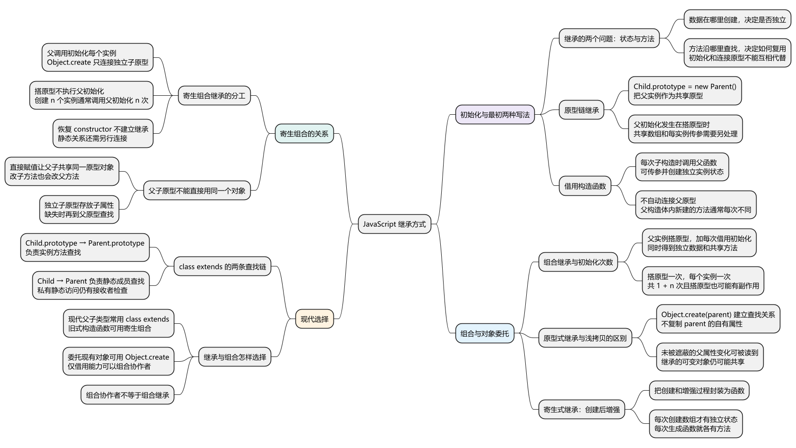
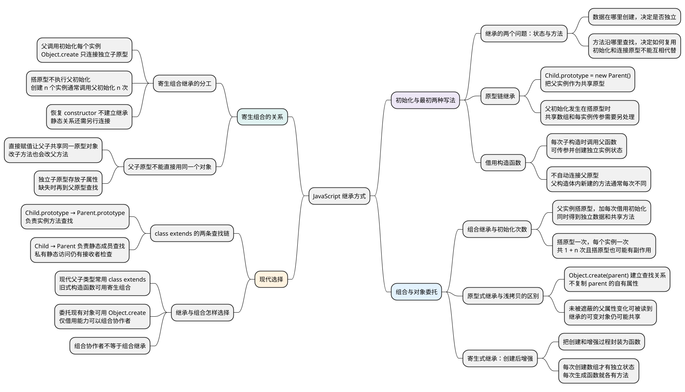

# JavaScript 继承方式

<!-- core-mindmap:start -->
[](examples/c12-mindmap.svg)

<details>
<summary>PlantUML 源码</summary>



</details>

<!-- core-mindmap:end -->

**口述总览：** 让一个对象使用另一个对象提供的方法，是代码复用的一种方式。但方法能找到了，不代表每个对象的数据也准备好了。理解 JavaScript 的继承，始终分别回答两个问题：每个实例的数据是否独立，父级方法怎样复用。常见的六种继承写法，就是对这两件事的不同安排。

<!-- recall-route:start -->
**记忆线：** 独立状态与共享方法 → 六种继承安排 → 两条原型链 → 继承还是组合。每种写法都追问数据在哪里创建、方法沿哪里查找。

本篇按 10 个主要知识点复习：[先自查](#self-check) · [口述与答案](#interview)。导图、自查与口述顺序对应，完整答案可直接顺序阅读，不依赖跳转。
<!-- recall-route:end -->

本篇接着[原型与原型链](03_原型与原型链.md)比较各类写法；[构造函数与 new](02_构造函数与new.md)解释创建实例的具体步骤。[class 与私有成员](05_class与私有成员.md)继续讲现代类的初始化与封装。以下每个 JavaScript 代码块均可在现代 Node.js ES 模块中独立运行。

<a id="k01"></a>

## 先分清实例自己的数据与父级共享的方法

**口述：** 假设 Parent 提供 name、items 和 say，Child 需要沿用这些能力。name 和 items 通常是每个实例各自维护的数据；say 可以是共享函数，因为调用时的 this 会指出它正在操作哪个实例。这种让子对象沿用父级能力的关系称为继承。

检查任何一种实现，都先做两件事：

- 看数据在哪里创建：是在每次创建实例时写到实例上，还是提前写到了大家共用的原型上？
- 看方法怎样找到：是沿原型链查找同一个函数，还是每次创建对象时又生成一个函数？

父函数的初始化代码与父原型上的方法是分开的。执行 Parent.call(this, name) 可以写入实例数据，却不会自动连接原型；连接原型可以找到方法，却不会自动执行 Parent。

方法共享也不等于状态共享。多个实例调用同一个 say 时，this 可以分别是各自的实例；但如果它们读到的是原型上的同一个数组，修改数组内容就会互相影响。

<a id="k02"></a>

## 只接原型或只做初始化，各自缺少什么

### 让子原型成为父实例：方法能复用，状态可能共享

**口述：** 如果把一个父实例放在 Child.prototype 上，子实例就能沿它继续找到父方法。这叫**原型链继承**。问题是父初始化写入的数组也留在这个共享对象上，并没有为每个子实例单独创建。

<!-- example: inheritance-prototype-chain -->
```js
let calls = 0;
function Parent(name) {
  calls++;
  this.name = name;
  this.items = [];
}
Parent.prototype.say = function () { return this.name; };
function Child() {}
Child.prototype = new Parent('shared');
console.log(calls); // 1

const a = new Child('A');
const b = new Child('B');
a.items.push(1);
console.log(a.say(), b.say()); // shared shared
console.log(b.items.length, calls); // 1 1
console.log(Object.hasOwn(a, 'items')); // false
console.log(a.say === b.say); // true
```

Parent 在建立 Child.prototype 时执行了一次。a 和 b 自身都没有 items，读取时找到同一个原型数组，因此 a.items.push(1) 之后，b 也能看到这个元素。

这里不能笼统说“父构造函数不能传参”：new Parent('shared') 已经传了参数。真正的限制是，这次初始化发生在搭建共享原型时；以后 new Child('A') 的参数不会自动变成一次针对 a 的父初始化。当前 Child 没有处理参数，所以两个实例都读到 shared。

这种写法简单，父原型方法也确实复用了，但会把实例状态与共享原型混在一起。为每个子实例单独初始化所需数据，才能避免这类共享问题。

### 在子构造函数内执行父初始化：数据独立，父原型没接上

**口述：** 换个方向，在创建每个 Child 时，让 Parent 以当前子实例为 this 执行。它写入的属性就属于当前实例。这叫**借用构造函数**，也常叫构造函数继承；它只解决初始化，不会自动继承父原型方法。

<!-- example: inheritance-borrow-constructor -->
```js
function Parent(name) {
  this.name = name;
  this.items = [];
  this.ownSay = function () { return this.name; };
}
Parent.prototype.say = function () { return this.name; };
function Child(name) {
  Parent.call(this, name);
}

const a = new Child('A');
const b = new Child('B');
a.items.push(1);
console.log(a.name, b.name); // A B
console.log(b.items.length, Object.hasOwn(a, 'items')); // 0 true
console.log(typeof a.say); // undefined
console.log(a.ownSay === b.ownSay); // false
console.log(a instanceof Parent); // false
```

Parent.call 没有复制 Parent 的代码，只是调用同一个函数，并把 this 指定为当前子实例。每次调用中的 [] 创建不同数组，因此数据独立；ownSay 的函数表达式也每次重新求值，因此每个实例各有一个函数。

a 的查找路线仍然是 a → Child.prototype → Object.prototype，没有经过 Parent.prototype，所以找不到 say。把方法放进父构造函数可以让实例拥有它，但失去了本例希望通过原型共享函数的效果。

**注意：** 这里借用的是可普通调用的函数。class 构造器不能通过 Parent.call 执行，其派生构造流程见[下一篇](05_class与私有成员.md#k02)。

<a id="k03"></a>

## 同时接原型与做初始化：组合继承多做了哪一步

**口述：** 把前面两种做法合起来：用父实例搭建子原型，再在每次创建子实例时调用父函数，就能同时得到独立数据和共享方法。这叫**组合继承**。它能工作，但搭原型时已经执行了一次父初始化，留下了通常用不上的原型数据。

<!-- example: inheritance-combination -->
```js
let calls = 0;
function Parent(name) {
  calls++;
  this.name = name;
  this.items = [];
}
Parent.prototype.say = function () { return this.name; };
function Child(name) {
  Parent.call(this, name);
}
Child.prototype = new Parent('prototype');
console.log(calls); // 1

const a = new Child('A');
const b = new Child('B');
a.items.push(1);
console.log(calls); // 3
console.log(a.say(), b.items.length); // A 0
console.log(Object.hasOwn(a, 'items')); // true
console.log(Object.hasOwn(Child.prototype, 'items')); // true
console.log(a.items === Child.prototype.items); // false
console.log(a.say === b.say); // true
```

a 自己的 items 遮住了 Child.prototype.items。两个子实例的数据分别创建，say 则沿 Child.prototype → Parent.prototype 找到同一个函数，所以两个核心问题都处理了。

额外成本发生在哪里，要按时间线数：搭建子原型调用 Parent 一次，此后每次 new Child 再调用一次。在只搭建一次原型、创建 n 个子实例的前提下，共调用 1 + n 次，不能说每创建一个子实例固定调用两次。

这不只关乎一个多余数组。如果父初始化还会登记对象或执行其他副作用，搭建原型也会触发它。我们只想连接父方法，却执行了一整套实例初始化，因此还可以继续改进。

<a id="k04"></a>

## 直接从对象出发：建立查找关系，再按需增强

### 原型式继承：创建一个以现有对象为原型的新对象

**口述：** 如果已经有一个对象提供可复用的属性，就可以直接让新对象以它为原型，不必先定义父子构造函数。这叫**原型式继承**，现代 JavaScript 可以使用 Object.create 实现。

<!-- example: inheritance-prototypal -->
```js
const parent = {
  name: 'parent',
  items: [],
  say() { return this.name; }
};
const a = Object.create(parent);
const b = Object.create(parent);
a.name = 'A';
parent.name = 'changed';
a.items.push(1);

console.log(a.say(), b.say()); // A changed
console.log(Object.keys(b).length); // 0
console.log(Object.hasOwn(a, 'say')); // false
console.log(b.items.length, parent.items.length); // 1 1
console.log(Object.getPrototypeOf(a) === parent); // true
```

b 没有自己的属性，却可以读到 parent 的 name 和 say；parent.name 改变后，b 的读取结果也改变了。a 写入自己的 name 后，则优先读到 A。

**Object.create(parent) 建立的是查找关系，不是浅拷贝。** 这次调用没有把 parent 的自有属性复制到新对象上。对象展开等浅拷贝会把可枚举自有属性写到另一个对象，但嵌套对象引用仍可能共享；不能因为两种方式都可能共享数组，就把它们当成同一操作。

原型式继承适合明确希望委托给一个现有对象的场景。它不会自动隔离可变状态：本例的 items 仍在 parent 上，两个新对象读到的是同一个数组。

### 寄生式继承：创建对象以后，再补上需要的能力

**口述：** 还可以把“创建一个对象，再给它增加属性或方法”封装进函数，向调用者返回增强后的对象。这个模式通常叫**寄生式继承**。它的状态是否独立、函数是否共享，仍由增强时的具体代码决定。

<!-- example: inheritance-parasitic -->
```js
const parent = {
  items: [],
  say() { return this.name; }
};
function createChild(name) {
  const child = Object.create(parent);
  child.name = name;
  child.items = [];
  child.describe = function () { return this.say(); };
  return child;
}

const a = createChild('A');
const b = createChild('B');
a.items.push(1);
console.log(a.describe(), b.items.length); // A 0
console.log(a.say === b.say); // true
console.log(a.describe === b.describe); // false
```

这里显式写入 child.items = []，所以实例数组独立；如果删去这一步，读取 items 就仍会找到 parent 上的共享数组。say 沿原型共享，describe 却在每次创建时生成一个新函数。

这种封装便于在创建时增强对象，但“增强”不天然保证状态独立，也不天然保证新加方法共享。如果方法不需要每个对象单独生成，可以将函数放在共享位置，避免重复创建。

<a id="k05"></a>

## 只连接需要的关系：寄生组合继承

**口述：** 回到父子构造函数的场景。每个子实例仍执行父初始化，但建立子原型时只创建一个以父原型为原型的空对象，就不必为了接上方法而额外执行 Parent。这种写法叫**寄生组合继承**。

<!-- example: prototype-inheritance -->
```js
function Parent(name) {
  this.name = name;
  this.items = [];
}
Parent.prototype.say = function () {
  return this.name;
};
Parent.kind = 'parent';

function Child(name) {
  Parent.call(this, name);
}
Child.prototype = Object.create(Parent.prototype);
Object.defineProperty(Child.prototype, 'constructor', {
  value: Child,
  writable: true,
  configurable: true
});

const a = new Child('A');
const b = new Child('B');
a.items.push(1);

console.log(a.say(), b.items.length); // A 0
console.log(a instanceof Parent, a instanceof Child); // true true
console.log(a.say === b.say); // true
console.log(Child.kind); // undefined
```

这段代码分工很清楚：

- Parent.call(this, name) 对当前子实例执行初始化，使 name 和 items 成为它自己的属性。
- Object.create(Parent.prototype) 创建独立的子原型，接上父方法的查找路径；这一步没有调用 Parent。
- 补回 constructor 只是让子原型上的普通属性指向 Child，不负责连接原型，也不影响 new 选择哪个构造函数。

这里用 Object.defineProperty 恢复 constructor，并使其默认不可枚举。直接赋值也能写入这个普通属性，但在此处新增自有属性时会默认可枚举。

创建 n 个子实例，父初始化执行 n 次；搭建子原型不额外执行。数据独立、方法共享、子原型与父原型分开，是这种写法相较组合继承的实际好处。

### 为什么子原型必须是独立对象

<!-- example: inheritance-prototype-alias -->
```js
function Parent() {}
Parent.prototype.say = function () { return 'parent'; };
function Child() {}
Child.prototype = Parent.prototype;
Child.prototype.say = function () { return 'child'; };
Child.prototype.constructor = Child;

console.log(new Parent().say()); // child
console.log(Child.prototype === Parent.prototype); // true
console.log(Parent.prototype.constructor === Child); // true
```

直接写 Child.prototype = Parent.prototype，只是让两个属性指向同一个对象。子类型改方法，父类型也跟着变；给子类型恢复 constructor，也会改到父原型。

Object.create 则保留两个不同对象：Child.prototype 可以存放子类型自己的方法，找不到时才继续查 Parent.prototype。这里只修改自己定义的类型，不需要修改任何原生对象的原型。

<a id="k06"></a>

## 实际开发怎样选择

**口述：** 读旧代码时，要能识别六种写法各自做了什么；写新代码时，则从对象关系出发选择。只有确实需要稳定的父子类型关系，才建立继承；只是想借用一项能力，可以把函数或协作对象组合起来。

在需要父子构造函数继承的旧式代码中，寄生组合把实例初始化与原型连接分开，通常比 new Parent 搭原型更清楚。若只是让一个对象委托给另一个现有对象查找，Object.create 就足够，但要明确共享的可变状态归谁管理。

现代类代码通常用 class extends 表达继承。它仍然依赖原型机制，并同时建立实例方法与静态成员两条查找链：

<!-- example: inheritance-class-links -->
```js
class Parent {
  static kind = 'parent';
  constructor(name) {
    this.name = name;
    this.items = [];
  }
  say() { return this.name; }
}
class Child extends Parent {}
const a = new Child('A');
const b = new Child('B');
a.items.push(1);

console.log(a.say(), b.items.length); // A 0
console.log(a.say === b.say); // true
console.log(Object.getPrototypeOf(Child.prototype) === Parent.prototype); // true
console.log(Object.getPrototypeOf(Child) === Parent); // true
console.log(Child.kind); // parent
```

实例方法沿 a → Child.prototype → Parent.prototype 查找；静态成员沿 Child → Parent 查找。前面的寄生组合示例只连接了第一条，所以 Child.kind 是 undefined；extends 示例同时连接第二条，因此可以读取父类的公开静态属性 kind。

这条静态查找链不代表父类的私有静态成员也能以子类作为接收者访问，其限制见[私有成员的边界](05_class与私有成员.md#k04)。

class 不是把任意旧式继承代码换个外观就完全等价。字段的初始化顺序、super 的调用与查找、私有成员限制，都在[下一篇](05_class与私有成员.md)展开。

继承要求子类型能遵守父类型的对外约定。若订单服务只是需要存储能力，让它持有 storage 对象通常比继承某个数据库类更合适；这种通过协作者完成工作的方式称为组合。它与前面的“组合继承”是不同概念。

<a id="summary"></a>

复习任何继承代码，先问“每个实例的数据是否独立”，再问“父级方法怎样复用”。随后检查父初始化发生几次、子原型是否独立、静态成员有没有另建关系；六种名称就能落到具体执行过程上。

<a id="self-check"></a>

## 自查问题

先遮住答案，沿记忆线逐题口述；下方按相同顺序提供完整回答与记忆提示。

1. [分析 JavaScript 继承时，为什么要把实例初始化与父方法复用分开？](#recall-01)
2. [把父实例放在 Child.prototype 上能复用什么？为什么数组可能共享，子实例参数又不会自动交给父初始化？](#recall-02)
3. [Parent.call(this) 为什么能让数据独立，却不能自动继承父原型方法？它复制了父函数代码吗？](#recall-03)
4. [组合继承怎样兼顾独立数据和共享方法？创建 n 个实例时父初始化为什么是 1 + n 次？](#recall-04)
5. [Object.create 为什么不是浅拷贝？父对象后来改变属性，新对象什么时候能看到？](#recall-05)
6. [寄生式继承做了什么？返回增强对象能保证状态独立和方法共享吗？](#recall-06)
7. [寄生组合继承怎样避免搭原型时执行父构造？恢复 constructor 和静态继承分别有什么作用？](#recall-07)
8. [为什么 Child.prototype = Parent.prototype 会影响父类型？Object.create 怎样解决？](#recall-08)
9. [class extends 建立哪两条关系？只做寄生组合，为什么不一定能读取父类静态属性？](#recall-09)
10. [现代代码与旧式构造函数代码各怎样选择继承？组合和组合继承是一回事吗？](#recall-10)

<a id="interview"></a>

## 试题与答案

以下按 10 个知识点归纳，原有分级题号和示例继续保留。

<a id="recall-01"></a>

### 继承的两个问题：状态与方法

**自查：** 分析 JavaScript 继承时，为什么要把实例初始化与父方法复用分开？

**回答：** 实例数据独立与父级方法复用是两个不同的问题。调用父初始化，可以在当前实例上准备 name、数组等状态，但不会自动接上父原型；关联父原型，可以沿链找到方法，却不等于父初始化已经执行。共享方法通过本次 this 操作不同实例，而共享数组会让修改互相影响。

**记忆：** 初始化管每份状态，原型链管共享方法。

<a id="recall-02"></a>

### 原型链继承

**自查：** 把父实例放在 Child.prototype 上能复用什么？为什么数组可能共享，子实例参数又不会自动交给父初始化？

**回答：** 原型链继承用一个父实例作为子原型，因此子实例能沿链找到父方法。但父初始化发生在搭建共享原型时，数组等数据也留在这个共享对象上，子实例读取后修改同一数组会互相影响。搭原型时可以给父函数传参；限制在于以后创建每个子实例时，不会自动再按它的参数执行一次独立的父初始化。

**记忆：** 父实例当共享原型，方法能找，原型上的数组也会共用。

<a id="recall-03"></a>

<a id="c12-03"></a>

### C12-03 [P0·原理] 借用父构造函数初始化为什么不继承父原型方法？

**自查：** Parent.call(this) 为什么能让数据独立，却不能自动继承父原型方法？它复制了父函数代码吗？

**回答：** Parent.call(this, name) 只是以当前子实例为 this 调用父函数，执行属性初始化，不会修改对象的原型关联。如果没有另行连接 Child.prototype 与 Parent.prototype，子实例的查找链就不经过父原型，自然找不到父原型上的方法。

**记忆：** 借用只是调用初始化，不复制代码，也不自动接原型。

<a id="recall-04"></a>

<a id="c12-05"></a>

### C12-05 [P1·原理] 组合继承中父构造函数到底调用几次？

**自查：** 组合继承怎样兼顾独立数据和共享方法？创建 n 个实例时父初始化为什么是 1 + n 次？

**回答：** 在典型的 Child.prototype = new Parent() 加 Parent.call(this) 写法中，搭建子原型调用一次，每创建一个子实例再调用一次。若原型只搭建一次、创建 n 个子实例，总计 1 + n 次；不是每个实例固定调用两次。寄生组合使用 Object.create 搭建原型，可以省去那次用于搭原型的父初始化。

**记忆：** 搭原型一次，每建实例一次；独立数据遮蔽了原型上的多余数据。

<a id="recall-05"></a>

<a id="c12-04"></a>

### C12-04 [P0·原理] Object.create为什么不是浅拷贝？

**自查：** Object.create 为什么不是浅拷贝？父对象后来改变属性，新对象什么时候能看到？

**回答：** Object.create(parent) 创建一个以 parent 为原型的新对象，这次调用不复制 parent 的自有属性。读取继承属性时会继续到 parent 查找，父对象的后续修改也可能反映到读取结果中。浅拷贝则会把相应属性写到新对象自身；两者都可能共享嵌套对象引用，但机制不同。

**记忆：** 原型式建立后续查找，浅拷贝把属性写到新对象自身。

<a id="recall-06"></a>

### 寄生式继承：创建后增强

**自查：** 寄生式继承做了什么？返回增强对象能保证状态独立和方法共享吗？

**回答：** 寄生式继承把创建对象、补充属性或方法、返回增强对象的过程封装在函数里。名称本身不保证状态独立或方法共享：显式为每个结果创建数组，才会获得独立数组；增强时每次创建新的函数，就会各有一份方法。沿原型取得的共享方法与本次增强生成的方法要分别判断。

**记忆：** 先创建再增强，独立与共享仍看具体代码。

<a id="recall-07"></a>

<a id="c12-02"></a>

### C12-02 [P1·编码] 寄生组合继承各部分负责什么？

**自查：** 寄生组合继承怎样避免搭原型时执行父构造？恢复 constructor 和静态继承分别有什么作用？

**回答：** 借用父构造函数负责给每个实例初始化独立数据，Object.create 负责连接子原型与父原型，补回 constructor 只是恢复普通属性。这些操作没有自动建立构造函数之间的静态继承，也不能用 call 执行 class 构造函数。正文的完整例子可以分别验证状态独立、方法共享和原型关系。

**记忆：** 父调用初始化，Object.create 接原型，constructor 只是普通属性。

<a id="recall-08"></a>

<a id="c12-01"></a>

### C12-01 [P0·原理] Child.prototype=Parent.prototype为什么危险？

**自查：** 为什么 Child.prototype = Parent.prototype 会影响父类型？Object.create 怎样解决？

**回答：** 这样父子直接共享同一个原型对象。通过子类型增加或修改原型方法，会影响父类型。使用 Object.create 创建独立的子原型，再让它关联父原型，可以在复用父方法的同时保留子类型自己的属性。

**记忆：** 共用同一对象会互相修改，独立子原型才能只扩展自己。

<a id="recall-09"></a>

### class extends 的两条查找链

**自查：** class extends 建立哪两条关系？只做寄生组合，为什么不一定能读取父类静态属性？

**回答：** 普通 class extends 同时建立实例方法链与类对象的静态成员链：子原型关联父原型，子类对象关联父类对象。只用 Object.create 连接实例原型，不会自动建立类对象之间的静态关系。公开静态方法可以被继承，但私有静态字段还检查接收者；class 也有 super、字段初始化等专门构造规则。

**记忆：** 实例方法一条链，类的静态成员另一条链。

<a id="recall-10"></a>

<a id="c12-06"></a>

### C12-06 [P1·设计] 如何选择继承方式？

**自查：** 现代代码与旧式构造函数代码各怎样选择继承？组合和组合继承是一回事吗？

**回答：** 先判断是否需要稳定的父子类型关系，还是只需要组合某些能力。需要现代类继承时通常使用 class extends；维护旧式构造函数继承时可采用寄生组合，将独立状态初始化与父方法复用分开；直接委托给现有对象时可以使用 Object.create。任何选择都要检查实例状态是否独立、方法如何复用，不能只根据写法名称判断。

通过持有并调用协作者来复用能力，称为组合；“组合继承”则特指原型链继承与借用构造函数结合的继承写法，两者不是同一个概念。

**记忆：** 父子关系稳定再继承，只需一项能力可组合协作者。

参考：[MDN：继承与原型链](https://developer.mozilla.org/zh-CN/docs/Web/JavaScript/Guide/Inheritance_and_the_prototype_chain)、[MDN：Object.create](https://developer.mozilla.org/zh-CN/docs/Web/JavaScript/Reference/Global_Objects/Object/create)。
