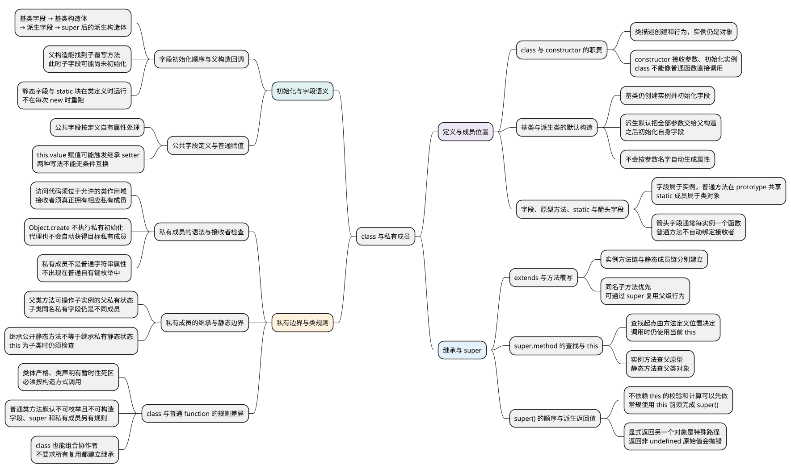

# class 与私有成员

<!-- core-mindmap:start -->
[](examples/c13-mindmap.svg)

<details>
<summary>PlantUML 源码</summary>



</details>

<!-- core-mindmap:end -->

**口述总览：** class 用来集中描述一类对象如何初始化、有哪些共享方法，以及如何继承其他类。通过 new 创建的实例仍然是 JavaScript 对象，class 没有另造一种语言数据类型。学习时先会定义和使用一个类，再区分成员的位置、构造顺序与私有访问规则。

<!-- recall-route:start -->
**记忆线：** 创建实例 → 成员位置 → extends 与 super → 初始化顺序 → 私有检查。遇到问题分别检查原型关系、字段是否准备好、当前接收者是谁。

本篇按 11 个主要知识点复习：[知识点归纳与自查](#self-check) · [试题与答案](#interview)。导图、自查与口述顺序对应，完整答案可直接顺序阅读，不依赖跳转。
<!-- recall-route:end -->

本篇按“基本写法 → constructor → 成员位置 → extends 与 super → 初始化顺序 → 私有成员”展开。示例在支持类字段与私有成员的现代 Node.js 中独立运行。对象创建与 new 的具体规则见[构造函数与 new](02_构造函数与new.md)，原型关系见[原型与原型链](03_原型与原型链.md)。

## class 是什么，如何初始化一个实例

**口述：** 一个类把实例需要的数据和操作组织在一起。创建实例时，constructor 接收传入的参数，建立这个实例最初的状态；创建完成后，再通过实例调用方法。多个实例可以各自保存数据，同时共用普通实例方法。

### 先写对类声明，再使用 new

类名后面直接写类体，不在类名后加参数括号。参数写在类体里的 constructor 上，因此正确形式是 `class Person { constructor(name) {} }`；`class Person() {}` 是语法错误。

<!-- example: class-basic-constructor -->
```js
class Person {
  constructor(name, age) {
    this.name = name;
    this.age = age;
  }
  say() {
    return `我叫${this.name}，今年${this.age}岁`;
  }
}

const person = new Person('Lin', 18);
console.log(person.say()); // 我叫Lin，今年18岁
console.log(typeof Person, typeof person); // function object
```

new Person 把参数交给 constructor；构造过程中，this 表示正在初始化的实例。这里 name 和 age 被写到 person 自身，say 则描述实例可以执行的操作。

say 中的 return 把结果交还调用处。若只在 say 里 console.log 一句话而不 return，调用 say 的返回值就是 undefined；外层再 console.log(person.say())，会先看到那句话，再看到 undefined。输出日志与返回结果是两件事。

constructor 是类中专门负责构造的入口，不是每次调用实例方法都会执行的初始化钩子。一个类只能显式定义一个 constructor；class 构造器也不能当普通函数直接调用，Person() 或 Person.call(...) 都会抛 TypeError。

### 不写 constructor，会发生什么

没有 extends 的类叫**基类**；通过 extends 继承另一个类的类叫**派生类**。省略 constructor 时，语言提供默认构造行为，但这两种类的默认行为不同：

- 基类：可以创建实例，仍会初始化实例字段，只是不执行额外的构造体逻辑。
- 派生类：把接收到的全部参数交给父类构造流程，完成后仍会初始化自己的实例字段。

<!-- example: class-default-constructor -->
```js
class Empty {}
class Named {
  constructor(name) {
    this.name = name;
  }
}
class Student extends Named {}

const empty = new Empty();
const student = new Student('Lin');
console.log(Object.getPrototypeOf(empty) === Empty.prototype); // true
console.log(student.name); // Lin
```

Student 没写 constructor，父类仍然收到了 Lin。默认构造行为不会根据参数名自动生成同名属性；name 存在，是因为 Named 的构造体进行了赋值。需要增加参数处理或额外初始化时，再显式写 constructor。

<a id="k01"></a>

## 类里写的成员实际放在哪里

**口述：** 实例属性属于每个对象，普通实例方法放在类的 prototype 上供实例共享，static 成员属于类对象。箭头字段虽然也能作为方法调用，但它是每个实例各自创建的函数，不能把这几种成员都归为“原型方法”。

先区分四种写法，再看它们的位置：

- `this.value = 0`：在构造体里给当前实例赋值；本例使用的 `value = 0` 是实例字段，也在每次构造时初始化。
- `increment() {}`：普通实例方法，定义在 Counter.prototype 上。
- `reset = () => {}`：值为箭头函数的实例字段，每个实例创建一个函数。
- `static kind = 'counter'`：静态字段，属于 Counter；static 方法也属于类对象。

<!-- example: class-member-locations -->
```js
class Counter {
  value = 0;
  increment() {
    return ++this.value;
  }
  reset = () => {
    this.value = 0;
  };
  static kind = 'counter';
}

const a = new Counter();
const b = new Counter();
console.log(Object.hasOwn(a, 'value')); // true
console.log(Object.hasOwn(a, 'increment')); // false
console.log(a.increment === b.increment); // true
console.log(a.reset === b.reset); // false
console.log(Counter.kind, a.kind); // counter undefined
```

a 与 b 读到同一个 increment 函数，但各自通过实例调用时，函数里的 this 分别指向 a 和 b，所以共享方法仍能操作各自的数据。

箭头字段 reset 在实例初始化时记住外层的实例 this，取出后调用仍能操作该实例，代价是每个实例各有函数。普通方法不自动绑定实例，取出做回调时要通过 bind、包装函数或调用方约定明确接收者，见[this 指向](../02_运行基础/06_this指向.md)。

static 成员通常通过类访问。静态方法里的 this 取决于调用时点号左边是谁，例如 Counter.someMethod() 中是 Counter；它不会自动得到某个实例的 value。

<a id="k03"></a>

## extends 建立继承，super 分别处理构造和方法调用

**口述：** extends 让子类实例可以使用父类的共享方法，也让子类可以查找父类的静态成员。super() 用于派生构造器的父类构造流程；super.method() 用于从父级查找方法并以当前 this 调用，两者的任务不同。

### 继承后，可以复用或改写父类方法

子类可以增加自己的成员，也可以定义同名方法改变行为，这叫**覆写**。需要在原有行为上继续加工时，可以在子方法里调用 super.method()。

<!-- example: class-super -->
```js
class Base {
  static kind = 'base';
  greet() {
    return this.name;
  }
}
class Child extends Base {
  constructor(name) {
    super();
    this.name = name;
  }
  greet() {
    return super.greet() + '!';
  }
}

const child = new Child('Lin');
console.log(child.greet()); // Lin!
console.log(Child.kind); // base
console.log(Object.getPrototypeOf(Child) === Base); // true
console.log(Object.getPrototypeOf(Child.prototype) === Base.prototype); // true
```

调用 child.greet() 时先找到子方法；其中 super.greet 从 Base.prototype 开始查找父方法，但仍以 child 作为 this，所以父方法读到 child.name，再由子方法补上感叹号。它没有创建额外的父实例，也没有把 this 换成 Base.prototype。

实例方法的查找沿 Child.prototype → Base.prototype，静态成员的查找沿 Child → Base。super 的查找起点由方法定义的位置决定，不能简单替换为 Object.getPrototypeOf(this)。静态方法中的 super.method() 则从父类对象查找方法，同样保留当前 this。

### super() 必须先于 this，不必是第一条语句

派生构造器借助 super() 调用父类构造流程，取得并初始化当前 this。常规构造流程在访问 this、使用 super.method() 或正常结束构造前，必须完成 super()；但是参数校验、局部计算和日志等不依赖 this 的操作可以放在前面。

<!-- example: class-super-before-this -->
```js
class Person {
  constructor(name) {
    this.name = name;
  }
}
class Student extends Person {
  constructor(name) {
    const cleaned = name.trim();
    super(cleaned);
    this.role = 'student';
  }
}

const student = new Student(' Lin ');
console.log(student.name, student.role); // Lin student
```

局部变量 cleaned 的计算没有读取当前实例，因此可以先执行。把 this.role 的赋值移到 super() 前，则会因 this 尚未初始化而抛 ReferenceError。

派生构造器显式返回另一个对象是特殊路径，可以不经过常规 super() 初始化；返回非 undefined 的原始值则会抛错。这里只保留这个边界，普通业务构造流程按“完成 super，再使用 this”理解即可。

<a id="k02"></a>

## 字段和构造体按什么顺序运行

**口述：** 基类字段先于基类构造体初始化；派生类字段在 super() 完成父类构造流程之后、后续构造体代码之前初始化。因此父类构造器运行时，子类方法通常已经能找到，但子类字段还没有准备好。

<!-- example: class-initialization -->
```js
const events = [];
class Base {
  x = (events.push('base field'), 1);
  constructor() {
    events.push('base body');
  }
}
class Child extends Base {
  y = (events.push('child field'), 2);
  constructor() {
    super();
    events.push('child body');
  }
}

new Child();
console.log(events.join(' ->'));
// base field ->base body ->child field ->child body
```

同一个类的实例字段按声明顺序初始化。上例的执行路线是：基类字段 → 基类构造体 → 子类字段 → super() 后的子类构造体代码。若子类在 super() 之前有允许的局部操作，它们会更早执行。

静态字段和 static 块属于另一条时间线：类定义求值时按声明顺序执行，不会每次 new 都重新执行。

### 父构造器为什么可能读到未准备好的子字段

<!-- example: class-early-override -->
```js
class Base {
  constructor() {
    console.log(this.describe());
  }
}
class Child extends Base {
  label = 'ready';
  describe() {
    return this.label;
  }
}

const child = new Child(); // undefined
console.log(child.describe()); // ready
```

对象已关联 Child.prototype，所以父构造器能找到子类覆写的 describe；此时 label 还没有初始化，方法读到 undefined。构造完成后再调用，同一个方法就能读到 ready。

因此，基类构造体应避免调用依赖子类状态的可覆写方法；可以把启动操作安排在构造完成之后。

### 公共字段定义与普通赋值还有一个区别

`value = 0` 按“定义自有属性”的方式初始化。`this.value = 0` 则是普通赋值，可能调用原型链上继承来的 setter，也就是处理该属性赋值的函数。

因此，若父原型为 value 定义了 setter，子类声明同名公共字段通常会直接创建自有属性；在构造体里给 this.value 赋值则可能进入 setter。两种写法常能得到相似的数据，却不能无条件视为同一个操作。

<a id="k04"></a>

## 私有成员只允许在规定范围内访问

**口述：** # 成员用来保存或实现只供类内部访问的状态和行为。它不是换个名字的普通属性：代码必须处于允许访问该私有名字的类作用域中，接收访问的对象也必须真正拥有该私有成员。

### 先理解内部访问，再看接收者检查

`#value` 是私有字段；`#read() {}` 则是私有方法。类内部可以通过 this 访问它们，外部通过公开方法间接使用。类外直接写 real.#value 会在语法分析阶段失败，不能把它当成读取一个不存在的普通属性。

<!-- example: class-private-brand -->
```js
class Secret {
  #value = 7;
  read() {
    return this.#value;
  }
}
const real = new Secret();
const fake = Object.create(Secret.prototype);

console.log(real.read()); // 7
console.log(Reflect.ownKeys(real).length); // 0
console.log(fake instanceof Secret); // true
try {
  fake.read();
} catch (error) {
  console.log(error.name); // TypeError
}
```

fake 有正确的原型路径，可以找到 read，也能通过默认 instanceof；但它没有执行 Secret 的私有初始化，所以无法读取 #value。这种检查“当前接收者是否拥有对应私有成员”的机制，常称为**品牌检查**。

real['#value'] 只是读取名为 #value 的普通字符串属性，与真正的私有字段无关。私有成员不出现在 Object.keys 或 Reflect.ownKeys 的结果中，也不会被普通属性遍历复制。

### 私有成员在继承和代理中的边界

父类私有状态可以在构造子实例时被初始化，所以父类方法可以操作子实例里的那份父类私有状态。子类代码不能直接访问父类的 #名字；子类即使声明同名 #字段，也是不同的私有成员。

Proxy 是包装目标对象的另一对象。通过代理调用 read 时，this 可能变成代理，而私有成员在原目标上；即使代理没有自定义拦截逻辑，也不会自动通过私有检查。代理行为见[Proxy 与 Reflect](06_Proxy与Reflect.md)。

静态私有成员还有一个接收者边界：

<!-- example: class-private-static -->
```js
class Base {
  static #value = 1;
  static read() {
    return this.#value;
  }
}
class Child extends Base {}

console.log(Base.read()); // 1
try {
  Child.read();
} catch (error) {
  console.log(error.name); // TypeError
}
```

Child 能继承公开的 read 方法，但调用时 this 是 Child；私有静态字段属于 Base，Child 没有这一成员。如果方法设计为始终读取 Base 的状态，可以写 Base.#value。

下划线命名只是一种约定，Symbol 用于减少键冲突，闭包通过作用域隐藏变量；#成员则有专门的语法限制和接收者检查。

<a id="k05"></a>

## class 与普通 function 有哪些区别

**口述：** class 仍建立在原型机制上，集中表达构造、方法和继承关系；但它同时带来必须遵守的调用、作用域和初始化规则，不能与任意普通函数写法视为完全等价。

- 普通 function 声明通常既能普通调用，也能通过 new 构造；class 构造器必须通过构造方式调用。
- 类体自动使用严格模式；普通函数要看所在环境或是否声明严格模式。
- 类声明的名字会在作用域中建立绑定，但执行到声明并初始化前不能访问，这段时期称为**暂时性死区**。理解时应区分“名字已经建立绑定”与“已经可以使用”，不能像普通函数声明那样提前调用。
- 类定义的普通方法默认不可枚举，并且没有构造能力，不能拿来 new。这是方法定义的语义，不能只根据函数有没有 prototype 属性判断能否构造。
- extends 通常同时建立实例方法与静态成员的继承关系；普通构造函数也能配置这两条关系，只是不会因为连接了实例原型就自动完成静态继承。
- 字段、super 和私有成员还规定了自己的初始化与访问规则。

### 使用 class 也可以把工作交给协作者

class 并不要求每次复用行为都建立继承。下面在构造时接收存储对象，实例方法把保存工作交给它，这种方式称为**组合**。

<!-- example: class-composition -->
```js
class OrderService {
  constructor(storage) {
    this.storage = storage;
  }
  save(order) {
    return this.storage.write(order);
  }
}

const saved = [];
const service = new OrderService({
  write(order) {
    saved.push(order.id);
    return order.id;
  }
});
console.log(service.save({ id: 'A' })); // A
console.log(saved.join(',')); // A
```

构造器保存每个实例要使用的协作者，save 方法负责转交操作。协作者的返回值、错误和同步或异步约定仍需明确。继承方式的比较与选择见[JavaScript 继承方式](04_JavaScript继承方式.md)，这里重点理解 class 的构造与成员规则。

<a id="summary"></a>

复述 class 时先说它如何组织和初始化对象，再说明成员分别放在哪里，最后沿“super → 字段顺序 → 方法查找与 this → 私有检查”分析行为。遇到边界时，区分原型关系、初始化是否完成和当前接收者，避免用一个规则代替全部机制。

<a id="self-check"></a>

## 知识点归纳与自查

本节按 11 个知识点回忆和归纳。先用自查问题检查理解，再顺序阅读各点口述与记忆提示；分级试题在后面的独立章节。

### 自查问题

1. [class 是一种新的语言数据类型吗？constructor 什么时候执行，能普通调用类吗？](#recall-01)
2. [类不写 constructor 可以吗？基类与派生类的默认行为有什么不同，参数会自动变属性吗？](#recall-02)
3. [类字段、普通方法、静态成员分别在哪里？箭头字段为什么可以保留实例 this，成本又是什么？](#recall-03)
4. [extends 建立哪些关系？子方法与父方法同名时怎样查找，静态成员通过哪里继承？](#recall-04)
5. [super.method 为什么不是以父原型作为 this？实例方法与静态方法中的 super 分别从哪里找？](#recall-05)
6. [super() 必须在派生构造器第一行吗？访问 this、正常返回与显式返回对象各有什么要求？](#recall-06)
7. [基类字段、基类构造体、子字段和子构造体是什么顺序？父构造器为什么可能调用到尚不能正常工作的子方法？](#recall-07)
8. [类中的 value = 0 与构造体里的 this.value = 0 总是等价吗？父原型 setter 会怎样影响？](#recall-08)
9. [为什么原型正确、instanceof 为 true 的对象，也可能不能访问 #字段？私有成员会被 ownKeys 列出来吗？](#recall-09)
10. [子类能直接访问父类私有字段吗？继承公开静态方法后，为什么 this.#value 仍可能失败？](#recall-10)
11. [为什么不能说 class 与任意旧式构造函数代码完全等价？类方法可枚举吗、能 new 吗？](#recall-11)

<a id="recall-01"></a>

### class 与 constructor 的职责

**自查：** class 是一种新的语言数据类型吗？constructor 什么时候执行，能普通调用类吗？

**口述：** class 集中描述一组对象的初始化、共享方法和继承关系，类创建的实例仍是 JavaScript 对象。类名后直接写类体，参数写在 constructor 中；new 时它接收参数并初始化当前实例，不是每次调用实例方法都会重跑构造。一个类只能显式定义一个 constructor，class 构造器必须按构造方式调用，不能直接调用或使用 call 普通调用。

**记忆：** 类组织创建规则，constructor 管初始化，new 才进入构造。

<a id="recall-02"></a>

### 基类与派生类的默认构造

**自查：** 类不写 constructor 可以吗？基类与派生类的默认行为有什么不同，参数会自动变属性吗？

**口述：** 可以。基类省略 constructor 后仍能创建实例并初始化实例字段，只是不执行额外构造体逻辑。派生类省略后，会把收到的全部参数交给父类构造流程，再初始化自己的实例字段；不会自动根据参数名生成实例属性。

**记忆：** 基类仍初始化字段，派生默认转交参数；属性仍由代码定义。

<a id="recall-03"></a>

### 字段、原型方法、static 与箭头字段

**自查：** 类字段、普通方法、静态成员分别在哪里？箭头字段为什么可以保留实例 this，成本又是什么？

**口述：** 实例字段和箭头字段在每个实例上初始化，普通实例方法在类的 prototype 上共享，static 成员属于类对象。箭头字段能够保留实例 this，但每个实例各有函数；普通方法共享，取出作为回调时需明确接收者。

**记忆：** 字段在实例，方法在原型，static 在类；箭头字段每例一份。

<a id="recall-04"></a>

### extends 与方法覆写

**自查：** extends 建立哪些关系？子方法与父方法同名时怎样查找，静态成员通过哪里继承？

**口述：** 通常的 class extends 让子类 prototype 关联父类 prototype，并让子类对象关联父类对象，分别支持实例方法和静态成员查找。子类定义同名方法叫覆写，读取时先得到子方法；可以通过 super.method 在父方法基础上继续处理。extends 没有把父类所有方法复制进每个实例，父类私有成员也不能像公开成员那样随意访问。

**记忆：** extends 接两条链，覆写优先找子方法。

<a id="recall-05"></a>

### super.method 的查找与 this

**自查：** super.method 为什么不是以父原型作为 this？实例方法与静态方法中的 super 分别从哪里找？

**口述：** 不是。super 依据方法的定义位置从相应父级查找；找到的方法以当前 this 调用，所以仍能操作子实例。静态方法中的 super 也保留当前 this，但查找父类对象，不能与实例方法的查找链混淆。

**记忆：** super 改查找起点，不替换当前 this。

<a id="recall-06"></a>

### super() 的顺序与派生返回值

**自查：** super() 必须在派生构造器第一行吗？访问 this、正常返回与显式返回对象各有什么要求？

**口述：** 不必。参数校验、局部计算等不依赖 this 的操作可以在前。常规流程必须在访问 this、使用 super.method() 或正常结束构造之前完成 super()，因为派生构造器要由它取得并初始化 this。显式返回另一对象是特殊路径，不应拿来概括常规构造顺序。

派生构造器显式返回另一个对象时可以走不调用 super 的特殊路径；返回非 undefined 的原始值会抛 TypeError，正常返回 undefined 则仍需要已初始化的 this。

**记忆：** 可以先做局部计算，常规构造先 super 再用 this。

<a id="recall-07"></a>

### 字段初始化顺序与父构造回调

**自查：** 基类字段、基类构造体、子字段和子构造体是什么顺序？父构造器为什么可能调用到尚不能正常工作的子方法？

**口述：** 常规流程先初始化基类字段，再执行基类构造体；super() 完成父构造流程后初始化派生字段，再继续执行 super() 后的派生构造体代码。父构造器若调用子类覆写方法，方法已经可以沿原型找到，但它依赖的子字段可能还未初始化。

**记忆：** 父字段、父构造、子字段、后续子构造；方法可找到不等于字段已准备。

<a id="recall-08"></a>

### 公共字段定义与普通赋值

**自查：** 类中的 value = 0 与构造体里的 this.value = 0 总是等价吗？父原型 setter 会怎样影响？

**口述：** 公共字段按定义自有属性的语义初始化；构造体中的 this.value = 0 是普通赋值，可能调用继承来的 setter。因此父原型存在同名 setter 时，子类公共字段通常直接定义实例自有属性，而普通赋值可能进入 setter。即使常见例子的最后结果相近，也不能把两种语义无条件视为相同。

**记忆：** 字段是定义自有属性，赋值可能走继承 setter。

<a id="recall-09"></a>

### 私有成员的语法与接收者检查

**自查：** 为什么原型正确、instanceof 为 true 的对象，也可能不能访问 #字段？私有成员会被 ownKeys 列出来吗？

**口述：** 原型关系只能帮助找到方法，私有访问还检查 this 是否真正拥有该类初始化的私有成员。Object.create(Secret.prototype) 没有执行私有初始化；Proxy 作为另一个接收者也不自动拥有目标的私有成员，因此可能抛 TypeError。

类外直接访问未获准的私有名字会在语法分析时失败。对象上的字符串键 "#value" 与真正的私有字段无关，私有成员也不会被 Object.keys、Reflect.ownKeys 当作普通属性枚举。

**记忆：** 能找到方法不等于拥有私有成员，语法范围和接收者都要检查。

<a id="recall-10"></a>

### 私有成员的继承与静态边界

**自查：** 子类能直接访问父类私有字段吗？继承公开静态方法后，为什么 this.#value 仍可能失败？

**口述：** 父构造流程可以为子实例初始化父类私有状态，因此父类方法仍能操作它；子类代码却不能直接使用父类的私有名字，子类同名私有声明也是另一成员。公开静态方法可以沿类对象链继承，但私有静态状态属于声明它的类，以子类为 this 访问会因接收者不符合要求而失败；如果确实要固定读父类状态，可在父类内部明确使用父类名称。

**记忆：** 父私有状态可在子实例中，子代码不能直接读；静态私有只认所属接收者。

<a id="recall-11"></a>

### class 与普通 function 的规则差异

**自查：** 为什么不能说 class 与任意旧式构造函数代码完全等价？类方法可枚举吗、能 new 吗？

**口述：** class 建立在原型机制之上，让类和继承的写法更集中，但还规定了类体严格模式、必须通过构造方式调用、类声明的暂时性死区、普通方法默认不可枚举，以及字段、super 和私有成员等规则。不能把它与任意旧式函数继承写法视为完全等价。

类体定义的普通方法没有构造能力，不能用 new 调用；这与类构造器本身需要构造调用是不同的规则。

**记忆：** 类基于原型，但严格模式、调用方式、初始化和私有访问有专门规则。

<a id="interview"></a>

## 试题与答案

<a id="c13-06"></a>

### C13-06 [P0·基础] 可以省略constructor吗，默认构造行为有什么区别？

**回答：** 可以。基类省略 constructor 后仍能创建实例并初始化实例字段，只是不执行额外构造体逻辑。派生类省略后，会把收到的全部参数交给父类构造流程，再初始化自己的实例字段；不会自动根据参数名生成实例属性。

<a id="c13-01"></a>

### C13-01 [P0·基础] class字段、方法、static分别放在哪里？

**回答：** 实例字段和箭头字段在每个实例上初始化，普通实例方法在类的 prototype 上共享，static 成员属于类对象。箭头字段能够保留实例 this，但每个实例各有函数；普通方法共享，取出作为回调时需明确接收者。

<a id="c13-03"></a>

### C13-03 [P1·原理] super.method的this是父对象吗？

**回答：** 不是。super 依据方法的定义位置从相应父级查找；找到的方法以当前 this 调用，所以仍能操作子实例。静态方法中的 super 也保留当前 this，但查找父类对象，不能与实例方法的查找链混淆。

<a id="c13-07"></a>

### C13-07 [P0·原理] super()一定要写在派生构造器第一行吗？

**回答：** 不必。参数校验、局部计算等不依赖 this 的操作可以在前。常规流程必须在访问 this、使用 super.method() 或正常结束构造之前完成 super()，因为派生构造器要由它取得并初始化 this。显式返回另一对象是特殊路径，不应拿来概括常规构造顺序。

派生构造器显式返回另一个对象时可以走不调用 super 的特殊路径；返回非 undefined 的原始值会抛 TypeError，正常返回 undefined 则仍需要已初始化的 this。

<a id="c13-02"></a>

### C13-02 [P0·原理] 派生类字段什么时候初始化？

**回答：** 常规流程先初始化基类字段，再执行基类构造体；super() 完成父构造流程后初始化派生字段，再继续执行 super() 后的派生构造体代码。父构造器若调用子类覆写方法，方法已经可以沿原型找到，但它依赖的子字段可能还未初始化。

<a id="c13-04"></a>

### C13-04 [P1·原理] 为什么有原型关系的对象也不能读#字段？

**回答：** 原型关系只能帮助找到方法，私有访问还检查 this 是否真正拥有该类初始化的私有成员。Object.create(Secret.prototype) 没有执行私有初始化；Proxy 作为另一个接收者也不自动拥有目标的私有成员，因此可能抛 TypeError。

类外直接访问未获准的私有名字会在语法分析时失败。对象上的字符串键 "#value" 与真正的私有字段无关，私有成员也不会被 Object.keys、Reflect.ownKeys 当作普通属性枚举。

<a id="c13-05"></a>

### C13-05 [P1·原理] class只是完全等价的语法糖吗？

**回答：** class 建立在原型机制之上，让类和继承的写法更集中，但还规定了类体严格模式、必须通过构造方式调用、类声明的暂时性死区、普通方法默认不可枚举，以及字段、super 和私有成员等规则。不能把它与任意旧式函数继承写法视为完全等价。

类体定义的普通方法没有构造能力，不能用 new 调用；这与类构造器本身需要构造调用是不同的规则。

参考：[MDN：类](https://developer.mozilla.org/zh-CN/docs/Web/JavaScript/Reference/Classes)、[MDN：constructor](https://developer.mozilla.org/zh-CN/docs/Web/JavaScript/Reference/Classes/constructor)、[MDN：super](https://developer.mozilla.org/zh-CN/docs/Web/JavaScript/Reference/Operators/super)。
