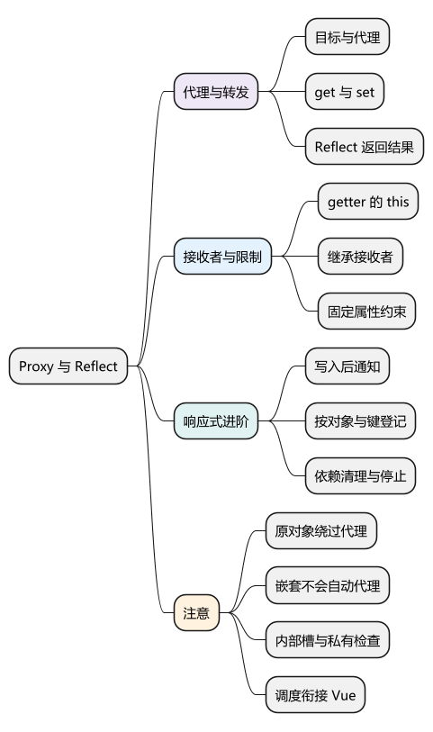
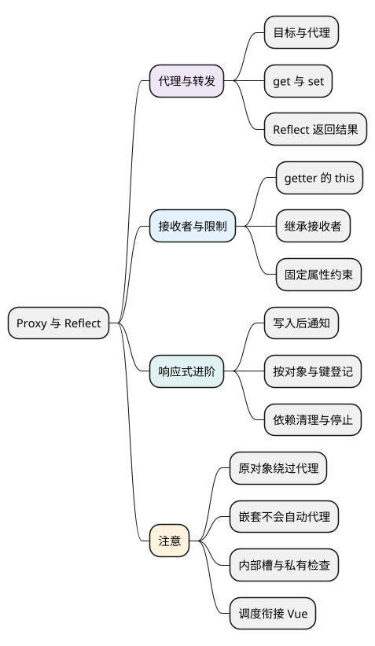

# Proxy 与 Reflect

<!-- core-mindmap:start -->
[](examples/c14-mindmap.svg)

<details>
<summary>PlantUML 源码</summary>



</details>

<!-- core-mindmap:end -->

**口述总览：** Proxy 让我们在读写对象等操作发生时增加处理，例如检查写入值、记录访问。Reflect 则帮助我们在增加处理后，继续按语言原有的规则完成操作。先掌握这两个用途，再看接收者和代理的限制；文末的响应式实现是衔接 Vue 的进阶选读。

以下示例各自独立，按现代浏览器 ES 模块或 Node.js ES 模块的严格模式运行。理解基础代理不要求先掌握依赖收集或更新调度。

<a id="k01"></a>

## 代理是什么，为什么操作必须经过代理

**口述：** Proxy 是围绕目标对象创建的另一个对象。访问代理时，读取、写入等操作可以被处理函数拦截；直接访问原对象则会绕过这一层。代理没有克隆数据，也不会自动接管所有对原对象的访问。

new Proxy(target, handler) 接收目标对象和处理器对象。target 是原本要操作的对象；handler 决定遇到操作时怎样处理。handler 上的 get、set 等方法通常叫 trap，也就是对应操作的拦截入口。

先用只有普通可写数据属性的对象，观察一次读取和一次写入：

<!-- example: proxy-basics -->
```js
const target = { count: 0 };
const visited = [];
const proxy = new Proxy(target, {
  get(target, key) {
    visited.push('get:' + String(key));
    return target[key];
  },
  set(target, key, value) {
    visited.push('set:' + String(key));
    target[key] = value;
    return true;
  }
});

console.log(proxy === target); // false
console.log(proxy.count); // 0
proxy.count = 2;
console.log(target.count); // 2

target.count = 3;
console.log(proxy.count); // 3
console.log(visited.join(',')); // get:count,set:count,get:count
```

读取 proxy.count 进入 get，写入 proxy.count 进入 set；直接操作 target.count 不进入这两个入口。get 返回的值就是这次读取的结果，set 返回 true 表示本次写入被接受。

这个例子手动读写 target[key]，足以展示普通数据属性的入口。涉及 getter、setter、不可写属性或继承时，需要继续保留它们原本的规则，下一节用 Reflect 完成转发。

这能用于校验、记录访问和响应式通知。它也带来身份问题：以原对象作为 Map 的键，与以代理作为键，是两个不同的条目。

嵌套对象不会自动成为代理。如果只代理外层，读取到的内层对象仍可能是原对象；需要深层代理时，要另外处理内层对象。

<a id="k02"></a>

## Reflect 怎样保留默认操作

**口述：** 拦截之后，经常仍然需要完成原本的读取或写入。Reflect 把这些对象操作提供为函数，便于先增加行为，再把操作交还给语言默认规则。

Reflect 是静态工具对象，不需要 new。先掌握最常用的两个方法：Reflect.get(target, key, receiver) 读取属性，Reflect.set(target, key, value, receiver) 写入属性。receiver 表示这次操作的接收者，先原样传下去，下一节再对照解释它的作用。

handler 只需定义确实要处理的操作；没有提供某个 trap 时，代理会按对应默认操作转发。例如只写 set，也仍然可以读取普通属性。

### 校验后转发写入：Reflect.set()

Reflect.set 返回表示写入是否成功的布尔值；它不承诺所有错误都变成 false，非法目标、访问器抛错等仍可能抛异常。set trap 也必须正确返回操作结果，不能无条件宣称成功。

<!-- example: proxy-validate-set -->
```js
const user = new Proxy({ age: 18 }, {
  set(target, key, value, receiver) {
    if (key === 'age' && (!Number.isInteger(value) || value < 0)) {
      throw new TypeError('age must be a non-negative integer');
    }
    return Reflect.set(target, key, value, receiver);
  }
});

user.age = 20;
console.log(user.age); // 20
try {
  user.age = -1;
} catch (error) {
  console.log(error.name); // TypeError
}
console.log(user.age); // 20
```

这里先检查业务约束，再由 Reflect.set 处理描述符、原型 setter 和接收者等语言规则。直接写 target[key] = value 不完全等价，下一节会解释 receiver。

### 写入失败时，要把真实结果返回去

<!-- example: proxy-set-result -->
```js
const target = {};
Object.defineProperty(target, 'id', { value: 1 });
const proxy = new Proxy(target, {
  set(target, key, value, receiver) {
    return Reflect.set(target, key, value, receiver);
  }
});

console.log(Reflect.set(proxy, 'id', 2)); // false
try {
  proxy.id = 2;
} catch (error) {
  console.log(error.name); // TypeError
}
console.log(target.id); // 1
```

id 不可写，所以 Reflect.set 返回 false。通过赋值语法执行同一次失败写入时，本篇使用的严格模式会抛 TypeError。二者都没有把 id 改成 2；也不要把“返回 false”理解成 Reflect 会吞掉所有异常。

### 列出键与枚举属性不是一回事

按需认识其他入口即可：Reflect.ownKeys 返回目标的所有自有字符串键和 Symbol 键；Object.keys 还会筛选可枚举的字符串属性，因此可能触发 ownKeys 与 getOwnPropertyDescriptor 两类操作。

同理，get 拦截属性读取，has 拦截 in，deleteProperty 拦截 delete。只实现 get/set，不等于已经追踪了枚举、删除和存在性检查。

apply 只能拦截本来就可调用的目标；construct 需要目标本身有构造能力。Proxy 不能把普通对象凭空变成函数。

<a id="k03"></a>

## receiver 为什么会影响 getter 的 this

**口述：** target 是这一层实际保存属性的目标；receiver 是本次读取的接收者，通常是代理，也可能是继承代理的对象。Reflect.get 的第三个参数决定访问器 getter 内的 this。

只读普通数据属性时，target[key] 看起来经常能工作；属性变成 getter 后，区别就出现了。

<!-- example: proxy-receiver -->
```js
const accessed = [];
const target = {
  value: 2,
  get doubled() {
    return this.value * 2;
  }
};
const direct = new Proxy(target, {
  get(target, key) {
    accessed.push(String(key));
    return target[key];
  }
});
console.log(direct.doubled); // 4
console.log(accessed.join(',')); // doubled

accessed.length = 0;
const proxy = new Proxy(target, {
  get(target, key, receiver) {
    accessed.push(String(key));
    return Reflect.get(target, key, receiver);
  }
});

console.log(proxy.doubled); // 4
console.log(accessed.join(',')); // doubled,value
```

两次结果都是 4，但内部读取走了不同路径。先看使用 Reflect 的这次：

1. 读取 proxy.doubled，进入 get，记录 doubled。
2. Reflect.get 找到 target 的 getter，并以 receiver，也就是 proxy，作为 this。
3. getter 执行 this.value，等价于这次读取 proxy.value。
4. 第二次进入 get，记录 value，再返回 2，最后得到 4。

前面的 return target[key] 则以 target 为 getter 的 this。内部读取 target.value 绕过代理，所以日志只有 doubled。需要记录内部属性访问时，两种写法不能互换。

### 原型继承时，接收者还可能是子对象

<!-- example: proxy-inherited-receiver -->
```js
const base = new Proxy({
  value: 2,
  get doubled() {
    return this.value * 2;
  }
}, {
  get(target, key, receiver) {
    return Reflect.get(target, key, receiver);
  }
});
const child = Object.create(base);
child.value = 5;

console.log(child.doubled); // 10
console.log(base.doubled); // 4
```

child 自身没有 doubled，查找进入 base 代理时，receiver 仍是 child，所以 getter 读取 child.value。

Reflect.set 的 receiver 同样参与 setter 的 this 和普通属性的写入落点。receiver 是对象操作语义的一部分，保留它有助于维持正确行为，并非专为某个框架增加的参数。

<a id="k05"></a>

## 哪些操作不能任意拦截或伪装

**口述：** Proxy 可以改变很多可观察行为，但必须尊重目标某些已经固定的事实。内建对象和私有成员也可能要求真实目标作为接收者，所以空 handler 不保证对所有对象透明。

“不变量”就是代理不能违反的一致性约束。例如目标上不可配置且不可写的数据属性，get 必须返回与目标一致的值。

<!-- example: proxy-invariant -->
```js
const target = {};
Object.defineProperty(target, 'id', { value: 1 });
const proxy = new Proxy(target, {
  get() {
    return 2;
  }
});
try {
  console.log(proxy.id);
} catch (error) {
  console.log(error.name); // TypeError
}
```

defineProperty 未提供 writable 和 configurable 时，它们默认是 false。代理试图把固定的 1 说成 2，运行时因此拒绝。ownKeys、原型与不可扩展对象也有相应限制。

Map 等内建对象的方法需要内部槽，class 的 #成员需要私有检查。方法若以 proxy 为 this，未必满足目标自身满足的条件；需要按对象类别设计处理，而不是机械代理所有对象。

Proxy.revocable(target, handler) 返回 proxy 和 revoke。调用 revoke() 后，再通过代理读写属性或调用目标等操作会抛 TypeError；这用于结束代理访问能力，不会撤销已经泄露的原对象引用，也不等于服务端权限校验。

<a id="k04"></a>

## 进阶选读：从属性访问走到响应式依赖

**口述：** 响应式系统需要记住“哪个函数读过哪个对象的哪个属性”，写入后再通知相关函数。Proxy 只提供观察操作的入口，依赖关系、清理和执行时机需要系统自己管理。

到前一节，已经可以解释基础代理、Reflect、receiver 和代理限制。下面用于衔接 Vue 响应式原理，可以先跳过，直接完成基础题和后续 JavaScript 学习。

### 先把成功写入与再次执行一个函数连起来

<!-- example: proxy-manual-notify -->
```js
const state = new Proxy({ count: 0 }, {
  set(target, key, value, receiver) {
    const ok = Reflect.set(target, key, value, receiver);
    if (ok && key === 'count') showCount();
    return ok;
  }
});
function showCount() {
  console.log('count=' + state.count);
}

showCount(); // count=0
state.count = 1; // count=1
```

这段代码把“成功写 count 后执行 showCount”直接写进了 set。它没有自动发现谁读过 count，只是在写入后主动调用已知函数。若多个函数读取不同属性，就要进一步记录它们各自依赖什么。

把一个需要重新执行的函数称为 effect。最小关系是：

```text
目标对象 → 属性键 → 读取过该属性的 effect 集合
```

要按对象和键分别存储，因为两个对象都叫 count，也不应该互相通知。WeakMap 适合以目标对象作为外层键，但它不能代替对具体订阅的清理。

### 为什么每次运行前要清理旧依赖

假设 effect 读取 enabled ? count : 'off'。enabled 为 true 时，需要订阅 enabled 和 count；变成 false 后，只需 enabled。

如果一直增加订阅，从不删除旧订阅，之后修改 count 仍会触发已经不需要它的 effect。清理后重新收集，才能让依赖跟随当前执行分支。

下面只支持浅层普通可写数据属性、同步 effect、分支切换和主动停止。它不支持继承写入、复杂访问器或 effect 相互递归更新；示例不应直接用作应用的响应式库。

<!-- example: proxy-mini-reactive -->
```js
const dependencies = new WeakMap();
let active = null;

function effect(fn) {
  let stopped = false;
  function clean() {
    for (const set of run.deps) set.delete(run);
    run.deps.clear();
  }
  function run() {
    if (stopped) return;
    clean();
    const previous = active;
    active = run;
    try {
      fn();
    } finally {
      active = previous;
    }
  }
  run.deps = new Set();
  run.stop = () => {
    stopped = true;
    clean();
  };
  run();
  return run;
}

function reactive(target) {
  return new Proxy(target, {
    get(target, key, receiver) {
      if (active) {
        let byKey = dependencies.get(target);
        if (!byKey) dependencies.set(target, byKey = new Map());
        let set = byKey.get(key);
        if (!set) byKey.set(key, set = new Set());
        set.add(active);
        active.deps.add(set);
      }
      return Reflect.get(target, key, receiver);
    },
    set(target, key, value, receiver) {
      const before = target[key];
      const ok = Reflect.set(target, key, value, receiver);
      if (ok && !Object.is(before, value)) {
        const jobs = new Set(dependencies.get(target)?.get(key) ?? []);
        for (const run of jobs) {
          if (run !== active) run();
        }
      }
      return ok;
    }
  });
}

const state = reactive({ enabled: true, count: 0 });
const output = [];
const runner = effect(() => {
  output.push(state.enabled ? state.count : 'off');
});
state.count = 1;
state.enabled = false;
state.count = 2;
runner.stop();
state.enabled = true;
console.log(JSON.stringify(output)); // [0,1,"off"]
```

初次执行得到 0；count 改为 1 后执行；enabled 改为 false 后执行并清除 count 订阅；后面的 count 修改不触发。stop 删除剩余订阅，所以最后启用也不再执行。

通知时复制集合，是因为 run 会删除并重新登记订阅。直接遍历同时被修改的原集合，可能让同一任务反复加入并再次执行。

### Vue 还需要处理什么

Vue 的响应式建立在这些语言能力之上，但还要处理嵌套对象、数组与集合、删除和枚举、computed、依赖清理及组件销毁。通常还会用 WeakMap 缓存“原对象 → 代理”，避免同一个对象被反复包装后产生不同代理身份。

本例在写入后立即同步执行相关函数。框架还会决定是否合并多次更新、什么时候执行任务，这类执行安排称为调度。先理解依赖从哪里来，再到 [Vue 原理与源码](../../04_Vue/02_Vue3原理与源码/00_目录.md)学习完整更新流程，不必在这里一次实现全部能力。

<a id="summary"></a>

分析基础代理时，先标出操作是否经过 proxy，再看 trap 是否正确转发，接着确认 receiver 与目标限制。进入响应式进阶后，再检查如何登记依赖、通知和停止；这些机制需要在 Proxy 之外自行建立。

<a id="interview"></a>

## 试题与答案

<a id="c14-01"></a>

### C14-01 [P1·原理] Proxy与defineProperty的区别是什么？

**回答：** defineProperty 为具体对象的具体属性设置描述符；Proxy 创建独立身份的代理对象，拦截读取、写入、删除、存在性检查、枚举或函数调用等操作。直接访问 target 可绕过代理。两者都不能独自完成深层依赖、清理和调度。

<a id="c14-02"></a>

### C14-02 [P1·原理] get里为何用Reflect.get而不是target[key]？

**回答：** Reflect.get(target, key, receiver) 能保留 getter 的接收者。getter 内部读取 this.value 时，this 仍可能是代理或继承对象；target[key] 会把 this 改为 target，可能绕过代理并漏收集依赖。普通数据属性暂时看不出差别，访问器和继承能暴露差别。

<a id="c14-03"></a>

### C14-03 [P1·编码] 实现一个可解释的浅层reactive/effect。

**回答：** 见上面的完整教学例：以 WeakMap 按对象隔离，再按属性键保存 effect；运行前清理旧依赖，运行时收集，成功写入且值变化后通知快照，stop 主动退订。它仅支持声明过的浅层普通数据属性，不具备 Vue 的缓存、集合处理和调度能力。

<a id="c14-04"></a>

### C14-04 [P2·原理] 为什么不能把任何对象都透明代理？

**回答：** 代理与目标身份不同，内建方法要求的内部槽、私有成员要求的接收者检查不自动转移。代理也必须遵守不可写、不可配置和不可扩展目标的不变量。应按对象类别设计适配并验证接收者，不能把空 handler 等同于完全透明。

参考：[MDN：Proxy](https://developer.mozilla.org/zh-CN/docs/Web/JavaScript/Reference/Global_Objects/Proxy)、[Reflect](https://developer.mozilla.org/zh-CN/docs/Web/JavaScript/Reference/Global_Objects/Reflect)。
