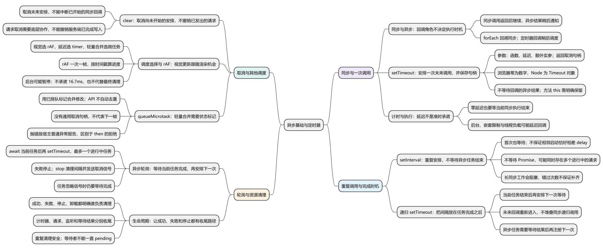
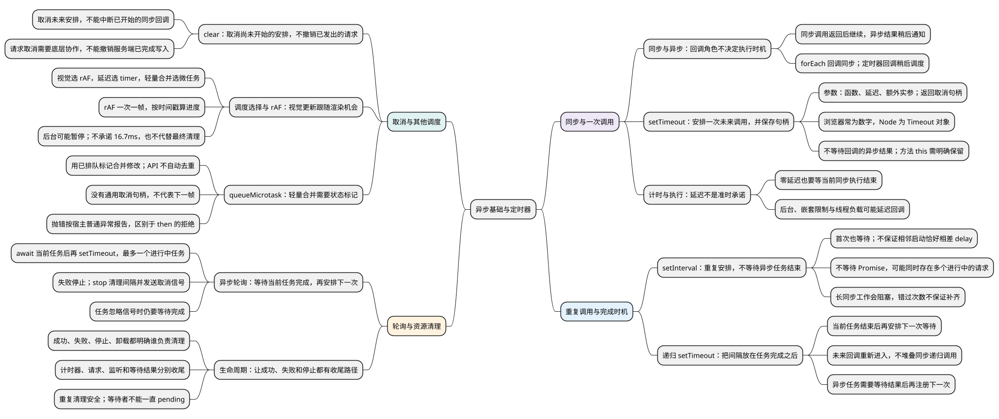

# 异步基础与定时器

<!-- core-mindmap:start -->
[](examples/c15-mindmap.svg)

<details>
<summary>PlantUML 源码</summary>



</details>

<!-- core-mindmap:end -->

**口述总览：** 同步调用沿当前步骤执行，异步操作允许调用者先继续，结果稍后再通知。定时器负责安排回调，不负责开一条线程；读代码时先分清“现在注册了什么”和“以后执行了什么”，再判断何时需要清理。

<!-- recall-route:start -->
**记忆线：** 同步还是异步 → 何时注册与执行 → 一次还是重复 → 选择调度方式 → 停止与清理。先分清调用发生在现在还是以后，再判断等待、重叠与取消。

本篇按 10 个主要知识点复习：[先自查](#self-check) · [口述与答案](#interview)。先尝试口述，再用正文示例验证；文末完整保留每点的回答和记忆提示，不依赖跳转也能复习。
<!-- recall-route:end -->

定时器由浏览器和 Node 提供，不属于 ECMAScript 语言核心，具体计时限制和返回句柄会随环境不同。

基础示例直接观察回调，不需要先掌握 Promise 或 async/await。除仅浏览器的帧回调外，其余示例可在现代浏览器或 Node 中独立运行；文末完整轮询作为进阶选读。

<a id="basic"></a>

## 基本概念：同步调用、异步通知与回调

**同步**表示这次调用沿当前执行路径完成，返回后调用者再继续。**异步**表示先启动或注册操作，调用者可以继续，结果通过之后的回调、Promise 等方式交付。

回调只是“作为参数交给别人调用的函数”，并不天然异步。数组 forEach 会同步调用回调；定时器会在以后调用回调，区别由具体 API 决定。

<!-- example: timers-sync-async -->
```js
[1, 2].forEach(value => console.log(`each ${value}`));
setTimeout(() => console.log('timer'), 0);
console.log('after registration');
// each 1
// each 2
// after registration
// timer
```

forEach 返回时两个回调已经执行；setTimeout 返回时，只完成了注册，timer 回调尚未运行。因此“使用了回调”与“异步执行”不能画等号。

浏览器或 Node 管理等待条件，JavaScript 回调仍需要执行机会。长时间同步计算会延迟回调；完整队列推导见[事件循环](04_事件循环与调度.md)。

<a id="timeout"></a>

## 稍后执行一次：setTimeout() 与 clearTimeout()

`setTimeout(callback, delay = 0, ...args)` 接收回调、毫秒延迟和传给回调的额外参数，返回用于取消的句柄。它注册一次未来调用，不等待 callback 完成，也不使用 callback 的返回值。

`clearTimeout(handle)` 取消尚未开始的定时器，返回 undefined。已经开始的回调不能靠 clearTimeout 从中间中断，它启动的异步请求也不会被自动取消。

<!-- example: timers-timeout-clear -->
```js
const cancelled = setTimeout(() => console.log('cancelled callback'), 0);
clearTimeout(cancelled);
setTimeout((name, count) => {
  console.log(`${name} ${count}`); // run 1
}, 0, 'run', 1);
console.log('sync'); // 先输出 sync，再输出 run 1
```

取消发生在同步阶段，第一项没有机会运行。第二项注册后，当前代码先输出 sync；稍后回调收到额外参数 run、1，再输出 run 1。回调自己记录结果，不需要额外的等待包装。

### 延迟不是准确执行时间

delay 是计时要求，不是准时承诺。条件满足后，还要等待当前代码结束并取得调度机会；浏览器对嵌套定时器、后台页面等还可能增加限制。

因此 0 不代表立即执行，2000 也不代表注册后精确两秒执行。当前同步代码还没结束时，即使计时条件已经满足，回调也不能插进来运行。大于宿主支持范围的延迟还可能被截断或改写，不要用超大整数实现长年等待。

**环境差异：** 浏览器通常返回数字 id；Node 返回 Timeout 对象。业务代码保留句柄并传给对应 clear 函数即可，不依赖其具体类型。Node 还提供 ref/unref 等专有能力，浏览器没有同样接口。

**注意：** 传函数，不传需要动态执行的代码字符串。需要对象方法的 this 时，使用箭头包装或 bind，例如 `() => controller.refresh()`；定时器不会自动保留原来的方法调用接收者。

<a id="interval"></a>

## 重复安排回调：setInterval() 与 clearInterval()

`setInterval(callback, delay = 0, ...args)` 按重复计时规则安排回调，返回句柄；`clearInterval(handle)` 停止后续安排。首次回调也要等待调度，不会在注册时立即调用。

<!-- example: timers-interval -->
```js
let count = 0;
const timer = setInterval(() => {
  count++;
  console.log(count);
  if (count === 3) clearInterval(timer);
}, 0);
// 依次输出 1、2、3，然后停止。
```

这个例子根据实际回调次数停止，没有通过“等三十毫秒”猜测发生了几次。它展示调用次数，不承诺相邻回调的真实间隔。

### 重复启动的间隔，不等于任务结束后的空闲时间

setInterval 按宿主的重复计时规则安排回调，并不是每次等上一个回调完成后，再重新留出完整的 delay。它更适合表达“大致按某个节奏重复启动”，不能据此保证两次实际启动之间恰好相差 delay。

假设间隔设置为 2000ms，但一次同步任务阻塞了 3000ms。阻塞期间其他回调只能等待；同步代码结束后，下一次回调可能很快获得机会，也可能继续等待调度。不能概括成“总会立即补跑”，更不能假定宿主会把错过的次数逐次补齐。

### 上一次请求没结束，下一次为什么仍会启动？

setInterval 不等待回调启动的异步操作完成。若每 1 秒调用一次、每次请求需要 3 秒，上次请求未结束，下次回调就可能再次发请求，于是出现多个尚未结束的请求。后面学到 async 函数时也一样：定时器不会等待回调返回的 Promise。

这里的“重叠”是异步操作生命周期重叠，不是同一线程同时执行两段同步 JavaScript。长同步回调仍然会阻塞线程，延迟其他回调。

**注意：** 仅适合允许这种独立重复触发的场景。需要“上次完成后再等一会儿”的轮询，使用后面的递归 setTimeout 方式。组件卸载、页面功能停用或任务结束时，要由创建者清理句柄。

### 同步任务结束后，再安排下一次

先不使用 Promise，只处理一个同步 task。每次 task 返回之后，才注册下一次定时器；累计执行三次后，不再注册：

<!-- example: timers-repeat-sync -->
```js
let count = 0;
function task() {
  count++;
  console.log('task ' + count);
}
function tick() {
  task();
  if (count < 3) setTimeout(tick, 20);
  else console.log('stopped');
}
tick();
// task 1
// task 2
// task 3
// stopped
```

首次 tick 立即执行；后续先完成当前 task，再按 20ms 的延迟要求等待下一次调度。setTimeout 并没有在当前调用栈里直接调用 tick，所以这不是不断堆叠同步调用的递归。

这种写法把等待放在任务完成之后。若同步任务耗时约 500ms、延迟改成 2000ms，忽略额外调度延迟时，两次开始大约相差 2500ms；其中 2000ms 是这项任务两次执行之间安排的等待，不代表整个线程都处于空闲。

这个短例要求 task 同步完成。如果 task 只是启动请求后立即返回，下一次计时仍可能早于请求完成，异步操作依然会重叠。需要等待异步结果时，再使用[完整轮询的进阶实现](#polling)。

如果只是监听 URL 中 # 片段的变化，优先使用 hashchange 事件，而不是定时读取 location.hash。监听和清理方式见 [Hash 变化事件](../05_模块化与浏览器实践/02_DOM操作与DOM事件.md#events-hash)。注意 history.pushState、history.replaceState 不会触发 hashchange，需要按路由方案处理。

<a id="raf"></a>

## 随绘制安排视觉更新：requestAnimationFrame() 与 cancelAnimationFrame()

`requestAnimationFrame(callback)` 是浏览器帧调度 API，返回取消句柄。callback 接收高精度时间戳，调用一次只安排一帧；下一帧要再次注册。

`cancelAnimationFrame(handle)` 取消尚未执行的帧回调。Node 默认没有浏览器页面的这一对 API；下面例子仅在可见浏览器页面运行。

<!-- example: timers-browser-raf -->
```js
const cancelled = requestAnimationFrame(() => console.log('should not run'));
cancelAnimationFrame(cancelled);
let frames = 0;
let previous;
function frame(timestamp) {
  if (previous !== undefined) console.log(timestamp >= previous); // true
  previous = timestamp;
  frames++;
  if (frames === 2) console.log(frames); // 2
  else requestAnimationFrame(frame);
}
requestAnimationFrame(frame);
```

回调时间戳适合计算动画进度，例如“经过时间 × 每毫秒移动距离”。不要默认每次前进固定像素，因为高刷新率屏幕和掉帧会改变回调次数。

透明度动画也是一样：每次都写 `opacity = 0.1`，只会反复设置同一个值；每次增加 0.1，又会让速度依赖回调次数。可以记录第一帧的 start，设定大于零的 duration，再用 `progress = Math.min(1, (timestamp - start) / duration)` 得到经过时间对应的进度，并把 progress 映射到起止透明度之间。视觉动画优先使用 rAF 安排更新，达到终点后停止注册下一帧。

**注意：** rAF 不是精确的 16.7ms 定时器，后台页面可能暂停回调；其中的重计算仍占用主线程。它适合合并视觉更新，不适合成为业务数据保存或最终清理的唯一触发点。

<a id="microtask"></a>

## 当前同步工作结束后补一次处理：queueMicrotask()

有些轻量处理要等当前同步代码结束后再统一执行，这类后续工作可以安排成**微任务**。`queueMicrotask(callback)` 将函数加入微任务队列，没有延迟参数，返回 undefined；下面只看合并修改的用法，完整队列与绘制顺序见[事件循环](04_事件循环与调度.md)。

<!-- example: timers-microtask-batch -->
```js
const values = [];
let queued = false;
function add(value) {
  values.push(value);
  if (queued) return;
  queued = true;
  queueMicrotask(() => {
    queued = false;
    console.log(values.join(' ')); // A B
  });
}
add('A');
add('B');
console.log('sync'); // 先输出 sync，再输出 A B
```

第一次 add 注册微任务，第二次看到 queued 已经为 true，就不重复注册。同步调用全部结束后，一次处理看到 A、B 两次修改。

**注意：** 它不表示“下一帧”，持续追加微任务可能让渲染和定时器一直等待。没有通用 clearMicrotask；不再需要时可由回调检查业务状态后跳过。

queueMicrotask 回调抛错会按宿主的普通异常方式报告；Promise.then 回调抛错则成为返回 Promise 的拒绝。不要为了简写忽略两者错误处理方式的区别。

<a id="polling"></a>

## 进阶选读：任务完成后再安排下一次轮询

**阅读前提：** 先完成[Promise](02_Promise.md)、[async 与 await](03_async与await.md)和[错误处理](05_错误处理.md)，再回来读完整实现。首次学习可直接进入文末基础题；下面保留的是带停止、错误与取消处理的进阶版本。

递归 setTimeout 的关键是把“安排下一次”放到当前异步任务完成之后。下面的 startRepeated 返回 done 和 stop：任务失败时 done 拒绝并停止继续安排；stop 停止后续调用，并给运行中的任务发送取消信号。

<!-- example: timers-repeat-after-completion -->
```js
function startRepeated(task, ms) {
  if (typeof task !== 'function' || !Number.isFinite(ms) || ms < 0) {
    throw new TypeError('invalid task or interval');
  }
  const controller = new AbortController();
  let stopped = false;
  let running = false;
  let timer;
  let resolveDone;
  let rejectDone;
  const done = new Promise((resolve, reject) => {
    resolveDone = resolve;
    rejectDone = reject;
  });
  async function tick() {
    if (stopped) return;
    running = true;
    try {
      await task(controller.signal);
    } catch (error) {
      stopped = true;
      rejectDone(error);
    } finally {
      running = false;
    }
    if (stopped) {
      controller.abort();
      resolveDone();
      return;
    }
    timer = setTimeout(tick, ms);
  }
  tick();
  return {
    done,
    stop() {
      if (stopped) return;
      stopped = true;
      clearTimeout(timer);
      controller.abort();
      if (!running) resolveDone();
    }
  };
}
(async () => {
  let active = 0;
  let maximum = 0;
  let calls = 0;
  const runner = startRepeated(async () => {
    maximum = Math.max(maximum, ++active);
    calls++;
    await Promise.resolve();
    active--;
    if (calls === 3) runner.stop();
  }, 0);
  await runner.done;
  runner.stop(); // 重复清理安全
  console.log(calls, maximum); // 3 1
})();
```

tick 每次先 await task，结束后才用 setTimeout 安排下一次 tick，所以最多只有一个任务进行中。它是“完成后等待 ms”，不是固定墙钟频率，也不补跑错过的次数。

stop 在等待间隔中调用时，清掉 timer 并完成 done；在任务进行中调用时，先停止后续安排并发出信号。任务若忽略 signal，done 仍要等它完成，不能假称已经终止。任务失败先让 done 拒绝，后续 resolveDone 不会覆盖已经确定的失败。

**注意：** 首次任务立即启动。调用者应及时 await/catch done；如果任务响应 abort 而拒绝，done 也可能拒绝，需要按实际取消原因处理。此版本失败即停止，不自动重试；重试预算、并发池与超时见[异步控制](../05_模块化与浏览器实践/05_异步控制与任务调度.md)。

<a id="summary"></a>
<a id="self-check"></a>

## 自查问题

先遮住答案，沿记忆线逐题口述；下方逐点保留完整回答与记忆提示。

1. [同步调用与异步通知有什么区别？回调函数一定异步吗？forEach 与定时器的回调分别什么时候执行？](#recall-01)
2. [setTimeout 接收什么、返回什么？额外参数怎样传递？它会等待回调完成或采用回调返回值吗？浏览器和 Node 的句柄有什么区别？](#recall-02)
3. [setTimeout(fn, 0) 为什么不是立即执行？延迟到期后为什么仍可能等很久？后台页面和长同步代码会怎样影响它？](#recall-03)
4. [setInterval 会等上一次工作完成吗？请求耗时超过间隔时会发生什么？同步回调与异步请求的重叠有什么区别？](#recall-04)
5. [递归 setTimeout 与 setInterval 的等待位置有什么不同？为什么不会持续堆高同步调用栈？同步任务示例能直接用于异步请求吗？](#recall-05)
6. [clearTimeout、clearInterval 分别停止什么？已经开始的回调或请求会自动中断吗？取消请求还需要什么？](#recall-06)
7. [rAF、定时器和 queueMicrotask 怎样选择？rAF 是固定 16.7ms 吗？动画为什么应按时间戳计算，业务清理能只靠 rAF 吗？](#recall-07)
8. [queueMicrotask 怎样合并同一段同步代码中的多次修改？它表示下一帧吗？能取消吗？抛错与 then 回调有什么不同？](#recall-08)
9. [怎样保证同一个轮询器最多运行一个异步任务？失败、等待间隔中停止、运行中停止，分别怎样处理？](#recall-09)
10. [定时任务需要覆盖哪些清理路径？只清掉句柄为什么可能还不够？怎样避免停止后仍有人永远等待结果？](#recall-10)

<a id="interview"></a>

## 试题与答案

以下按 10 个知识点依次归纳。原有分级题保留题号，其余标题对应同一条复习主线。

<a id="recall-01"></a>

<a id="c15-01"></a>

### C15-01 [P0·基础] 回调函数一定异步吗？

**自查：** 同步调用与异步通知有什么区别？回调函数一定异步吗？forEach 与定时器的回调分别什么时候执行？

**回答：** 同步调用沿当前执行路径完成，返回后调用者再继续；异步操作允许调用者先继续，再通过后续通知交付结果。回调只是交给其他代码调用的函数，是否异步由 API 的约定决定。forEach 会同步调用回调，定时器回调则稍后调度。宿主负责等待条件，回调中的 JavaScript 仍需要执行机会。见[基本概念](#basic)。

**记忆：** 回调只是角色，是否异步看 API；注册完成不等于回调执行。

<a id="recall-02"></a>

### setTimeout：安排一次未来调用，并保存句柄

**自查：** setTimeout 接收什么、返回什么？额外参数怎样传递？它会等待回调完成或采用回调返回值吗？浏览器和 Node 的句柄有什么区别？

**回答：** setTimeout 接收函数、毫秒延迟和传给回调的额外参数，返回用于取消的句柄。它只安排一次未来调用，不等待回调的异步工作，也不把回调返回值当作自己的结果。浏览器通常返回数字 id，Node 返回 Timeout 对象；业务代码保存句柄并交给对应 clear 函数即可。需要保留对象方法的接收者时，应使用箭头包装或 bind，不能认为直接传方法会自动保留原对象。

**记忆：** 传函数与延迟，保存返回句柄；回调结果不是定时器返回值。

<a id="recall-03"></a>

<a id="c15-02"></a>

### C15-02 [P0·原理] setTimeout(fn, 0) 为什么不是立即执行？

**自查：** setTimeout(fn, 0) 为什么不是立即执行？延迟到期后为什么仍可能等很久？后台页面和长同步代码会怎样影响它？

**回答：** setTimeout 先注册未来调用，计时条件满足后，回调仍要取得调度机会，不能打断当前同步 JavaScript。零延迟也不表示立即执行，后台限制、嵌套定时器限制和线程负载都可能推迟回调。超过宿主支持范围的延迟还可能被截断或改写，因此 delay 不是精确执行时刻，也不宜用超大数字模拟无限等待。见[延迟与环境](#timeout)。

**记忆：** 计时到期只是满足条件，真正执行还要等调度。

<a id="recall-04"></a>

### setInterval：重复安排，不等待异步任务结束

**自查：** setInterval 会等上一次工作完成吗？请求耗时超过间隔时会发生什么？同步回调与异步请求的重叠有什么区别？

**回答：** setInterval 按宿主的重复计时规则安排回调，首次也要等调度；它不会在每次工作结束后再完整等待一个 delay，也不会等待回调返回的 Promise。请求耗时超过间隔时，多个请求的生命周期可能重叠，但同一主线程不会同时执行两段同步回调。长同步任务会阻塞后续执行，不能保证阻塞结束后立即补跑，更不能假定错过的次数都会补齐。

**记忆：** interval 重复安排，不等请求结束；异步重叠不等于同步代码并行。

<a id="recall-05"></a>

### 递归 setTimeout：把间隔放在任务完成之后

**自查：** 递归 setTimeout 与 setInterval 的等待位置有什么不同？为什么不会持续堆高同步调用栈？同步任务示例能直接用于异步请求吗？

**回答：** 递归 setTimeout 可以在当前任务返回后才注册下一次调用，因此间隔放在本次完成之后；两次启动之间还包含任务耗时和调度延迟。下一次通过未来的定时回调进入，不是在当前调用栈里直接递归，所以不会一直堆积同步调用。这个结论要求当前任务确实完成：若只是发起请求就返回，必须额外等待它的 Promise，再安排下一次，才能避免请求重叠。

**记忆：** 先完成，再计时；启动了请求不等于完成了请求。

<a id="recall-06"></a>

<a id="c15-03"></a>

### C15-03 [P0·原理] clearInterval 能取消已经发出的请求吗？

**自查：** clearTimeout、clearInterval 分别停止什么？已经开始的回调或请求会自动中断吗？取消请求还需要什么？

**回答：** clearTimeout 取消尚未开始的一次调用，clearInterval 停止后续重复安排；它们不能从中间打断已经执行的同步回调，也不会自动停止回调发出的请求。底层操作需要支持取消 API 或响应 AbortSignal，已经在服务端完成的写入也不会被取消计时器撤销。停止后续安排、取消运行中的工作和处理业务副作用，需要分别设计。见[重复调用](#interval)。

**记忆：** clear 取消安排，不撤销已开始的工作。

<a id="recall-07"></a>

<a id="c15-04"></a>

### C15-04 [P1·工程取舍] rAF、定时器和 queueMicrotask 怎样选择？

**自查：** rAF、定时器和 queueMicrotask 怎样选择？rAF 是固定 16.7ms 吗？动画为什么应按时间戳计算，业务清理能只靠 rAF 吗？

**回答：** 视觉更新可用 requestAnimationFrame，延迟或重复调用用定时器，同步修改后的轻量合并可用 queueMicrotask。rAF 调用一次只安排一帧，回调收到时间戳，继续动画需要再次注册；按经过时间计算进度，才能避免速度依赖回调次数。刷新率、负载和可见性会影响帧回调，后台可能暂停，因此它不是固定 16.7ms 的计时器，也不适合作为数据保存或最终清理的唯一入口。三者都不会把同步重计算自动搬离主线程。见[帧回调](#raf)与[微任务](#microtask)。

**记忆：** 视觉用帧，延迟用计时，轻量合并用微任务；动画进度看时间。

<a id="recall-08"></a>

### queueMicrotask：轻量合并需要状态标记

**自查：** queueMicrotask 怎样合并同一段同步代码中的多次修改？它表示下一帧吗？能取消吗？抛错与 then 回调有什么不同？

**回答：** queueMicrotask 把回调加入微任务队列，不接收延迟参数，也不返回取消句柄。合并多次同步修改时，用一个已排队标记避免重复注册，让后续回调统一处理；这个合并来自业务标记，API 本身不会自动去重。微任务不代表下一帧，持续追加还会拖延其他任务和渲染。没有通用 clearMicrotask，可在回调中检查状态后跳过；其抛错按宿主的普通异常方式报告，而 then 处理器抛错会拒绝返回的新 Promise。

**记忆：** 标记防重复，微任务集中处理；不是下一帧，报错也不是自动拒绝 Promise。

<a id="recall-09"></a>

<a id="c15-05"></a>

### C15-05 [P0·编码] 如何让异步轮询始终只运行一项？

**自查：** 怎样保证同一个轮询器最多运行一个异步任务？失败、等待间隔中停止、运行中停止，分别怎样处理？

**回答：** 必须等当前任务的 Promise 完成后，再用 setTimeout 安排下一次，不能依靠 setInterval 等待 async 回调。正文 startRepeated 首次立即启动，失败让 done 拒绝并停止后续安排；等待间隔中 stop 清除计时并完成等待，运行中 stop 则停止后续安排并发送取消信号。若任务不响应 signal，done 仍要等它结束，不能声称已经中止。它实现的是完成后等待，不是固定频率，也不自动重试。见[完整轮询](#polling)。

**记忆：** await 当前任务，再计时；停止安排和停止运行分别处理。

<a id="recall-10"></a>

<a id="c15-06"></a>

### C15-06 [P1·工程取舍] 定时任务清理需要覆盖哪些路径？

**自查：** 定时任务需要覆盖哪些清理路径？只清掉句柄为什么可能还不够？怎样避免停止后仍有人永远等待结果？

**回答：** 成功结束、失败、主动停止和组件卸载都应有明确的清理责任。创建方保存句柄，停止后不再注册，重复清理应安全；如果还有监听、请求或等待结果的 Promise，也要分别释放、取消或交付终态。单纯清掉 timer 可能留下等待者一直 pending，必须让完成或失败有去向。已开始的任务需要协作取消，调用方也应及时 await 或 catch done。见[轮询 stop](#polling)。

**记忆：** 清句柄、停后续、处理运行中任务，也要让等待者结束。

参考：[MDN setTimeout](https://developer.mozilla.org/en-US/docs/Web/API/Window/setTimeout)、[MDN requestAnimationFrame](https://developer.mozilla.org/en-US/docs/Web/API/Window/requestAnimationFrame)、[MDN queueMicrotask](https://developer.mozilla.org/en-US/docs/Web/API/Window/queueMicrotask)、[Node timers](https://nodejs.org/api/timers.html)。
