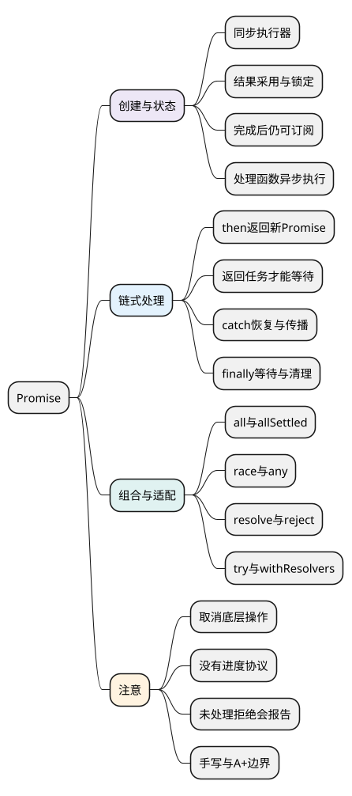

# Promise

<!-- core-mindmap:start -->
[](examples/c16-mindmap.svg)

<details>
<summary>PlantUML 源码</summary>



</details>

<!-- core-mindmap:end -->

**口述总览：** Promise 用一个对象表示一次操作最终成功还是失败。调用者先拿到这个对象，再用 then 处理成功、catch 处理失败；每一段处理又返回新的 Promise，因此可以把后续步骤与错误处理连起来。

回调也能通知结果，但不同 API 的参数与报错方式可能不同，连续操作还需要手动衔接。Promise 统一这套结果接口，不负责把计算移到其他线程，也不自动限制并发或取消操作。各例直接使用 Promise，可在现代浏览器或 Node 中独立运行，无需先读 async/await。

## 先创建结果对象，再接收成功或失败

**口述：** 创建 Promise 时，把真正的操作放进传入的函数；操作成功时交给 resolve，失败时交给 reject。调用者通过 then 和 catch 注册处理函数，不必把后续全部步骤都塞进操作内部。

<!-- example: promise-basic -->
```js
const result = new Promise((resolve, reject) => {
  setTimeout(() => {
    const name = 'Lin';
    if (name) resolve(name);
    else reject(new Error('empty name'));
  }, 0);
});
result
  .then(name => console.log(name)) // Lin
  .catch(error => console.log(error.message));
console.log('registered'); // 先输出 registered，再输出 Lin
```

创建时先注册定时器，调用者接好处理函数并输出 registered。稍后定时器交付 Lin，成功处理函数才输出名字；把 name 改为空字符串，会走 reject，再由 catch 输出错误信息。接收结果的回调不会打断当前同步代码。

new Promise 中负责接入操作的函数叫 **executor**。then、catch 注册的是接收结果后的处理函数，与 executor 的执行时机不同，下面分别来看。

<a id="k01"></a>

## 状态与执行时机：结果可以稍后交付，executor 立即执行

**口述：** Promise 只有等待、成功、失败三种状态。构造器立即执行传入函数，then 注册的处理函数稍后执行；调用 resolve 也不一定意味着马上成功。

这三个状态分别叫 pending、fulfilled、rejected：pending 可以变为 fulfilled 或 rejected，进入后两者后不会再改变。settled 是“已经成功或失败”的统称，不是第四种状态。

`new Promise(executor)` 的 executor 是接收 resolve、reject 的函数，负责把外部操作接入 Promise：成功时调用 resolve，失败时调用 reject。这个函数在构造时同步执行。

<!-- example: promise-executor-order -->
```js
const output = [];
const promise = new Promise(resolve => {
  output.push('executor');
  resolve(7);
  output.push('after resolve');
});
promise.then(value => {
  output.push(`value ${value}`);
  console.log(output.join(' | '));
  // executor | after resolve | caller | value 7
});
output.push('caller');
```

先创建 Promise，executor 立即运行。resolve(7) 决定成功值，却不会像 return 一样结束 executor，所以 after resolve 仍然输出。then 注册处理器后，调用者继续执行；当前同步代码结束，处理器才有机会运行。

### 已经成功或失败，再注册回调还来得及吗？

来得及。Promise 保存已经确定的结果，后来注册的处理函数仍能收到它；处理函数依旧异步执行，不会因为结果已经准备好就改为同步调用。

<!-- example: promise-late-subscription -->
```js
const passed = new Promise(resolve => resolve('ok'));
const failed = new Promise((resolve, reject) => reject('bad'));
passed.then(value => console.log('success', value));
failed.then(undefined, reason => console.log('failure', reason));
console.log('registered');
// registered
// success ok
// failure bad
```

两份 Promise 在注册 then 前就已成功或失败；then 的第一项处理成功，第二项处理失败。当前代码仍先输出 registered，再执行两个处理函数。同一个 Promise 也可以多次注册处理函数，读取已有结果。

### resolve 为什么不等于立即 fulfilled？

resolve 收到另一个 Promise 时，会采用对方最终的结果。如果对方还在等待，当前 Promise 也要等；但接下来再次调用 reject，已经不能改成另一个决定。

<!-- example: promise-adoption -->
```js
let finishInner;
const inner = new Promise(resolve => { finishInner = resolve; });
const outer = new Promise((resolve, reject) => {
  resolve(inner);
  reject(new Error('ignored'));
});
outer.then(value => console.log(value)); // 42
finishInner(42);
```

在 finishInner 之前，outer 仍处于 pending，但已经决定跟随 inner。resolved 描述“结果已经确定或已经锁定跟随关系”，fulfilled 才是三种状态中的成功。

executor 内同步抛错会让 Promise 拒绝；它注册的未来定时器回调另有执行过程，回调抛错不会被原构造器自动捕获，见[错误处理](05_错误处理.md#k03)。

pending 只表示尚未成功或失败，不表示完成百分比。Promise 没有原生进度通知协议，需要进度时另外设计事件或回调；它也没有通用 cancel()。支持取消的底层操作可以通过 AbortSignal 等机制协作停止，Promise 再反映操作结果，已经确定的成功或失败不会被改写，见[请求取消](../05_模块化与浏览器实践/04_Fetch、请求取消与竞态.md)。

<a id="k02"></a>

## then：用回调的结果决定下一段

**口述：** 每次 then 都返回一个新的 Promise。当前回调返回什么、抛出什么，决定新 Promise 的结果；原 Promise 的状态不会被改写。

`promise.then(onFulfilled, onRejected)` 接收两个可选处理函数，分别处理当前 Promise 的成功和失败。对应参数不是函数时，值或拒绝原因会继续传给下一段。

处理函数实际执行后，按下面规则理解返回值：

- 返回普通值：下一段以这个值成功，包括省略 return 时的 undefined。
- 返回 Promise 或带 then 方法的对象：下一段等待它的最终结果。
- 抛出异常：下一段以这个异常失败。

Promise.resolve(2) 可以创建成功值为 2 的 Promise，便于从一个已知结果开始演示链条。

<!-- example: promise-chain -->
```js
const source = Promise.resolve(2);
const next = source.then(value => value * 3);
console.log(source === next); // false
next
  .then(value => {
    console.log(value); // 6
    return Promise.resolve(value + 1);
  })
  .then(value => { throw new Error(`bad ${value}`); })
  .catch(error => error.message)
  .then(result => console.log(result)); // bad 7
```

逐段推导是：source 成功 2 → next 成功 6 → 等待返回的 Promise 得到 7 → 抛错产生拒绝 → catch 返回字符串，后续恢复为成功。

### 为什么漏写 return 会让后面提前继续？

在 then 内调用 load()，只表示启动了 load。只有把它返回，链条才知道要等待它。回调内部写了多少层缩进，不决定等待关系。

<!-- example: promise-return-task -->
```js
function load() {
  return new Promise(resolve => {
    setTimeout(() => resolve('loaded'), 0);
  });
}
Promise.resolve()
  .then(() => { load(); }) // 漏写 return
  .then(value => console.log('missing', value)) // missing undefined
  .then(() => load()) // 返回本次任务的 Promise
  .then(value => console.log('returned', value)); // returned loaded
```

第一次 load 已经启动，但回调没有返回它，下一段先拿到 undefined。第二次用箭头函数直接返回 load()，下游才等待任务并拿到 loaded。这里依靠 Promise 与定时器的执行规则观察顺序，没有猜测任务耗时；实际工程还要避免脱离链条的任务拒绝后无人处理。

<a id="k03"></a>

## catch 与 finally：恢复错误和结束清理各有职责

**口述：** catch 决定失败后怎样继续，finally 负责不依赖成功失败的清理。catch 返回普通值会恢复成功，返回 Promise 则跟随其结果；finally 通常保留原结果，但清理失败可以覆盖它。

`catch(onRejected)` 等价于 `then(undefined, onRejected)`，返回新 Promise。只写日志后不再 throw，等于告诉调用者“错误已处理”，下游得到成功的 undefined。

没有处理拒绝，不代表错误消失。浏览器和 Node 会按各自规则报告未处理拒绝，Node 还可能结束进程。应及时处理错误，或把 Promise 返回给负责接管结果的调用者，见[错误处理](05_错误处理.md#k03)。

`finally(onFinally)` 不接收原成功值或拒绝原因，返回新 Promise。它只在所连接的 Promise 成功或失败后运行；前面一直 pending，它就一直不会运行。普通返回值不会替换原值；如果返回 Promise，会等待清理完成。清理抛错或返回拒绝的 Promise，则下游接收清理错误。

<!-- example: promise-error-paths -->
```js
Promise.resolve()
  .then(
    () => { throw new Error('from success'); },
    () => console.log('same then catches')
  )
  .catch(error => console.log(error.message)) // from success
  .then(() => Promise.resolve(1).finally(() => 99))
  .then(value => {
    console.log(value); // 1
    return Promise.reject(new Error('business'))
      .finally(() => { throw new Error('cleanup'); });
  })
  .catch(error => console.log(error.message)); // cleanup
```

同一次 then 的第二个参数只处理“进入这个 then 时已有的失败”，不能捕获第一个参数自己抛出的错误。成功处理器抛错后，是 then 返回的新 Promise 失败，所以需要后面的 catch。

清理也可能出错。若必须保留原业务原因，要单独记录次要错误，或者用 cause、AggregateError 表达多层原因，不能默认用清理失败替换一切。

<a id="k04"></a>

## resolve 与 reject：把不同结果接入统一接口

**口述：** Promise.resolve 会采用输入的结果，Promise.reject 则直接把输入作为失败原因。两者不对称；带 then 方法的对象也可以参与结果衔接。

`Promise.resolve(value)` 接收一个值，返回 Promise：普通值成为成功值；同构造器的原生 Promise 可直接返回自身；thenable 会按它的 then 方法接入。

thenable 就是提供可调用 then 方法的对象。它不一定是 Promise 实例，例如某些库自己实现的异步结果对象。这里的“采用”不是对象拷贝，而是根据对方报告的结果完成当前 Promise。

`Promise.reject(reason)` 返回以 reason 拒绝的新 Promise，哪怕 reason 本身是 Promise，也不会等待它。

<!-- example: promise-normalize -->
```js
const original = Promise.resolve(1);
console.log(Promise.resolve(original) === original); // true
Promise.resolve({ then(resolve) { resolve(2); } })
  .then(value => {
    console.log(value); // 2
    return Promise.reject(original);
  })
  .catch(reason => console.log(reason === original)); // true
```

读取 then 属性也可能触发 getter 并抛错，then 还可能多次调用回调。原生 Promise 会处理这些边界；应用代码通常使用 Promise.resolve 接入，不需要先靠 instanceof 排除其他实现。

<a id="k05"></a>

## 组合多个结果：all、allSettled、race、any

**口述：** 四种组合分别等待全部成功、全部结束、最先结束、最先成功。它们组合结果，不控制任务启动，也不会自动取消其他操作。

四个方法都接收可迭代对象，常用数组，也接受普通值。它们返回一个新的 Promise；需要关注结果形状、失败策略以及空输入。

### 全部成功：Promise.all(iterable)

全部成功后得到数组，位置按输入顺序排列；某项拒绝后整体拒绝，其他已启动任务仍可能继续。空输入得到成功的空数组。

<!-- example: promise-combinators -->
```js
let finishFirst;
const first = new Promise(resolve => { finishFirst = resolve; });
const all = Promise.all([first, Promise.resolve('B')]);
all.then(values => console.log(JSON.stringify(values))); // ["A","B"]
finishFirst('A');
```

第二项已经成功，第一项由 finishFirst 手动完成；all 仍按输入位置返回 A、B。组合方法接收的是结果对象，不负责决定任务何时启动。

### 全部结束：Promise.allSettled(iterable)

每项成功或失败都记录下来，结果按输入顺序排列。成功项包含 status 与 value，失败项包含 status 与 reason；空输入得到空数组。

<!-- example: promise-all-settled -->
```js
Promise.allSettled([1, Promise.reject('bad')])
  .then(results => console.log(JSON.stringify(results)));
// [{"status":"fulfilled","value":1},{"status":"rejected","reason":"bad"}]
```

它适合互不依赖的批量结果汇总。“不会因单项失败而失败”不包括读取或迭代输入本身出错。

### 最先结束：Promise.race(iterable)

第一个成功或失败的结果决定整体；空输入一直等待。它适合选择等待结果，例如任务与超时比赛，但另一项操作不会自动停下来。

<!-- example: promise-race -->
```js
Promise.race([Promise.resolve('first'), 2])
  .then(value => console.log(value)); // first
```

这里两项都不需要等待外部操作，先接入的成功结果获胜；不要据此推断真实任务永远按输入位置获胜。

### 最先成功：Promise.any(iterable)

任意一项成功即得到该值；全部失败时以 AggregateError 拒绝。它是一种汇总错误，其中 errors 按输入顺序保存失败原因；空输入也拒绝。

<!-- example: promise-any -->
```js
Promise.any([Promise.reject('bad'), 3])
  .then(value => {
    console.log(value); // 3
    return Promise.any([]);
  })
  .catch(error => console.log(error.name, error.errors.length)); // AggregateError 0
```

可能拒绝的输入应及时交给组合方法接管。如果写 `Promise.all(urls.map(url => fetch(url)))`，map 阶段已发出所有请求；限制同时运行数量需要掌握任务调用权，见[异步控制](../05_模块化与浏览器实践/05_异步控制与任务调度.md)。

<a id="k06"></a>
<a id="k07"></a>

## 进阶选读：辅助 API 与实现边界

**口述：** 辅助 API 可以减少包装代码，但不会代替超时、清理或取消策略。手写组合函数时，应先说清自己实现了哪些行为。

### 在外部交付结果：Promise.withResolvers()

无参数，返回 `{ promise, resolve, reject }`，把结果对象和完成它的函数一起交给调用者，方便接入事件。调用者仍要保证流程能结束。

<!-- example: promise-with-resolvers -->
```js
const { promise, resolve } = Promise.withResolvers();
promise.then(value => console.log(value)); // ready
resolve('ready');
console.log('registered'); // 先输出 registered，再输出 ready
```

这里可以在构造器外调用 resolve；真正的约束是成功或失败后不能再次改变状态，并非所有外部代码都不能影响结果。

### 同步调用并统一结果：Promise.try(fn, ...args)

接收函数与要传给它的参数，同步调用 fn，返回一个 Promise 来采用返回结果或接住同步抛错。`Promise.resolve().then(fn)` 则稍后才调用 fn。两者的调用时机不同；try 和 withResolvers 都应核对目标运行时支持。

<!-- example: promise-try-order -->
```js
const events = [];
Promise.try(value => {
  events.push(`call ${value}`);
  return value * 2;
}, 3).then(value => {
  events.push(`result ${value}`);
  console.log(events.join(' | ')); // call 3 | caller | result 6
});
events.push('caller');
```

### 手写组合方法与完整 Promise 实现的边界

下面的手写 all 留作掌握前面 API 后的编码练习；首次阅读可以先进入问答。它借助原生 Promise 处理调度和结果采用，只实现常见 all 行为，不实现原生静态方法的子类构造器协议。

<!-- example: promise-all-demo -->
```js
function allDemo(iterable) {
  return new Promise((resolve, reject) => {
    const output = [];
    let remaining = 1;
    let index = 0;
    for (const item of iterable) {
      const current = index++;
      remaining += 1;
      Promise.resolve(item).then(value => {
        output[current] = value;
        remaining -= 1;
        if (remaining === 0) resolve(output);
      }, reject);
    }
    remaining -= 1;
    if (remaining === 0) resolve(output);
  });
}
allDemo([Promise.resolve(1), 2])
  .then(values => {
    console.log(JSON.stringify(values)); // [1,2]
    return allDemo([]);
  })
  .then(values => {
    console.log(JSON.stringify(values)); // []
    return allDemo([Promise.reject(new Error('bad'))]);
  })
  .catch(error => console.log(error.message)); // bad
```

remaining 初始为 1，代表“输入还没有迭代完”。每遇一项加 1，每成功一项减 1，迭代结束也减 1；这样没有输入时也能完成。结果按 current 存放，因此不会被完成顺序打乱。迭代器同步抛错会被构造器捕获并变成拒绝。

allDemo 组合的是原生 Promise，没有实现 Promise 构造器。Promise/A+ 主要约束 then 的行为以及如何采用回调返回结果，涉及链式返回、thenable、异常、重复完成和循环引用等规则。原生 Promise 还规定构造器、静态 API 与宿主调度等行为；不能把一个状态骨架或这个受限的 all 练习称为完整 Promise/A+ 或原生 Promise 实现。

<a id="summary"></a>
<a id="interview"></a>

## 试题与答案

**口述主线：** 先说一次结果和三种状态，再解释同步 executor、异步处理器、每段返回的新 Promise，最后根据业务选择组合方式。

<a id="c16-01"></a>

### C16-01 [P0·原理] resolved与fulfilled是否相同？

**回答：** 不相同。fulfilled 是成功状态；resolved 表示结果已确定或锁定跟随关系。resolve 一个 pending Promise 后仍可能 pending，但后续 reject 已不能随意更改决定。见[状态与执行时机](#k01)。

<a id="c16-02"></a>

### C16-02 [P0·原理] then返回的Promise由什么决定？

**回答：** 由实际执行处理器的返回或抛错决定：普通值成功，Promise/thenable 采用其结果，抛错拒绝；没有对应处理器则透传。启动任务却不 return，会使下游提前拿到 undefined。见[链式返回](#k02)。

<a id="c16-03"></a>

### C16-03 [P0·原理] catch与finally怎样改变链？

**回答：** catch 返回普通值代表恢复成功，返回 Promise 则采用其结果，继续抛错则保持失败；finally 普通返回保留原结果，异步清理会被等待，清理抛错或拒绝则覆盖原结果。它们都不改变旧 Promise 的状态。见[错误与清理](#k03)。

<a id="c16-04"></a>

### C16-04 [P0·基础] all、allSettled、race、any怎么选？

**回答：** 分别对应全成功、全结束、最先结束、最先成功。再确认空输入、失败策略及结果形状；四者都不提供自动取消或并发上限。见[组合多个结果](#k05)。

<a id="c16-05"></a>

### C16-05 [P0·编码] 实现Promise.all的核心行为。

**回答：** 用输入索引保存结果、计数判断全部完成、Promise.resolve 接入普通值与 thenable，并将任意拒绝交给整体 reject。正文 allDemo 演示空输入处理；还需验证乱序完成、抛错迭代器与失败。它不声称实现完整原生协议。见[实现边界](#k07)。

<a id="c16-06"></a>

### C16-06 [P1·原理] Promise.try(fn)与resolve().then(fn)的调用时机相同吗？

**回答：** 不同。try 同步调用 fn，then 版本在后续微任务执行 fn。二者可以统一返回与抛错的结果接口，但调用时机可观察，不能随意替换。见[辅助 API](#k06)。

<a id="c16-07"></a>

### C16-07 [P0·基础] Promise已经成功或失败，再注册then还能收到结果吗？

**回答：** 能。Promise 保留已经确定的结果，后来注册的成功或失败处理函数仍能收到它；处理函数依旧异步执行，先等当前同步代码结束。同一个 Promise 可以多次注册处理函数，不会因此重新执行原操作。

参考：[MDN Promise](https://developer.mozilla.org/en-US/docs/Web/JavaScript/Reference/Global_Objects/Promise)。
