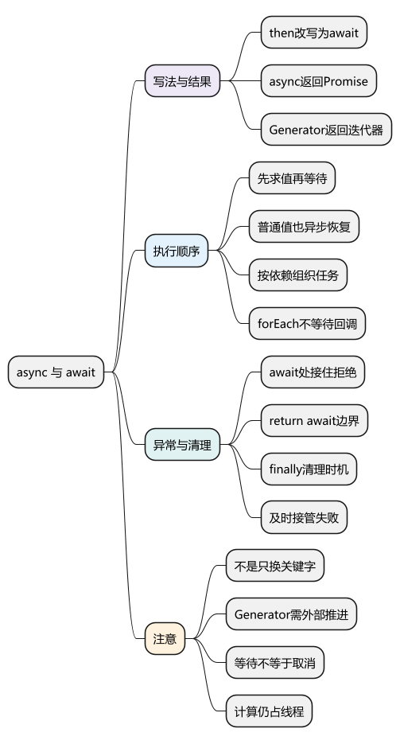
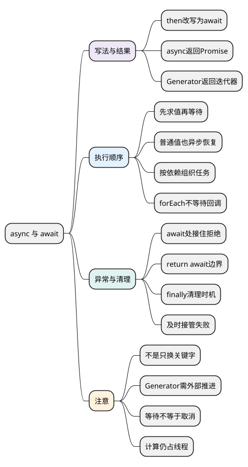

# async 与 await

<!-- core-mindmap:start -->
[](examples/c17-mindmap.svg)

<details>
<summary>PlantUML 源码</summary>



</details>

<!-- core-mindmap:end -->

**口述总览：** async 函数仍然返回 Promise，await 让当前函数等到结果后再继续书写后面的步骤。学习时先把熟悉的 then 链改写一次，再区分任务何时启动、当前函数何时暂停，以及失败由哪里接住。

先读懂 [Promise](02_Promise.md)，再看本篇。async/await 没有增加后台线程，也没有改变 Promise 的成功与失败机制。

各例独立运行；需要 await 时放在 async 函数内部，可用于现代浏览器或 Node，不依赖顶层 await。

## 同一个任务，先看 then 与 await 两种写法

**口述：** then 把后续操作写进回调；await 把成功结果交给当前变量，让后续操作写在下一行。两者都依赖 Promise 传递结果，调用者拿到的也仍是 Promise。

<!-- example: async-then-comparison -->
```js
function loadName() { return Promise.resolve('Lin'); }
function withThen() {
  return loadName().then(name => name.toUpperCase());
}
async function withAwait() {
  const name = await loadName();
  return name.toUpperCase();
}
withThen()
  .then(name => {
    console.log(name); // LIN
    return withAwait();
  })
  .then(name => console.log(name)); // LIN
```

两种写法都等名字到达后再转成大写。async 用来声明这种返回 Promise 的函数，await 表达“在当前函数里等这个结果”；下面再分别解释它们的规则。

<a id="k01"></a>

## async：把函数的返回和抛错变成 Promise 结果

**口述：** 调用 async 函数，总会拿到一个 Promise。return 的值成为成功结果，throw 成为拒绝；函数开始执行时仍按普通同步调用推进。

给函数加 async，改变的是调用者拿到结果的方式。调用者不能直接把返回值当最终业务数据，需要用 await 或 then 获取。

<!-- example: async-return -->
```js
async function value() { return 7; }
const result = value();
console.log(result instanceof Promise); // true
result.then(number => console.log(number)); // 7
```

这里返回的 7 成为成功值，调用者先拿到 Promise，再通过 then 取值。如果返回已有 Promise，async 函数会采用它的结果，但返回的不是同一个 Promise 对象；要区分“最终值相同”与“引用相同”。

## await：暂停当前函数，把继续执行交给后续调度

**口述：** await 先计算右侧表达式，再等待它的结果。暂停的是这个 async 函数的后半段，调用者和其他可以运行的代码仍能继续。

“暂停”不是把整个线程卡在这一行。运行时保存本函数继续执行所需的状态，等结果可用后再恢复。右侧如果是普通值，也会经过异步恢复，不是原地同步跳过。

<!-- example: async-pause -->
```js
function getValue() {
  console.log('getValue');
  return 7;
}
async function work() {
  console.log('start');
  const result = await getValue();
  console.log(`resume ${result}`);
}
work();
console.log('caller');
// start
// getValue
// caller
// resume 7
```

这段代码可以按四步解释：

- work 被调用，先同步输出 start。
- 遇到 await，先执行 getValue，所以 getValue 仍早于 caller。
- await 让 work 的后半段暂停，调用者拿到 Promise 并输出 caller。
- 后续恢复 work，result 得到普通值 7，再输出 resume 7；普通值也没有让 await 同步跳过。

因此，`await heavyCalculation()` 中 heavyCalculation 的同步重计算仍会先占用当前线程。await 等待的是它的返回结果，无法把已经运行的计算搬走。

普通脚本中 await 需要位于 async 函数内部；ES module 还支持顶层 await，但会影响依赖模块的执行，见[模块化](../05_模块化与浏览器实践/01_模块化.md)。

<a id="k02"></a>

## 顺序与并发：先判断任务有没有数据依赖

**口述：** 后一步需要前一步的数据，就顺序等待；互相独立的工作，可以先一起启动，再汇总结果。并发与否取决于启动点，不取决于 await 写了几个。

假设订单请求需要用户 id，就必须先获得用户。用户资料与页面配置互不依赖，则可以同时调用。这里的并发表示多个操作处于进行中，不表示两段主线程 JavaScript 同时执行。

<!-- example: async-sequential-concurrent -->
```js
(async () => {
  const events = [];
  async function loadUser() {
    events.push('user');
    return { id: 7 };
  }
  async function loadOrders(id) {
    events.push(`orders ${id}`);
    return ['order'];
  }
  const user = await loadUser();
  await loadOrders(user.id);
  console.log(events.join(' | ')); // user | orders 7

  let finishA;
  let finishB;
  const loadA = () => new Promise(resolve => { finishA = resolve; });
  const loadB = () => new Promise(resolve => { finishB = resolve; });
  const both = Promise.all([loadA(), loadB()]);
  console.log(typeof finishA, typeof finishB); // function function
  finishB('B');
  finishA('A');
  console.log(JSON.stringify(await both)); // ["A","B"]
})();
```

两个 finish 都已存在，证明两个操作已经启动。我们明确先完成 B、再完成 A；Promise.all 仍按输入顺序返回结果。这个演示不需要猜两次请求各耗时多少。

### 为什么 forEach(async callback) 不会等待全部完成？

forEach 的设计是同步遍历并忽略回调返回值。async 回调返回 Promise，但 forEach 不会自动收集它们，自身仍返回 undefined。

<!-- example: async-for-each-pitfall -->
```js
let finish;
const gate = new Promise(resolve => { finish = resolve; });
const output = [];
const returned = [1].forEach(async value => {
  await gate;
  output.push(value);
  console.log(output.join(',')); // 1
});
console.log(returned, output.length); // undefined 0
finish();
```

forEach 已经返回，回调却仍停在 await，结果数组还是空的。调用 finish 后回调才继续；在 forEach 前加 await，也只是等待它返回的 undefined，不能把这些回调连成一个可等待的任务。这个例子用明确的完成信号观察顺序，不依赖等待若干毫秒。

<!-- example: async-loop -->
```js
(async () => {
  async function double(value) { return value * 2; }
  const sequential = [];
  for (const value of [1, 2, 3]) {
    sequential.push(await double(value));
  }
  const concurrent = await Promise.all([1, 2, 3].map(double));
  console.log(JSON.stringify(sequential)); // [2,4,6]
  console.log(JSON.stringify(concurrent)); // [2,4,6]
})();
```

结果可以相同，启动策略不同：for...of 等当前一项结束才启动下一项，map 立即生成所有 Promise，all 负责接管全部结果。

不要先创建一批可能失败的 Promise，再很晚才逐个 await；尚未接管的项可能先拒绝。少量独立操作应及时接入 all/allSettled；大量任务用[并发池](../05_模块化与浏览器实践/05_异步控制与任务调度.md#k01)控制启动数量。

<a id="k03"></a>

## 先接住 await 的失败，再判断 return await 的边界

**口述：** await 遇到拒绝，会在当前函数这一位置表现为抛错，因此本地 catch 可以处理。直接 return Promise 则把最终结果交给调用者，当前 finally 可能提前执行。

先看最常见的失败处理：

<!-- example: async-catch-failure -->
```js
async function fail() { throw new Error('failed'); }
async function main() {
  try {
    await fail();
  } catch (error) {
    console.log(error.message); // failed
  }
}
main().catch(console.error);
```

即使 throw 出现在第一个 await 之前，fail() 对调用者也表现为 Promise 拒绝。main 在 await 处收到这个失败，所以本地 catch 能接住；只在 fail() 调用外包同步 try/catch，却不等待或处理返回的 Promise，并不能接住这种拒绝。

### return Promise 与 return await Promise

比较的关键是“当前函数是否要等待结果，再决定恢复或清理”。

<!-- example: async-return-await -->
```js
(async () => {
  async function direct() {
    try { return Promise.reject(new Error('direct')); }
    catch { return 'caught locally'; }
  }
  async function handled() {
    try { return await Promise.reject(new Error('awaited')); }
    catch (error) { return `local ${error.message}`; }
  }
  try { await direct(); }
  catch (error) { console.log(`caller ${error.message}`); } // caller direct
  console.log(await handled()); // local awaited
})();
```

直接 return 的 try 正常执行了 return，没有在当前流程抛错，所以本地 catch 不会运行；调用者等待返回的 Promise 后接到拒绝。handled 在 await 位置恢复为异常，于是本地 catch 可以转换结果。

### 清理资源时，完成时间也会影响 finally

<!-- example: async-return-await-cleanup -->
```js
(async () => {
  const events = [];
  let finish;
  const task = new Promise(resolve => { finish = resolve; });
  async function keepResource() {
    try { return await task; }
    finally { events.push('cleanup'); }
  }
  const result = keepResource();
  events.push('before finish');
  finish('done');
  console.log(await result); // done
  console.log(events.join(' | ')); // before finish | cleanup
})();
```

keepResource 使用 return await，所以 finally 等 task 结束后才清理。若改成 return task，函数会先执行 finally，再让返回的 Promise 跟随 task，资源可能过早释放。

finally 中应避免 return 或 throw 意外覆盖原结果；清理失败如何保留根因，见[错误处理](05_错误处理.md#k02)。

<a id="k04"></a>

## 为什么不把 async 函数放进 Promise 构造器？

**口述：** Promise 构造器不使用 executor 的返回值。async executor 又会生成自己的 Promise，两份结果没有自动连起来，失败时可能出现内层拒绝、外层一直等待。

常见误写是 `new Promise(async resolve => { const data = await load(); resolve(data); })`。load 拒绝后，async 函数的 Promise 失败；但外层没有调用 reject，构造器也不会接管 executor 返回的 Promise。

已有 Promise 的操作直接用 async 函数组合。需要把传统回调或事件接口接入 Promise 时，再在构造器中明确连接成功和失败回调。

<!-- example: async-adapt-callback -->
```js
function readByCallback(callback) {
  queueMicrotask(() => callback(null, 'data'));
}
function readAsPromise() {
  return new Promise((resolve, reject) => {
    readByCallback((error, value) => {
      if (error) reject(error);
      else resolve(value);
    });
  });
}
(async () => {
  async function load() {
    const text = await readAsPromise();
    return text.toUpperCase();
  }
  console.log(await load()); // DATA
})();
```

适配层只负责把 callback 的两个分支接到 resolve/reject，业务层直接 await。真实事件源还要考虑回调是否永远不来、取消后如何移除监听，以及处理回调内部抛出的错误。

<a id="k05"></a>

## 等待、取消与页面响应是三个问题

**口述：** await 负责等待结果，AbortSignal 负责传递取消意图，分片或 Worker 负责降低连续计算对主线程的占用。它们不能互相代替。

AbortController 的 abort() 是发出信号，底层 fetch 或自定义任务需要主动响应。等待方不再关心结果，不代表网络、服务器写入或计算自动停止。

连续执行 `await Promise.resolve()` 往往只在微任务中续接。浏览器可能一直忙于这些后续代码，仍没有机会绘制。需要处理大量数据时，可以减少工作量、分成有界小块安排到后续任务，或把合适的计算交给 Worker。

requestAnimationFrame 适合安排视觉更新，其回调里的大量计算依旧占主线程。先测量卡顿位置，再选择调度方式，见[事件循环](04_事件循环与调度.md#k04)。

<a id="generator-relation"></a>

### 进阶补充：async/await 与 Generator 有什么关系

Generator 函数通过 function* 声明，调用后返回保存执行进度的生成器对象，由 next 等方法推进到 yield 暂停点。async 函数调用后先执行同步部分，返回的是 Promise；await 之后何时恢复由运行时安排，不需要调用者反复 next。

<!-- example: async-generator-comparison -->
```js
function* steps() { yield 'pause'; return 'done'; }
async function task() { await 0; return 'done'; }
const iterator = steps();
console.log('generator', iterator.next().value); // generator pause
const result = task();
console.log(typeof iterator.next, result instanceof Promise); // function true
console.log('generator', iterator.next().value); // generator done
result.then(value => console.log('async', value)); // async done
```

生成器需要外部继续推进；async 在等待后自动继续，并通过 Promise 交付结果。可以用“Generator 加自动执行器”类比 async/await 的转换：执行器等待交出的 Promise，再用 next 或 throw 送回值或错误。但这需要完整的推进与异常传递逻辑，不能只替换 function*、yield 两个符号，也不能据此认定原生 async 内部必须使用 Generator。该关系不是学习本篇的前置条件，细节见[迭代器与生成器](../06_选读扩展/01_迭代器与生成器.md)。

<a id="summary"></a>
<a id="interview"></a>

## 试题与答案

**口述主线：** async 保证返回 Promise，await 先求值再暂停；启动方式决定顺序或并发，等待位置决定本地异常与清理边界。

<a id="c17-01"></a>

### C17-01 [P0·原理] async函数调用后立刻异步执行吗？

**回答：** 调用先同步执行到实际经过的第一个 await，右侧表达式也先求值。await 后续逻辑再异步恢复。async 保证返回 Promise，不会自动并行执行计算。见[async 返回值](#k01)。

<a id="c17-02"></a>

### C17-02 [P0·原理] await会阻塞整个线程吗？

**回答：** 等待期间暂停当前 async 函数，其他可调度代码可以继续；但 await 前后的同步计算仍会占用线程。连续等待已成功 Promise 也不保证绘制机会。见[等待与页面响应](#k05)。

<a id="c17-03"></a>

### C17-03 [P0·原理] return await是否总是多余？

**回答：** 不是。当前 catch 需要接管拒绝，或者 finally 必须在操作完成后再清理时，return await 有明确意义。没有本地处理要求时可直接 return Promise，不能机械删除。见[异常与清理](#k03)。

<a id="c17-04"></a>

### C17-04 [P1·原理] new Promise(async resolve=>...)为什么危险？

**回答：** 构造器忽略 executor 返回值，async executor 自己的 Promise 与外层没有自动连接。内部拒绝后，外层可能没有 resolve/reject 而一直等待。已有 Promise 直接用 async 组合，回调适配明确连接两个分支。见[构造器边界](#k04)。

<a id="c17-05"></a>

### C17-05 [P1·工程取舍] 如何选择串行、Promise.all和并发池？

**回答：** 先看数据依赖，依赖前一步就串行；少量独立任务及时用 all/allSettled 接管；大量任务或资源受限则用池控制启动。结果汇总、错误恢复和取消还要分别设计。见[顺序与并发](#k02)。

<a id="c17-06"></a>

### C17-06 [P1·原理] async/await只是把Generator的两个关键字替换了吗？

**回答：** 不是。Generator 函数返回生成器对象，需要外部推进；async 函数返回 Promise，await 的暂停和恢复由运行时处理。Generator 配合自动执行器可以作为转换类比，但还要处理等待、继续执行、异常传递和最终结果，不能只替换语法符号。普通值经过 await 也异步恢复，拒绝则在 await 位置表现为异常，可由本地 catch 处理。

参考：[MDN async function](https://developer.mozilla.org/en-US/docs/Web/JavaScript/Reference/Statements/async_function)、[MDN await](https://developer.mozilla.org/en-US/docs/Web/JavaScript/Reference/Operators/await)。
