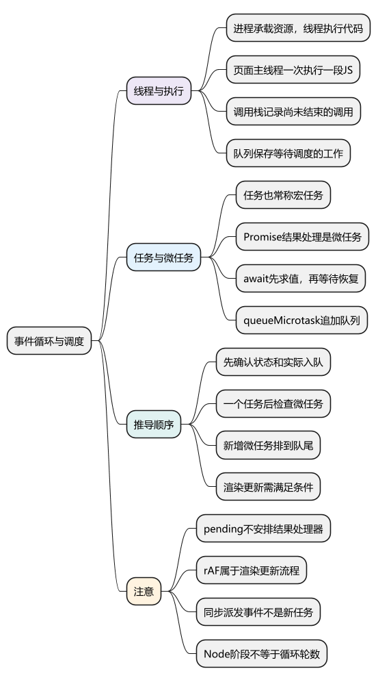
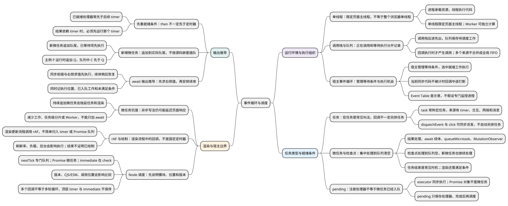
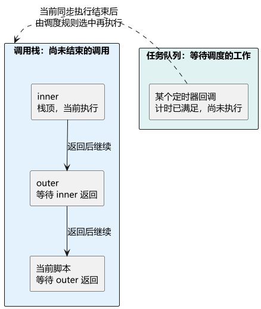
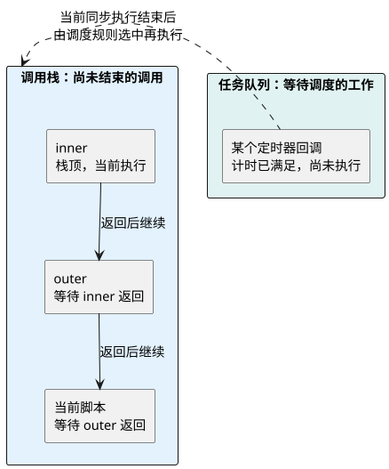
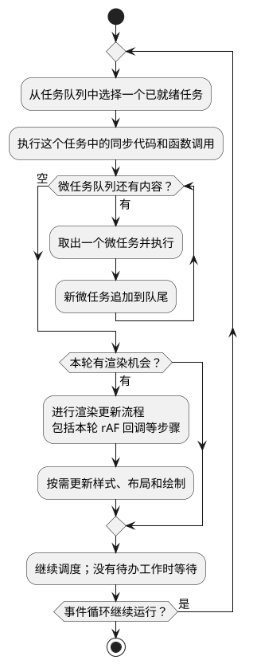

# 事件循环与调度

<!-- core-mindmap:start -->
[](examples/c18-mindmap.svg)

<details>
<summary>PlantUML 源码</summary>



</details>

<!-- core-mindmap:end -->

**口述总览：** 事件循环负责安排代码什么时候有机会执行。在浏览器页面的常见流程中，先执行一个任务里的同步代码，再处理微任务，直到当前微任务队列清空；浏览器随后按条件更新渲染，并继续安排后续工作。定时器回调通常作为任务调度，Promise 的结果处理和 await 的后续恢复通过微任务完成。判断顺序，要看它们什么时候真正入队，而不是只看代码写在上面还是下面。

<!-- recall-route:start -->
**记忆线：** 限定运行环境 → 分清栈与队列 → 判断任务类型和入队条件 → 逐步处理微任务 → 检查渲染与 Node 差异。先确认哪些工作已经就绪，再推导执行顺序。

本篇按 12 个主要知识点复习：[知识点归纳与自查](#self-check) · [试题与答案](#interview)。先尝试口述，再用正文示例验证；文末完整保留每点的回答和记忆提示，不依赖跳转也能复习。
<!-- recall-route:end -->

本篇按“单线程与运行环境 → 调用栈与队列 → 任务与微任务 → 一轮怎样运行 → 输出推导 → 渲染和环境边界”展开。先使用浏览器页面的模型，Node 差异放在最后；定时器 API 见[异步基础与定时器](01_异步基础与定时器.md)。

<a id="process-thread"></a>

## 单线程指什么：进程、线程与页面主线程

**口述：** 进程主要承载和隔离资源，线程负责执行代码。说页面 JavaScript 是单线程，通常是在说页面主线程同一时刻执行一段 JavaScript；浏览器整体仍可以有多个进程和线程。

- **进程**：操作系统组织资源和隔离运行环境的基本单位之一。不同进程通常有各自的虚拟地址空间，也可以通过专门机制通信或共享数据。
- **线程**：进程中的执行单位，由操作系统调度。同一进程的线程通常共享部分内存和资源，但各自保留调用栈等执行状态。
- **页面主线程**：通常执行页面 JavaScript、DOM 操作及部分渲染工作。同一主线程中的同步 JavaScript 不会因为计时结束，就被定时器回调从中间打断。

因此，单线程不表示整个浏览器一次只能做一件事。浏览器还会协调网络、计时和其他工作；Worker 可以在独立线程中执行 JavaScript，并通过消息与页面协作。页面、iframe 与进程的对应关系取决于浏览器架构，不是固定的“一页一个进程”。

本篇先讨论一个页面主线程的调度。线程怎样执行属于实现层，调用栈怎样组织一次次函数调用见[执行上下文与调用栈](../02_运行基础/05_执行上下文与调用栈.md)；Worker 的通信与限制见[Web Worker](../06_选读扩展/02_WebWorker.md)。

<a id="stack-and-queues"></a>

## 调用栈与任务队列：当前调用和待执行工作分别放在哪里

**口述：** 调用栈记录已经进入执行、尚未结束的调用；队列保存等待调度的工作。函数被调用时进入调用栈，调用结束后退出；等待执行的定时器回调不会提前占着一个调用位置。

调用栈按**后进先出**组织：外层函数调用内层函数，内层先执行，结束后外层才继续。它不是把所有同步语句先排好队，再一条条取出的地方。

任务队列可以理解为待办列表。宿主把具备执行条件的任务放入相应队列，之后按调度规则选择工作；被选中的回调真正执行时，才产生相应调用。浏览器有不同任务来源，不能把所有待办合成一条全局队列，单凭登记时间推断全部先后。

<!-- example: loop-call-stack-and-queue -->
```js
function inner() {
  console.log('inner');
}
function outer() {
  console.log('outer start');
  setTimeout(() => console.log('timer'), 0);
  inner();
  console.log('outer end');
}
outer();
console.log('script end');
// outer start
// inner
// outer end
// script end
// timer
```

调用 outer 后，它先输出 outer start，并同步调用 setTimeout 注册计时。接着调用 inner，此时 inner 位于调用栈顶部，outer 等待它返回；inner 结束后 outer 继续输出 outer end，最后回到脚本输出 script end。

timer 回调没有参与这段嵌套调用。它需要等计时条件满足，并在当前同步执行结束后获得调度机会，才进入执行。

<!-- stack-queue-comparison:start -->
[](examples/c18-stack-queue.svg)

<details>
<summary>PlantUML 源码</summary>



</details>

<!-- stack-queue-comparison:end -->

图中假设某个定时器已经满足计时条件，用来对照“已就绪”和“正在执行”；注册定时器时并不保证立即入队。图只画一个任务队列，微任务及多个任务来源的调度在后面继续说明。

<a id="k01"></a>

## 为什么需要事件循环：等待操作与执行回调不是一回事

**口述：** 页面主线程同一时刻执行一段 JavaScript，但浏览器仍能管理网络等待、计时和用户输入。等到条件满足，相关回调需要由运行环境安排执行，不能随意打断当前正在运行的同步代码。

运行 JavaScript 的浏览器或 Node，称为**宿主环境**。它们提供计时、网络等能力，并通过事件循环按规则推进待处理的工作。业务代码负责调用 API 和定义回调，不需要自己反复检查调用栈。

教程中的 Event Table 可以作为“宿主登记等待条件和回调”的示意，不是各引擎必须实现的一张表。也不需要假设存在一个专门的 monitoring process 持续检查调用栈：事件循环由宿主按自身机制实现。

先看最短的定时器例子：

<!-- example: loop-stack -->
```js
console.log('A');
setTimeout(() => console.log('T'), 0);
console.log('B');
// A
// B
// T
```

先输出 A，再注册定时器，然后继续输出 B。当前同步代码结束、定时条件满足，并获得调度机会后，才执行回调输出 T。延迟为 0 不表示立即调用。

所以，长时间同步循环不仅会推迟定时器，也会拖延点击处理和页面更新。异步等待不等于把回调里的计算移到另一个线程；需要独立计算线程时再了解 [Web Worker](../06_选读扩展/02_WebWorker.md)。

<a id="k02"></a>

## 任务与微任务：两种不同的调度安排

**口述：** 任务承载一批需要运行的工作，例如处理一次定时器回调或一次用户交互。微任务是在专门的检查时机处理的后续工作，例如 Promise 的结果处理。两者最终都要执行 JavaScript，区别主要在调度时机。

### 任务：教程通常也称为宏任务

浏览器标准称为 **task（任务）**，很多面试资料把它叫作“宏任务”。本文第一次说明对应关系，后面优先使用“任务”。常见来源包括：

- 定时器满足条件后安排的回调，如 setTimeout、setInterval。
- 浏览器安排的用户交互处理，如一次真实用户点击。
- 某些网络、消息等事件处理。

初学时可以把一个独立的普通脚本中的同步执行视为当前任务里的工作，但不要把所有脚本、模块和函数调用都机械归为“一个新宏任务”。

**回调不一定异步。** 普通调用一个函数仍然同步；脚本里的 button.click()、dispatchEvent() 也会同步派发事件并调用相应监听器，不会因为叫“事件回调”就自动等到下一个任务。事件如何传播见 [DOM 事件](../05_模块化与浏览器实践/02_DOM操作与DOM事件.md#k01)。

### 微任务：在微任务检查点处理的后续工作

常见来源包括 Promise 的 then/catch/finally 结果处理、await 后续代码的恢复、queueMicrotask 注册的回调，以及浏览器 MutationObserver 的通知。

**微任务检查点**可以先理解为“运行环境开始集中处理微任务的时机”。常见位置是一个任务完成之后。处理期间新加入的微任务继续按队列顺序执行，因此必须把这一批队列处理完，才能完成检查点。

需要分清三件事：

- Promise 本身是对象；不能直接说“Promise 是微任务”。new Promise 传入的执行函数会同步运行。
- then 注册回调，不等于立刻调用回调。Promise 已成功或失败时安排处理；仍处于 pending 时，先保存处理器，等它成功或失败后再调度。
- await 先计算右侧表达式，其中的同步调用照常执行；后续恢复通过微任务进行，不是阻塞整个线程等待。

### 先观察一个最简单的任务与微任务对照

<!-- example: loop-basic-order -->
```js
console.log('A');
setTimeout(() => console.log('T'), 0);
Promise.resolve().then(() => console.log('P'));
console.log('B');
// A
// B
// P
// T
```

A、B 是当前同步输出；P 是已经成功的 Promise 安排的微任务；T 是定时器等待调度的任务。当前同步执行结束后，先处理 P，再有机会执行 T。

这个结论有前提：**P 已经具备入队条件。** 如果 Promise 依赖未来的定时器才完成，顺序就不同：

<!-- example: loop-ready-condition -->
```js
const delayed = new Promise(resolve => {
  setTimeout(() => {
    console.log('timer resolves');
    resolve('ready');
  }, 0);
});
delayed.then(() => console.log('then'));
console.log('sync');
// sync
// timer resolves
// then
```

这里必须先执行定时器里的 resolve，才能安排 then 的处理。所谓“微任务优先”，不能让尚未有结果的操作凭空完成。

<a id="pending-example"></a>

### 没有交付结果：写了 then，也可能始终不执行

<!-- example: loop-pending-promise -->
```js
setTimeout(() => console.log('定时器开始啦'), 0);
const waiting = new Promise(resolve => {
  console.log('马上执行啦');
});
waiting.then(() => console.log('执行then函数啦'));
console.log('代码执行结束');
// 马上执行啦
// 代码执行结束
// 定时器开始啦
```

执行器中的日志同步输出，但这个例子既没有调用 resolve/reject，也没有抛错，所以 waiting 一直 pending。then 只登记了处理器，没有把成功回调加入微任务队列，因此不会输出“执行then函数啦”。定时器与这个 Promise 没有完成依赖，仍能照常执行。

如果在执行器输出日志之后增加 resolve()，才会得到“马上执行啦 → 代码执行结束 → 执行then函数啦 → 定时器开始啦”。对比时只改变这一行，就能看到：先判断状态和入队条件，再判断任务种类的执行顺序。

## 一轮怎样运行：执行任务，再处理微任务和渲染机会

**口述：** 对常见的浏览器输出题，先走完当前任务中的同步代码，再按入队顺序处理微任务；队列清空后，浏览器才有机会继续其他工作。不是先把所有定时器跑完，再统一处理 Promise。

<!-- event-loop-flow:start -->
[](examples/c18-flow.svg)

<details>
<summary>PlantUML 源码</summary>



</details>

<!-- event-loop-flow:end -->

这张图展示有任务可执行时的简化主线：浏览器实际可能有多个任务队列，微任务检查点也不只出现在图中这一处。图中省略了空闲调度以及部分回调结束后的额外检查点，不把所有来源合成一个全局先进先出队列。

观察两个定时器之间发生的事情：

<!-- example: loop-between-tasks -->
```js
setTimeout(() => {
  console.log('T1');
  Promise.resolve().then(() => console.log('M1'));
}, 0);
setTimeout(() => console.log('T2'), 0);
// T1
// M1
// T2
```

同一执行环境中，两个同延迟定时器按本例的注册顺序调度。第一个回调结束后，先处理它安排的微任务 M1，然后执行第二个定时器。不能把它记成“所有任务一批、所有微任务一批”。

<a id="k03"></a>

## 综合例子：加入 await，再加入嵌套微任务

**口述：** 判断输出时，始终跟踪三项：当前同步执行到了哪里，哪些微任务已经入队，哪些异步条件尚未满足。新微任务追加到队尾，源码嵌套深度不决定优先级。

<!-- example: loop-queue-walk -->
```js
console.log('A');
setTimeout(() => console.log('T'), 0);
Promise.resolve().then(() => {
  console.log('P');
  queueMicrotask(() => console.log('Q'));
});
async function run() {
  console.log('B');
  await 0;
  console.log('C');
}
run();
console.log('D');
// A B D P C Q T（每项单独一行）
```

逐步推导：

1. 输出 A，注册定时器；已成功 Promise 的处理器 P 入队。
2. 调用 run，立即输出 B。await 0 让后续 C 等待微任务恢复，调用者继续输出 D。
3. 当前相关微任务是 P → C。执行 P 时输出 P，并将 Q 追加到 C 后面。
4. 依次执行 C、Q，微任务队列清空。
5. 定时器取得执行机会，输出 T。

因此结果是 A → B → D → P → C → Q → T。Q 写在 P 内部，却不会越过已经等待的 C。

这是一个独立示例，没有混入其他业务任务。分析真实页面时，还要追踪网络结果、用户操作和已有微任务，不能只凭某一段源码推断整个页面顺序。

<a id="k04"></a>

## 微任务与渲染：异步写法为什么仍会卡住页面

**口述：** 微任务虽然稍后执行，但仍然占用执行线程。不断追加微任务，会延迟其他任务和绘制；浏览器也不保证每执行一个任务就渲染一帧。

### 连续微任务会延迟其他工作

<!-- example: loop-microtask-chain -->
```js
let count = 0;
setTimeout(() => console.log('timer'), 0);
function step() {
  console.log('micro ' + ++count);
  if (count < 3) queueMicrotask(step);
}
queueMicrotask(step);
// micro 1
// micro 2
// micro 3
// timer
```

每次 step 都追加下一个微任务，它仍在本次检查点处理。把次数变得极大，或者每个微任务做大量计算，定时器和渲染就可能长时间得不到机会，这通常叫**微任务饥饿**。

反复 await 已成功的 Promise 也可能形成连续的微任务恢复，所以“加一个 await”不保证页面能刷新。先减少计算量；需要分片时把有界工作安排到后续任务，或在支持的环境使用 scheduler.yield；重计算也可以评估 Worker。具体方案还要考虑总耗时与通信成本。

### rAF 与渲染有关，不是另一种普通定时器

requestAnimationFrame 在浏览器的渲染更新流程中执行回调，通常用于本次绘制前更新视觉状态。不要把它直接塞进“定时器宏任务”或“Promise 微任务”的清单。

它不保证每 16.7ms 一次：屏幕刷新率、主线程负载、页面可见性和浏览器调度都会影响执行。后台页可能暂停帧回调，数据保存和最终清理不能完全依赖它。

rAF 里的同步重计算也会拖慢绘制；回调结束仍可能涉及微任务检查。因此“执行完一个 rAF 回调”也不是“屏幕一定已经更新”的证明。这里理解时机即可，API 参数和动画用法见[定时器篇](01_异步基础与定时器.md#raf)。

<a id="k05"></a>

## 进阶：Node 的队列不能直接套用浏览器结论

**口述：** Node 使用自己的事件循环阶段，并提供 process.nextTick 和 setImmediate。比较执行顺序前，应说明 Node 版本、模块模式和代码位于哪里。

常见阶段包括 timers、poll、check，分别与定时器、I/O 处理、setImmediate 调度有关。process.nextTick 使用 Node 的专门队列；它与 Promise 微任务的处理顺序不能简单套在所有位置。

下面明确作为 Node CommonJS 顶层脚本运行，例如保存为 .cjs：

<!-- example: loop-node-commonjs -->
```js
const events = ['sync'];
process.nextTick(() => events.push('nextTick'));
Promise.resolve().then(() => events.push('promise'));
setImmediate(() => {
  events.push('immediate');
  console.log(events.join(' | '));
  // sync | nextTick | promise | immediate
});
```

把同一段代码保存为 .mjs 并在现代 Node 的 ESM 顶层运行，会看到 sync → promise → nextTick → immediate；在上面的 CommonJS 顶层则是 sync → nextTick → promise → immediate。模块求值与当前微任务处理的关系不同，差异有明确的环境条件，不是输出“有一点误差”。不要把 nextTick 与 Promise 混记成一个普通微任务队列，也不要把“nextTick 永远最先”当成跨位置规则。

### 分析代码的执行阶段，不等于统计事件循环轮数

Node 的 timers、poll、check 是一轮事件循环中的不同阶段，一个阶段可能处理多个回调。因此，把一段代码拆成“顶层代码 → 定时器一 → 定时器二”三段来推导，不等于证明它恰好经历三轮 libuv 事件循环。顶层模块求值也不能机械当作其中一轮。

分析输出题时，应分别记录回调执行、nextTick 队列与 Promise 微任务的处理时机；需要确认底层循环轮次时，还要结合运行版本、调度位置与运行时观测。

顶层 setTimeout(0) 与 setImmediate 也不应承诺固定先后；在 I/O 回调内部安排时，关系可能不同，Node/libuv 版本还会影响阶段细节。前端第一轮先掌握浏览器模型，这些边界需要时再验证。

<a id="summary"></a>

复习时先说明页面主线程的范围，再区分调用栈记录调用、队列保存待办，以及任务和微任务的处理时机，再用最短例子走一轮。深入时继续追踪实际入队条件、微任务追加、渲染机会和运行环境，就能沿同一条规则分析。

<a id="self-check"></a>

## 知识点归纳与自查

本节按 12 个知识点回忆和归纳。先用自查问题检查理解，再顺序阅读各点口述与记忆提示；分级试题在后面的独立章节。

### 自查问题

1. [进程、线程与页面主线程有什么区别？JavaScript 单线程表示浏览器同一时刻只能做一件事吗？Worker 又有什么作用？](#recall-01)
2. [调用栈与任务队列分别保存什么？等待中的 timer 回调是否已经占着调用栈？全部任务能按注册时间排成一条全局队列吗？](#recall-02)
3. [事件循环解决什么问题？异步等待怎样与单线程执行配合？Event Table 和 monitoring process 是必须存在的实现吗？](#recall-03)
4. [task 与宏任务是什么关系？常见来源有哪些？dispatchEvent、button.click 和普通函数调用会自动变成新任务吗？](#recall-04)
5. [哪些操作产生微任务？微任务检查点是什么？是否只在任务结束后才检查，每个任务后都一定绘制一帧吗？](#recall-05)
6. [一直 pending 的 Promise 调用 then 后，回调会进入微任务队列吗？executor 的日志与独立定时器为什么仍会执行？](#recall-06)
7. [then 一定比 setTimeout 先执行吗？如果 Promise 的 resolve 在未来定时器里，顺序怎样判断？](#recall-07)
8. [Promise 回调中新建微任务为什么不立即执行？主例中 P、C、Q 怎样排序？两个任务之间会不会先处理微任务？](#recall-08)
9. [综合输出题里的 async 函数怎样拆开分析？await 右侧调用与后续语句各属于什么时候？为什么不能只看源码先后？](#recall-09)
10. [为什么持续 queueMicrotask 或 await Promise.resolve() 仍可能卡住页面？怎样让其他任务和绘制获得机会？](#recall-10)
11. [rAF 回调是不是每 16.7ms 必执行？它属于普通 timer 任务或 Promise 微任务吗？回调结束能证明屏幕已更新吗？](#recall-11)
12. [Node 的 nextTick、Promise、setImmediate 怎样比较？CommonJS 与 ESM 顶层为何可能不同？几个回调是否等于几轮事件循环？](#recall-12)

<a id="recall-01"></a>

### 单线程：限定页面主线程，不等于整个浏览器单线程

**自查：** 进程、线程与页面主线程有什么区别？JavaScript 单线程表示浏览器同一时刻只能做一件事吗？Worker 又有什么作用？

**口述：** 进程承载资源和隔离运行环境，线程是进程中的执行单位。页面 JavaScript 单线程通常指同一页面主线程一次执行一段 JavaScript；浏览器整体可以用多个进程和线程协调网络、计时及其他工作。Worker 可以在独立线程执行 JavaScript，通过消息与页面协作。页面与进程不是固定一对一，分析顺序要先说明讨论的是哪个运行环境和线程。

**记忆：** 页面主线程一次执行一段代码，浏览器整体仍可多线程协作。

<a id="recall-02"></a>

### 调用栈与队列：正在调用和等待执行分开记录

**自查：** 调用栈与任务队列分别保存什么？等待中的 timer 回调是否已经占着调用栈？全部任务能按注册时间排成一条全局队列吗？

**口述：** 调用栈记录已经进入、尚未结束的调用，按后进先出组织执行和返回；队列保存等待调度的工作。定时器等待期间不提前占据一个函数调用，回调被选中并实际执行时才产生调用。浏览器有多个任务来源和任务队列，不能把所有任务都合并成一条全局先进先出队列，单凭注册时间推断跨来源先后。

**记忆：** 栈记当前调用，队列放待办；任务来源不同，不能只按登记时间排序。

<a id="recall-03"></a>

### 宿主事件循环：管理等待条件与执行机会

**自查：** 事件循环解决什么问题？异步等待怎样与单线程执行配合？Event Table 和 monitoring process 是必须存在的实现吗？

**口述：** 浏览器或 Node 等宿主管理网络、计时和输入条件，再按规则给就绪工作提供执行机会。等待条件和运行回调是两回事，计时完成不能随意打断当前同步代码。事件循环由宿主实现，业务代码不必自己轮询调用栈。Event Table 可作为登记关系的示意，不能认为所有引擎必须有同名表或专门的 monitoring process；回调里的计算也不会因异步注册而自动离开主线程。

**记忆：** 宿主管等待与调度，回调仍需执行机会；示意名称不是强制实现。

<a id="recall-04"></a>

### 任务：宏任务是常见叫法，回调不一定另排任务

**自查：** task 与宏任务是什么关系？常见来源有哪些？dispatchEvent、button.click 和普通函数调用会自动变成新任务吗？

**口述：** 浏览器标准的 task 常被教程称为宏任务，常见来源包括满足条件的定时器回调、用户交互以及某些网络或消息处理。任务承载需要运行的一批工作，但不是每个函数、脚本或事件回调都自动创建新任务。普通函数调用仍同步，脚本中的 dispatchEvent 和 button.click 会同步派发相应事件并调用监听器，所以必须看具体 API 和调用路径，不能只凭回调名称分类。

**记忆：** 任务看宿主怎样安排，事件回调也可能同步调用。

<a id="recall-05"></a>

### 微任务与检查点：集中处理到队列清空

**自查：** 哪些操作产生微任务？微任务检查点是什么？是否只在任务结束后才检查，每个任务后都一定绘制一帧吗？

**口述：** Promise 的结果处理、await 续体、queueMicrotask 和 MutationObserver 通知是常见微任务来源。微任务检查点是集中处理这些工作的时机，处理期间新加入的微任务也继续执行，直到队列清空。任务结束后是常见检查时机，但浏览器还有其他规定的检查点，不能说只此一处。完成检查点后是否更新渲染还受渲染机会等条件影响，也不保证每个任务后绘制一帧。

**记忆：** 检查点处理到队列空，但检查点不只一处，绘制也不每次必发生。

<a id="recall-06"></a>

### pending：注册处理器不等于微任务已经入队

**自查：** 一直 pending 的 Promise 调用 then 后，回调会进入微任务队列吗？executor 的日志与独立定时器为什么仍会执行？

**口述：** 不会仅因调用 then 就安排成功或失败处理器。pending Promise 先保存处理器，成功或失败后再安排对应处理。executor 本身在构造时同步执行，如果没有 resolve、reject，也没有抛错，结果可以一直 pending，then 中的日志就不会运行；与它没有完成依赖的定时器仍照常调度。Promise 是结果对象，不能直接把整个对象或 executor 叫作微任务。见[pending 对照](#pending-example)。

**记忆：** executor 现在执行，pending 先登记，结果完成才安排处理器。

<a id="recall-07"></a>

### 先看就绪条件：then 不一定先于定时器

**自查：** then 一定比 setTimeout 先执行吗？如果 Promise 的 resolve 在未来定时器里，顺序怎样判断？

**口述：** 不一定。已成功 Promise 的处理器可以在当前同步代码后的微任务检查点运行，早于后续定时器；但如果 Promise 要由未来的定时器完成，就必须先执行那个定时器里的 resolve，再安排结果处理。微任务的调度规则不能让未完成结果凭空就绪。应先限定宿主环境，判断状态与实际入队条件，再比较任务类别。见[就绪条件](#k02)。

**记忆：** 先有结果才排处理；微任务优先不能越过完成依赖。

<a id="recall-08"></a>

### 新增微任务：追加到实际队尾，不按源码嵌套插队

**自查：** Promise 回调中新建微任务为什么不立即执行？主例中 P、C、Q 怎样排序？两个任务之间会不会先处理微任务？

**口述：** 执行微任务时新注册的微任务会追加到实际队尾，已经等待的微任务先运行。主例中 P 执行时才加入 Q，而 C 已经入队，所以是 P、C、Q；源码嵌套不决定优先级。常见浏览器流程是在一个任务结束后处理微任务，再继续其他任务，不能先跑完所有定时器再处理全部 Promise。推导时持续记录队列，取出一个，再追加它产生的工作。见[综合推导](#k03)。

**记忆：** 新来的排队尾，不按嵌套插队；一个任务后先看微任务。

<a id="recall-09"></a>

### await 输出推导：先求右侧值，再安排续体

**自查：** 综合输出题里的 async 函数怎样拆开分析？await 右侧调用与后续语句各属于什么时候？为什么不能只看源码先后？

**口述：** 先沿当前同步执行路径走：async 调用先执行同步前缀，遇到 await 时先计算右侧表达式，然后等待结果并在后续通过微任务恢复续体。主例先得到同步 A、B、D，再按队列得到 P、C、Q，最后轮到 T。应同时记录当前执行位置、已经入队的微任务和仍未满足的等待条件，真实页面还可能有其他任务与微任务，不能凭一段源码推断全部页面顺序。

**记忆：** 同步先走，await 右边先算；续体何时入队，才决定后面顺序。

<a id="recall-10"></a>

### 微任务饥饿：异步写法仍可能延迟页面响应

**自查：** 为什么持续 queueMicrotask 或 await Promise.resolve() 仍可能卡住页面？怎样让其他任务和绘制获得机会？

**口述：** 微任务执行仍占用线程，检查点期间不断追加微任务，就可能让队列长时间无法清空，定时器、交互和渲染持续等待，这通常称为微任务饥饿。await 已成功 Promise 通常只是把续体放回微任务，并没有消除同步计算。先减少工作量，再把有界小块安排到后续任务，或在支持环境使用 scheduler.yield；合适的重计算也可以评估 Worker，视觉更新另用 rAF 组织。见[响应与渲染](#k04)。

**记忆：** 微任务一直续，其他工作一直等；异步写法不等于让出渲染机会。

<a id="recall-11"></a>

### rAF 与绘制：渲染流程中的回调，不是固定定时器

**自查：** rAF 回调是不是每 16.7ms 必执行？它属于普通 timer 任务或 Promise 微任务吗？回调结束能证明屏幕已更新吗？

**口述：** 不是。rAF 在浏览器渲染更新流程中运行，通常用于绘制前更新视觉状态，不宜简单归到定时器任务或 Promise 微任务清单。刷新率、负载、可见性和调度影响执行，后台页可能暂停，不能依靠它保证业务完成。回调内的重计算仍拖慢绘制，结束后也可能还有微任务检查和其他渲染步骤，因此回调结束不是屏幕已经更新的证明。见[渲染机会](#k04)。

**记忆：** rAF 跟随渲染机会，不保 16.7ms；回调结束不等于画面已经显示。

<a id="recall-12"></a>

### Node 调度：先说明模块、位置和版本

**自查：** Node 的 nextTick、Promise、setImmediate 怎样比较？CommonJS 与 ESM 顶层为何可能不同？几个回调是否等于几轮事件循环？

**口述：** Node 有 timers、poll、check 等阶段，setImmediate 与 check 阶段有关，process.nextTick 使用专门队列，Promise 使用微任务。比较前要说明版本、模块模式和调用位置：正文 CommonJS 顶层为 nextTick 先于 Promise，现代 ESM 顶层示例则相反，不能推广成 nextTick 永远最先。顶层 setTimeout(0) 与 setImmediate 不承诺固定顺序，I/O 内部又有不同条件。一个阶段可能处理多个回调，按输出拆成几段不代表经历同样数量的 libuv 循环。见[Node 边界](#k05)。

这段 ESM 顶层示例通过异步模块求值运行，已经处在微任务相关的执行流程中，随后加入的 Promise 微任务可在返回处理 nextTick 队列前运行，因此不能直接套用 CommonJS 顶层顺序。它不是所有 ESM 回调的全局优先级都反转，仍要看当前执行位置。

**记忆：** Node 先报环境，nextTick 不混普通微任务；回调段数不等于循环轮数。

<a id="interview"></a>

## 试题与答案

<a id="c18-06"></a>

### C18-06 [P0·原理] Promise 一直 pending 时，then 会进入微任务队列吗？

**回答：** 不会仅因调用 then 就安排成功或失败处理器。pending Promise 先保存处理器，成功或失败后再安排对应处理。executor 本身在构造时同步执行，如果没有 resolve、reject，也没有抛错，结果可以一直 pending，then 中的日志就不会运行；与它没有完成依赖的定时器仍照常调度。Promise 是结果对象，不能直接把整个对象或 executor 叫作微任务。见[pending 对照](#pending-example)。

<a id="c18-01"></a>

### C18-01 [P0·原理] then一定比setTimeout先执行吗？

**回答：** 不一定。已成功 Promise 的处理器可以在当前同步代码后的微任务检查点运行，早于后续定时器；但如果 Promise 要由未来的定时器完成，就必须先执行那个定时器里的 resolve，再安排结果处理。微任务的调度规则不能让未完成结果凭空就绪。应先限定宿主环境，判断状态与实际入队条件，再比较任务类别。见[就绪条件](#k02)。

<a id="c18-02"></a>

### C18-02 [P0·原理] Promise回调中新建微任务为什么不插队？

**回答：** 执行微任务时新注册的微任务会追加到实际队尾，已经等待的微任务先运行。主例中 P 执行时才加入 Q，而 C 已经入队，所以是 P、C、Q；源码嵌套不决定优先级。常见浏览器流程是在一个任务结束后处理微任务，再继续其他任务，不能先跑完所有定时器再处理全部 Promise。推导时持续记录队列，取出一个，再追加它产生的工作。见[综合推导](#k03)。

<a id="c18-03"></a>

### C18-03 [P0·工程取舍] await Promise.resolve为什么仍会让页面卡住？

**回答：** 微任务执行仍占用线程，检查点期间不断追加微任务，就可能让队列长时间无法清空，定时器、交互和渲染持续等待，这通常称为微任务饥饿。await 已成功 Promise 通常只是把续体放回微任务，并没有消除同步计算。先减少工作量，再把有界小块安排到后续任务，或在支持环境使用 scheduler.yield；合适的重计算也可以评估 Worker，视觉更新另用 rAF 组织。见[响应与渲染](#k04)。

<a id="c18-04"></a>

### C18-04 [P1·原理] rAF回调是不是每16.7ms必执行？

**回答：** 不是。rAF 在浏览器渲染更新流程中运行，通常用于绘制前更新视觉状态，不宜简单归到定时器任务或 Promise 微任务清单。刷新率、负载、可见性和调度影响执行，后台页可能暂停，不能依靠它保证业务完成。回调内的重计算仍拖慢绘制，结束后也可能还有微任务检查和其他渲染步骤，因此回调结束不是屏幕已经更新的证明。见[渲染机会](#k04)。

<a id="c18-05"></a>

### C18-05 [P1·原理] Node nextTick、Promise、setImmediate怎么比较？

**回答：** Node 有 timers、poll、check 等阶段，setImmediate 与 check 阶段有关，process.nextTick 使用专门队列，Promise 使用微任务。比较前要说明版本、模块模式和调用位置：正文 CommonJS 顶层为 nextTick 先于 Promise，现代 ESM 顶层示例则相反，不能推广成 nextTick 永远最先。顶层 setTimeout(0) 与 setImmediate 不承诺固定顺序，I/O 内部又有不同条件。一个阶段可能处理多个回调，按输出拆成几段不代表经历同样数量的 libuv 循环。见[Node 边界](#k05)。

这段 ESM 顶层示例通过异步模块求值运行，已经处在微任务相关的执行流程中，随后加入的 Promise 微任务可在返回处理 nextTick 队列前运行，因此不能直接套用 CommonJS 顶层顺序。它不是所有 ESM 回调的全局优先级都反转，仍要看当前执行位置。

参考：[HTML 事件循环](https://html.spec.whatwg.org/multipage/webappapis.html#event-loops)、[Node 事件循环](https://nodejs.org/en/learn/asynchronous-work/event-loop-timers-and-nexttick)。
