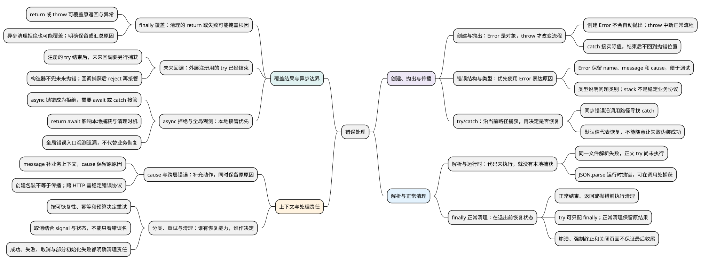

# 错误处理

<!-- core-mindmap:start -->
[](examples/c19-mindmap.svg)

<details>
<summary>PlantUML 源码</summary>



</details>

<!-- core-mindmap:end -->

**口述总览：** Error 对象记录失败信息，throw 才会把它抛出并中断当前正常流程。try/catch 让调用方接住异常，决定恢复还是继续向上抛；finally 用于离开当前流程前的清理。异步操作还需要把回调或 Promise 的失败接回等待它的代码，不能只靠源码外面套一层 try。

<!-- recall-route:start -->
**记忆线：** 创建错误 → 抛出与捕获 → 恢复或传播 → finally 清理 → 跨异步边界 → 保留原因并分类。每次先问错误在哪里产生、谁有能力恢复、谁负责收尾。

本篇按 10 个主要知识点复习：[先自查](#self-check) · [口述与答案](#interview)。先尝试口述，再用正文示例验证；文末完整保留每点的回答和记忆提示，不依赖跳转也能复习。
<!-- recall-route:end -->

错误处理的目标是让失败有明确去向，并在必要时恢复或提示。到处加 catch 并不会自动提高可靠性；一个无条件返回默认值的 catch，也可能让真正失败伪装成成功。

本篇按“创建与抛出 → 捕获与传播 → 清理 → 异步边界 → 补充原因和分类”展开。各例可在支持 Error.cause 和 Promise 的现代 Node.js ES 模块中独立运行；异步部分接着[Promise](02_Promise.md)和[async 与 await](03_async与await.md)阅读。

<a id="k01"></a>

## 先区分创建错误对象与抛出异常

**口述：** new Error(message) 创建并返回一个记录错误信息的对象，本身不会让代码跳进 catch。throw value 才是抛出动作：它中断当前正常流程，让运行时沿执行路径寻找能接住它的 catch。

message 是错误说明，name 是错误名称。try 中放可能抛错的操作；catch(error) 中的 error 是本次实际抛出的值，变量名可以自己取。没有异常时跳过 catch；捕获并正常结束后，继续执行整个 try/catch 后面的语句。

<!-- example: error-create-vs-throw -->
```js
const problem = new Error('名称不能为空');
console.log(problem.name, problem.message); // Error 名称不能为空

try {
  console.log('开始检查');
  throw problem;
  console.log('不会执行');
} catch (error) {
  console.log(error === problem, error.message); // true 名称不能为空
}
console.log('继续执行');
```

完整输出依次是 Error 名称不能为空、开始检查、true 名称不能为空、继续执行。“不会执行”不会输出：执行 throw 后，try 剩余语句被跳过，catch 接到同一个对象；catch 结束后不会回到抛错位置接着运行。

throw 可以抛任意值，但通常优先抛 Error 对象，便于保留名称、说明和原因。主流引擎还提供调试栈 stack；其字符串格式不是统一业务协议，不应靠解析它决定错误类别。

### 常见错误名称用来表达什么

常见内建类型各有用途：

- TypeError：类型不符合操作要求，例如调用一个非函数值。
- ReferenceError：无法访问某个名字，例如未声明标识符或暂时性死区。
- RangeError：值超出允许范围，例如创建非法长度的数组。
- SyntaxError：语法不合法，例如 JSON.parse 解析无效 JSON。
- URIError：URI 编解码遇到不合法输入。
- AggregateError：汇总多个原因，例如 Promise.any 全部失败。
- Error 是通用类型；EvalError 是历史类型，日常较少直接使用。

这些名称描述错误类别，不会自动决定恢复办法。语言也会主动抛错，例如调用非函数值时抛 TypeError，不要求代码中显式写出 throw。

<a id="k02"></a>

## try/catch：捕获当前执行路径中的异常，再决定是否恢复

**口述：** throw 会中断当前正常流程，沿调用关系寻找 catch。catch 可以恢复、转换后再抛，或者原样抛给上层；正常返回就是一次明确的恢复决定。

try 不是“包住所有坏事”的容器。它只对执行期间传播到这里的异常起作用。同步函数在 try 内调用并抛错，错误可以沿这次调用回到 catch。

<!-- example: error-recovery -->
```js
function parseCount(text) {
  const count = Number(text);
  if (!Number.isInteger(count) || count < 0) {
    throw new RangeError('count must be a non-negative integer');
  }
  return count;
}
function readOptionalCount(text) {
  try {
    return parseCount(text);
  } catch (error) {
    if (error instanceof RangeError) return 0;
    throw error;
  }
}
console.log(readOptionalCount('3')); // 3
console.log(readOptionalCount('-1')); // 0
```

这里明确规定“可选数量非法时按 0 处理”，所以返回 0 是业务允许的恢复。若库存扣减失败也随便返回 0，调用者可能误以为操作成功，因此默认值不是普遍正确的错误策略。

只在当前层知道怎样恢复时恢复。底层通用库通常提供准确原因，页面或服务入口再决定重试、降级、提示或记录，避免每一层重复输出同一条错误日志。

同一文件在解析阶段就语法错误时，代码尚未开始执行，文件正文里的 try/catch 无法补救。JSON.parse 在运行时解析字符串并抛错，则可以像上例一样捕获。

## finally：先完成清理，再把结果交给调用方

**口述：** finally 会在 try/catch 准备正常结束、返回或抛错时运行。常见用途是恢复临时状态、释放锁或结束订阅；只做正常清理时，原来的返回值或异常会继续交给调用方。

<!-- example: error-finally-cleanup -->
```js
const state = { busy: false };
function read(shouldFail) {
  state.busy = true;
  try {
    if (shouldFail) throw new Error('read failed');
    return 'ready';
  } finally {
    state.busy = false;
  }
}
console.log(read(false), state.busy); // ready false
try { read(true); }
catch (error) { console.log(error.message, state.busy); } // read failed false
```

成功返回 ready 前会恢复 busy；失败向外抛出前也会恢复 busy。try 后面可以只接 finally，不一定要有 catch：这里的 read 不负责恢复失败，所以把异常留给调用方处理。

### 清理中的 return 或 throw 会覆盖原结果

<!-- example: error-finally -->
```js
function replacedReturn() {
  try { return 1; }
  finally { return 2; }
}
function hiddenFailure() {
  try { throw new Error('business failed'); }
  finally { return 'looks successful'; }
}
console.log(replacedReturn()); // 2
console.log(hiddenFailure()); // looks successful
```

第一段原本准备返回 1，却被 finally 的 return 2 替换。第二段原本准备抛错，finally 的返回让调用者看到成功。这就是“清理代码掩盖根因”的一种常见形式。

因此 finally 通常不写业务 return，也不默认吞掉原来的错误。业务与清理都失败时，要明确保留原错误还是汇总两个原因；异步 finally 中 await 一个拒绝的清理 Promise，也可能覆盖原结果。

finally 也不是进程崩溃、强制终止或页面被关闭时的绝对保障。重要持久化不能只依赖“程序结束前一定有最后一次 JavaScript 清理”。

<a id="k03"></a>

## 异步边界：注册回调的 try 早已结束

**口述：** try/catch 捕获的是执行路径，不是源码缩进。定时器回调稍后才运行，原来的同步 try 已经结束；需要在回调内捕获，并把失败交给等待它的人。

例如 `try { setTimeout(callback, 0); } catch { ... }` 只包围注册定时器这一步。callback 未来抛错时，并没有正在等待它返回的原 try。

下面把定时器中的同步抛错变成 Promise 拒绝，调用者再用 await 捕获。

<!-- example: error-timer-adapter -->
```js
function readLater() {
  return new Promise((resolve, reject) => {
    setTimeout(() => {
      try {
        resolve(JSON.parse('{bad'));
      } catch (error) {
        reject(error);
      }
    }, 0);
  });
}
(async () => {
  try {
    await readLater();
  } catch (error) {
    console.log(error.name); // SyntaxError
  }
})();
```

错误经过两段连接：定时器内部 catch 把异常交给 reject；外部 await 把拒绝恢复成当前函数里的异常，再进入外层 catch。只写 `new Promise(resolve => setTimeout(...))`，不能让构造器自动捕获未来回调的异常。

### async 函数为什么需要 await 或 catch 接管？

async 内 throw 会变成返回 Promise 的拒绝。直接调用函数后不等待，就没有把拒绝接回当前 try。

<!-- example: error-async-boundary -->
```js
(async () => {
  async function work() { throw new Error('failed'); }
  async function caller() {
    try { return await work(); }
    catch (error) { return `handled ${error.message}`; }
  }
  console.log(await caller()); // handled failed
})();
```

return await 让失败在当前 try 内发生；直接 return work() 则交由返回的 Promise 采用最终结果。本地 catch 与 finally 的区别见[async/await](03_async与await.md#k03)。

浏览器 error、unhandledrejection 事件和 Node 相应机制适合观测遗漏错误，但不是业务恢复入口。到全局才发现失败，通常已经缺少安全重试、恢复页面状态所需的局部信息。

<a id="k04"></a>

## 补充失败原因，再决定怎样分类和处理

**口述：** 底层错误说明哪里失败，上层还可以补充正在执行的业务动作。需要包装错误时，用 cause 保留原原因；是否重试、提示或取消，则根据业务含义判断，不由一个错误名称包办。

<a id="cause"></a>

### cause：补充上下文，同时保留原错误

new Error(message, { cause }) 返回新的 Error 对象：message 描述当前层的失败，cause 保存传入的原原因，可以是任意值。

<!-- example: error-cause -->
```js
function readConfig(text) {
  try {
    return JSON.parse(text);
  } catch (cause) {
    throw new Error('配置解析失败', { cause });
  }
}
try {
  readConfig('{bad');
} catch (error) {
  console.log(error.message); // 配置解析失败
  console.log(error.cause instanceof SyntaxError); // true
}
```

JSON.parse 抛出的 SyntaxError 是原原因；readConfig 补充“配置解析失败”。包装后继续 throw，调用方才能接到新错误。只创建或记录错误对象，不会自动把失败继续抛出去。

对外接口可以返回稳定 code、安全文案和 requestId。跨 HTTP 后通常只有 JSON 数据，服务端 Error 原型不会自动来到浏览器，内部路径和密钥等也不应直接出现在用户提示里。

### 分类与资源清理保留明确的责任边界

用户主动取消通常是一次正常的停止意图，不必一律显示“服务器故障”。但也不能简单地把所有名字叫 AbortError 的异常吞掉：要结合本次操作的 signal、业务状态和真实原因判断。

重试需要错误分类和预算。权限拒绝、参数非法通常原样重试没有意义；写入结果不明时还要确认幂等与状态，见[异步控制](../05_模块化与浏览器实践/05_异步控制与任务调度.md#k03)。

创建资源的一层应明确谁在成功、失败和取消时释放它；中途初始化失败，也要清理已经创建的部分。订阅移除、重复清理和多资源释放的完整设计见[内存与资源生命周期](../01_数据类型、内建对象与内存管理/22_垃圾回收机制、内存泄漏与资源清理.md)，本篇重点掌握异常传播与 finally 的执行位置。

<a id="summary"></a>

复述时从“Error 只是对象，throw 才抛出”开始，再说明谁能捕获、是否恢复、finally 怎样清理。异步失败必须接回等待它的执行路径；需要上层上下文时，再用 cause 保留原因。

<a id="self-check"></a>

## 自查问题

先遮住答案，沿记忆线逐题口述；下方逐点保留完整回答与记忆提示。

1. [new Error 与 throw 有什么区别？catch 接到什么，处理结束后会回到原抛错位置继续吗？](#recall-01)
2. [为什么通常建议抛 Error 而不是字符串？name、message、stack、cause 分别用于什么？常见错误类型能自动决定恢复策略吗？](#recall-02)
3. [try/catch 怎样捕获同步被调函数的错误？catch 返回默认值表示什么？不知道怎样恢复时该如何处理？](#recall-03)
4. [同一文件的语法错误能靠文件正文中的 try/catch 捕获吗？为什么 JSON.parse 的 SyntaxError 又可以捕获？](#recall-04)
5. [finally 何时执行？没有 catch 能只用 try/finally 吗？正常清理会改变返回值或原异常吗？它是所有退出场景的绝对保证吗？](#recall-05)
6. [finally 中 return、throw 或 await 拒绝会怎样？业务和清理同时失败时，为什么要明确保留或汇总策略？](#recall-06)
7. [为什么注册定时器外面的 try/catch 抓不到未来回调抛错？放进 new Promise 就会自动捕获吗？怎样把失败接回来？](#recall-07)
8. [async 内抛错怎样交给调用者？return await 对本地 catch 有什么作用？全局 error 或 unhandledrejection 能代替业务恢复吗？](#recall-08)
9. [上层怎样补充正在执行的业务动作，又不丢失底层错误？cause 能保存什么？跨 HTTP 后还会保留 Error 原型吗？](#recall-09)
10. [所有错误都 catch 后重试有什么风险？取消、权限错误和写入结果不明分别怎样考虑？清理责任应该放在哪里？](#recall-10)

<a id="interview"></a>

## 试题与答案

以下按 10 个知识点依次归纳。原有分级题保留题号，其余标题对应同一条复习主线。

<a id="recall-01"></a>

### 创建与抛出：Error 是对象，throw 才改变流程

**自查：** new Error 与 throw 有什么区别？catch 接到什么，处理结束后会回到原抛错位置继续吗？

**回答：** new Error 创建记录失败信息的对象，本身不把控制流交给 catch。throw 才中断当前正常执行，并沿执行路径寻找可以接住异常的 catch；catch 得到实际抛出的值，不会自动生成另一个错误。被跳过的语句不会在 catch 之后重新执行，catch 正常结束后从整个 try/catch 后面继续。语言操作也可能主动抛错，不要求业务显式写出 throw。

**记忆：** Error 记录问题，throw 改变流程，catch 之后不回到抛错处。

<a id="recall-02"></a>

<a id="c19-03"></a>

### C19-03 [P1·基础] 为什么建议抛Error而不是字符串？

**自查：** 为什么通常建议抛 Error 而不是字符串？name、message、stack、cause 分别用于什么？常见错误类型能自动决定恢复策略吗？

**回答：** throw 可以抛任意值，但 Error 提供 message、name 等结构，可用 cause 保留底层原因，也便于调试。TypeError 表达不适合的操作类型，ReferenceError 表达名字访问问题，RangeError 表达范围问题，SyntaxError 表达语法或运行时解析问题，AggregateError 可以汇总多个原因。主流引擎提供 stack，但格式不是稳定业务协议，错误名称也不会自动决定是否重试。跨接口仍应定义稳定 code、安全文案和追踪标识。见[创建与抛出](#k01)和[cause](#cause)。

name 表示错误名称或类别，message 描述这次失败，stack 提供调试用的调用位置与栈信息，cause 保存包装错误时传入的原始原因。cause 可以是任意值，stack 的内容和格式则由引擎提供，不能依赖固定字符串格式处理业务。

**记忆：** Error 保留结构，类型帮助分类；stack 和错误名不代替业务协议。

<a id="recall-03"></a>

### try/catch：沿当前路径捕获，再决定是否恢复

**自查：** try/catch 怎样捕获同步被调函数的错误？catch 返回默认值表示什么？不知道怎样恢复时该如何处理？

**回答：** 同步函数在 try 中调用并抛错，异常可沿这次调用回到 catch。catch 可以恢复、补充上下文后再抛，或原样交给上层；正常返回默认值是明确的恢复决定，不代表仅记录了失败。只有当前层了解怎样安全恢复时才恢复，例如可选数量非法时允许按零处理；库存扣减失败随意返回零可能掩盖业务失败。没有恢复能力时保留原因向上传播，并避免各层重复记录同一错误。

**记忆：** catch 正常返回就是恢复；不会恢复就把原因交给能决定的上层。

<a id="recall-04"></a>

### 解析与运行时：代码未执行，就没有本地捕获

**自查：** 同一文件的语法错误能靠文件正文中的 try/catch 捕获吗？为什么 JSON.parse 的 SyntaxError 又可以捕获？

**回答：** 同一文件在解析阶段就有语法错误时，正文没有开始执行，因此其中的 try/catch 也尚未生效，无法就地补救。JSON.parse 是在程序运行时解析传入字符串，错误沿当时的执行路径抛出，调用处的 try/catch 可以接住。两者都可能表现为 SyntaxError，但发生阶段不同，捕获能力要看当时是否已经进入相应执行路径。

**记忆：** 文件解析失败还没运行；运行时解析抛错才能沿当前 try 捕获。

<a id="recall-05"></a>

### finally 正常清理：在退出前恢复状态

**自查：** finally 何时执行？没有 catch 能只用 try/finally 吗？正常清理会改变返回值或原异常吗？它是所有退出场景的绝对保证吗？

**回答：** try/catch 准备正常结束、返回或抛错时，会先执行对应 finally，再把原结果交给调用方。可以只有 try/finally，用来恢复临时状态或释放资源，而不在本层恢复错误。finally 正常完成会保留原来的返回值或异常；但它不是进程崩溃、强制终止或页面关闭时的绝对保障，重要持久化不能仅靠最后一次 JavaScript 清理。

**记忆：** 退出前先清理，正常清理保留原结果；强制终止不能靠 finally 保证。

<a id="recall-06"></a>

<a id="c19-02"></a>

### C19-02 [P1·原理] finally中的return或throw会怎样？

**自查：** finally 中 return、throw 或 await 拒绝会怎样？业务和清理同时失败时，为什么要明确保留或汇总策略？

**回答：** finally 中新的 return 或 throw 会覆盖此前准备返回或抛出的结果，可能把失败伪装成成功，也可能让清理错误替换业务错误。异步 finally 中 await 的清理 Promise 拒绝，也可能成为新的失败。finally 应以清理为主，不随意写业务返回；如果业务和清理都失败，要明确保留原原因、记录次要错误，或通过 cause、AggregateError 汇总，不能无意间丢失根因。见[结果传播](#k02)。

**记忆：** finally 正常则保留，新 return 或新失败会覆盖；双重失败要定策略。

<a id="recall-07"></a>

<a id="c19-01"></a>

### C19-01 [P0·原理] try/catch为什么抓不到timer回调错误？

**自查：** 为什么注册定时器外面的 try/catch 抓不到未来回调抛错？放进 new Promise 就会自动捕获吗？怎样把失败接回来？

**回答：** 外层 try 包围的是同步注册过程，未来回调执行时原流程已经结束，因此不能接住该回调的错误；源码缩进包围不等于执行时间上一直包围。Promise 构造器也只处理 executor 同步抛错，不自动捕获未来回调。可在回调内部 try/catch，把失败交给 reject，再让调用者 await 或 catch 接管，形成完整的错误传播路径。见[异步边界](#k03)。

**记忆：** try 包执行路径，不包未来时间；回调内捕获，再 reject 接出去。

<a id="recall-08"></a>

### async 拒绝与全局观测：本地接管优先

**自查：** async 内抛错怎样交给调用者？return await 对本地 catch 有什么作用？全局 error 或 unhandledrejection 能代替业务恢复吗？

**回答：** async 内抛错会拒绝返回的 Promise，调用处只包同步 try 却不等待并不能接住它。await 把拒绝接回当前函数的位置，因此本地 catch 可以恢复；return await 还可让本地捕获与清理等到任务结束。直接 return Promise 则由返回结果采用任务结局，本地 catch 不接未来拒绝。全局 error、unhandledrejection 及 Node 相应机制适合观测遗漏，通常已缺少安全恢复所需的局部信息，不能代替业务入口接管。

**记忆：** await 接回本地错误路径，全局观测补遗漏，不替代业务恢复。

<a id="recall-09"></a>

### cause 与跨层错误：补充动作，同时保留原原因

**自查：** 上层怎样补充正在执行的业务动作，又不丢失底层错误？cause 能保存什么？跨 HTTP 后还会保留 Error 原型吗？

**回答：** 包装错误时可以 new Error(当前层说明, { cause: 原原因 })，让 message 表达当前业务动作，cause 保存底层值，原原因可以是任意值。创建后仍需要 throw 或 reject 才继续传播，只构造或打印错误不会自动交给上层。跨 HTTP 通常传输 JSON，服务端 Error 原型不会自动来到浏览器；应设计稳定 code、安全提示和 requestId，避免把内部路径或敏感信息直接展示给用户。

**记忆：** message 补当前动作，cause 留原原因；包装后还要继续传播。

<a id="recall-10"></a>

<a id="c19-04"></a>

### C19-04 [P1·工程取舍] 所有错误都catch后重试有什么问题？

**自查：** 所有错误都 catch 后重试有什么风险？取消、权限错误和写入结果不明分别怎样考虑？清理责任应该放在哪里？

**回答：** 无差别重试可能反复提交非法参数、重复权限拒绝，或重做无法安全重复的写入，增加负载和副作用；统一默认值也可能掩盖失败。先判断可恢复性、幂等和重试预算，写入结果不明时还要确认真实状态。用户取消不必当作系统故障，但也不能仅按 AbortError 名称吞掉所有异常，要结合 signal 与业务状态。资源创建方应明确成功、失败、取消及部分初始化失败时谁收尾，日志与用户提示也应有统一责任。见[分类与清理](#k04)。

**记忆：** 先分类，再决定恢复和重试；资源谁创建，谁明确收尾责任。

参考：[MDN 控制流与错误处理](https://developer.mozilla.org/en-US/docs/Web/JavaScript/Guide/Control_flow_and_error_handling)、[MDN Error.cause](https://developer.mozilla.org/en-US/docs/Web/JavaScript/Reference/Global_Objects/Error/cause)。
