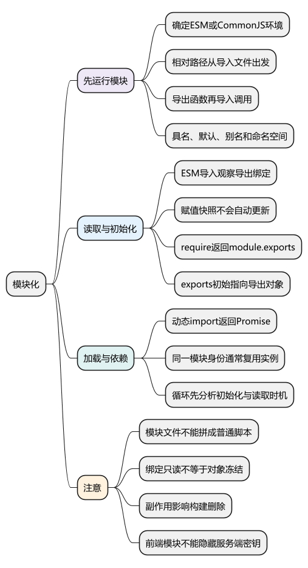
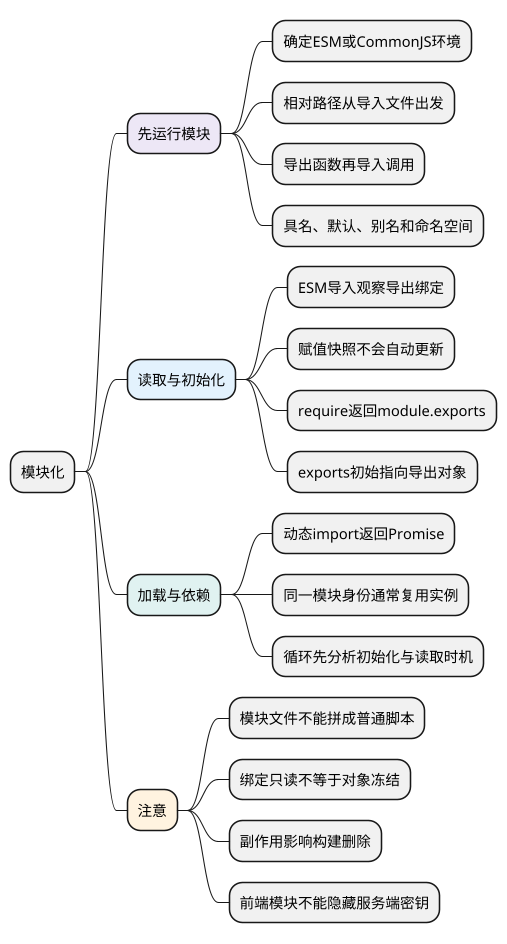

# 模块化

<!-- core-mindmap:start -->
[](examples/c20-mindmap.svg)

<details>
<summary>PlantUML 源码</summary>



</details>

<!-- core-mindmap:end -->

**口述总览：** 模块把代码分成有明确接口的单元：一个文件公开需要共享的值，另一个文件通过导入使用它们，内部变量保留在模块作用域中。先把一组文件运行起来，再理解导入得到什么、何时初始化，以及缓存和循环依赖的影响。

本篇按“运行环境 → 基础导入导出 → 活绑定与导出对象 → 动态加载 → 循环和构建”展开。同一组示例文件放在同一个独立目录，按对应的入口命令运行；不同组可以有同名 app.mjs，不要合并到一个文件。

<a id="k01"></a>

## 模块解决什么问题，示例怎样运行

**口述：** 多个脚本若依赖全局变量和人工安排的顺序，很难看出谁需要谁。模块用导入导出说明依赖：export 公开接口，import 在另一个模块中建立使用该接口的名字。

ESM 是 ECMAScript Modules 的简称，是 JavaScript 的标准模块机制。CommonJS 是 Node.js 中常见的另一套模块方式，使用 require 和 module.exports；后面再比较二者的行为。

### 先确定运行环境和文件入口

- 本篇跨文件示例使用现代 Node.js：.mjs 明确表示 ESM，.cjs 明确表示 CommonJS。在文件所在目录运行 node app.mjs 或 node app.cjs。
- './math.mjs' 表示相对于当前导入文件的路径；它不是相对于任意终端目录，也不是把变量名当文件名。Node 的这些 ESM 相对导入示例写出完整扩展名。
- 浏览器页面用 `<script type="module" src="./app.mjs"></script>` 指定模块入口，通常通过 HTTP 服务运行；模块请求遵守 URL 和 CORS 等规则。
- .js 在 Node 中如何解释，还受 package.json 的 type 和版本相关规则影响；浏览器也不天然支持 Node 的 require。打包工具的格式转换与包名解析是另一层能力。

### 最小双文件：公开一个函数，再导入调用

新建 math.mjs 与 app.mjs，运行 node app.mjs。

<!-- example: module-basic-math -->
```js
// 文件：math.mjs
export function add(a, b) {
  return a + b;
}
```

<!-- example: module-basic-app -->
```js
// 文件：app.mjs
import { add } from './math.mjs';
console.log(add(2, 3)); // 5
```

export 让 add 成为公开接口；import 中的花括号按导出名称选择接口。导入本身不会调用 add，真正计算发生在 add(2, 3)。未导出的顶层变量保留在模块内部，不会因另一个文件导入该模块而变成全局变量。

### 具名、默认、别名和命名空间怎样写

具名导出按名字选择，可以有多个；默认导出每个模块最多一个，导入方可以自行取本地名称。as 改的是当前文件使用的名字，不会重命名原模块的接口。

另建 greeting.mjs 与 app.mjs，运行 node app.mjs。

<!-- example: module-exports-greeting -->
```js
// 文件：greeting.mjs
export const language = 'zh-CN';
export function greet(name) {
  return `你好，${name}`;
}
export default greet;
```

<!-- example: module-imports-app -->
```js
// 文件：app.mjs
import hello, { language as lang, greet } from './greeting.mjs';
import * as api from './greeting.mjs';

console.log(hello('Lin')); // 你好，Lin
console.log(greet('Bo')); // 你好，Bo
console.log(lang, api.language); // zh-CN zh-CN
console.log(api.default('Mo')); // 你好，Mo
```

hello 是导入默认导出时取的本地名称；greet 按同名导入，language 改名为 lang。api 是模块命名空间对象，api.language 读取具名导出，api.default 读取默认导出。

只想执行某模块的初始化而不取接口时，可以写 import './setup.mjs'，前提是相应文件存在。静态 import/export 是模块顶层的语法声明，不能像函数调用那样放进普通 if 或函数体；条件加载用后面的 import()。

### 静态依赖在模块正文执行前建立

可以用“加载 → 建立绑定 → 求值”理解运行过程：

1. 解析上例 app.mjs，发现它依赖 greeting.mjs。
2. 为模块接口建立关联，确认被导入的名字存在。
3. 执行依赖所需的初始化，再按依赖规则执行入口代码。

因此静态 import 不需要先执行到那一行，运行环境才知道依赖谁。真实依赖图可能有循环或顶层 await，其执行顺序在基础用法之后再分析。

<a id="k02"></a>

## ESM 活绑定与 CommonJS 导出值

**口述：** ESM 导入提供对导出绑定的只读视图，导出方修改绑定后，导入方能读到新值；CommonJS 的 require 返回 module.exports 的值，之后是否可见变化，要看对象引用和读取方式。

### ESM：导入名持续观察导出方的绑定

“活绑定”就是读取导入名时，仍然观察导出方的那个绑定。新建 counter.mjs 与 app.mjs，运行 node app.mjs。

<!-- example: module-esm-counter -->
```js
// 文件：counter.mjs
export let count = 0;
export function increase() {
  count += 1;
}
```

<!-- example: module-esm-app -->
```js
// 文件：app.mjs
import { count, increase } from './counter.mjs';

const snapshot = count;
console.log(count); // 0
increase();
console.log(count, snapshot); // 1 0
```

increase 改变 count 后，app 再读 count 得到 1。

snapshot 则是执行 const snapshot = count 时取得的数值 0。它不会因为原绑定变化而重新赋值，所以仍是 0。

导入方不能直接执行 count = 10 来改写导入绑定。但是，如果导出的是对象，允许修改的对象属性仍可能被修改；绑定只读不等于对象冻结。

### CommonJS 的最小对照

require(id) 接收模块路径或名称，加载后返回 module.exports 的值。Node 的 CommonJS 中，exports 初始指向 module.exports 的同一个对象，因此 exports.name = value 可以给该导出对象添加属性。

但 exports = newObject 只改变局部变量指向；需要整体替换导出值时，应赋给 module.exports。先分清“修改同一个对象”与“让变量改指别处”，再读下面的例子。

另建一组 counter.cjs 与 app.cjs，运行 node app.cjs。

<!-- example: module-cjs-counter -->
```js
// 文件：counter.cjs
exports.count = 0;
exports.increase = () => {
  exports.count += 1;
};
```

<!-- example: module-cjs-app -->
```js
// 文件：app.cjs
const counter = require('./counter.cjs');
const { count: snapshot } = counter;

console.log(counter.count); // 0
counter.increase();
console.log(counter.count, snapshot); // 1 0
```

require 得到了导出的对象。counter.count 每次都是读取同一个对象当前的属性，所以可见变化；解构得到的 snapshot 是当时的数值，所以不变。

因此“ESM 是引用，CommonJS 是值拷贝”过于粗糙。CommonJS 导出的对象也可以被共享，关键要区分“模块绑定”“共享对象属性”和“一次赋值产生的快照”。

已经 require 到旧对象的调用方，也不会因为模块后来把 module.exports 改为另一个对象，就让自己的旧变量自动指向新对象。这再次体现“保存对象引用”与“持续观察绑定”的区别。

<a id="k03"></a>

## 动态 import 与模块执行时机

**口述：** 静态 import 声明固定依赖，import() 在运行到表达式时请求模块，并返回 Promise。它适合按需加载，但等待和失败路径也会随之进入业务流程。

新建 format.mjs 与 app.mjs，运行 node app.mjs。这个入口是 ESM，因此可以使用顶层 await。

<!-- example: module-dynamic-format -->
```js
// 文件：format.mjs
export function formatPrice(value) {
  return value.toFixed(2);
}
```

<!-- example: module-dynamic-app -->
```js
// 文件：app.mjs
try {
  const api = await import('./format.mjs');
  console.log(api.formatPrice(12)); // 12.00
} catch (error) {
  console.error('价格格式化模块加载失败', error);
}
```

Promise 兑现后得到模块命名空间对象，因此读取 api.formatPrice。失败可能来自找不到模块、网络问题、解析错误或模块初始化抛错。

浏览器应用可在打开图表或编辑器时再加载对应代码。界面需要明确等待态、失败提示和受控重试；构建产物发布后，旧页面请求已删除的分包也可能失败。

### 加载一次与缓存的范围

在同一个加载环境中，解析为同一模块身份的导入通常复用模块实例，不会每次调用 import() 都重新执行正文。Node.js 的 CommonJS 通常也会按解析结果缓存。

“同一模块”受解析 URL、文件路径、加载环境和打包副本等因素影响。不同 Worker、进程或独立打包副本，不会天然共享一个 JS 对象。

顶层 await 会让依赖该模块完成初始化的代码继续等待。它适合确实必须完成的初始化，但把不稳定网络请求放到所有页面都依赖的基础模块，会扩大启动等待和失败的影响范围。

### ESM 与 CommonJS 互操作

Node.js 与构建工具提供一定互操作，但导出形态、具名导出推断和同步加载带顶层 await 的模块都有环境限制。

分析问题时先确认运行时版本、文件格式和真正执行的产物，不要只记“ESM 异步、CommonJS 同步”。CommonJS 的 require 通常同步执行；ESM 则涉及静态关联、求值和可能的异步依赖，它不是同一层的简单二分。

<a id="k04"></a>

## 循环依赖为什么有时能运行

**口述：** 有环不代表一定错误。ESM 可以先建立导入导出的关联，关键在于读取某个绑定时，它是否已经初始化。延迟到函数调用时读取，可能与顶层立即读取产生不同结果。

新建 a.mjs 与 b.mjs，运行 node a.mjs。

<!-- example: module-cycle-a -->
```js
// 文件：a.mjs
import { readA } from './b.mjs';

export const value = 'ready';
console.log(readA()); // ready
```

<!-- example: module-cycle-b -->
```js
// 文件：b.mjs
import { value } from './a.mjs';

export function readA() {
  return value;
}
// 若在本文件顶层加入 console.log(value)，则会提前读取未初始化绑定。
```

这两个文件互相依赖，但 b 的顶层只是定义函数，没有执行函数体中的 return value。

随后 a 初始化 value，再调用 readA，这时 value 已经准备好，所以返回 ready。若 b 在顶层立刻读取 value，a 的 const 尚未初始化，会触发暂时性死区并抛 ReferenceError。

不能只看依赖图就断言正确或错误，还要写出“谁先执行到哪一步、何时读取绑定”。

### CommonJS 的环不能照搬这个结论

CommonJS 遇到循环 require 时，可能返回尚未完成初始化的 exports 对象，另一方读到缺失属性或旧的部分结果。它与 ESM 的未初始化绑定不是同一种机制。

修复复杂循环时，优先抽取双方共享的基础模块、改变依赖方向，或明确把读取安排到初始化完成之后。随意加 timer 只能改变时序，可能掩盖依赖结构问题。

<a id="k05"></a>

## 模块边界与构建优化怎样衔接

**口述：** ESM 的静态结构帮助工具分析代码，但不保证所有未使用内容都能被删除。模块作用域也不提供客户端保密能力，执行在哪个环境才决定谁能读取它。

Tree Shaking 关注“某段未使用代码能否安全删除”；代码分包关注“仍然需要的代码什么时候加载”。

模块即使没有被读取的导出，仍可能在顶层注册全局行为、导入样式或执行初始化。这些是副作用。错误声明 sideEffects: false 可能让构建器删掉必要行为，因此要检查产物与实际运行，而不只看源码出现 export。

前端模块和注入构建产物的环境变量最终交给客户端，不能用文件作用域隐藏服务端密钥。模块化解决命名与依赖管理，不是安全隔离。

<a id="summary"></a>

阅读模块代码时按四个问题推导：当前是什么格式和运行环境；导入得到的是绑定还是导出值；初始化与读取谁先发生；缓存和副作用影响到哪里。双文件最小复现通常比把代码拼进控制台更能说明问题。

<a id="interview"></a>

## 试题与答案

<a id="c20-01"></a>

### C20-01 [P0·原理] ESM和CommonJS主要区别是什么？

**回答：** ESM 通过静态 import/export 建立接口关联，导入是导出绑定的只读视图；CommonJS 用运行时 require 取得 module.exports 的值，对象引用仍可以共享。还要说明运行环境、初始化与缓存，不能用“引用和拷贝”或“异步和同步”概括全部差异。

<a id="c20-02"></a>

### C20-02 [P0·原理] 为什么snapshot不随导出count变化？

**回答：** import 得到的 count 持续观察导出绑定；const snapshot = count 只在执行赋值时读取数值。之后 increase 更新导出绑定，不会重新执行那次赋值，因此 count 是 1，snapshot 仍是 0。

<a id="c20-03"></a>

### C20-03 [P1·原理] 循环依赖为何有时不报错？

**回答：** 取决于读取时机。关联建立后，const 绑定仍可能未初始化；依赖模块顶层提前读取会报错。若只是定义函数，直到初始化结束后才调用并读取，就可能正常。应从实际入口逐步推导，不能只看存在一个环。

<a id="c20-04"></a>

### C20-04 [P1·工程取舍] 使用ESM就一定Tree Shaking成功吗？

**回答：** 不一定。静态结构便于分析，删除还要判断使用关系与副作用。样式导入、注册和初始化可能必须保留；错误的副作用配置会删掉功能。应结合构建产物和运行验证判断结果。

<a id="c20-05"></a>

### C20-05 [P1·工程取舍] 动态import的风险如何处理？

**回答：** 它把加载等待移动到实际需要能力的时刻，也增加失败路径。提供等待状态、失败提示和受控重试，并考虑发布后旧分包失效的问题；不要无限刷新。动态路径是否能被构建器分析，以及最终如何分包，也要按工具验证。

参考：[MDN：JavaScript 模块](https://developer.mozilla.org/zh-CN/docs/Web/JavaScript/Guide/Modules)、[Node.js：模块](https://nodejs.org/api/modules.html)。
