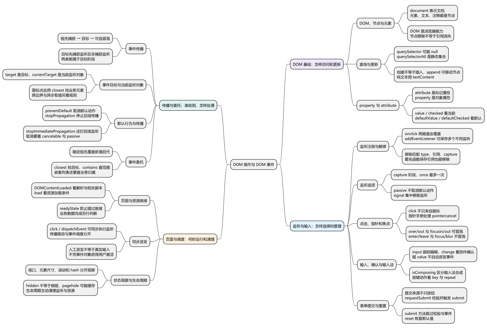
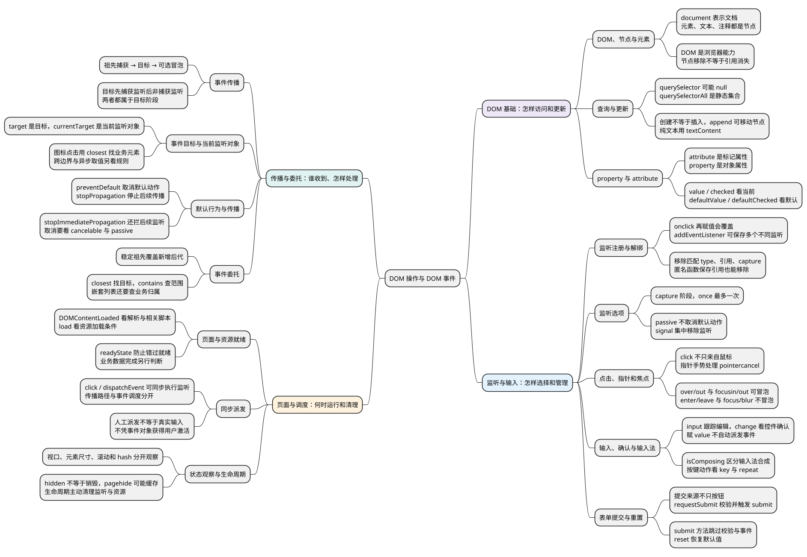

# DOM 操作与 DOM 事件

<!-- core-mindmap:start -->
[](examples/c21-mindmap.svg)

<details>
<summary>PlantUML 源码</summary>



</details>

<!-- core-mindmap:end -->

**口述总览：** DOM 是浏览器把页面表示成对象的方式。JavaScript 通过 DOM 读取和修改页面，通过事件监听响应点击、输入、提交和资源状态变化。先选择合适的事件和绑定方式，再区分当前属性状态、事件传播与默认行为，并在页面功能结束时清理监听。

<!-- recall-route:start -->
**记忆线：** 页面对象 → 查询与当前状态 → 绑定和选项 → 事件用途 → 传播与委托 → 调度和生命周期。先说想响应什么，再分清“谁收到了、是否默认执行、何时运行”。

本篇按 15 个主要知识点复习：[先自查](#self-check) · [口述与答案](#interview)。每个知识点都写出完整口述与记忆提示，复制到语雀后也可以按顺序直接阅读。
<!-- recall-route:end -->

## 基本概念：DOM、节点与元素

HTML 是描述页面的文本，DOM 是浏览器解析后建立的对象树。document 表示文档；元素、文本、注释等都属于节点，Element 是其中表示元素的一类。

因此，获取按钮后修改 button.textContent，就是修改页面对象的内容。DOM 是浏览器提供的能力；下面的示例面向已有 document.body 的浏览器页面，各例相互独立。先会查询和修改元素，再学习事件监听、传播与委托。

<a id="k03"></a>

## 查找和更新元素：querySelector()、textContent、classList

**口述：** 先查询或创建元素，再修改它的文本、属性或类名。查询可能找不到结果，创建也不等于已经显示在页面上；插入节点后，页面树才包含它。

- document.querySelector(selector)：selector 是 CSS 选择器字符串，返回第一个匹配的 Element，没有匹配时返回 null；访问属性前先确认结果存在。
- element.querySelectorAll(selector)：按选择器查询后代，返回静态 NodeList；没有匹配时长度为 0，不随后续元素增删更新，可以用 for...of 遍历。document 上也可以调用它。
- document.createElement(tag)：接收标签名字符串，返回新元素，此时还没插入页面。
- parent.append(...nodesOrStrings)：向末尾追加节点或文本字符串，返回 undefined；已有节点会移动位置，不会自动克隆。
- element.remove()：不接收参数，从父节点移除当前元素，返回 undefined。
- element.textContent：读取文本字符串；设置时用文本替换原来的子节点，不解析 HTML。
- element.classList.add/remove(...tokens)：添加或移除指定类名，返回 undefined；contains(token) 返回是否含有该类名的布尔值。
- element.classList.toggle(token, force)：省略 force 时切换类名，传 true 时添加、false 时移除；返回操作后是否包含该类名。element.style 用于读写内联样式。

选择器语法无效时，querySelector/querySelectorAll 会抛 SyntaxError，这与合法选择器没有匹配结果不同。

<!-- example: c18-dom -->
~~~js
const list = document.createElement('ul');
document.body.append(list);

const items = list.querySelectorAll('li');
const item = document.createElement('li');
item.textContent = '<b>Alice</b>';
item.classList.add('selected');
list.append(item);

console.log(items.length); // 0：查询结果是静态集合
console.log(list.querySelectorAll('li').length); // 1
console.log(item.querySelector('b')); // null：插入的是文本
console.log(item.classList.contains('selected')); // true
list.remove();
~~~

**注意：** innerHTML 会把字符串作为 HTML 解析，外部输入不能未经处理直接写入。需要纯文本时使用 textContent。删除节点不等于移除程序里所有对它的引用。

## 区分当前状态和标记属性：property、getAttribute()

**口述：** attribute 是 HTML 标记层面的属性，property 是 DOM 对象上的属性。部分属性会相互反映，但表单的当前输入与默认值可能不同，不能把两者视为始终同步。

getAttribute(name) 按名称读取标记属性，返回字符串或 null；setAttribute(name, value) 把值转为字符串后写入，返回 undefined。input.value 是 DOM 对象的 property，用来读写文本框当前的值。

<!-- example: c18-property -->
~~~js
const input = document.createElement('input');
input.setAttribute('value', 'Alice');
input.value = 'Bob';

console.log(input.getAttribute('value')); // Alice
console.log(input.defaultValue); // Alice
console.log(input.value); // Bob
~~~

用户编辑文本框改变的是当前 value。类似地，checkbox 的 checked 表示当前状态，defaultChecked 表示默认状态。读取用户输入通常使用 property。

页面初始化还要确认 DOM 是否已解析；相关的 DOMContentLoaded、load 与 readyState 在[页面和资源事件](#page-events)中一起说明。

## 监听与清理：addEventListener()、removeEventListener()

**口述：** 事件表示一次发生的事情，例如点击或输入。监听函数是希望事件发生时执行的回调，收到的 event 对象记录事件类型、目标等信息。注册监听只是建立响应关系，不会当场执行这个回调。

<a id="binding-forms"></a>

### HTML 内联与 onclick 属性：同一个处理器位置

可以直接在 HTML 的 onclick 属性中写处理代码。下面放进页面后，点击按钮会把文字改为“已点击”：

<!-- example: c21-inline-handler -->
```html
<button type="button" onclick="this.textContent = '已点击'">点我</button>
```

也可以在 JavaScript 中写 button.onclick = fn，把函数赋给同一个事件处理器位置。再次赋值会替换之前的 onclick，设为 null 可以清空它。HTML 内联写法和 .onclick 赋值不是两套可以无限叠加的监听；内联写法还会把行为放进页面标记中，日常应用通常用 JavaScript 集中注册。

### addEventListener：保留多个监听，按引用移除

addEventListener(type, listener, options) 中，type 是事件名字符串，例如 'click'；listener 通常是接收 event 的函数；可选的 options 指定监听方式。方法返回 undefined。传入 onClick 是交出函数，写 onClick() 则会立即执行函数并把返回值传进去。

removeEventListener(type, listener, options) 返回 undefined，按事件类型、同一个回调引用和 capture 值匹配移除。事件名写 'click'，不带 onclick 的 on 前缀。

<!-- example: c21-binding-slots -->
```js
const button = document.createElement('button');
const calls = [];
button.onclick = () => calls.push('first');
button.onclick = () => calls.push('second');
const saved = () => calls.push('saved');
button.addEventListener('click', saved);
button.addEventListener('click', () => calls.push('other'));
button.click();

button.onclick = null;
button.removeEventListener('click', saved);
button.click();
console.log(calls.join(' → ')); // second → saved → other → other
```

first 被第二次 onclick 赋值替换；addEventListener 注册的两个不同函数仍各自存在。清空 onclick 不会清空它们，移除 saved 也不会移除 other。相同 type、函数引用和 capture 的重复注册，不会再添加一份相同监听。

saved 保存的是匿名箭头函数，也能正常移除。关键是能否拿到同一个函数引用，不是函数有没有名字。旧资料称这些方式为 DOM0、DOM2 等；这些是历史分类，不能据此把事件用途和传播规则分成互不相通的几套体系。

下面单独看注册与移除同一个回调，第三个参数暂时省略。

<!-- example: c21-listener-basic -->
```js
const button = document.createElement('button');
let count = 0;
function onClick(event) {
  count++;
  console.log(event.type, event.currentTarget === button); // click true
}
button.addEventListener('click', onClick);
button.click();
button.removeEventListener('click', onClick);
button.click();
console.log(count); // 1
```

第一次 click 执行 onClick，event.type 是 'click'，event.currentTarget 是本次正在执行监听的按钮。移除后第二次 click 不再增加 count。两次写出的箭头函数是不同函数，不能用一个新函数去移除先前注册的函数。

### 监听选项：阶段、次数、取消和默认行为

第三个参数可以是表示 capture 的布尔值，也可以是选项对象：

- capture：默认 false，决定采用捕获监听还是非捕获监听；目标节点上的具体阶段见下节。
- once：最多响应一次后移除监听；如果始终没触发，监听仍可能存在。
- signal：传入 AbortSignal；对应控制器执行 abort() 时移除监听。
- passive：声明不在回调中取消默认行为，不能在该监听中成功使用 preventDefault。

用 AbortController 可以把监听的结束动作集中起来。signal 是该控制器提供的取消信号，不是事件本身。

<!-- example: c18-listener -->
~~~js
const button = document.createElement('button');
let count = 0;
const controller = new AbortController();
button.addEventListener('click', () => count++, {
  signal: controller.signal
});

button.click();
controller.abort();
button.click();
console.log(count); // 1
~~~

**注意：** 移除监听不要求重新提供完全相同的 options 对象，匹配关键是 type、listener 和 capture。组件卸载时应按归属清理资源；仅把变量设为 null 不会自动移除监听。

<a id="event-types"></a>
<a id="common-events"></a>

## 按用途选择事件：先说希望响应什么

**口述：** 点击、输入、焦点移动和表单提交是不同的动作。选择事件时看业务想知道什么，不要把一次按钮点击当作所有提交，也不要只靠按键事件判断文本是否改变。下面按用途分组，传播中的“冒泡”表示事件还会向祖先传递，具体过程见后面的[传播规则](#k01)。

### 点击与双击：响应激活操作

click 常用于按钮、链接等元素的激活，不只来自鼠标；有些可交互元素也能由键盘触发点击。dblclick 表示双击，常见鼠标双击会先产生两次 click，再产生 dblclick；同时监听两者时，单击处理不会自动等待是否发生双击。

需要普通确认操作时通常用 click。若设计了单击和双击两种不同动作，要明确如何协调，避免一次双击已经执行两次单击业务。

### 指针移动与进出：区分整体边界和后代切换

pointerdown、pointermove、pointerup 可统一表示鼠标、触摸和笔的指针操作；连续手势还应处理 pointercancel，避免手势被取消后仍保留拖动状态。只处理鼠标的旧代码常见 mousedown、mousemove、mouseup。

mouseover/mouseout 会冒泡，在父元素与其内部后代之间移动时也可能触发；mouseenter/mouseleave 不冒泡，更适合观察是否进入或离开整个元素范围。对应的 pointerover/pointerout 与 pointerenter/pointerleave 也有这一区别。event.relatedTarget 可帮助判断从哪里来、到哪里去。

### 键盘操作：用 key 判断按键，文本变化另看输入事件

keydown 表示按下，长按可能重复触发，可看 event.repeat；keyup 表示释放。event.key 给出按键含义，例如 'Enter'、'Escape'，比记忆数字 keyCode 更清楚。输入法合成期间，不应把确认候选字的 Enter 随意当作业务提交。

下面手动派发按键事件，只演示判断逻辑；真实键盘与输入法时序需在目标浏览器检查。

<!-- example: c21-keyboard-action -->
```js
const input = document.createElement('input');
input.addEventListener('keydown', event => {
  if (event.isComposing || event.repeat) return;
  if (event.key === 'Enter') {
    event.preventDefault();
    console.log('确认');
  }
});
input.dispatchEvent(new KeyboardEvent('keydown', {
  key: 'Enter', bubbles: true, cancelable: true
})); // 确认
```

<a id="events-input"></a>

### 文本输入与确认：input、change 和输入法合成

input 常用于跟踪用户编辑后的值，包括键盘、粘贴等输入来源；change 表示值按控件规则完成一次确认。文本框通常在值改变后失去焦点时触发 change，选择框、复选框等的确认时机不同，不能统一解释成“鼠标离开”。直接给 input.value 赋值不会自动触发这两个事件。

select 事件表示在文本框或 textarea 中选择文本，不是 `<select>` 改选项的别名；后者通常观察 change。

输入法合成（IME）会经历 compositionstart、compositionupdate、compositionend。InputEvent.isComposing 可判断输入事件是否仍处于合成期间；即时搜索等场景可先忽略中间结果。若同时处理 compositionend 和最终 input，要避免重复发起相同操作，并按目标浏览器验证时序。

<!-- example: c21-input-and-change -->
```js
const input = document.createElement('input');
let updates = 0;
input.addEventListener('input', event => {
  if (event.isComposing) return;
  updates++;
  console.log('input', input.value);
});
input.addEventListener('change', () => console.log('change', input.value));
input.value = 'Lin';
console.log(updates); // 0：赋值不自动派发事件
input.dispatchEvent(new InputEvent('input', { isComposing: true }));
input.dispatchEvent(new InputEvent('input')); // input Lin
input.dispatchEvent(new Event('change')); // change Lin
```

这里手动派发事件来验证处理函数，不能据此推断真实输入法一定按这三次派发运行。需要在修改前检查输入意图时，可进一步了解 beforeinput；不能把所有编辑都归结为某个 keydown。

### 焦点变化：知道当前正在操作哪个控件

focus/blur 表示取得和失去焦点，不冒泡；focusin/focusout 会冒泡，适合在表单容器统一观察后代的焦点变化。也可以对 focus/blur 使用祖先捕获监听。焦点可由键盘、鼠标或 focus() 等方式改变，不等于鼠标进入或离开。

### 表单提交与重置：监听表单本身

submit 是表单的提交事件，不只是“提交按钮被点击”。提交按钮、符合条件的文本框回车和 form.requestSubmit() 都可能启动提交流程；若内建约束校验失败，通常不会进入 submit 监听。

requestSubmit() 按提交方式执行约束校验并触发 submit，可传入所属表单的提交按钮；form.submit() 则直接启动提交，跳过约束校验且不触发 submit 事件。需要复用表单监听时，优先考虑 requestSubmit，不能把二者当成同义方法。

reset 在重置表单时触发，例如重置按钮或 form.reset()。默认行为是恢复控件的默认值，不是把一切清空；监听执行时默认重置尚未完成，preventDefault() 可阻止它。

<!-- example: c21-form-submit-reset -->
```js
const form = document.createElement('form');
const input = document.createElement('input');
input.name = 'name';
input.defaultValue = 'Alice';
input.value = 'Bob';
input.required = true;
form.append(input);
document.body.append(form);
form.addEventListener('submit', event => {
  event.preventDefault();
  console.log('submit', input.value);
});
form.addEventListener('reset', () => console.log('reset', input.value));
form.requestSubmit(); // submit Bob
form.reset(); // reset Bob
console.log(input.value); // Alice
form.remove();
```

示例取消默认提交以免导航；reset 监听读到 Bob，而 reset() 返回后已恢复为 Alice。真实提交、按回车以及浏览器校验提示仍需在页面中确认。

<a id="page-events"></a>

### 页面和资源：分清加载完成、失败与中止

- DOMContentLoaded：文档解析完成，并完成需要等待的 defer 等脚本执行，不等于所有图片、async 脚本和业务请求都完成。
- load：观察相应资源加载完成；window 的 load 等待页面相关资源满足加载条件，不是“用户刚进入页面”，也不代表未来业务请求全部结束。
- error：资源加载失败时，通常在相应元素上处理，例如图片的 load/error。abort 表示操作被中止，不能把它当作图片失败的通用事件；是否提供 abort 要看具体 API，例如 FileReader、XMLHttpRequest。

动态载入脚本时，DOMContentLoaded 可能已经发生：document.readyState 为 'loading' 时可以等待该事件，否则通常可立即执行只依赖 DOM 已解析的初始化。网络和图片结果应另外判断，不要用一个页面事件表示所有功能都就绪。

<a id="events-hash"></a>

### 尺寸、滚动与地址片段：观察页面状态变化

- window 的 resize 用于观察视口尺寸变化；观察某个元素自身尺寸通常用 ResizeObserver，不能给任意 div 注册 resize 就认为会收到通知。
- scroll 用于观察文档或滚动容器的位置变化。高频回调应保持轻量，按需要使用[防抖与节流](03_防抖与节流.md)；滚动可能来自键盘或代码，不一定来自滚轮。
- hashchange 用于观察 URL 的片段标识（# 后部分）变化；history.pushState/replaceState 不会因此自动触发 hashchange，即使写入的 URL 含有不同片段。

### 可见性和离开：按生命周期暂停或清理

document 的 visibilitychange 配合 visibilityState，可以观察页面显示或隐藏，例如切换标签页时暂停不必要的工作。hidden 不等于页面被销毁，重新可见时可能需要恢复。

pagehide 可以提示页面离开当前展示，但也可能进入往返缓存；event.persisted 可帮助判断是否缓存。不要把 unload 当作可靠的最后清理机会，它在移动端等情形可能不触发，也可能影响缓存。组件卸载时仍应主动释放监听和定时器；页面隐藏、缓存、恢复则按资源用途安排，见[内存与资源生命周期](../01_数据类型、内建对象与内存管理/22_垃圾回收机制、内存泄漏与资源清理.md)。

### 旧事件名：理解历史，使用现代替代

keypress 已弃用，它不是“按下并松开”的合并事件；按键操作使用 keydown/keyup，文本编辑主要看 beforeinput/input。旧 mousewheel 通常改用 wheel，但滚轮事件不保证页面一定滚动。textInput 已过时，文本编辑使用 beforeinput/input；DOMSubtreeModified 等旧 DOM 变动事件不再作为现代方案，观察 DOM 变化使用 MutationObserver。

这些替代关系不应理解为只替换字符串就完全等价；触发条件、时机和可取消性仍要按各自规则处理。

<a id="k01"></a>

## 理解事件传播：捕获、目标、冒泡

**口述：** 可传播的 DOM 事件沿一条路径到达目标，并可能向祖先冒泡。target 表示事件目标，currentTarget 表示当前正在执行监听的对象。委托利用祖先监听处理后代事件。

以点击列表里的按钮为例：

~~~text
捕获：document → 列表
目标：在按钮处执行监听
冒泡：列表 → document
~~~

在祖先节点，capture: true 的监听于捕获阶段执行，非捕获监听于冒泡阶段执行。在事件目标自身，两类监听都属于目标阶段，event.eventPhase 都是 Event.AT_TARGET；目标处先执行捕获监听，再执行非捕获监听，不能只由 capture 值判断阶段。

不是所有事件都冒泡，例如 focus/blur 常使用祖先的捕获监听，或改用可冒泡的 focusin/focusout。下面先观察最常见的点击路径。

<!-- example: c18-propagation -->
~~~js
const outer = document.createElement('div');
const button = document.createElement('button');
outer.append(button);
document.body.append(outer);
const order = [];

outer.addEventListener('click', () => order.push('capture'), true);
button.addEventListener('click', event => {
  order.push('target');
  console.log(event.target === button, event.currentTarget === button);
  // true true
});
outer.addEventListener('click', event => {
  order.push('bubble');
  console.log(event.target === button, event.currentTarget === outer);
  // true true
});
button.click();
console.log(order.join(' → ')); // capture → target → bubble
outer.remove();
~~~

Shadow DOM 可能调整外部看到的 target；需要分析跨边界事件时再结合 composed 和 composedPath()，普通页面委托先理解上述路径。

<a id="k02"></a>

## 区分默认行为和事件传播：preventDefault()、stopPropagation()

**口述：** 默认行为是浏览器为操作提供的动作，例如提交表单、跳转链接或切换复选框状态；传播是监听器接收事件的路径。取消默认行为与停止传播分别控制这两件事。

- preventDefault()：无参数，尝试取消可取消事件的默认行为，不会自动停止传播。
- stopPropagation()：无参数，阻止后续传播，不会自动取消默认行为；同一次监听器调用过程内，当前节点剩余监听仍可执行。
- stopImmediatePropagation()：无参数，还会阻止这次派发中当前节点后续监听执行。
- event.defaultPrevented：查看默认行为是否已被取消。

这三个方法都返回 undefined。event.cancelable 表示事件是否可取消；在不可取消事件或 passive 监听中调用 preventDefault，不能成功取消默认行为。

<!-- example: c21-default-and-propagation -->
```js
const outer = document.createElement('div');
const checkbox = document.createElement('input');
checkbox.type = 'checkbox';
outer.append(checkbox);
document.body.append(outer);
checkbox.addEventListener('click', event => event.preventDefault());
outer.addEventListener('click', event => {
  console.log(event.defaultPrevented); // true
});
checkbox.click();
console.log(checkbox.checked); // false
outer.remove();
```

取消点击的默认行为后，复选框没有保留本次切换，祖先却仍然收到了点击。这说明取消默认行为不会自动停止冒泡。

**注意：** “不阻止同一节点其他监听”不能无限推广。目标上的捕获监听与非捕获监听分两次调用过程处理：若目标捕获监听执行 stopPropagation，同一轮其余捕获监听仍可运行，但随后目标非捕获监听可能不会执行。

表单里通常先 preventDefault()，再执行自己的校验和提交逻辑。不要为了“避免重复处理”到处 stopPropagation，否则上层组件或委托监听可能收不到事件。

## 用一个监听处理列表操作：closest() 配合事件委托

点击按钮内的图标时，target 可能是图标。先用 closest() 找到对应按钮，再确认按钮属于当前列表，最后读取业务标识。

element.closest(selector) 接收 CSS 选择器，从元素自身开始向祖先查找，返回最近的匹配元素或 null。container.contains(node) 返回 node 是否为容器自身或其后代的布尔值。button.dataset.id 读取 data-id 属性对应的字符串；这些 API 不会自动判断业务列表归属，所以还要组合检查。

<!-- example: c18-delegation -->
~~~js
function mountList(container, onSelect) {
  const controller = new AbortController();
  container.addEventListener('click', event => {
    if (!(event.target instanceof Element)) return;
    const button = event.target.closest('button[data-id]');
    if (!button || !container.contains(button)) return;
    onSelect(button.dataset.id);
  }, { signal: controller.signal });
  return () => controller.abort();
}

const list = document.createElement('div');
const button = document.createElement('button');
button.dataset.id = '7';
const icon = document.createElement('span');
icon.textContent = '查看';
button.append(icon);
list.append(button);
document.body.append(list);

const selected = [];
const cleanup = mountList(list, id => selected.push(id));
icon.click();
cleanup();
icon.click();
console.log(selected.join(',')); // 7
list.remove();
~~~

**注意：** 若容器内还嵌套独立的业务列表，需要增加归属规则，例如确认最近的列表祖先就是当前列表。委托便于集中处理，也能覆盖后来加入的后代，但不保证一定更快：目标匹配、事件频率和容器范围都有成本。通常选择就近且稳定的祖先，不要求把所有监听注册到 document。现代代码直接使用 event.target，不必常规保留旧 IE 的 srcElement 回退。

<a id="k04"></a>
<a id="k05"></a>

## 同步派发与用户交互任务：传播不等于调度

**口述：** 事件传播回答“这次派发会经过哪些监听”；事件循环回答“待处理的工作何时获得执行机会”。用户交互会由浏览器安排相关任务，但代码调用 button.click() 或 dispatchEvent() 时，监听可以在这个调用返回前同步执行。

button.click() 触发按钮的点击行为，返回 undefined。dispatchEvent(event) 接收 Event 对象并同步派发：可取消事件被成功取消时返回 false，否则返回 true。new Event(type, options) 创建事件对象，options 中的 bubbles、cancelable 默认都是 false。

<!-- example: c21-synchronous-dispatch -->
```js
const button = document.createElement('button');
const order = [];
button.addEventListener('click', () => order.push('click'));
button.addEventListener('notice', () => order.push('notice'));

order.push('before');
button.click();
button.dispatchEvent(new Event('notice'));
order.push('after');
console.log(order.join(' → ')); // before → click → notice → after
```

两次派发中的监听都先于 after 执行。因此不能把所有事件回调都记成“以后从任务队列取出”。回调里启动的 Promise 或定时器仍按各自规则继续调度，详见[事件循环](../04_异步机制/04_事件循环与调度.md)。

<a id="summary"></a>

复述时先说如何查询和修改 DOM，再按用途选择事件、比较绑定和移除方式，最后区分传播、默认行为和任务调度。请求与后台计算分别见[Fetch、请求取消与竞态](04_Fetch、请求取消与竞态.md)和[Web Worker](../06_选读扩展/02_WebWorker.md)。

<a id="self-check"></a>

## 自查问题

先遮住答案，沿记忆线逐题口述；下面按相同顺序给出完整回答，复制到语雀后也能直接阅读。

1. [DOM 与 HTML 是什么关系？节点和元素有什么区别？移除节点是否意味着它已经被垃圾回收？](#recall-01)
2. [querySelector 和 querySelectorAll 返回什么？创建节点会自动显示吗？textContent 与 innerHTML 怎样选择？](#recall-02)
3. [input.value 与 getAttribute("value") 为什么可能不同？读取用户当前输入应该看哪个？](#recall-03)
4. [onclick 与 addEventListener 怎样选择和移除？匿名函数能解绑吗？重复注册怎样判断？](#recall-04)
5. [四个常用监听选项分别控制什么？once 是否替代生命周期清理？移除时要提供同一个 options 对象吗？](#recall-05)
6. [click 只来自鼠标吗？over/out 与 enter/leave、focus/blur 与 focusin/focusout 有什么区别？](#recall-06)
7. [input 与 change 有何区别？直接赋 value 会触发事件吗？怎样处理输入法合成和键盘快捷操作？](#recall-07)
8. [submit 是否只在点击按钮时触发？requestSubmit、submit、reset 有什么区别？](#recall-08)
9. [事件流有哪些阶段？目标节点的捕获监听属于捕获阶段吗？所有事件都会冒泡吗？](#recall-09)
10. [target 与 currentTarget 有何区别？委托中点击图标怎样找到按钮，异步后还能直接依赖 currentTarget 吗？](#recall-10)
11. [preventDefault、stopPropagation、stopImmediatePropagation 能互相替代吗？passive 或不可取消事件会怎样？](#recall-11)
12. [事件委托为什么能处理后来新增的后代？怎样处理嵌套列表，委托一定更快吗？](#recall-12)
13. [DOMContentLoaded 是否表示页面全部加载完？load、error 与 abort 怎样区分，动态脚本怎样避免错过 DOM 就绪？](#recall-13)
14. [dispatchEvent 和 click 的监听何时执行？dispatchEvent 返回什么，人工派发是否等于真实用户操作？](#recall-14)
15. [resize、scroll、hashchange 分别观察什么？页面 hidden、pagehide 是否都表示销毁？怎样清理监听和过时方案？](#recall-15)

<a id="interview"></a>

## 试题与答案

以下按 15 个知识点归纳口述回答，原有试题编号与锚点保留在对应知识点下。

<a id="recall-01"></a>

### DOM、节点与元素：页面的对象表示

**自查：** DOM 与 HTML 是什么关系？节点和元素有什么区别？移除节点是否意味着它已经被垃圾回收？

**回答：** HTML 是页面标记文本，DOM 是浏览器解析后建立的对象树，document 表示文档。元素、文本、注释都属于节点，Element 是表示元素的那一类。JavaScript 通过这些对象查询和修改页面；DOM 是浏览器提供的能力，不能假设普通 Node 环境也有 document。把节点从页面移除，只是改变树关系，其他对象仍可能引用它，不能据此断言已经回收。

**记忆：** HTML 是标记，DOM 是对象树；元素是节点之一，移除不等于回收。

<a id="recall-02"></a>

### 查询与更新：先处理空结果，再修改内容

**自查：** querySelector 和 querySelectorAll 返回什么？创建节点会自动显示吗？textContent 与 innerHTML 怎样选择？

**回答：** querySelector 返回首个匹配元素或 null；querySelectorAll 返回静态 NodeList，没有匹配时为空，后续节点变化不会更新这份结果。无效选择器会抛 SyntaxError。createElement 只创建对象，插入后才进入页面树；append 已有节点会移动它，不会自动克隆。文本用 textContent，外部字符串不能未经可信处理就交给 innerHTML 解析。classList 用于操作类名，style 主要读写内联样式。

**记忆：** 查询可能为空，集合可能静态；创建还要插入，纯文本用 textContent。

<a id="recall-03"></a>

### property 与 attribute：当前状态不等于标记默认值

**自查：** input.value 与 getAttribute("value") 为什么可能不同？读取用户当前输入应该看哪个？

**回答：** attribute 是 HTML 标记层面的属性，property 是 DOM 对象上的属性，部分属性有映射关系，但不能认为始终同步。用户编辑后的 input.value 表示当前值，value 标记属性与 defaultValue 对应默认值；复选框的 checked 与 defaultChecked 也区分当前和默认状态。读取当前输入通常使用 property，getAttribute 返回标记属性的字符串值或 null。

**记忆：** attribute 看标记，property 看对象状态；当前值与默认值分开。

<a id="recall-04"></a>

<a id="c21-06"></a>

### C21-06 [P0·基础] onclick与addEventListener怎样选择和移除？

**自查：** onclick 与 addEventListener 怎样选择和移除？匿名函数能解绑吗？重复注册怎样判断？

**回答：** HTML 内联 onclick 和 JavaScript 的 onclick 赋值使用同一个事件处理器位置，再次赋值会覆盖，设为 null 可以清空。addEventListener 可以注册多个不同监听，移除时按事件类型、同一回调引用和 capture 匹配；这三个条件相同的重复注册不会增加一份监听。清空 onclick 不会移除另外注册的监听。匿名函数只要保存引用也能解绑，注册时传函数而不是立即调用后的结果。

**记忆：** onclick 一个位，监听可以多份；解绑看类型、同一引用和 capture。

<a id="recall-05"></a>

### 监听选项：capture、once、passive 与 signal

**自查：** 四个常用监听选项分别控制什么？once 是否替代生命周期清理？移除时要提供同一个 options 对象吗？

**回答：** capture 选择捕获或非捕获监听，once 让监听最多响应一次，passive 声明不会在该回调中取消默认行为，signal 允许控制器取消时移除监听。once 尚未触发时仍可能保留，不能代替组件结束时的清理。移除不要求同一个 options 对象，关键仍是事件类型、回调引用与 capture；passive 监听中不能成功使用 preventDefault。

**记忆：** capture 管阶段，once 管次数，passive 限制取消，signal 管结束。

<a id="recall-06"></a>

### 点击、指针和焦点：按动作选择事件

**自查：** click 只来自鼠标吗？over/out 与 enter/leave、focus/blur 与 focusin/focusout 有什么区别？

**回答：** click 常表示可交互元素的激活，也可能由键盘触发；双击通常已经发生两次 click，再发生 dblclick。指针事件可统一鼠标、触摸与笔，拖动还应处理 pointercancel。over/out 会冒泡且可能因后代切换触发，enter/leave 不冒泡，更适合整体边界。focus/blur 不冒泡，focusin/focusout 会冒泡；焦点变化不等于鼠标进出。按业务动作选择事件，不能只靠名字相近来替换。

**记忆：** 激活、边界、焦点各有用途；事件是否冒泡要单独看。

<a id="recall-07"></a>

<a id="c21-07"></a>

### C21-07 [P0·原理] input与change有什么区别，输入法合成怎样处理？

**自查：** input 与 change 有何区别？直接赋 value 会触发事件吗？怎样处理输入法合成和键盘快捷操作？

**回答：** input 主要跟踪用户编辑后的值，change 表示按控件规则完成一次确认，文本框常在改值后失焦触发，选择框等规则不同。直接赋 value 不会自动触发二者。输入法合成中可用 isComposing 暂缓处理中间结果，最终 input 与 compositionend 的衔接要验证并避免重复处理。键盘动作使用 keydown/keyup 和 event.key，长按还可检查 repeat；确认候选字的 Enter 不应随意当作业务提交。

**记忆：** 文本变化看 input，确认看 change；合成未结束别抢着处理。

<a id="recall-08"></a>

<a id="c21-08"></a>

### C21-08 [P0·原理] submit是否只在点击提交按钮时触发？

**自查：** submit 是否只在点击按钮时触发？requestSubmit、submit、reset 有什么区别？

**回答：** 提交按钮、符合条件的回车和 requestSubmit 都可以启动提交流程，约束校验失败通常不会进入 submit 监听。requestSubmit 按提交规则校验并触发事件，form.submit 则跳过约束校验且不触发 submit。业务应监听表单，不只监听按钮 click。reset 的默认行为恢复控件默认值而不是全部清空，reset 监听执行时默认重置还没完成，必要时可取消默认动作。

**记忆：** 提交监听表单，requestSubmit 走校验和事件；reset 恢复默认值。

<a id="recall-09"></a>

### 事件传播：捕获、目标与冒泡

**自查：** 事件流有哪些阶段？目标节点的捕获监听属于捕获阶段吗？所有事件都会冒泡吗？

**回答：** 事件沿传播路径经历捕获、到达目标，并在允许时向祖先冒泡。祖先的 capture 监听在捕获阶段执行，非捕获监听在冒泡阶段执行；目标节点的两种监听都属于目标阶段，通常先执行捕获监听再执行非捕获监听。不是所有事件都会冒泡，例如 focus/blur 可以用祖先捕获监听或对应的 focusin/focusout 处理。传播描述路径，不决定回调一定异步执行。

**记忆：** 捕获到目标，可冒泡才向外；目标两类监听都在目标阶段。

<a id="recall-10"></a>

<a id="c21-01"></a>

### C21-01 [P0·原理] target与currentTarget有什么区别？委托如何处理图标点击？

**自查：** target 与 currentTarget 有何区别？委托中点击图标怎样找到按钮，异步后还能直接依赖 currentTarget 吗？

**回答：** target 表示事件目标，点击图标时可能是按钮内部元素；currentTarget 表示当前正在执行监听的对象。祖先委托可用 closest 从图标找到业务按钮，再检查归属。监听返回后不要依赖 currentTarget 仍保存原值，需要异步使用时在回调内保存所需对象或业务标识。Shadow DOM 可能重定向外部看到的 target，跨边界还需结合 composed 与 composedPath 分析。

**记忆：** target 看事件目标，currentTarget 看当前监听对象；异步用的信息提前保存。

<a id="recall-11"></a>

<a id="c21-02"></a>

### C21-02 [P0·基础] preventDefault与stopPropagation能互相替代吗？

**自查：** preventDefault、stopPropagation、stopImmediatePropagation 能互相替代吗？passive 或不可取消事件会怎样？

**回答：** preventDefault 尝试取消可取消事件的默认动作，不自动停止传播；stopPropagation 阻止后续传播，不自动取消默认动作；stopImmediatePropagation 还会阻止当前监听器调用过程中后续监听执行。passive 监听或不可取消事件不能成功取消默认行为。停止传播不宜简化成“同节点所有监听都照常”：目标捕获和非捕获分开处理，前者停止传播可能阻止随后目标非捕获监听。

**记忆：** 默认动作与传播分开管；立即停止还拦当前后续监听。

<a id="recall-12"></a>

### 事件委托：匹配元素，还要确认归属

**自查：** 事件委托为什么能处理后来新增的后代？怎样处理嵌套列表，委托一定更快吗？

**回答：** 委托在稳定祖先上统一监听后代事件，因此新增后代通常无需逐项注册。处理时先确认 target 可作为元素使用，再用 closest 找业务元素、contains 检查容器范围；嵌套业务列表还要确认最近的列表祖先属于当前实例。委托需要匹配和分发成本，不保证一定更快，应选择就近稳定的祖先，并在功能结束时移除监听。

**记忆：** 祖先统一接收，匹配后检查归属；动态方便不等于必然更快。

<a id="recall-13"></a>

<a id="c21-03"></a>

### C21-03 [P1·基础] DOMContentLoaded是否表示页面所有内容加载完？

**自查：** DOMContentLoaded 是否表示页面全部加载完？load、error 与 abort 怎样区分，动态脚本怎样避免错过 DOM 就绪？

**回答：** DOMContentLoaded 主要对应文档解析和需要等待的相关脚本执行完成，不等待所有图片、async 脚本或未来请求。load 对应相应资源满足加载条件，业务就绪仍要根据数据、组件和资源分别判断。动态脚本可以先看 document.readyState，仍在 loading 时等待 DOMContentLoaded，否则执行仅依赖 DOM 已解析的初始化。资源 error 表示失败，abort 表示 API 定义的中止，不能把中止当成图片加载失败的通用事件。

**记忆：** DOM 就绪、资源完成、业务可用分别判断；先查 readyState 防止错过事件。

<a id="recall-14"></a>

### 同步派发：事件传播不等于任务调度

**自查：** dispatchEvent 和 click 的监听何时执行？dispatchEvent 返回什么，人工派发是否等于真实用户操作？

**回答：** 代码调用 dispatchEvent 或 click 时，相关监听可以在调用返回前同步执行，不能把所有事件回调都背成未来任务。dispatchEvent 对可取消且被成功取消的事件返回 false，否则返回 true；Event 的 bubbles、cancelable 默认都是 false。人工派发不能等同于真实用户输入，也不能凭它获得浏览器要求的真实用户激活；通过 dispatchEvent 人工派发的事件，以及程序调用 click 触发的点击，isTrusted 为 false。传播回答经过哪些监听，事件循环回答工作何时执行。

**记忆：** 程序派发可以同步；传播管路径，调度管时机，派发不制造用户激活。

<a id="recall-15"></a>

### 状态观察与生命周期：隐藏、离开和卸载不同

**自查：** resize、scroll、hashchange 分别观察什么？页面 hidden、pagehide 是否都表示销毁？怎样清理监听和过时方案？

**回答：** window resize 观察视口尺寸变化，元素尺寸可用 ResizeObserver；scroll 观察文档或元素的滚动位置变化，hashchange 观察 URL 的片段标识（# 后部分）变化。scroll 与 wheel 不等价，pushState/replaceState 也不会自动触发 hashchange。visibilitychange 的 hidden 表示当前不可见，不等于销毁；pagehide 还可能进入往返缓存，需要结合 persisted 与恢复流程。组件结束应主动清理监听、定时器和请求，不能依赖不可靠的 unload。旧 keypress、DOM 变动事件应按用途改用现代输入事件或 MutationObserver，而不是只替换字符串。

**记忆：** 观察对象与事件匹配；隐藏可恢复，卸载主动清理，不赌 unload。

<a id="c21-04"></a>

原题已移至 [Fetch 篇：fetch返回200之后为什么还能失败？](04_Fetch、请求取消与竞态.md#c23-06)。

<a id="c21-05"></a>

原题已移至 [Worker 篇：Worker一定提升性能吗？](../06_选读扩展/02_WebWorker.md#c27-05)。
