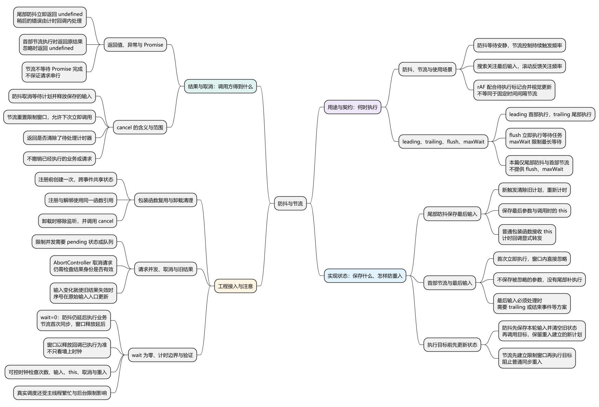
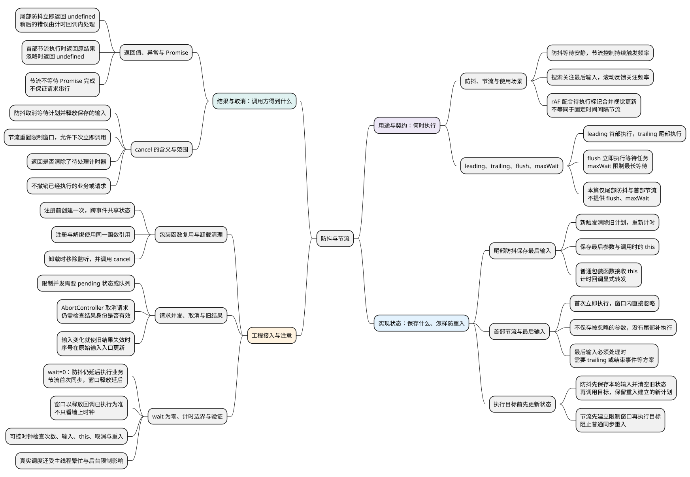

# 防抖与节流
<!-- core-mindmap:start -->
[](examples/c22-mindmap.svg)

<details>
<summary>PlantUML 源码</summary>



</details>

<!-- core-mindmap:end -->

**口述总览：** 防抖和节流都把高频触发转换为更少的业务执行，但目标不同：防抖关注“停下来之后处理”，节流关注“持续触发时控制频率”。实现前必须说明何时执行、保留哪次参数、返回什么，以及取消到底取消什么；否则名字相同的实现也可能有完全不同的行为。

<!-- recall-route:start -->
**记忆线：** 选择场景 → 约定首尾 → 保存输入 → 更新状态 → 返回与取消 → 复用、请求与验证。先问“等停下来还是持续限频”，再问“最后输入、结果和清理怎样处理”。

本篇按 10 个主要知识点复习：[先自查](#self-check) · [口述与答案](#interview)。每个知识点都写出完整口述与记忆提示，复制到语雀后也可以按顺序直接阅读。
<!-- recall-route:end -->

本篇完整实现两种明确契约：**尾部防抖**与**首部节流**。代码可在现代浏览器或 Node.js 使用；带 await 的独立示例按 ES 模块运行。定时器基础见[异步基础与定时器](../04_异步机制/01_异步基础与定时器.md)。

<a id="concept"></a>

## 防抖等待安静，节流限制频率

**口述：** 尾部防抖每次触发都重新计时，只有持续一段时间没有新输入才执行；首部节流第一次立即执行，接下来的一段时间忽略新触发。选择依据是业务需要最后结果，还是需要及时且有限频率的反馈。

**防抖（debounce）**常用于搜索输入、窗口尺寸停止变化后的计算。多次输入最终合并成一次，所以通常保留最后参数与最后接收者。

**节流（throttle）**常用于持续滚动、拖动过程中的进度上报。持续输入期间仍能间隔执行，但不同实现对最后一次是否补执行有不同约定。

以 wait=200ms，在 0、80、160、400ms 触发为例，假设计时任务按时得到执行：

```text
触发：       0     80    160             400
尾部防抖：                       360             600
首部节流：   0                          400
```

防抖把前三次合并到 360ms 左右执行，400ms 又启动新等待。首部节流在 0ms 立即执行，80/160ms 忽略，400ms 已可以再次执行。

这只是计划时间。主线程忙、后台页面限制或调度延迟都会让实际回调更晚；setTimeout 不提供精确实时保证。

<a id="contract"></a>

## 先确定首部、尾部、返回与取消契约

**口述：** 防抖和节流不是只有一个 timer 的代码技巧，而是多次调用间的状态规则。leading、trailing、cancel 等词要对应到具体行为，不能只暴露选项名称。

- **leading：** 一轮开始时是否立即执行。本篇节流开启，防抖关闭。
- **trailing：** 一轮结束时是否用最后一次输入补执行。本篇防抖开启，节流关闭。
- **cancel：** 清除尚未执行的计划或当前限制窗口。本篇返回是否清除了一个待处理计时器。
- **flush：** 若有等待任务，立即执行它。本篇两个实现都不提供。
- **maxWait：** 连续触发也不能无限推迟，达到最长等待就执行。本篇不提供。

尾部防抖可能在输入一直不停时长期不执行；首部节流可能丢掉最后一次输入。这不是同一个 bug，而是两种已约定行为。如果业务要求持续输入也定期保存、最后输入必达，要另选带 maxWait 或 trailing 的方案。

返回值也不同：尾部防抖的包装调用立即返回 undefined，稍后的业务返回值不会穿越时间返回给原调用者；首部节流在真正执行时返回目标结果，被忽略时返回 undefined。

<a id="debounce"></a>

## 尾部防抖：保存最后一次参数与 this

**口述：** 防抖在多次调用间保存一个计时器和最后输入。新调用先清除旧计划，再覆盖参数与 this；时间到后先清空内部状态，再执行目标，避免目标同步重入时被旧状态覆盖。

`debounce(fn, wait = 200)` 返回普通包装函数，不修改 fn。wait 必须是非负有限数，实际延迟仍受运行环境限制；调用方应使用合理的短时间间隔。

<!-- example: c21-debounce -->
```js
function debounce(fn, wait = 200) {
  if (typeof fn !== 'function' || !Number.isFinite(wait) || wait < 0) {
    throw new TypeError('function and non-negative finite wait required');
  }
  let timer = null;
  let args;
  let receiver;

  function cancel() {
    const pending = timer !== null;
    if (pending) clearTimeout(timer);
    timer = null;
    args = receiver = undefined;
    return pending;
  }

  function wrapped(...nextArgs) {
    cancel();
    args = nextArgs;
    receiver = this;
    timer = setTimeout(() => {
      const savedArgs = args;
      const savedReceiver = receiver;
      timer = null;
      args = receiver = undefined;
      Reflect.apply(fn, savedReceiver, savedArgs);
    }, wait);
  }

  wrapped.cancel = cancel;
  return wrapped;
}

let finish;
const finished = new Promise(resolve => { finish = resolve; });
const search = debounce(function(term) {
  console.log(this.name, term); // last ab
  finish();
}, 10);
console.log(search.call({ name: 'first' }, 'a')); // undefined
search.call({ name: 'last' }, 'ab');
await finished;
search.call({ name: 'canceled' }, 'abc');
console.log(search.cancel(), search.cancel()); // true false
```

输出顺序是 undefined、`last ab`、`true false`。示例等待实际调用完成，不依赖“机器必须恰好在第 10ms 执行”的假设。

### 为什么包装函数不能直接用箭头

这里需要保留调用包装时的 this，因此 wrapped 使用普通 function。计时回调则直接使用已经保存的 receiver，不依赖宿主给 timer 回调什么 this。

先复制参数、再清空内部引用、最后执行目标，使 fn 内部再次调用 wrapped 时，新计时器不会被旧回调的清理覆盖。cancel 也会释放等待期间保存的参数与接收者。

**注意：** 本实现不会向原调用者返回稍后的结果或 Promise。若 fn 抛错，错误发生在计时回调中；若 fn 返回被拒绝的 Promise，也不会自动被包装处理。异步业务应在目标回调内捕获并交给明确的错误处理入口。

<a id="throttle"></a>

## 首部节流：执行前先关闭本轮入口

**口述：** 首部节流首次立即执行，同时创建限制窗口。窗口内后续调用直接忽略，不保存参数；计时器结束后重新开放。先建立窗口再执行目标，可以挡住目标同步触发的重入。

`throttle(fn, wait = 200)` 返回包装函数。实际执行时返回 fn 的原结果；被忽略时返回 undefined。cancel 清空限制窗口，允许下一次调用立即执行，但不撤销过去的执行。

<!-- example: c21-throttle -->
```js
function throttle(fn, wait = 200) {
  if (typeof fn !== 'function' || !Number.isFinite(wait) || wait < 0) {
    throw new TypeError('function and non-negative finite wait required');
  }
  let timer = null;
  function wrapped(...args) {
    if (timer !== null) return undefined;
    timer = setTimeout(() => { timer = null; }, wait);
    return Reflect.apply(fn, this, args);
  }
  wrapped.cancel = () => {
    const pending = timer !== null;
    if (pending) clearTimeout(timer);
    timer = null;
    return pending;
  };
  return wrapped;
}

const calls = [];
const limited = throttle(function(value) {
  calls.push(this.name + ':' + value);
  return value * 2;
}, 20);
console.log(limited.call({ name: 'A' }, 2)); // 4
console.log(limited.call({ name: 'B' }, 3)); // undefined
console.log(limited.cancel()); // true
console.log(limited.call({ name: 'C' }, 4)); // 8
limited.cancel();
console.log(calls.join(',')); // A:2,C:4
```

第二次调用发生在窗口内，参数 3 和接收者 B 都被忽略。cancel 重新开放入口，第三次用 C 执行。最后再次取消，示例不会留下活动计时器。

**注意：** 目标同步抛错也算已经占用本轮窗口，异常直接抛给调用者。目标返回 Promise 时，窗口也不会等它完成；因此节流不等于“同一时刻只有一个请求”。需要禁止并发时还应维护请求的 pending 状态。

<a id="integration"></a>

## 接入时保持函数身份，并分别处理取消与请求顺序

**口述：** 正确实现只是第一步，包装函数还必须跨事件复用，并在业务结束时清理。取消计时计划、取消网络请求、阻止旧结果覆盖新结果是三个不同动作。

### 包装函数在注册前创建一次

创建组件或模块时生成包装，事件触发时调用同一个包装。若在每次 input 回调内部执行 `debounce(search, 200)(value)`，每次都会产生新的 timer 状态，多个调用无法合并。

事件解绑同样要用注册时的那个包装函数。组件卸载时既要移除监听器，也要调用包装的 cancel。框架如果更新了包装函数，还要明确旧包装是否存在尚未执行的计划。

### cancel 不会中止已经开始的请求

防抖只减少发起次数。请求已经发送后，cancel 不能撤销它；可以使用 AbortController 尝试取消底层请求，并用序号或请求身份防止旧结果覆盖当前状态。

例如用户先搜索 A，后搜索 B，即使 A 最后完成，也应检查它是否仍是当前请求再提交结果。若需求是输入一变化就让旧结果失效，序号应在原始输入入口更新，不能等延迟请求真正开始时才更新。

### 视觉刷新与 rAF 合并

requestAnimationFrame 配合待执行标记，可以把视觉更新合并到下一帧，并在执行时读取最新输入；API 本身不会自动合并重复注册的多个回调。它按渲染调度，不等同于固定 200ms 节流，也不保证后台持续执行。滚动位置最终保存、请求速率限制和逐帧动画可能需要不同方案。

<a id="verification"></a>

## 验证参数、重入、取消与时间窗口

**口述：** 时间工具应验证可观察行为，不应只靠真实等待几百毫秒后看一次日志。使用可推进的测试时钟，可以准确检查窗口前后、连续触发、取消以及目标同步重入。

本篇实现以如下条件验证：

- 防抖：连续调用只执行一次，使用最后参数和最后 this；重置后按新等待计时。
- 防抖：cancel 后不执行，可重复取消，之后仍能再次使用；回调重入可以安排下一轮。
- 节流：首次立即执行，窗口内忽略，计时回调释放后可执行；cancel 立即重置入口。
- 节流：重入被窗口拦截，同步异常后窗口仍存在；返回值与 Promise 身份不被包装改变。
- 输入与时间：无效 wait 被拒绝；wait=0 时，尾部防抖的业务调用仍延后，首部节流的首次业务调用仍同步执行，延后的是窗口释放。

在这份计时器实现中，窗口是否结束以释放回调是否已经执行为准。即使墙上时钟显示已过去 wait，若事件循环还没执行释放回调，节流入口仍关闭。一个触发与计时器恰好同一时刻时，要以实际任务执行顺序判断，不能只凭时间戳断言。

真实浏览器还需按实际页面检查后台限速与繁忙主线程；可控时钟验证语言与状态逻辑，不能代替宿主调度测量。

<a id="self-check"></a>

## 自查问题

先遮住答案，沿记忆线逐题口述；下方完整归纳与这 10 个问题一一对应，跳转不可用时可以直接顺序核对。

1. [防抖与节流分别解决什么问题？搜索、滚动反馈怎样选择？rAF 按帧合并与固定间隔节流有什么区别？](#recall-01)
2. [leading、trailing、flush、maxWait 分别表示什么？本篇实现了哪些行为？持续输入时有哪些限制？](#recall-02)
3. [尾部防抖怎样保存最后参数和 this？为什么包装函数使用普通函数，而不是直接使用箭头？](#recall-03)
4. [首部节流怎样处理窗口内的调用？为什么可能丢掉最后一次输入？业务需要最终结果时怎样选择？](#recall-04)
5. [为什么防抖要在调用目标前清空旧状态，节流要先建立限制窗口？如果目标同步再次调用包装函数，会发生什么？](#recall-05)
6. [两个包装分别返回什么？同步异常和 Promise 怎样处理？为什么节流不保证请求串行？](#recall-06)
7. [cancel 在两个实现中分别取消什么，返回什么？重复取消会怎样？能取消已经发出的请求吗？](#recall-07)
8. [为什么包装函数要在注册前创建一次？每次事件重新创建会怎样？卸载时为什么既要解绑又要 cancel？](#recall-08)
9. [限制请求并发、取消请求和阻止旧结果覆盖有什么区别？新输入立即使旧结果失效时，序号应该在哪里更新？](#recall-09)
10. [wait=0 时哪些操作仍延后？时钟经过 wait 就一定解除节流吗？怎样验证边界、取消、this 和重入？](#recall-10)

<a id="interview"></a>

## 试题与答案

以下按 10 个知识点归纳口述回答，每点都可独立复述。先记住本篇的尾部防抖和首部节流契约，再对照正文实现分析。

<a id="recall-01"></a>

<a id="c22-01"></a>

### C22-01 [P0·基础] 防抖与节流分别解决什么问题？

**自查：** 防抖与节流分别解决什么问题？搜索、滚动反馈怎样选择？rAF 按帧合并与固定间隔节流有什么区别？

**回答：** 尾部防抖等待一段安静时间，把多次触发合并为最后一次处理，适合搜索输入、停止调整窗口后再计算。节流让持续触发按有限频率执行，适合持续滚动反馈或进度上报。选择时既要看是否需要及时反馈，也要看最后输入是否必须处理。视觉更新可通过 requestAnimationFrame 配合待执行标记合并到下一帧，但 API 本身不会自动合并重复注册的回调，也不等同于固定毫秒间隔节流或保证后台持续执行。

**记忆：** 停下来再处理选防抖，持续限频选节流，视觉更新考虑按帧合并。

<a id="recall-02"></a>

### 首部、尾部与最长等待：先说明调用契约

**自查：** leading、trailing、flush、maxWait 分别表示什么？本篇实现了哪些行为？持续输入时有哪些限制？

**回答：** leading 表示一轮开始时立即执行，trailing 表示等待结束时用保留的最后输入执行，flush 表示立即执行尚在等待的任务，maxWait 用于限制连续触发时的最长等待。本篇只实现尾部防抖和首部节流，提供 cancel，不提供 flush 或 maxWait。因此尾部防抖可能在持续输入时长期不执行，首部节流也不会自动补上最后一次输入。需要定期保存或最后输入必达时，应选择满足对应契约的方案。

**记忆：** 先说首部还是尾部，再说持续输入和最后输入怎么办。

<a id="recall-03"></a>

<a id="c22-02"></a>

### C22-02 [P0·编码] 尾部防抖为什么要保存 this 和最后参数？

**自查：** 尾部防抖怎样保存最后参数和 this？为什么包装函数使用普通函数，而不是直接使用箭头？

**回答：** 尾部防抖的新调用会清除旧计划、重新计时，并保存本次参数和接收者。真正执行发生在稍后，宿主不会自动保留原包装调用的 this 和参数，所以需要显式保存并转发。普通包装函数可以接收调用时的 this，计时回调再用保存的接收者执行目标；如果包装函数直接使用箭头，它读取的就是定义位置的外层 this。执行目标前还要清空旧状态，防止覆盖重入建立的新计划。

**记忆：** 新触发重新计时，最后参数与 this 一起保存、一起转发。

<a id="recall-04"></a>

<a id="c22-04"></a>

### C22-04 [P1·原理] 首部节流为什么可能丢掉最后一次输入？

**自查：** 首部节流怎样处理窗口内的调用？为什么可能丢掉最后一次输入？业务需要最终结果时怎样选择？

**回答：** 本篇首部节流在入口开放时立即执行，同时建立限制窗口；窗口内的新调用直接忽略，不保存参数，也没有 trailing 补执行。如果最后一次触发落在窗口内，之后没有新的触发，就不会再处理它。因此保存最终滚动位置等场景，需要尾部执行、结束事件等方案，不能假设首部节流结束后会自动补一次。

**记忆：** 首次立即执行，窗口内直接丢弃；最后输入必达要另加保证。

<a id="recall-05"></a>

### 同步重入：先更新内部状态，再执行目标

**自查：** 为什么防抖要在调用目标前清空旧状态，节流要先建立限制窗口？如果目标同步再次调用包装函数，会发生什么？

**回答：** 重入是目标尚未执行完，又同步进入包装函数。防抖计时回调先把本轮参数和接收者保存到局部变量，再清空旧计时器标记与共享输入，最后调用目标；这样目标重入时创建的新计划不会被旧回调随后清除。节流则先建立限制窗口再执行目标，使目标普通重入时看到入口已关闭。若目标主动调用 cancel，则会按取消契约重新开放入口，不能再期待原窗口继续拦截。

**记忆：** 防抖先清旧状态，节流先关入口，更新状态后再执行业务。

<a id="recall-06"></a>

<a id="c22-05"></a>

### C22-05 [P1·工程取舍] 包装后能保证请求串行和返回 Promise 吗？

**自查：** 两个包装分别返回什么？同步异常和 Promise 怎样处理？为什么节流不保证请求串行？

**回答：** 不能一概保证。本篇尾部防抖立即返回 undefined，稍后执行的结果不会返回给原调用者；目标抛错发生在计时回调中，返回的 Promise 也不会自动被处理，需要在业务回调内捕获并交给错误处理入口。首部节流实际执行时返回目标原结果，包括原 Promise；忽略调用时返回 undefined，同步异常直接向调用者抛出且本轮窗口仍保留。窗口释放不会等待 Promise 完成，因此旧请求可能尚未结束，新请求已经开始。若设计返回 Promise 的防抖，还必须约定被覆盖、取消和失败时每个调用者的 Promise 怎样完成。

**记忆：** 防抖结果不会回到旧调用；节流保留执行结果，但计时限频不等于请求串行。

<a id="recall-07"></a>

<a id="c22-03"></a>

### C22-03 [P0·原理] cancel 取消了什么，能取消请求吗？

**自查：** cancel 在两个实现中分别取消什么，返回什么？重复取消会怎样？能取消已经发出的请求吗？

**回答：** 本篇防抖的 cancel 清除尚未执行的计时计划，并释放保存的参数和接收者；节流的 cancel 清除限制窗口，让下一次调用可以立即执行。两者返回是否清除了一个待处理计时器，没有待处理计时器时返回 false，可以重复调用。它们不撤销已经执行的业务，也不取消已经发出的请求。取消请求需要底层取消机制，结果是否仍有效还要检查版本或身份。

**记忆：** 防抖取消等待，节流重置窗口；取消计时不等于取消请求。

<a id="recall-08"></a>

### 包装函数复用：共享状态并在卸载时清理

**自查：** 为什么包装函数要在注册前创建一次？每次事件重新创建会怎样？卸载时为什么既要解绑又要 cancel？

**回答：** 每次创建包装函数，都会产生一套独立的计时状态。应该在注册事件前创建一次，在后续事件中复用同一个包装；如果每次事件都重新创建防抖函数，多次触发就无法合并。注册与解绑还需要使用同一个函数引用。组件卸载时，移除监听可以阻止后续事件继续调用，cancel 则清理已经安排的计时计划或限制窗口，两者作用不同。替换包装函数时，也要清理旧包装尚未完成的计划。

**记忆：** 创建一次跨事件复用，卸载既解绑，也取消已有计划。

<a id="recall-09"></a>

### 请求控制：限并发、取消请求与结果有效性分别处理

**自查：** 限制请求并发、取消请求和阻止旧结果覆盖有什么区别？新输入立即使旧结果失效时，序号应该在哪里更新？

**回答：** 防抖节流限制的是调用时机和频率，不保证请求只有一个在执行。限制并发需要维护 pending 状态或队列；取消底层请求可以使用 AbortController，但取消不会撤销已经完成的服务端业务，也不能代替结果有效性检查。异步结果提交前，还应核对序号或请求身份，避免先发出的旧请求后完成并覆盖新结果。如果需求是输入一变化旧结果就失效，序号应在原始输入入口立即更新，而不能等防抖后的新请求开始才更新；否则等待期间完成的旧请求仍可能更新界面。

**记忆：** 限频、限并发、取消、校验结果分开做；输入变了就使旧结果失效。

<a id="recall-10"></a>

<a id="c22-06"></a>

### C22-06 [P1·工程取舍] 如何验证防抖节流，wait=0 时哪些操作仍会延后？

**自查：** wait=0 时哪些操作仍延后？时钟经过 wait 就一定解除节流吗？怎样验证边界、取消、this 和重入？

**回答：** 用可控时钟推进到窗口前后，检查执行次数、最后输入、this、cancel、重复使用、重入以及异常和返回值契约。wait=0 时，尾部防抖仍延后执行业务；首部节流首次同步执行，延后的是限制窗口的释放，所以同一段同步代码里的后续调用仍会被忽略。本篇节流以释放回调已经执行为准，即使时钟经过 wait，只要回调还没执行，入口就仍然关闭。真实环境还可能受繁忙主线程和后台限速影响，应区分状态逻辑验证与实际调度测量。

**记忆：** 零等待不等于立即执行；窗口看释放回调，验证看可观察行为。

参考：[MDN：Debounce](https://developer.mozilla.org/en-US/docs/Glossary/Debounce)、[MDN：Throttle](https://developer.mozilla.org/en-US/docs/Glossary/Throttle)。
