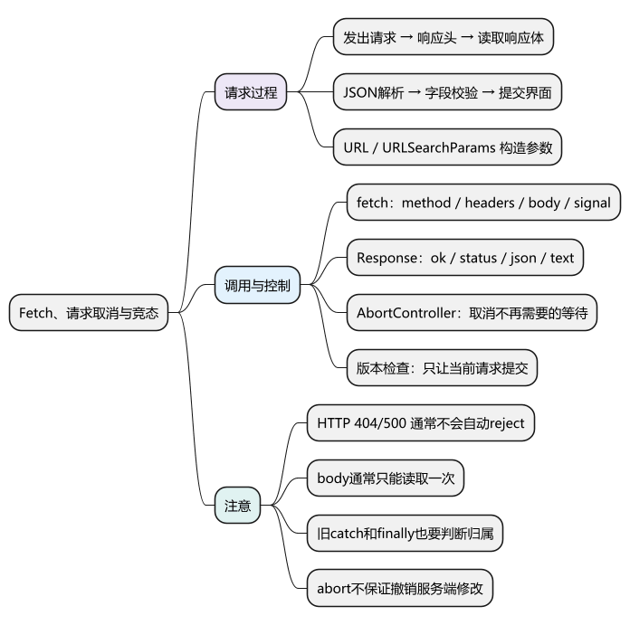
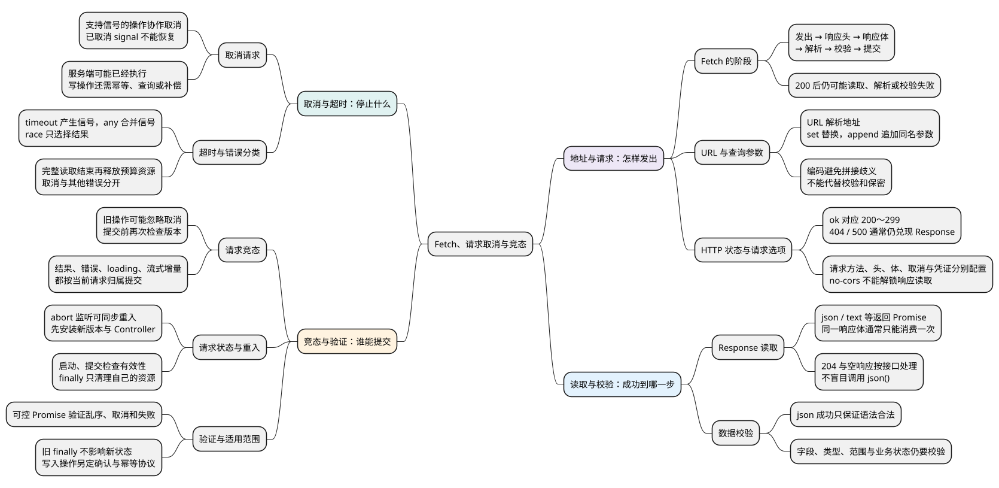

# Fetch、请求取消与竞态

<!-- core-mindmap:start -->

PlantUML 源码

<!-- core-mindmap:end -->

**口述总览：** Fetch 用于发起请求并取得响应。拿到响应不等于读完数据，HTTP 成功也不等于业务成功。取消用于停止不再需要的等待，版本检查用于保证只有当前请求能更新界面，两者需要配合。

<!-- recall-route:start -->
**记忆线：** 构造地址 → 发出请求 → 检查 HTTP → 读取与校验 → 取消和超时 → 最新结果提交 → 验证和清理。一次请求分阶段看，资源取消和结果有效性分开管。

本篇按 10 个主要知识点复习：[知识点归纳与自查](#self-check) · [试题与答案](#interview)。每个知识点都写出完整口述与记忆提示，复制到语雀后也可以按顺序直接阅读。
<!-- recall-route:end -->

## 基本用途：把请求分成几个阶段

一次请求可以按这个顺序理解：

~~~text
发出请求 → 收到响应头 → 读取响应体 → 解析数据 → 校验结构 → 提交界面
~~~

fetch 返回的 Promise 通常在响应头可用时完成，此时得到 Response。response.json() 等方法继续读取响应体并解析，因此还可能失败。

下面的请求示例用于浏览器页面；独立的 URL、Response 和任务控制例子也可以在支持相关 API 的现代 Node.js 中运行。示例地址只是接口占位，需要替换成自己的服务。

## 构造请求地址：URL、URLSearchParams

- new URL(path, base)：组合地址，返回 URL 对象。
- url.searchParams.set(name, value)：设置参数，已有同名参数会被替换。
- append(name, value)：追加参数，允许重复键。
- get(name) / getAll(name)：读取一个值或全部同名值。
- 参数值由 API 编码，避免手动拼接时遗漏特殊字符。

<!-- example: c22-url -->
~~~js
const url = new URL('/api/search', 'https://example.test');
url.searchParams.set('q', 'a&b');
url.searchParams.append('tag', 'js');
url.searchParams.append('tag', 'vue');

console.log(url.search); // ?q=a%26b&tag=js&tag=vue
console.log(url.searchParams.get('q')); // a&b
console.log(JSON.stringify(url.searchParams.getAll('tag'))); // ["js","vue"]
~~~

**注意：** URL 编码负责表达参数，不能代替服务端校验。敏感信息也不应因为经过编码就被放进公开 URL。

## 发起请求与读取结果：fetch()、Response

fetch(url, options) 返回 Promise<Response>。常用选项有 method、headers、body、signal 和 credentials。

- response.status：HTTP 状态码。
- response.ok：状态是否在 200～299。
- response.headers.get(name)：读取允许访问的响应头。
- response.json() / text() / blob() / arrayBuffer()：按需要读取响应体，返回 Promise。
- body 通常只能消费一次，不要先 text() 再 json() 读取同一份响应体。

<!-- example: c22-response -->
~~~js
const response = new Response('{"name":"Alice"}', {
  status: 200,
  headers: { 'Content-Type': 'application/json' }
});
console.log(response.ok, response.status); // true 200
console.log((await response.json()).name); // Alice
console.log(response.bodyUsed); // true

try {
  await response.text();
} catch (error) {
  console.log(error.name); // TypeError
}
~~~

**注意：** HTTP 404/500 通常不会让 fetch 自动拒绝；网络错误、取消等才可能使请求 Promise 拒绝。mode: 'no-cors' 也不是读取跨域响应的解决办法，它会得到受限的 opaque 响应。

## 封装 JSON 请求：检查 HTTP，再解析与校验

先做一个明确支持范围的小函数：读取有 JSON 响应体的接口。它处理 HTTP 状态和解析，具体业务字段由调用方校验。

<!-- example: c22-fetch-json -->
~~~js
async function fetchJson(url, options = {}) {
  const response = await fetch(url, options);
  if (!response.ok) {
    const error = new Error('HTTP ' + response.status);
    error.status = response.status;
    throw error;
  }
  return response.json();
}

async function saveUser(user, signal) {
  const data = await fetchJson('/api/users', {
    method: 'POST',
    headers: { 'Content-Type': 'application/json' },
    body: JSON.stringify(user),
    signal
  });
  if (data === null || typeof data !== 'object' ||
      typeof data.id !== 'string') {
    throw new Error('响应缺少字符串 id');
  }
  return data;
}
~~~

这个例子有三层检查：

- response.ok 回答 HTTP 是否成功。
- json() 回答响应体能否解析为 JSON。
- id 检查回答数据是否符合本次业务约定。

**注意：** 204 或其他空响应不应该盲目调用 json()。跨域携带 Cookie 常需 credentials: 'include' 和服务端正确配置，还受到 Cookie 策略限制；前端配置不能替代后端鉴权。

## 取消和超时：AbortController、AbortSignal

**口述：** AbortController 发出取消信号，支持该信号的操作决定如何响应。它可以中断 Fetch 的等待和响应体读取，但不能保证撤销服务端已经完成的修改。

<!-- example: c22-abort -->
~~~js
const controller = new AbortController();
const reasons = [];
controller.signal.addEventListener('abort', () => {
  reasons.push(controller.signal.reason);
}, { once: true });

controller.abort('用户取消');
controller.abort('再次取消');
console.log(controller.signal.aborted); // true
console.log(reasons.join(',')); // 用户取消
~~~

请求时把 signal 传给 fetch；用户离开页面或新请求取代旧请求时调用 abort。已经取消的 signal 不能恢复，新一轮任务要创建新的 Controller。

支持时，可以用 AbortSignal.timeout(ms) 产生超时信号，用 AbortSignal.any([...]) 合并用户取消与超时信号。旧环境可使用定时器和 Controller，并在整个读取流程结束后清除计时器。

**注意：** 仅用 Promise.race 等到超时，并不会自动停止另一个请求。处理取消时要结合本次 signal 和取消原因；不要把所有异常都当作“用户取消”吞掉。

## 只允许最新请求提交：版本检查配合取消

用户先搜索 A，再搜索 B。如果 B 先返回、A 后返回，直接赋值就会让旧结果覆盖新结果，这叫请求竞态。

~~~text
发起 A：记录版本 1
发起 B：当前版本改为 2，尝试取消 A
B 完成：版本 2 仍有效，提交
A 完成：版本 1 已过时，忽略
~~~

取消节省资源；即使某段操作不响应取消，版本检查仍能拦住旧结果。

<!-- example: c22-latest -->
~~~js
function createLatestRunner() {
  let version = 0;
  let controller = null;

  return {
    async run(task, commit) {
      const current = ++version;
      const previous = controller;
      const own = new AbortController();
      controller = own;
      previous?.abort();
      try {
        if (current !== version || own.signal.aborted) return 'stale';
        const value = await task(own.signal);
        if (current !== version || own.signal.aborted) return 'stale';
        commit(value); // 本例约定同步提交
        return 'committed';
      } catch (error) {
        if (current !== version || own.signal.aborted) return 'stale';
        throw error;
      } finally {
        if (controller === own) controller = null;
      }
    },
    cancel() {
      version++;
      const previous = controller;
      controller = null;
      previous?.abort();
    }
  };
}

const runner = createLatestRunner();
const shown = [];
let finishA;
const first = runner.run(
  () => new Promise(resolve => { finishA = resolve; }),
  value => shown.push(value)
);
const second = runner.run(
  async () => 'B',
  value => shown.push(value)
);

console.log(await second); // committed
finishA('A');
console.log(await first); // stale
console.log(shown.join(',')); // B
~~~

这里故意让 A 忽略 signal，验证版本检查仍然生效。先安装新 Controller，再取消旧请求，因为 abort 会同步触发监听，监听中也可能再次发起请求。启动任务前和提交时都检查版本；finally 只清理自己拥有的 Controller，避免旧请求结束时破坏新请求的状态。

在页面中，task 可调用 fetchJson(url, { signal })，commit 更新结果；卸载时调用 runner.cancel()。多块独立界面各自创建 runner，避免相互取消。

**注意：** loading、错误提示和流式增量也要检查归属。这个控制器处理“只要最新结果”的场景；支付、保存等必须处理每次结果的操作，需要另外定义协议和服务端幂等规则。

## 注意：把失败定位到具体阶段

排查时先分清请求没发出、HTTP 失败、响应体读取失败、JSON 解析失败、字段不合法，还是旧结果误提交。可以用请求标识关联日志，但应避免记录敏感请求体。

大批量请求的并发限制与重试见[异步控制](05_异步控制与任务调度.md)；持续接收文本或 AI 输出见[流式响应与 SSE](../06_选读扩展/03_流式响应与SSE.md)。

## 知识点归纳与自查

本节按 10 个知识点回忆和归纳。先用自查问题检查理解，再顺序阅读各点口述与记忆提示；分级试题在后面的独立章节。

### 自查问题

1. [fetch 返回 200 之后为什么还能失败？从发请求到更新页面，需要经过哪些阶段？](#recall-01)
2. [URL 和 URLSearchParams 怎样构造请求地址？set 与 append 有何区别，编码能代替业务校验吗？](#recall-02)
3. [为什么 fetch 遇到 404 不一定进入 catch？method、headers、body、signal 和 credentials 分别控制什么？](#recall-03)
4. [json、text、blob、arrayBuffer 返回什么？同一响应能先 text 再 json 吗，204 应怎样处理？](#recall-04)
5. [response.json 已经成功，能直接使用数据吗？请求封装与调用方分别应该检查什么？](#recall-05)
6. [AbortController 能取消哪些工作？已经取消的 signal 能复用吗，abort 能保证服务端没有执行吗？](#recall-06)
7. [AbortSignal.timeout、any 与 Promise.race 各能做什么？超时预算应该覆盖到哪个阶段，取消错误能一律忽略吗？](#recall-07)
8. [为什么取消旧请求后还要检查版本？哪些状态更新都必须检查归属？](#recall-08)
9. [为什么先保存新 Controller 再 abort 旧请求？旧 finally 如何避免破坏新请求，卸载时还需要做什么？](#recall-09)
10. [怎样验证只提交最新结果，而不依赖真实网络延迟？“只要最新结果”能直接用于支付和保存吗？](#recall-10)

### Fetch 的阶段

**自查：** fetch 返回 200 之后为什么还能失败？从发请求到更新页面，需要经过哪些阶段？

**口述：** 一次请求可以分为发出请求、取得响应头、读取响应体、解析、校验业务数据和提交界面。fetch 的 Promise 通常在响应头可用时兑现为 Response，此时响应体可能还没读完。即使 HTTP 是 200，后面仍可能发生响应体读取失败、取消、JSON 解析失败或业务字段不符合要求。排查时应定位具体失败阶段，不能只看状态码认定整个流程成功。

**记忆：** 响应头、响应体、解析、业务校验逐层过关；200 不是全流程成功。

### URL 与查询参数：让 API 处理编码

**自查：** URL 和 URLSearchParams 怎样构造请求地址？set 与 append 有何区别，编码能代替业务校验吗？

**口述：** URL 负责按基准地址解析路径，searchParams 提供查询参数的读写。set 会替换同名参数，append 可以追加重复键，get 读取一个值，getAll 读取全部同名值。API 按规则编码特殊字符，避免手工拼接时把参数内容误当分隔符。编码只解决如何表达参数，不能代替服务端校验，也不能让敏感信息适合放进公开 URL。

**记忆：** 地址交给 URL，参数交给 searchParams；编码不是校验或保密。

### HTTP 状态与请求选项

**自查：** 为什么 fetch 遇到 404 不一定进入 catch？method、headers、body、signal 和 credentials 分别控制什么？

**口述：** fetch 收到 404 或 500 时通常仍得到正常的 HTTP 响应，需要检查 response.ok 或 status 并按业务主动抛错；网络故障、取消等才可能让请求 Promise 直接拒绝。method、headers 和 body 描述请求方法、头与内容，signal 传递取消，credentials 控制凭证携带策略。跨域 Cookie 还需要服务端和 Cookie 策略配合；no-cors 会得到受限响应，不能用来绕过跨域读取限制，前端配置也不能代替服务端鉴权。

**记忆：** HTTP 错误自己查，网络与取消另处理；跨域不能靠 no-cors 绕过。

### Response 读取：响应体通常只能消费一次

**自查：** json、text、blob、arrayBuffer 返回什么？同一响应能先 text 再 json 吗，204 应怎样处理？

**口述：** Response 提供状态、头和响应体，json、text、blob、arrayBuffer 按相应形式读取响应体并返回 Promise。json 还会解析 JSON，响应体通常只能消费一次，已经使用后再读取会失败。需要分支读取时，应在消费前按用途考虑 clone 及其缓冲成本，或者读取一次再处理结果。204 或其他没有 JSON 内容的响应不能盲目调用 json，应按接口契约判断是否有内容。

**记忆：** 读取方法也是异步，响应体通常一次消费；空响应别硬解析 JSON。

### 数据校验

**自查：** response.json 已经成功，能直接使用数据吗？请求封装与调用方分别应该检查什么？

**口述：** JSON 解析成功只表示文本符合 JSON 语法，结果仍可能是 null、数组或字段类型与范围不符。小型请求封装可检查 HTTP 状态并解析内容，调用方再检查本次业务需要的字段和状态，或者使用约定的结构校验器。应区分 HTTP 失败、读取或解析失败与业务校验失败，不能把任一层成功当作其余层已经通过。

**记忆：** HTTP 看状态，JSON 看语法，业务看字段与约定。

### 取消请求

**自查：** AbortController 能取消哪些工作？已经取消的 signal 能复用吗，abort 能保证服务端没有执行吗？

**口述：** AbortController 通过 signal 向支持取消的操作发出信号，可以影响 Fetch 等待及响应体读取，但不是任意代码的强制停止开关。signal 一旦取消不能恢复，新一轮任务应创建新控制器。客户端取消时服务端可能已经提交修改，因此不能判定“没有执行”；写入、重试或结果不明时，需要服务端幂等键、状态查询或业务补偿明确结果。

**记忆：** signal 单向取消，客户端停止等待不等于服务端回滚。

### 超时与错误分类：结束等待也要管资源

**自查：** AbortSignal.timeout、any 与 Promise.race 各能做什么？超时预算应该覆盖到哪个阶段，取消错误能一律忽略吗？

**口述：** 支持时可用 AbortSignal.timeout 产生超时信号，用 any 合并用户取消与超时；旧环境可以用定时器和控制器，并在受保护的完整读取流程结束后清理计时器。Promise.race 只选择先完成的结果，不自动停止另一个请求。预算应明确覆盖到响应头还是完整数据流程，错误处理结合本次 signal 与取消原因，不能把所有网络、解析或业务错误都当作用户取消吞掉。

**记忆：** 超时先明确预算范围，race 不停任务；取消按本次原因识别。

### 请求竞态

**自查：** 为什么取消旧请求后还要检查版本？哪些状态更新都必须检查归属？

**口述：** 旧请求可能已经完成、正在后处理，或根本不响应 signal，单靠取消不能阻止它更新页面。每次启动记录版本，提交时再次确认仍是当前版本，才能阻止旧结果覆盖新结果。结果数据、loading、错误提示以及流式增量都属于状态写入，都应检查归属。取消主要减少无用工作，版本检查保证结果有效；各块独立界面应有各自的控制范围。

**记忆：** 取消减少浪费，版本守住提交；数据、错误和 loading 一起判断。

### 请求状态与重入：先安装新状态，再取消旧任务

**自查：** 为什么先保存新 Controller 再 abort 旧请求？旧 finally 如何避免破坏新请求，卸载时还需要做什么？

**口述：** abort 会同步触发取消监听，监听中可能再次启动请求，所以应先安装本轮版本和 Controller，再取消旧任务，并在真正启动和提交前检查本轮是否仍有效。finally 只清理自己拥有的 Controller，不能无条件清掉当前新请求。取消或卸载时先使版本失效，再释放引用并通知旧任务；本篇 commit 约定同步，若提交本身包含 await，需要在后续状态写入前继续检查归属。

**记忆：** 先装新状态再取消旧任务；启动和提交查版本，finally 只清理自己的。

### 验证与适用范围

**自查：** 怎样验证只提交最新结果，而不依赖真实网络延迟？“只要最新结果”能直接用于支付和保存吗？

**口述：** 用可控 Promise 故意让 B 先完成、A 后完成，确认只显示 B，并覆盖取消后才完成、旧请求失败、当前请求失败和旧 finally 不影响新请求。还应检查所有界面状态写入，而不只检查成功数据。最新结果策略适合搜索等场景；支付、保存等需要确认每次业务结果的操作，不能直接丢弃旧结果，应单独设计确认协议、幂等与状态查询。日志按请求标识定位阶段，同时避免记录敏感数据。

**记忆：** 用可控顺序测竞态；搜索可只要最新，业务写入要确认每次结果。

## 试题与答案

### C23-06 [P0·原理] fetch返回200之后为什么还能失败？

**回答：** 一次请求可以分为发出请求、取得响应头、读取响应体、解析、校验业务数据和提交界面。fetch 的 Promise 通常在响应头可用时兑现为 Response，此时响应体可能还没读完。即使 HTTP 是 200，后面仍可能发生响应体读取失败、取消、JSON 解析失败或业务字段不符合要求。排查时应定位具体失败阶段，不能只看状态码认定整个流程成功。

### C23-01 [P0·原理] 为什么 fetch 遇到 404 不一定进入 catch？

**回答：** fetch 收到 404 或 500 时通常仍得到正常的 HTTP 响应，需要检查 response.ok 或 status 并按业务主动抛错；网络故障、取消等才可能让请求 Promise 直接拒绝。method、headers 和 body 描述请求方法、头与内容，signal 传递取消，credentials 控制凭证携带策略。跨域 Cookie 还需要服务端和 Cookie 策略配合；no-cors 会得到受限响应，不能用来绕过跨域读取限制，前端配置也不能代替服务端鉴权。

### C23-02 [P0·基础] response.json() 已经成功，能直接使用数据吗？

**回答：** JSON 解析成功只表示文本符合 JSON 语法，结果仍可能是 null、数组或字段类型与范围不符。小型请求封装可检查 HTTP 状态并解析内容，调用方再检查本次业务需要的字段和状态，或者使用约定的结构校验器。应区分 HTTP 失败、读取或解析失败与业务校验失败，不能把任一层成功当作其余层已经通过。

### C23-05 [P1·工程取舍] abort 能保证服务端操作没有执行吗？

**回答：** AbortController 通过 signal 向支持取消的操作发出信号，可以影响 Fetch 等待及响应体读取，但不是任意代码的强制停止开关。signal 一旦取消不能恢复，新一轮任务应创建新控制器。客户端取消时服务端可能已经提交修改，因此不能判定“没有执行”；写入、重试或结果不明时，需要服务端幂等键、状态查询或业务补偿明确结果。

### C23-03 [P0·原理] 为什么取消旧请求后还要检查版本？

**回答：** 旧请求可能已经完成、正在后处理，或根本不响应 signal，单靠取消不能阻止它更新页面。每次启动记录版本，提交时再次确认仍是当前版本，才能阻止旧结果覆盖新结果。结果数据、loading、错误提示以及流式增量都属于状态写入，都应检查归属。取消主要减少无用工作，版本检查保证结果有效；各块独立界面应有各自的控制范围。

### C23-04 [P1·编码] 怎样验证只提交最新结果的实现？

**回答：** 用可控 Promise 故意让 B 先完成、A 后完成，确认只显示 B，并覆盖取消后才完成、旧请求失败、当前请求失败和旧 finally 不影响新请求。还应检查所有界面状态写入，而不只检查成功数据。最新结果策略适合搜索等场景；支付、保存等需要确认每次业务结果的操作，不能直接丢弃旧结果，应单独设计确认协议、幂等与状态查询。日志按请求标识定位阶段，同时避免记录敏感数据。
