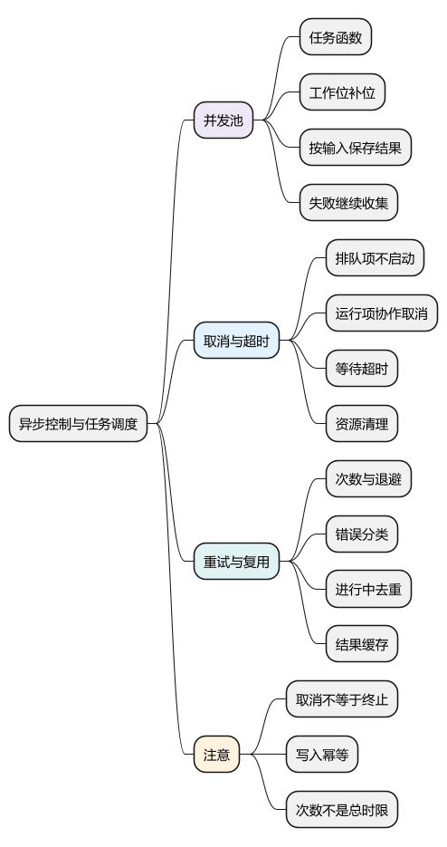
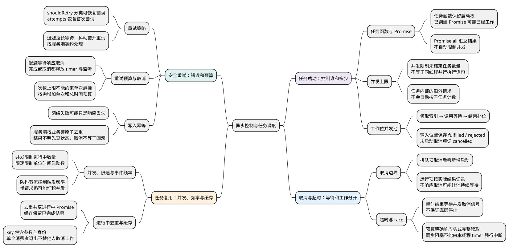

# 异步控制与任务调度

<!-- core-mindmap:start -->
[](examples/c24-mindmap.svg)

<details>
<summary>PlantUML 源码</summary>



</details>

<!-- core-mindmap:end -->

**口述总览：** Promise 表示一次工作的结果，调度器掌握任务什么时候启动。先取得任务调用权，再明确并发上限、结果顺序、取消与超时边界，最后按业务语义加入有限重试、去重和缓存。限制调用频率不能代替限制同时进行的任务数。

<!-- recall-route:start -->
**记忆线：** 掌握启动权 → 工作位补位 → 结果与取消 → 超时预算 → 安全重试 → 限速、去重和缓存。先说控制哪一层，再说失败和结束后谁负责清理。

本篇按 10 个主要知识点复习：[知识点归纳与自查](#self-check) · [试题与答案](#interview)。每个知识点都写出完整口述与记忆提示，复制到语雀后也可以按顺序直接阅读。
<!-- recall-route:end -->

**本篇主线：掌握启动权 → 限制同时运行数量 → 处理取消与超时 → 有预算地重试 → 区分去重与缓存。**

Promise 表示结果，调度器决定什么时候调用任务。例如有一百个文件要上传，即使 Promise.all 能汇总结果，也不代表适合一次启动一百次上传。

示例面向支持 Promise、AbortController 的现代浏览器和 Node，接收有限任务数组，不实现跨进程调度、无限任务流或服务器限流协议。

<a id="k01"></a>

## 任务函数与已启动 Promise：谁掌握开始工作的时机？

**口述：** 控制并发需要接收还没启动的函数。已经拿到请求 Promise 时，请求通常已经发出了，调度器无法把它退回未开始状态。

比较 `() => fetch(url)` 与 `fetch(url)`：前者是一份“以后执行”的工作，后者已经调用 fetch 并拿到结果对象。并发池应保存前者，在有空位时再调用。

“并发上限为 2”表示最多两个任务尚未结束。每当一个任务成功或失败，就释放一个工作位，再启动下一项。它不表示两个 JavaScript 函数在同一个线程同时执行。

还要明确三件事：

- 失败策略：某项失败后继续收集，还是停止继续启动？
- 结果位置：按输入顺序返回，还是按完成顺序返回？
- 取消范围：未启动项怎样表示，运行中项是否支持停止？

本篇选择继续收集全部结局，并按输入位置返回。一个任务内部若又发出十个请求，池无法自动将这些子请求计为十个工作位。

## 实现并发池：领取索引、等待结束、再补位

**口述：** 每个工作位反复领取一个索引，调用任务并等待它结束，再领取下一项。索引在 await 之前确定，结果写回同一位置，所以可以限制数量并保留顺序。

下面的 pool 接收任务函数数组、正整数 limit，以及可选 signal。返回 Promise，成功值是每项的结果记录；参数非法则整体拒绝。

- fulfilled：任务成功，包含 value。
- rejected：已启动任务抛错或拒绝，包含 reason。
- cancelled：轮到该项时已经取消，因此从未调用任务。

<!-- example: control-pool -->
```js
async function pool(tasks, limit, { signal } = {}) {
  if (!Array.isArray(tasks) || !Number.isInteger(limit) || limit < 1) {
    throw new TypeError('invalid tasks or limit');
  }
  const queue = Array.from(tasks);
  if (queue.some(task => typeof task !== 'function')) {
    throw new TypeError('each task must be a function');
  }
  const results = new Array(queue.length);
  let cursor = 0;
  async function worker() {
    while (cursor < queue.length) {
      const index = cursor++;
      if (signal?.aborted) {
        results[index] = { status: 'cancelled', reason: signal.reason };
        continue;
      }
      try {
        const value = await queue[index](signal);
        results[index] = { status: 'fulfilled', value };
      } catch (reason) {
        results[index] = { status: 'rejected', reason };
      }
    }
  }
  await Promise.all(Array.from({ length: Math.min(limit, queue.length) }, worker));
  return results;
}
(async () => {
  let active = 0;
  let maximum = 0;
  let finishFirst;
  const firstGate = new Promise(resolve => { finishFirst = resolve; });
  const completed = [];
  const tasks = [
    async () => {
      maximum = Math.max(maximum, ++active);
      await firstGate;
      active--;
      completed.push('A');
      return 'A';
    },
    async () => {
      maximum = Math.max(maximum, ++active);
      await Promise.resolve();
      active--;
      completed.push('B');
      return 'B';
    },
    () => { finishFirst(); throw new Error('failed'); }
  ];
  const results = await pool(tasks, 2);
  console.log(maximum, completed.join(' ')); // 2 B A
  console.log(results.map(item => item.status).join(' '));
  // fulfilled fulfilled rejected
  console.log(results.slice(0, 2).map(item => item.value).join(' ')); // A B

  const controller = new AbortController();
  let laterCalls = 0;
  const cancelled = await pool([
    () => { controller.abort('stop'); return 'already started'; },
    () => { laterCalls++; }
  ], 1, { signal: controller.signal });
  console.log(cancelled.map(item => item.status).join(' '), laterCalls);
  // fulfilled cancelled 0
})();
```

第一个工作位停在 firstGate，第二个先完成 B，于是领取第三项。第三项释放 firstGate 后抛错；该错误被记录，A 随后完成。完成顺序是 B、A，返回位置仍是 A、B、失败。

复制任务数组可以固定本次调度输入，也能发现稀疏数组中的空位。领取索引是当前线程中的同步操作，过程中没有 await，因此两个工作位不会领取同一索引。

取消示例中，第一项已经运行，而且它选择正常返回，结果就是 fulfilled。第二项尚未启动，才被标记 cancelled。这比把所有结果强行改成“取消”更准确地表达实际执行情况。

<a id="k02"></a>

## 取消与超时：结束等待不等于终止操作

**口述：** 取消需要操作主动响应信号；超时首先决定调用者还等不等。即使等待已经失败，未响应取消的操作也可能继续完成。

AbortController 创建控制器，signal 用于传递取消状态，abort(reason) 发出信号。支持信号的 API 会自行结束工作；自定义任务要检查 signal.aborted、监听 abort，并释放自己的资源。

下面的 withTimeout 接收任务函数和毫秒预算，返回先完成的结果。超时同时发送取消信号并拒绝等待；它不支持外部 signal，也无法强制中断同步死循环。

<!-- example: control-timeout -->
```js
function withTimeout(task, ms) {
  if (typeof task !== 'function' || !Number.isFinite(ms) || ms < 0) {
    throw new TypeError('invalid task or timeout');
  }
  const controller = new AbortController();
  let timer;
  const deadline = new Promise((resolve, reject) => {
    timer = setTimeout(() => {
      const error = new Error('timeout');
      controller.abort(error);
      reject(error);
    }, ms);
  });
  const work = Promise.resolve().then(() => task(controller.signal));
  return Promise.race([work, deadline]).finally(() => clearTimeout(timer));
}
(async () => {
  let finish;
  let receivedSignal;
  let completed = false;
  const underlying = new Promise(resolve => { finish = resolve; })
    .then(value => { completed = true; return value; });
  try {
    await withTimeout(signal => {
      receivedSignal = signal;
      return underlying; // 故意不响应取消，用于演示边界
    }, 0);
  } catch (error) {
    console.log(error.message, receivedSignal.aborted, completed);
    // timeout true false
  }
  finish('late result');
  console.log(await underlying, completed); // late result true
})();
```

超时后 underlying 仍由 finish 控制，它确实还能完成。race 接管了参与者的拒绝，但无法替任务关闭网络、清除监听或撤销服务端写入。

本例把同步抛错也接入 work 的拒绝，任务完成或超时后清掉 timer。真实请求还要界定预算覆盖响应头还是完整响应体；fetch 成功拿到响应头，不代表 body 已读完。

收到取消后若运行中的任务永不结束，上面的 pool 也会一直等待。若业务要求立即放弃等待，可另建等待层，但要继续接管后台结果，并单独处理资源释放与旧结果提交问题。

<a id="k03"></a>

## 有限重试：只重做可以安全重做的工作

**口述：** 重试要先确认错误可恢复、操作允许重复，再限制次数和等待预算。增加等待间隔是减轻压力，不能解决重复写入的业务问题。

退避是失败后逐渐延长等待，抖动是在等待范围内加入随机变化，避免很多客户端同一时刻再次请求。429、某些 5xx 或暂时网络问题是否可重试，要按服务端契约判断；输入错误和权限错误通常不应原样重试。

下面演示次数上限、错误分类、退避和等待期间取消。delay 在正常完成或取消时都移除监听；任务本身仍需响应 signal。

<!-- example: control-retry -->
```js
function delay(ms, signal) {
  return new Promise((resolve, reject) => {
    if (signal?.aborted) { reject(signal.reason); return; }
    function abort() {
      clearTimeout(timer);
      signal?.removeEventListener('abort', abort);
      reject(signal.reason);
    }
    const timer = setTimeout(() => {
      signal?.removeEventListener('abort', abort);
      resolve();
    }, ms);
    signal?.addEventListener('abort', abort, { once: true });
  });
}
async function retry(task, {
  attempts = 3, baseDelay = 100, signal, shouldRetry = () => false
} = {}) {
  if (typeof task !== 'function' || typeof shouldRetry !== 'function' ||
      !Number.isInteger(attempts) || attempts < 1 ||
      !Number.isFinite(baseDelay) || baseDelay < 0) {
    throw new TypeError('invalid retry options');
  }
  for (let attempt = 1; ; attempt++) {
    if (signal?.aborted) throw signal.reason;
    try { return await task({ attempt, signal }); }
    catch (error) {
      if (signal?.aborted) throw signal.reason;
      if (attempt >= attempts || !shouldRetry(error)) throw error;
      const ceiling = baseDelay === 0 ? 0 :
        Math.min(30000, baseDelay * 2 ** Math.min(attempt - 1, 30));
      await delay(Math.random() * ceiling, signal);
    }
  }
}
(async () => {
  let calls = 0;
  const value = await retry(({ attempt }) => {
    calls++;
    if (attempt < 3) throw new Error('temporary');
    return 'ok';
  }, { attempts: 3, baseDelay: 0, shouldRetry: error => error.message === 'temporary' });
  console.log(value, calls); // ok 3
  let deniedCalls = 0;
  try {
    await retry(() => { deniedCalls++; throw new Error('permission'); });
  } catch (error) {
    console.log(error.message, deniedCalls); // permission 1
  }
})();
```

shouldRetry 默认 false，意味着调用者必须主动允许重试。attempts 限制总尝试次数，不是“首次以外的重试次数”；每次失败后必须等待 delay，期间取消会直接结束流程。

这个版本不实现单次执行超时、整体截止时间或 Retry-After。一个任务永远不结束，次数上限无法让它结束；生产代码需要按业务组合这些预算。

### 为什么创建订单不能看见网络错误就重试？

服务器可能已经创建订单，只是响应丢失。再次创建就可能重复扣费。幂等键用于让服务端识别“同一业务操作的重复提交”，需要服务端原子去重，并绑定用户、参数与有效期；客户端生成一个随机字符串本身不等于实现了幂等。

如果执行结果不明，应按接口能力查询状态、复用同一业务键，再决定是否重试。取消也不能自动撤销已完成的服务器操作。

<a id="k04"></a>

## 限速、进行中去重与结果缓存

**口述：** 并发池控制同时进行多少，限速控制单位时间启动多少，去重让同时的相同工作共享结果，缓存则复用已经完成的数据。

例如每秒启动一次、每次请求持续三十秒，仍可能有约三十个请求在途中。所以每秒限速和并发上限常需要同时设置。

进行中去重常叫 single-flight：相同 key 的任务尚未结束时，返回同一个 Promise；完成后删除，让下一次调用重新执行。

<!-- example: control-single-flight -->
```js
function createSingleFlight() {
  const active = new Map();
  return (key, task) => {
    if (active.has(key)) return active.get(key);
    const promise = Promise.resolve().then(task)
      .finally(() => active.delete(key));
    active.set(key, promise);
    return promise;
  };
}
(async () => {
  let calls = 0;
  const run = createSingleFlight();
  const first = run('user:7', () => ++calls);
  const second = run('user:7', () => ++calls);
  console.log(first === second, await first, calls); // true 1 1
  console.log(await run('user:7', () => ++calls)); // 2
})();
```

task 放进 then，是为了让同步抛错也成为拒绝，并在执行前把 Promise 放入 Map。finally 让成功和失败都删除记录；这里没有缓存已完成结果，也没有容量与超时策略。

key 必须包含影响结果的参数和用户身份。若多个消费者共享同一个请求，一个消费者不想等了，不应直接替其他人取消底层工作，需要分别管理等待关系。

缓存还要考虑失效时间、容量和更新策略；输入防抖与节流关注事件触发频率。它们各自解决不同的问题，不能靠一个 loading 布尔值代替。

<a id="summary"></a>

<a id="self-check"></a>

## 知识点归纳与自查

本节按 10 个知识点回忆和归纳。先用自查问题检查理解，再顺序阅读各点口述与记忆提示；分级试题在后面的独立章节。

### 自查问题

1. [并发池为什么要接收任务函数，而不能只接收已经创建的 Promise？Promise.all 自带并发限制吗？](#recall-01)
2. [并发为 2 是否表示两个 JavaScript 函数同时运行？每个任务内部再发多个请求，池会自动计数吗？](#recall-02)
3. [怎样实现最多 N 个任务并发并保留每项结局？同步抛错、乱序完成和空输入怎样处理？](#recall-03)
4. [池取消后，排队任务与运行中任务分别怎样处理？所有结果都会变成 cancelled 吗？](#recall-04)
5. [Promise.race 超时为什么没停请求？预算应覆盖什么，同步死循环能靠超时定时器中断吗？](#recall-05)
6. [哪些失败值得重试？退避与抖动分别解决什么问题，attempts 是额外重试次数吗？](#recall-06)
7. [有限重试如何避免无限等待和取消失效？只有次数上限足够吗，退避阶段怎样清理？](#recall-07)
8. [创建订单遇到网络错误能直接重试吗？幂等键需要服务端做什么，取消会撤销写入吗？](#recall-08)
9. [并发池、每秒限速、防抖和节流分别控制什么？每秒只发一个请求是否保证只有一个进行中请求？](#recall-09)
10. [single-flight 与结果缓存有什么不同？key 应包含什么，共享请求怎样处理某个消费者的取消？](#recall-10)

<a id="recall-01"></a>

### 任务函数与 Promise：启动权决定能否调度

**自查：** 并发池为什么要接收任务函数，而不能只接收已经创建的 Promise？Promise.all 自带并发限制吗？

**口述：** 任务函数表示尚未开始的工作，调度器可以在有空位时调用；已经创建的请求 Promise 通常对应已经启动的请求，无法把它退回未开始状态。Promise.all 只汇总结果，不控制请求何时发出，也不会自动限制数量。先掌握任务启动权，才谈得上排队、暂停新增和并发上限。

**记忆：** 调度要拿函数，Promise 只表结果；all 不替你控制启动。

<a id="recall-02"></a>

### 并发上限：限制尚未结束的任务数

**自查：** 并发为 2 是否表示两个 JavaScript 函数同时运行？每个任务内部再发多个请求，池会自动计数吗？

**口述：** 并发上限描述同时尚未结束的任务数量，不表示同一个 JavaScript 线程同时执行多段函数语句。任务等待 I/O 时，其他工作位可以启动或继续执行。池只管理交给它的任务边界；一个任务内部再启动多个请求，池不会自动把这些子请求各计一个工作位，限制真正要保护的资源时应把任务粒度设计清楚。

**记忆：** 并发数看未结束任务，不看同时执行语句；任务粒度决定控制范围。

<a id="recall-03"></a>

### 工作位并发池

**自查：** 怎样实现最多 N 个任务并发并保留每项结局？同步抛错、乱序完成和空输入怎样处理？

**口述：** 正文 pool 创建有限工作位，每个工作位同步领取索引，调用任务并等待结束，再领取下一项。索引在 await 前确定，结果写回输入位置，所以完成乱序也不会改变返回顺序。同步抛错和异步拒绝都记录为 rejected，其余工作继续；成功为 fulfilled，尚未启动就被取消的项为 cancelled，空输入得到空结果。验证应覆盖峰值并发、顺序、失败、非法参数和取消后零新增启动。

**记忆：** 同步领号，完成补位，结果按原位置存；一项失败不阻止本例继续。

<a id="recall-04"></a>

### 取消边界：排队项不启动，运行项协作结束

**自查：** 池取消后，排队任务与运行中任务分别怎样处理？所有结果都会变成 cancelled 吗？

**口述：** 本篇池在领取任务后检查 signal，已经取消的未启动项不执行并记录 cancelled；运行中任务收到信号后是否结束，取决于任务自身是否支持取消。已运行任务仍按实际兑现或拒绝记录结果，不强行把成功改成取消。若运行项永不结束，池仍会等待；需要立即放弃等待时应增加独立等待层，并继续接管后台结果和资源清理。

**记忆：** 排队不再启动，运行需要配合；取消信号不改写真实结局。

<a id="recall-05"></a>

### 超时与 race

**自查：** Promise.race 超时为什么没停请求？预算应覆盖什么，同步死循环能靠超时定时器中断吗？

**口述：** race 只采用最先完成的结果，没有通用的终止能力。正文超时包装会同时发取消信号并拒绝等待，但底层任务必须响应信号，后台工作才可能结束；服务端已提交的写入也不能由 abort 撤销。完成或超时后应清理计时器，并明确预算覆盖响应头还是完整响应体。同步死循环阻塞线程，计时回调也无法及时执行，不能把这个包装当作强制中断。

**记忆：** race 选结果，signal 请求停止；释放资源和真正中断另看底层。

<a id="recall-06"></a>

### 重试策略：先判断能否重试，再决定等待

**自查：** 哪些失败值得重试？退避与抖动分别解决什么问题，attempts 是额外重试次数吗？

**口述：** 重试先判断错误是否可能恢复，以及业务是否允许重复执行。部分临时网络失败、429 或 5xx 可按服务端契约处理，输入和权限错误通常不应原样重试。退避逐渐延长等待，抖动加入随机变化，减少大量客户端同时重试的压力。正文 shouldRetry 默认不允许重试，attempts 表示包括首次在内的总尝试次数，不是首次之外的额外次数。

**记忆：** 可恢复且可重复才重试；退避拉开时间，抖动错开人群，总次数含首次。

<a id="recall-07"></a>

### 重试预算与取消

**自查：** 有限重试如何避免无限等待和取消失效？只有次数上限足够吗，退避阶段怎样清理？

**口述：** 有限重试需限制次数、明确 shouldRetry，让退避等待也响应取消，并在等待完成或取消时清理 timer 和监听。一次任务若永不结束，次数上限无法让流程退出，还需要按业务加入单次超时和总截止时间，必要时遵守 Retry-After。任务本身也应响应取消，不能只取消下一次延迟；写操作还必须先明确幂等保障。

**记忆：** 次数管重来几次，时间管等多久；任务和退避两边都要响应取消。

<a id="recall-08"></a>

### 写入幂等：网络失败不代表业务没执行

**自查：** 创建订单遇到网络错误能直接重试吗？幂等键需要服务端做什么，取消会撤销写入吗？

**口述：** 服务端可能已完成写入，只是响应丢失，客户端看到网络失败并不能断言业务没执行。再次创建可能产生重复订单或扣费，需要服务端识别同一业务操作的幂等键并原子去重，绑定用户、参数与有效期。客户端生成随机字符串本身不等于实现幂等；结果不明时应查询状态并复用原业务键，再决定重试或补偿。取消也不会自动撤销已提交的操作。

**记忆：** 响应丢了不等于没做；同一业务键配合服务端原子去重。

<a id="recall-09"></a>

### 并发、限速与事件频率：控制指标不同

**自查：** 并发池、每秒限速、防抖和节流分别控制什么？每秒只发一个请求是否保证只有一个进行中请求？

**口述：** 并发池控制同时未结束的任务数，限速控制单位时间内启动多少。常见尾部防抖在连续触发停止一段时间后执行；节流限制持续触发时的执行频率，是否首部执行或末尾补执行由具体选项决定。每秒启动一个、每次持续三十秒，仍可能有约三十个进行中请求，所以限速不能代替并发上限。需要同时保护服务器吞吐和客户端资源时，可以组合这些约束，而不是用一个 loading 布尔值代表全部状态。

**记忆：** 并发看同时多少，限速看一段时间启动多少；事件限频不管请求是否完成。

<a id="recall-10"></a>

### 进行中去重与缓存

**自查：** single-flight 与结果缓存有什么不同？key 应包含什么，共享请求怎样处理某个消费者的取消？

**口述：** 进行中去重让同一 key 的并行调用共享一个正在工作的 Promise，结束后删除，之后再调用会重新执行；结果缓存保留已完成数据，需要时效、容量与失效策略。正文把 task 放进 then，以接管同步抛错并先登记 Promise，再用 finally 在成功或失败后删除记录。key 应区分影响结果的参数和用户身份；多个消费者共享工作时，一个消费者取消等待不应擅自取消其他人的底层任务。

**记忆：** 去重共享进行中，缓存复用已完成；key 与各消费者取消责任要明确。

<a id="interview"></a>

## 试题与答案

<a id="c24-01"></a>

### C24-01 [P0·编码] 实现最多N个任务并发并保留每项结局。

**回答：** 正文 pool 创建有限工作位，每个工作位同步领取索引，调用任务并等待结束，再领取下一项。索引在 await 前确定，结果写回输入位置，所以完成乱序也不会改变返回顺序。同步抛错和异步拒绝都记录为 rejected，其余工作继续；成功为 fulfilled，尚未启动就被取消的项为 cancelled，空输入得到空结果。验证应覆盖峰值并发、顺序、失败、非法参数和取消后零新增启动。

<a id="c24-03"></a>

### C24-03 [P0·原理] Promise.race超时为什么没停请求？

**回答：** race 只采用最先完成的结果，没有通用的终止能力。正文超时包装会同时发取消信号并拒绝等待，但底层任务必须响应信号，后台工作才可能结束；服务端已提交的写入也不能由 abort 撤销。完成或超时后应清理计时器，并明确预算覆盖响应头还是完整响应体。同步死循环阻塞线程，计时回调也无法及时执行，不能把这个包装当作强制中断。

<a id="c24-02"></a>

### C24-02 [P1·编码] 有限重试如何避免无限等待和取消失效？

**回答：** 有限重试需限制次数、明确 shouldRetry，让退避等待也响应取消，并在等待完成或取消时清理 timer 和监听。一次任务若永不结束，次数上限无法让流程退出，还需要按业务加入单次超时和总截止时间，必要时遵守 Retry-After。任务本身也应响应取消，不能只取消下一次延迟；写操作还必须先明确幂等保障。

<a id="c24-04"></a>

### C24-04 [P1·工程取舍] 进行中去重与结果缓存有什么不同？

**回答：** 进行中去重让同一 key 的并行调用共享一个正在工作的 Promise，结束后删除，之后再调用会重新执行；结果缓存保留已完成数据，需要时效、容量与失效策略。正文把 task 放进 then，以接管同步抛错并先登记 Promise，再用 finally 在成功或失败后删除记录。key 应区分影响结果的参数和用户身份；多个消费者共享工作时，一个消费者取消等待不应擅自取消其他人的底层任务。

参考：[MDN AbortController](https://developer.mozilla.org/en-US/docs/Web/API/AbortController)、[MDN Promise](https://developer.mozilla.org/en-US/docs/Web/JavaScript/Reference/Global_Objects/Promise)。
