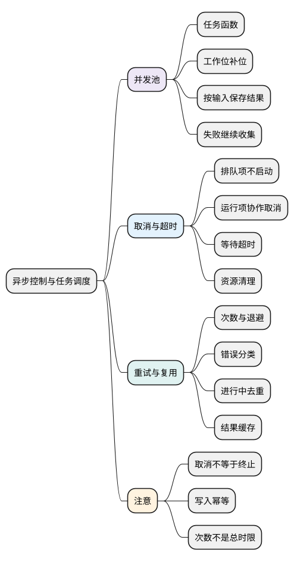

# 异步控制与任务调度

<!-- core-mindmap:start -->
[](examples/c24-mindmap.svg)

<details>
<summary>PlantUML 源码</summary>



</details>

<!-- core-mindmap:end -->

**本篇主线：掌握启动权 → 限制同时运行数量 → 处理取消与超时 → 有预算地重试 → 区分去重与缓存。**

Promise 表示结果，调度器决定什么时候调用任务。例如有一百个文件要上传，即使 Promise.all 能汇总结果，也不代表适合一次启动一百次上传。

示例面向支持 Promise、AbortController 的现代浏览器和 Node，接收有限任务数组，不实现跨进程调度、无限任务流或服务器限流协议。

<a id="k01"></a>

## 任务函数与已启动 Promise：谁掌握开始工作的时机？

**口述：** 控制并发需要接收还没启动的函数。已经拿到请求 Promise 时，请求通常已经发出了，调度器无法把它退回未开始状态。

比较 `() => fetch(url)` 与 `fetch(url)`：前者是一份“以后执行”的工作，后者已经调用 fetch 并拿到结果对象。并发池应保存前者，在有空位时再调用。

“并发上限为 2”表示最多两个任务尚未结束。每当一个任务成功或失败，就释放一个工作位，再启动下一项。它不表示两个 JavaScript 函数在同一个线程同时执行。

还要明确三件事：

- 失败策略：某项失败后继续收集，还是停止继续启动？
- 结果位置：按输入顺序返回，还是按完成顺序返回？
- 取消范围：未启动项怎样表示，运行中项是否支持停止？

本篇选择继续收集全部结局，并按输入位置返回。一个任务内部若又发出十个请求，池无法自动将这些子请求计为十个工作位。

## 实现并发池：领取索引、等待结束、再补位

**口述：** 每个工作位反复领取一个索引，调用任务并等待它结束，再领取下一项。索引在 await 之前确定，结果写回同一位置，所以可以限制数量并保留顺序。

下面的 pool 接收任务函数数组、正整数 limit，以及可选 signal。返回 Promise，成功值是每项的结果记录；参数非法则整体拒绝。

- fulfilled：任务成功，包含 value。
- rejected：已启动任务抛错或拒绝，包含 reason。
- cancelled：轮到该项时已经取消，因此从未调用任务。

<!-- example: control-pool -->
```js
async function pool(tasks, limit, { signal } = {}) {
  if (!Array.isArray(tasks) || !Number.isInteger(limit) || limit < 1) {
    throw new TypeError('invalid tasks or limit');
  }
  const queue = Array.from(tasks);
  if (queue.some(task => typeof task !== 'function')) {
    throw new TypeError('each task must be a function');
  }
  const results = new Array(queue.length);
  let cursor = 0;
  async function worker() {
    while (cursor < queue.length) {
      const index = cursor++;
      if (signal?.aborted) {
        results[index] = { status: 'cancelled', reason: signal.reason };
        continue;
      }
      try {
        const value = await queue[index](signal);
        results[index] = { status: 'fulfilled', value };
      } catch (reason) {
        results[index] = { status: 'rejected', reason };
      }
    }
  }
  await Promise.all(Array.from({ length: Math.min(limit, queue.length) }, worker));
  return results;
}
(async () => {
  let active = 0;
  let maximum = 0;
  let finishFirst;
  const firstGate = new Promise(resolve => { finishFirst = resolve; });
  const completed = [];
  const tasks = [
    async () => {
      maximum = Math.max(maximum, ++active);
      await firstGate;
      active--;
      completed.push('A');
      return 'A';
    },
    async () => {
      maximum = Math.max(maximum, ++active);
      await Promise.resolve();
      active--;
      completed.push('B');
      return 'B';
    },
    () => { finishFirst(); throw new Error('failed'); }
  ];
  const results = await pool(tasks, 2);
  console.log(maximum, completed.join(' ')); // 2 B A
  console.log(results.map(item => item.status).join(' '));
  // fulfilled fulfilled rejected
  console.log(results.slice(0, 2).map(item => item.value).join(' ')); // A B

  const controller = new AbortController();
  let laterCalls = 0;
  const cancelled = await pool([
    () => { controller.abort('stop'); return 'already started'; },
    () => { laterCalls++; }
  ], 1, { signal: controller.signal });
  console.log(cancelled.map(item => item.status).join(' '), laterCalls);
  // fulfilled cancelled 0
})();
```

第一个工作位停在 firstGate，第二个先完成 B，于是领取第三项。第三项释放 firstGate 后抛错；该错误被记录，A 随后完成。完成顺序是 B、A，返回位置仍是 A、B、失败。

复制任务数组可以固定本次调度输入，也能发现稀疏数组中的空位。领取索引是当前线程中的同步操作，过程中没有 await，因此两个工作位不会领取同一索引。

取消示例中，第一项已经运行，而且它选择正常返回，结果就是 fulfilled。第二项尚未启动，才被标记 cancelled。这比把所有结果强行改成“取消”更准确地表达实际执行情况。

<a id="k02"></a>

## 取消与超时：结束等待不等于终止操作

**口述：** 取消需要操作主动响应信号；超时首先决定调用者还等不等。即使等待已经失败，未响应取消的操作也可能继续完成。

AbortController 创建控制器，signal 用于传递取消状态，abort(reason) 发出信号。支持信号的 API 会自行结束工作；自定义任务要检查 signal.aborted、监听 abort，并释放自己的资源。

下面的 withTimeout 接收任务函数和毫秒预算，返回先完成的结果。超时同时发送取消信号并拒绝等待；它不支持外部 signal，也无法强制中断同步死循环。

<!-- example: control-timeout -->
```js
function withTimeout(task, ms) {
  if (typeof task !== 'function' || !Number.isFinite(ms) || ms < 0) {
    throw new TypeError('invalid task or timeout');
  }
  const controller = new AbortController();
  let timer;
  const deadline = new Promise((resolve, reject) => {
    timer = setTimeout(() => {
      const error = new Error('timeout');
      controller.abort(error);
      reject(error);
    }, ms);
  });
  const work = Promise.resolve().then(() => task(controller.signal));
  return Promise.race([work, deadline]).finally(() => clearTimeout(timer));
}
(async () => {
  let finish;
  let receivedSignal;
  let completed = false;
  const underlying = new Promise(resolve => { finish = resolve; })
    .then(value => { completed = true; return value; });
  try {
    await withTimeout(signal => {
      receivedSignal = signal;
      return underlying; // 故意不响应取消，用于演示边界
    }, 0);
  } catch (error) {
    console.log(error.message, receivedSignal.aborted, completed);
    // timeout true false
  }
  finish('late result');
  console.log(await underlying, completed); // late result true
})();
```

超时后 underlying 仍由 finish 控制，它确实还能完成。race 接管了参与者的拒绝，但无法替任务关闭网络、清除监听或撤销服务端写入。

本例把同步抛错也接入 work 的拒绝，任务完成或超时后清掉 timer。真实请求还要界定预算覆盖响应头还是完整响应体；fetch 成功拿到响应头，不代表 body 已读完。

收到取消后若运行中的任务永不结束，上面的 pool 也会一直等待。若业务要求立即放弃等待，可另建等待层，但要继续接管后台结果，并单独处理资源释放与旧结果提交问题。

<a id="k03"></a>

## 有限重试：只重做可以安全重做的工作

**口述：** 重试要先确认错误可恢复、操作允许重复，再限制次数和等待预算。增加等待间隔是减轻压力，不能解决重复写入的业务问题。

退避是失败后逐渐延长等待，抖动是在等待范围内加入随机变化，避免很多客户端同一时刻再次请求。429、某些 5xx 或暂时网络问题是否可重试，要按服务端契约判断；输入错误和权限错误通常不应原样重试。

下面演示次数上限、错误分类、退避和等待期间取消。delay 在正常完成或取消时都移除监听；任务本身仍需响应 signal。

<!-- example: control-retry -->
```js
function delay(ms, signal) {
  return new Promise((resolve, reject) => {
    if (signal?.aborted) { reject(signal.reason); return; }
    function abort() {
      clearTimeout(timer);
      signal?.removeEventListener('abort', abort);
      reject(signal.reason);
    }
    const timer = setTimeout(() => {
      signal?.removeEventListener('abort', abort);
      resolve();
    }, ms);
    signal?.addEventListener('abort', abort, { once: true });
  });
}
async function retry(task, {
  attempts = 3, baseDelay = 100, signal, shouldRetry = () => false
} = {}) {
  if (typeof task !== 'function' || typeof shouldRetry !== 'function' ||
      !Number.isInteger(attempts) || attempts < 1 ||
      !Number.isFinite(baseDelay) || baseDelay < 0) {
    throw new TypeError('invalid retry options');
  }
  for (let attempt = 1; ; attempt++) {
    if (signal?.aborted) throw signal.reason;
    try { return await task({ attempt, signal }); }
    catch (error) {
      if (signal?.aborted) throw signal.reason;
      if (attempt >= attempts || !shouldRetry(error)) throw error;
      const ceiling = baseDelay === 0 ? 0 :
        Math.min(30000, baseDelay * 2 ** Math.min(attempt - 1, 30));
      await delay(Math.random() * ceiling, signal);
    }
  }
}
(async () => {
  let calls = 0;
  const value = await retry(({ attempt }) => {
    calls++;
    if (attempt < 3) throw new Error('temporary');
    return 'ok';
  }, { attempts: 3, baseDelay: 0, shouldRetry: error => error.message === 'temporary' });
  console.log(value, calls); // ok 3
  let deniedCalls = 0;
  try {
    await retry(() => { deniedCalls++; throw new Error('permission'); });
  } catch (error) {
    console.log(error.message, deniedCalls); // permission 1
  }
})();
```

shouldRetry 默认 false，意味着调用者必须主动允许重试。attempts 限制总尝试次数，不是“首次以外的重试次数”；每次失败后必须等待 delay，期间取消会直接结束流程。

这个版本不实现单次执行超时、整体截止时间或 Retry-After。一个任务永远不结束，次数上限无法让它结束；生产代码需要按业务组合这些预算。

### 为什么创建订单不能看见网络错误就重试？

服务器可能已经创建订单，只是响应丢失。再次创建就可能重复扣费。幂等键用于让服务端识别“同一业务操作的重复提交”，需要服务端原子去重，并绑定用户、参数与有效期；客户端生成一个随机字符串本身不等于实现了幂等。

如果执行结果不明，应按接口能力查询状态、复用同一业务键，再决定是否重试。取消也不能自动撤销已完成的服务器操作。

<a id="k04"></a>

## 限速、进行中去重与结果缓存

**口述：** 并发池控制同时进行多少，限速控制单位时间启动多少，去重让同时的相同工作共享结果，缓存则复用已经完成的数据。

例如每秒启动一次、每次请求持续三十秒，仍可能有约三十个请求在途中。所以每秒限速和并发上限常需要同时设置。

进行中去重常叫 single-flight：相同 key 的任务尚未结束时，返回同一个 Promise；完成后删除，让下一次调用重新执行。

<!-- example: control-single-flight -->
```js
function createSingleFlight() {
  const active = new Map();
  return (key, task) => {
    if (active.has(key)) return active.get(key);
    const promise = Promise.resolve().then(task)
      .finally(() => active.delete(key));
    active.set(key, promise);
    return promise;
  };
}
(async () => {
  let calls = 0;
  const run = createSingleFlight();
  const first = run('user:7', () => ++calls);
  const second = run('user:7', () => ++calls);
  console.log(first === second, await first, calls); // true 1 1
  console.log(await run('user:7', () => ++calls)); // 2
})();
```

task 放进 then，是为了让同步抛错也成为拒绝，并在执行前把 Promise 放入 Map。finally 让成功和失败都删除记录；这里没有缓存已完成结果，也没有容量与超时策略。

key 必须包含影响结果的参数和用户身份。若多个消费者共享同一个请求，一个消费者不想等了，不应直接替其他人取消底层工作，需要分别管理等待关系。

缓存还要考虑失效时间、容量和更新策略；输入防抖与节流关注事件触发频率。它们各自解决不同的问题，不能靠一个 loading 布尔值代替。

<a id="summary"></a>
<a id="interview"></a>

## 试题与答案

**口述主线：** 先拿到任务调用权，再定义并发上限、结果契约、取消边界，最后加入有预算且符合业务语义的重试与复用。

<a id="c24-01"></a>

### C24-01 [P0·编码] 实现最多N个任务并发并保留每项结局。

**回答：** 正文 pool 用多个工作位领取索引，每项结束后补位，结果写回输入位置；捕获同步抛错与异步拒绝。取消后未启动项标为 cancelled，已运行任务按实际结果记录。测试要覆盖峰值并发、乱序、失败、空输入与取消后零新增启动。见[任务与工作位](#k01)。

<a id="c24-02"></a>

### C24-02 [P1·编码] 有限重试如何避免无限等待和取消失效？

**回答：** 限制次数、明确 shouldRetry、让退避等待响应取消，并清掉 timer 和监听。次数上限无法限制一次永不结束的任务，还要按需求加入单次超时与总截止时间；写操作必须有幂等保障。见[有限重试](#k03)。

<a id="c24-03"></a>

### C24-03 [P0·原理] Promise.race超时为什么没停请求？

**回答：** race 只选择最先完成的结果，不拥有通用终止能力。需要传入取消信号且底层响应；已经完成的服务器写入也不能由 abort 撤销。超时结束等待后，后台任务仍要有人接管和清理。见[取消与超时](#k02)。

<a id="c24-04"></a>

### C24-04 [P1·工程取舍] 进行中去重与结果缓存有什么不同？

**回答：** 去重共享正在进行的一次工作，结束即可删除；缓存保留已完成的数据，需要时效、容量和失效策略。两者都要正确区分 key，多个消费者的取消策略也必须明确。见[去重与缓存](#k04)。

参考：[MDN AbortController](https://developer.mozilla.org/en-US/docs/Web/API/AbortController)、[MDN Promise](https://developer.mozilla.org/en-US/docs/Web/JavaScript/Reference/Global_Objects/Promise)。
