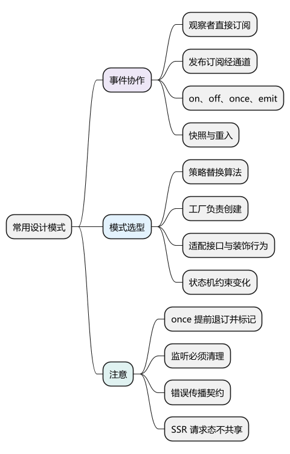
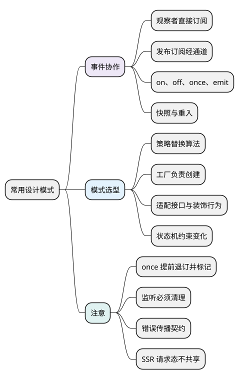

# 常用设计模式

<!-- core-mindmap:start -->
[](examples/c25-mindmap.svg)

<details>
<summary>PlantUML 源码</summary>



</details>

<!-- core-mindmap:end -->

设计模式描述反复出现的协作方式。选择时先说明“哪部分会变化、谁需要知道谁”，再决定是否值得增加一层抽象。本篇以观察者、发布订阅和事件生命周期为主，其余模式按实际变化点理解。

示例可分别在现代浏览器或 Node.js 中运行；本篇的 Emitter 是教学实现，通知语义会在代码前明确说明。

<a id="k01"></a>

## 观察者与发布订阅怎样连接双方

**口述：** 观察者通常让被观察对象直接维护订阅者，状态变化时通知它们；发布订阅通常通过事件通道连接发布者和订阅者。两者主要区别是依赖关系，不是谁一定同步或异步。

假设页面上的价格面板需要知道购物车变化：

- 直接调用：购物车自己调用 pricePanel.update，明确知道价格面板。
- 观察者：价格面板向购物车登记回调，购物车改变后通知所有观察者。
- 发布订阅：购物车向通道发布 cart:changed，面板订阅同一主题，双方只依赖通道契约。

依赖减少不等于契约消失。发布者和订阅者仍必须同意主题名称、数据格式、何时通知和何时退订。

### 一个最小观察者例子

<!-- example: patterns-observer -->
```js
class Price {
  #value = 0;
  #listeners = new Set();

  subscribe(listener) {
    this.#listeners.add(listener);
    return () => this.#listeners.delete(listener);
  }
  set(value) {
    if (Object.is(value, this.#value)) return;
    this.#value = value;
    for (const listener of [...this.#listeners]) listener(value);
  }
}

const price = new Price();
const stop = price.subscribe(value => console.log(value));
price.set(12); // 12
price.set(12); // 不重复通知
stop();
price.set(20); // 无输出
```

Price 既保存状态，又保存观察者；回调直接订阅这个对象。取快照是为了让通知过程中新增回调不混进本轮，具体移除语义仍要单独约定。

如果换成独立 bus，业务对象只发布消息，bus 负责保存订阅。这便于跨模块通知，但追踪一次变化影响谁，往往需要搜索主题和载荷，而不再是一条直接调用路径。

因此，局部父子组件交互优先考虑明确的参数和事件；多个独立模块确实需要解耦通知时，再引入事件通道。

<a id="k02"></a>

## 实现事件通道时，先定义通知契约

**口述：** on 保存监听，off 移除监听，emit 调用监听，once 最多调用一次。难点不只是这四个名字，而是通知过程中再次通知、增删监听和抛错时，系统如何保持承诺。

本例采用以下约定：

- on 对同一主题中的同一个函数引用去重，并返回退订函数。
- emit 同步按注册顺序处理开始时的快照；本轮新注册的监听等下轮。
- 本轮快照中的普通监听即使后来被移除，仍会完成本轮调用。
- once 的每次注册是独立订阅，通过返回的退订函数取消。
- 同步监听抛错会立即中断本轮，并把错误交给 emit 调用方。
- 不等待异步监听，不提供错误隔离和并发控制。

### 为什么 once 要在回调前退订

“重入”是当前处理尚未结束，又再次进入同一逻辑。例如监听函数内部调用 emit，这在单线程同步代码中也会发生。

如果 once 在回调执行之后才删除自己，回调里的 emit 会再次找到它，违背只执行一次的承诺。

仅提前删除还不够：外层 emit 可能已经把 once 放进快照，内层通知先执行了它，回到外层时旧快照还保留同一个包装函数。因此还要用 fired 标记阻止旧快照再次执行。

<!-- example: patterns-emitter -->
```js
class Emitter {
  constructor() {
    this.events = new Map();
  }
  on(type, listener) {
    if (typeof listener !== 'function') {
      throw new TypeError('listener must be a function');
    }
    let set = this.events.get(type);
    if (!set) this.events.set(type, set = new Set());
    set.add(listener);
    return () => this.off(type, listener);
  }
  off(type, listener) {
    const set = this.events.get(type);
    if (!set) return;
    set.delete(listener);
    if (set.size === 0) this.events.delete(type);
  }
  once(type, listener) {
    if (typeof listener !== 'function') {
      throw new TypeError('listener must be a function');
    }
    let fired = false;
    const wrapped = (...args) => {
      if (fired) return;
      fired = true;
      this.off(type, wrapped);
      listener(...args);
    };
    return this.on(type, wrapped);
  }
  emit(type, ...args) {
    const snapshot = [...(this.events.get(type) ?? [])];
    for (const listener of snapshot) listener(...args);
  }
}

const bus = new Emitter();
let nested = false;
let count = 0;
bus.on('tick', () => {
  if (!nested) {
    nested = true;
    bus.emit('tick');
  }
});
bus.once('tick', () => {
  count += 1;
});
bus.emit('tick');
console.log(count); // 1

const output = [];
const stop = bus.on('message', value => output.push(value));
bus.emit('message', 'A');
stop();
stop();
bus.emit('message', 'B');
console.log(output.join(',')); // A
```

这段 tick 例子故意让普通监听先引起内层 emit：

1. 外层快照包含普通监听和 once 包装函数。
2. 普通监听触发内层 emit，内层先执行 once，设置 fired 并退订。
3. 回到外层，旧快照仍有 once 包装函数，但 fired 让它直接返回。
4. 最终 count 只增加一次。

如果 once 自己的回调再次 emit，也会因提前退订而只执行一次。即使回调抛错，它已经被标为执行过，不会在下次通知时重试。

### on、off、once 怎样使用

on(type, listener) 和 once(type, listener) 都返回退订函数，调用它不需要记住内部包装函数。off(type, listener) 按实际注册的函数引用移除普通监听；不能重新写一个外观相同的箭头函数来代替原引用。

本例 once 使用内部 wrapped，因此要用 once 的返回值取消，而不是把原始回调传给 off。重复调用退订函数不会报错。

采用 Set 去重还意味着：多次 on 同一函数不会创建独立订阅，任何一个对应退订函数都会移除该监听。若需要每次注册分别取消，应改为独立订阅记录，并明确新的语义。

## 监听生命周期与错误怎样收口

**口述：** 谁注册监听，谁就应明确何时退订。事件通道一旦长于页面或组件寿命，未移除的回调就可能继续持有已经不再需要的对象。

回调常通过闭包访问组件状态或 DOM。只把组件变量赋为 null，并不能清除 bus → listener → 组件数据这条访问路径。

实际使用时可以把 on 返回的 stop 保存到组件生命周期、页面卸载或服务 dispose 中；同一个清理函数还可以一并取消 timer、订阅和未完成请求。

全局 bus 不是不能使用，而是存活范围扩大后需要更明确的主题命名、载荷类型和清理责任。能够使用页面内局部通道时，不必默认让所有事件跨页面共享。

### 错误是传播还是隔离

本例某个监听抛错后，后续监听不会运行。这适合需要调用方立即感知失败的简单同步流程。

如果业务要求所有监听都尝试执行，需要逐个捕获并汇总错误；如果允许异步监听，还要定义是否等待、按序还是并行，以及 Promise 拒绝交给谁处理。不要无条件 catch 后忽略，否则调用方会误以为通知已经完成。

验证事件实现时，至少覆盖这些行为：

- 同主题重复注册与重复退订。
- once 自己触发 emit，以及前面的监听先触发嵌套 emit。
- 本轮新增、移除监听是否符合快照约定。
- 一个监听抛错后，后续监听是否执行。
- 页面结束后，业务状态是否还被回调持有或继续更新。

<a id="k03"></a>

## 策略、工厂、适配器与装饰怎样选择

**口述：** 这些模式分别处理算法替换、对象创建、接口转换和附加行为。先找变化点，才能知道抽象应放在哪里。

### 算法会替换：策略

同一个目标有多种算法，且它们需要独立扩展和测试时，可以把算法作为函数选择或注入。

<!-- example: patterns-strategy -->
```js
const shipping = {
  normal: weight => weight * 2,
  express: weight => weight * 4
};

function quote(type, weight) {
  if (!Object.hasOwn(shipping, type)) {
    throw new TypeError('unknown shipping type');
  }
  if (!Number.isFinite(weight) || weight < 0) {
    throw new TypeError('invalid weight');
  }
  return shipping[type](weight);
}

console.log(quote('normal', 3)); // 6
console.log(quote('express', 3)); // 12
```

选择逻辑和计算逻辑被分开，新策略不用修改已有算法。若只有两个稳定且很短的分支，if 可能更清楚；把 if 换成对象本身不是设计收益，降低后续变化成本才是。

### 创建过程会变化：工厂

根据配置创建本地缓存、HTTP 客户端或测试替身，可以集中到 createStorage 之类的工厂函数。调用方依赖统一接口，不必重复理解每种对象的初始化步骤。

工厂负责创建，不应顺便吞掉权限、取消和错误语义。只有一个简单构造器时，直接 new 通常就足够。

### 现有接口不同：适配器

接入两个请求库时，一个失败返回状态对象，另一个抛异常。适配器可以把它们转换成项目约定的接口，减少上层差异。

转换时要保留实际需要的状态码、取消原因和重试信息；统一名字却丢掉关键能力，只是把差异藏得更深。

### 保持接口并附加行为：装饰

在请求函数外包一层计时、日志或缓存，并保持调用形式，就是常见装饰思路。包装函数要保留 this、参数、返回值和异常传播；加了缓存还要定义键、失效与容量。

适配器改变接口以便兼容，装饰通常保留接口并增加行为。两者都可以用普通函数完成，不必为了模式名创建一组类。

<a id="k04"></a>

## 单例、组合与状态机的适用边界

**口述：** 共享对象解决复用，组合解决协作，状态机解决合法变化。它们约束的是不同问题，不能用一个模式名替代所有状态设计。

### 模块单例的共享范围

模块导出的共享对象通常能在同一模块实例的消费者之间复用，但不会天然跨 Worker、iframe、进程或打包副本唯一。

SSR 服务端可能让同一个模块跨请求存活。把“当前用户 token”放到共享模块变量中，两个并行请求就可能互相覆盖。连接池和只读配置可以共享，用户上下文通常应按请求创建并明确传递。

### 组合与继承的选择

需要几个对象协作时，显式传入 storage、logger、transport 等接口通常就够了。继承更适合稳定的类型替换关系，而不是“我想用父类的两个方法”。

组合也要设计职责边界；把所有依赖都塞入一个万能 service 对象，同样会使接口难理解。

### 状态机约束合法变化

多个布尔值可能出现 loading 和 success 同时为 true。用一个互斥状态，再定义允许的变化，可以减少这种矛盾组合。

<!-- example: patterns-state-machine -->
```js
const allowed = {
  idle: ['loading'],
  loading: ['success', 'error', 'cancelled'],
  success: ['loading'],
  error: ['loading'],
  cancelled: ['loading']
};

function transition(state, next) {
  if (!Object.hasOwn(allowed, state) || !allowed[state].includes(next)) {
    throw new Error('illegal transition');
  }
  return next;
}

console.log(transition('idle', 'loading')); // loading
console.log(transition('loading', 'success')); // success
try {
  transition('success', 'idle');
} catch (error) {
  console.log(error.message); // illegal transition
}
```

这个函数只验证状态变化，不知道响应属于哪个请求。真实请求还需 requestId 或版本判断，防止旧请求的成功事件覆盖新请求状态。

<a id="summary"></a>

模式的价值应落到具体结果：减少直接依赖、方便替换某种实现、统一已有接口，或阻止非法状态。新增抽象也会增加阅读成本；先写清问题和契约，再决定是否需要它。

<a id="interview"></a>

## 试题与答案

<a id="c25-01"></a>

### C25-01 [P1·原理] 观察者和发布订阅的差异是什么？

**回答：** 观察者通常直接订阅被观察对象，由它维护并通知；发布订阅通常经独立事件通道按主题连接双方。区别是依赖关系，不是同步或异步。两者都需要定义载荷、通知顺序、错误和退订，事件通道还可能让依赖变得隐式。

<a id="c25-02"></a>

### C25-02 [P1·编码] 实现on、off、once、emit并处理once重入。

**回答：** 见正文 Emitter：on 保存监听并返回退订函数，off 按引用删除，emit 遍历快照。once 在调用前退订并设置 fired；退订阻止后续通知再次获取它，fired 阻止嵌套通知执行后，外层旧快照又执行一次。两层保护都要解释。

<a id="c25-03"></a>

### C25-03 [P1·工程取舍] 什么时候用策略或适配器，什么时候保留if？

**回答：** 多种算法持续变化且需要独立替换时用策略；既有接口不同而上层需要统一约定时用适配器。简单稳定分支可以保留 if。选择时说明减少了哪类修改，并确认转换没有丢掉取消、错误等关键语义。

<a id="c25-04"></a>

### C25-04 [P1·工程取舍] 模块单例在SSR中为什么危险？

**回答：** 服务端模块可能跨请求共享，把用户状态保存在模块变量会让并发请求互相读写。共享连接池和配置与用户请求态应分开，后者按请求创建并传递。模块单例也不代表跨进程或所有运行环境唯一。

<a id="c25-05"></a>

### C25-05 [P1·原理] 状态机比几个Boolean好在哪里？

**回答：** 状态机显式描述互斥状态及允许的转换，减少多个布尔值的矛盾组合。它只解决状态变化规则，还要检查事件属于哪个请求、是否过期，才能避免旧异步结果覆盖新状态。

参考：[MDN：JavaScript 指南](https://developer.mozilla.org/zh-CN/docs/Web/JavaScript/Guide)、[Node.js：Events](https://nodejs.org/api/events.html)。
