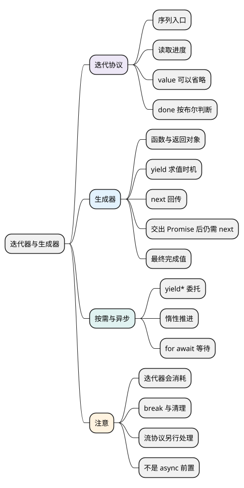

# 迭代器与生成器

<!-- core-mindmap:start -->
[](examples/c26-mindmap.svg)

<details>
<summary>PlantUML 源码</summary>



</details>

<!-- core-mindmap:end -->

**口述总览：** 一组数据不一定要一次全部取完。迭代器记住读到哪里，让调用者通过 next 请求下一项；可迭代对象提供取得迭代器的入口。生成器函数用 yield 描述暂停位置，简化这种按需读取的实现；下一项需要等待时，再使用异步迭代。

这是选读专题：用来解释 for...of、惰性序列和逐项读取异步数据。理解 Promise 与 async/await 不需要先掌握 Generator；它们可以先按异步函数自身的规则学习。

本篇先区分“提供序列的入口”和“保存读取进度的对象”，再看生成器函数如何简化这种对象的实现。各例可独立在现代浏览器或 Node.js 中运行。

<a id="k01"></a>

## 可迭代对象与迭代器分别负责什么

**口述：** 可迭代对象提供获取迭代器的入口；迭代器保存进度，并用 next 返回本次结果。for...of 会取得迭代器，反复调用 next，直到结果中的 done 被判断为真。

两个英文词分别对应两项协议：

- 可迭代对象 iterable：提供 [Symbol.iterator]() 方法，调用后返回迭代器。
- 迭代器 iterator：提供 next() 方法，每次返回一个对象；这个结果对象常称为 IteratorResult。
- value 表示本次交付的值，可以省略，读取时得到 undefined。
- done 表示是否完成，可以省略；读取后按布尔值判断，省略时的 undefined 按 false 处理。

因此，返回 { value: 'A' } 会交付 A 并继续；返回 {} 也合法，会交付 undefined 并继续；返回 { done: true } 则表示结束。关键要求是 next 必须返回对象，不能直接返回一个数字或 undefined。

数组通常是可迭代对象。数组的 values() 可以直接返回一个遍历元素的迭代器。

<!-- example: iterator-progress -->
```js
const values = ['A', 'B'];
const iterator = values.values();

console.log(JSON.stringify(iterator.next())); // {"value":"A","done":false}
console.log(JSON.stringify([...iterator])); // ["B"]
console.log(JSON.stringify([...iterator])); // []
console.log(JSON.stringify([...values])); // ["A","B"]
```

第一次 next 消费 A；展开同一个 iterator 时，从当前位置继续，所以只有 B。再次展开，它已经结束。展开数组则重新从数组取得一个新迭代器，因此仍得到 A 和 B。

这说明“数据还在”与“这个迭代器还有没有剩余项”不同。不要把已经消费的迭代器当成可重复读取的数组。

### 一个可以重新开始的自定义序列

<!-- example: iterator-custom-range -->
```js
const range = {
  start: 1,
  end: 3,
  [Symbol.iterator]() {
    let current = this.start;
    const end = this.end;
    return {
      next() {
        if (current > end) return { done: true };
        return { value: current++ };
      }
    };
  }
};

console.log([...range].join(',')); // 1,2,3
console.log([...range].join(',')); // 1,2,3
```

current 位于每次调用 [Symbol.iterator]() 产生的闭包中，所以两次遍历各有进度。若把 current 放在 range 上，两次遍历就可能互相影响。

产出数字时省略了 done，所以按 false 处理；结束时省略了 value，所以读取到的是 undefined。这两处都符合迭代协议，并不要求每次同时写出两个字段。

这里返回的对象只实现迭代器协议，已经足够让 for...of 使用；迭代器不一定也必须可迭代。数组迭代器和生成器对象则同时实现两种协议。

**注意：** 普通对象默认没有同步迭代入口；有 length 和数字属性的类数组也不一定可迭代。数组展开 [...value] 消费迭代协议，对象展开 {...value} 复制可枚举自有属性，它们不是同一种操作。

<a id="k02"></a>

## 生成器函数怎样交出一个能暂停的迭代器

**口述：** 使用 function* 定义的是生成器函数；调用它得到的是生成器对象。函数负责描述执行过程，对象保存这一次执行的进度。对对象调用 next，才让函数体开始或继续运行；yield 交出一个值并暂停。

先只看向外交付两个值，不传入参数：

<!-- example: generator-two-yields -->
```js
function* letters() {
  yield 'A';
  yield 'B';
}

const iterator = letters();
console.log(JSON.stringify(iterator.next())); // {"value":"A","done":false}
console.log(JSON.stringify(iterator.next())); // {"value":"B","done":false}
console.log(JSON.stringify(iterator.next())); // {"done":true}
```

letters 是函数，iterator 是调用结果，next 属于后者。第一次 next 运行到第一个 yield，第二次继续到第二个 yield，第三次到达函数末尾并结束。最后的 value 是 undefined，JSON.stringify 会省略这个字段，所以输出只看到 done。

普通函数运行到 return 就结束；生成器函数可以在结束前多次交出值，不必一次算完全部结果，也不必手工记录“下一步执行到哪里”。重新调用 letters() 会取得另一次执行对应的新对象。

### next 的参数怎样送回暂停位置

yield 不只向外交出值，它作为表达式也可以在恢复时接收一个值。先有暂停点，再讨论下一次 next 的参数：

<!-- example: generator-resume -->
```js
function* calculate() {
  const input = yield 'ready';
  return input * 2;
}

const iterator = calculate();
console.log(JSON.stringify(iterator.next(99)));
// {"value":"ready","done":false}
console.log(JSON.stringify(iterator.next(5)));
// {"value":10,"done":true}
console.log(JSON.stringify(iterator.next()));
// {"done":true}
```

逐步看三个时刻：

1. calculate() 只创建对象，函数体尚未运行。
2. 第一次 next 运行到 yield 'ready'，向外交出 ready 并停住。
3. 第二次 next(5) 把 5 作为上一个 yield 表达式的结果，所以 input 是 5，最终 return 10。

第一次 next(99) 没有“上一个暂停的 yield”可以接收参数，因此 99 被忽略。next 的参数不是要替换这次输出的值，而是送回函数内部、让上一次暂停继续。

完成后再次 next，不会重新执行函数，仍然得到 done 为 true、value 为 undefined 的结果。

### 代码什么时候开始，Promise 又由谁等待

yield 后面的表达式也不会提前求值。只有 next 把执行推进到对应的 yield，程序才计算要交出的值；如果交出的是 Promise，普通生成器也不会替调用者等待它。

<!-- example: generator-evaluation-and-promise -->
```js
const events = [];
function makeValue() {
  events.push('evaluate');
  return Promise.resolve(7);
}
function* steps() {
  events.push('start');
  yield 'pause';
  const value = yield makeValue();
  events.push('resume ' + value);
}

const iterator = steps();
console.log(events.length); // 0
console.log(iterator.next().value); // pause
console.log(events.join(',')); // start
const result = iterator.next();
console.log(events.join(',')); // start,evaluate
console.log(result.value instanceof Promise, result.done); // true false
result.value.then(value => {
  console.log(events.join(',')); // start,evaluate
  iterator.next(value);
  console.log(events.join(',')); // start,evaluate,resume 7
});
```

调用 steps 只拿到生成器对象，没有执行函数体，所以事件数是 0。第一次 next 才记录 start，并停在第一个 yield；此时还没有调用 makeValue。第二次 next 执行到 yield makeValue()，才计算表达式并交出 Promise 对象。

Promise 兑现后，事件仍只有 start、evaluate；生成器不会自动继续。这里由外部 then 回调等待结果，再显式调用 iterator.next(value)，才把 7 送回暂停位置并执行后面的语句。**这是普通 function* 生成器，不能把它当成 await 或后面介绍的 async function*。**

### yield 的值与 return 的值不同

<!-- example: generator-final-value -->
```js
function* values() {
  yield 1;
  yield 2;
  return 99;
}

console.log([...values()].join(',')); // 1,2
```

for...of 和展开收集的是 done 按 false 判断时交付的元素。return 99 对应完成结果，不会自动成为第三个元素。

生成器对象同时实现迭代器与可迭代协议，因此既能手动 next，也能交给 for...of。生成器函数本身与它返回的对象不能混用，例如 values 是函数，values() 才是这里可遍历的对象。

<a id="k03"></a>

## 委托、惰性与提前结束

**口述：** yield* 把一段迭代交给另一个序列；惰性表示按需推进；提前退出则要关注迭代器是否被关闭。三者都围绕“谁要求下一项、何时不再需要”展开。

### 委托子序列：yield*

<!-- example: generator-delegate -->
```js
function* child() {
  yield 'A';
  return 'done';
}
function* parent() {
  const result = yield* child();
  yield result;
}

console.log([...parent()].join(',')); // A,done
```

yield* 先把 child 产出的 A 交给外部。child 完成后，最终返回值 done 成为 yield* 表达式的结果。父生成器再显式 yield result，所以 done 这次才成为可遍历元素。

它不是“把 return 自动算作元素”，而是父生成器决定再交出这个值。

### 提前退出与 finally

<!-- example: generator-close -->
```js
function* sequence() {
  try {
    yield 1;
    yield 2;
  } finally {
    console.log('closed');
  }
}

for (const value of sequence()) {
  console.log(value); // 1
  break;
}
// closed
```

for...of 执行 break 时，会尝试调用迭代器的 return 方法。Generator 的 return 请求结束执行，于是进入 finally，完成清理。

如果只手动调用一次 next，随后丢弃迭代器，语言不会保证自动调用 return。也不能笼统认为“任何异常都一定关闭”：循环体抛错与迭代器 next 自身抛错是不同路径。

手动 iterator.throw(error) 会在暂停点注入异常，内部 try/catch 可以处理；iterator.return(value) 请求提前返回。若 finally 自己又 yield，return 不一定立即返回 done: true，清理代码最好保持简单且可预测。

### 惰性不等于没有成本

生成器可以描述很大的序列，甚至无限序列，因为每次只推进一部分。但把它全部展开、Array.from 或完整遍历，仍要付出全部计算和存储成本；无限序列不能这样耗尽。

如果只需要过滤一个小数组，普通数组方法通常更清楚。只有确实需要逐项计算、提前停止或减少中间数组时，惰性才有实际收益。

<a id="k04"></a>

## 异步迭代怎样逐项等待

**口述：** 同步迭代器直接交付下一项，异步迭代器允许下一项稍后才准备好。for await...of 逐项等待异步迭代结果，适合分批获取的数据；它不自动实现并发、取消或流协议。

异步可迭代对象提供 [Symbol.asyncIterator]()。异步迭代器的 next() 通常返回一个 Promise，兑现后得到 { value, done }。

async function* 是方便实现这种协议的语法：函数内部可以 await 等待，再 yield 交付一项。

<!-- example: iterator-async -->
```js
async function* pages() {
  yield await Promise.resolve('page-1');
  yield await Promise.resolve('page-2');
}

async function main() {
  const result = [];
  for await (const page of pages()) {
    result.push(page);
  }
  console.log(result.join(',')); // page-1,page-2
}
main().catch(console.error);
```

本例用 async 函数包住 for await，因此不依赖顶层 await。只有收到第一项并完成循环体后，循环才继续要求下一项。

for await 也能适配同步 iterable。不过，逐项等待不等于底层任务一定逐个启动：如果传入的 Promise 早已创建，请求可能已经同时运行。需要并发上限时，要另外设计任务启动策略。

for await 统一的是“怎样等待下一项”，不会把传输分段 chunk 自动变成完整业务消息。消息解码与分帧、取消和资源释放、重连及消费积压属于流接口的具体设计，集中见[流式响应与 SSE](03_流式响应与SSE.md)。本篇只需要先明确：迭代器每次交付的究竟是字节块、文本还是已经解析好的事件。

<a id="summary"></a>

## 怎样选择与验证

**口述：** 先判断数据是否已经完整、是否需要按需计算、下一项是否需要等待，再选择数组、同步迭代或异步迭代。不要为了使用 Generator 而增加一套不必要的状态流程。

已完成的小集合适合数组方法；按需生成或遍历结构适合迭代器；边获取边消费的数据适合异步迭代。Generator 只是实现迭代器的一种便利方式，普通对象同样能实现协议。

较新运行时提供 Iterator.from、map、filter、take、toArray 等迭代器辅助方法。它们可以组合惰性处理，但需要核对兼容性，也不能把同步 Iterator 辅助方法直接视为异步工具。

验证时至少看初次 next、连续 next、完成后的 next，以及提前 break 是否清理。带资源的迭代还要检查异常和取消路径，不能只看正常遍历结果。

<a id="interview"></a>

## 试题与答案

<a id="c26-01"></a>

### C26-01 [P1·基础] iterable、iterator、generator是什么关系？

**回答：** iterable 提供获得 iterator 的入口，iterator 用 next 保存并推进读取进度。生成器函数使用 function* 描述执行过程，调用后返回的生成器对象同时满足这两种协议，next 与 yield 配合实现暂停和恢复。可迭代对象可以每次产生新进度，同一个迭代器则通常从当前位置继续。

<a id="c26-02"></a>

### C26-02 [P1·原理] next(5)的5传到哪里？

**回答：** 首次 next 没有已暂停的 yield 接收参数，因此参数被忽略。后续 next(5) 把 5 送回上一次 yield，作为那个表达式的结果。const input = yield 'ready' 中，ready 是向外输出，下一次传入的 5 才赋给 input。

<a id="c26-03"></a>

### C26-03 [P1·原理] 生成器return值会出现在展开数组中吗？

**回答：** 不会自动出现。展开和 for...of 收集 done 按 false 判断时交付的元素，return 对应最终完成值。yield* 可以取得被委托生成器的最终返回值，父生成器若再显式 yield 它，它才会成为元素。

<a id="c26-04"></a>

### C26-04 [P1·工程取舍] for await适合流式接口，但解决了哪些问题？

**回答：** 它统一逐项等待和消费流程，可以配合 finally 管理资源。消息分帧、解码、重连、取消、并发与积压处理仍要额外设计；网络 chunk 也不保证是一条业务消息。应先明确迭代器每次交付什么，再决定消费逻辑。

参考：[MDN：迭代器与生成器](https://developer.mozilla.org/zh-CN/docs/Web/JavaScript/Guide/Iterators_and_generators)。
