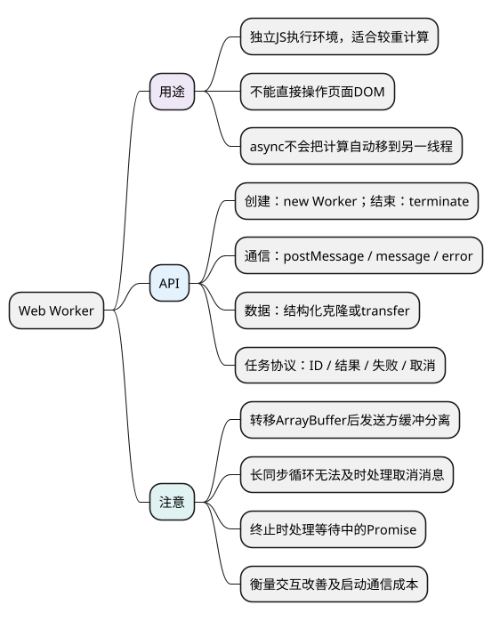

# Web Worker

<!-- core-mindmap:start -->

PlantUML 源码

<!-- core-mindmap:end -->

**口述总览：** Web Worker 让计算在独立的 JavaScript 执行环境中运行，页面通过消息与它通信。它适合可以脱离 DOM 的较重任务；启动、传输和结果处理也有成本，所以要结合实际卡顿原因决定是否使用。

## 基本用途：让页面线程有机会响应交互

页面线程既执行 JavaScript，也参与页面更新。如果长时间连续计算，点击和绘制就可能被推迟。

Worker 可以承担解析、统计、搜索等计算，页面线程负责展示结果。它有自己的全局环境，不能直接读取主页面局部变量，也不能直接操作页面 DOM。

~~~text
页面：接收交互 → 发送任务 ─────────→ 收到结果 → 更新 DOM
Worker：                收到消息 → 执行计算 → 发送结果
~~~

把函数加上 async 不会自动把 CPU 计算移到 Worker；await 主要改变等待和恢复方式。使用 Worker 也不会保证总耗时变短，主要目标可能是降低主线程阻塞。

下面讨论浏览器中的专用 Worker，需要通过 HTTP/HTTPS 页面运行；Node.js 使用的是另一套 worker_threads API。

## 创建与结束：new Worker()、terminate()

- new Worker(url, { type: 'module' })：从模块脚本创建 Worker，可在 Worker 文件中使用 import。
- worker.terminate()：从页面立即终止 Worker。
- Worker 内部可以调用 self.close() 结束自身的后续工作。
- Worker 文件地址需要满足同源、CSP 等浏览器加载规则；不要把本地 file 地址当作标准部署方式。

页面脚本是 ES 模块时，常用 new URL('./worker.js', import.meta.url) 表达文件位置。构建工具是否识别并生成独立产物，应查看实际构建结果。

## 发送与接收：postMessage()、message、error

**口述：** postMessage 发送数据，message 监听器接收数据。消息采用异步通信，不会把对方函数的返回值直接交给调用者。

下面是一个完整的两文件小例子：计算数组之和，结果返回后释放 Worker。

**文件 sum-worker.js：**

<!-- example: c23-worker-source -->
~~~js
self.addEventListener('message', event => {
  const values = event.data;
  if (!Array.isArray(values) ||
      !values.every(value => typeof value === 'number' &&
        Number.isFinite(value))) {
    self.postMessage({ ok: false, message: '需要有限数值数组' });
    return;
  }

  const sum = values.reduce((total, value) => total + value, 0);
  self.postMessage({ ok: true, sum });
});
~~~

**文件 main.js，以模块脚本加载：**

<!-- example: c23-worker-main -->
~~~js
const worker = new Worker(new URL('./sum-worker.js', import.meta.url), {
  type: 'module'
});

worker.addEventListener('message', event => {
  if (event.data.ok) {
    console.log(event.data.sum); // 6
  } else {
    console.error(event.data.message);
  }
  worker.terminate();
}, { once: true });

worker.addEventListener('error', event => {
  console.error(event.message);
  worker.terminate();
}, { once: true });

worker.postMessage([1, 2, 3]);
~~~

页面用 script type="module" 引入 main.js 即可。这个小数组只用于说明通信，不代表它适合为了性能专门创建 Worker。

**注意：** Worker 的 postMessage 返回 undefined。希望调用方 await 结果，需要自己用 Promise 包装，并处理成功、错误、超时与终止；不要留下永远无法结算的 Promise。

## 复制与转移：结构化克隆、transfer

普通消息通常通过结构化克隆传递。接收方获得自己的数据结构；函数、DOM 节点等不能直接作为普通消息复制。

ArrayBuffer 等可转移资源可以交出所有权，减少复制大块数据的成本。转移后，发送方原来的 ArrayBuffer 会被分离，不能继续按原数据使用。

下面用 structuredClone 演示同一类转移规则，在支持该 API 的环境中可独立运行：

<!-- example: c23-transfer -->
~~~js
const buffer = new ArrayBuffer(4);
new Uint8Array(buffer)[0] = 7;

const received = structuredClone(buffer, { transfer: [buffer] });
console.log(buffer.byteLength); // 0
console.log(received.byteLength); // 4
console.log(new Uint8Array(received)[0]); // 7
~~~

Worker 中的相应写法是 worker.postMessage({ buffer }, [buffer])。要让接收方使用资源，资源也应出现在消息中，不能只列入 transfer 数组。

**注意：** 转移不等于两边共享同一块可读写缓冲。SharedArrayBuffer 才涉及共享内存，它还有部署隔离和同步要求；多数业务先使用消息复制或转移即可。

## 取消与资源清理：任务终止也要处理结果归属

**口述：** 取消可以通过终止整个 Worker，或设计协作取消协议实现。页面还要忽略已经过时的消息，并让等待中的任务得到明确结局。

- 页面结束时调用 terminate，避免计算继续占用资源。
- 同一个 Worker 处理多任务时，消息带 taskId，把结果交给对应的调用方。
- 新任务取代旧任务时，检查 taskId 或版本，防止旧结果覆盖界面。
- Worker 出错或终止时，主动拒绝尚未完成的 Promise，并移除相应记录。
- 长计算若需要在 Worker 内响应“取消消息”，必须分块让出执行机会。连续同步循环没有结束时，消息监听器也无法及时执行。

只给计算加一个 AbortSignal 不会自动让 Worker 停止。要把取消行为传入自己的任务协议，或者在确认可丢弃整个执行环境时终止 Worker。

## 注意：先确认卡顿来自哪里

Worker 适合较重、可独立执行的计算。如果问题来自频繁 DOM 读写、布局或过量组件更新，应先处理对应工作。

比较方案时使用同一份数据，分别观察主线程长任务、交互延迟、总完成时间和内存；把 Worker 启动、数据传输和结果合并都算进去。一次任务可用单独 Worker，多次任务可以复用，但要管理队列与生命周期。

## 试题与答案

### C27-01 [P0·原理] async 函数能替代 Worker 执行重计算吗？

**回答：** 不能。async 函数中的同步计算仍在当前线程执行。Worker 提供独立执行环境，能把合适的计算移出页面线程，但通信和数据处理都有成本。

### C27-02 [P0·基础] Worker 可以直接修改 DOM 吗？

**回答：** 不可以。它通过 postMessage 返回结果，由页面线程更新 DOM；页面局部变量也不会自动出现在 Worker 中，需要通过消息或明确的共享机制传递数据。

### C27-03 [P1·原理] transfer 和普通消息复制有什么区别？

**回答：** 普通可克隆数据通常在接收方形成副本；transfer 转移可转移资源的所有权。例如 ArrayBuffer 转移后，发送方缓冲会被分离。它不等于共享内存。

### C27-04 [P1·工程取舍] 为什么发送取消消息后 Worker 仍可能继续计算？

**回答：** 如果 Worker 正在长时间同步循环，它还没有机会处理新消息。需要分块执行、按协议检查取消，或终止整个 Worker；页面还要处理迟到结果和等待中 Promise 的结束状态。

### C27-05 [P1·工程取舍] Worker一定提升性能吗？

**回答：** Worker 可以减少主线程被计算占用的时间，但启动、数据复制和通信也有成本。是否合适要结合数据量和实际测量；DOM 操作仍留在页面线程。
