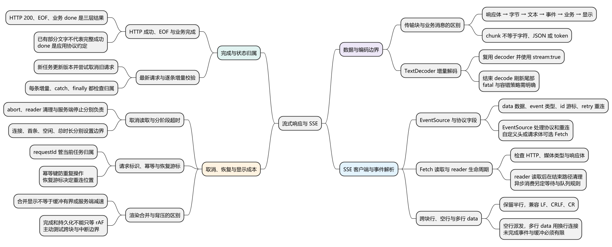
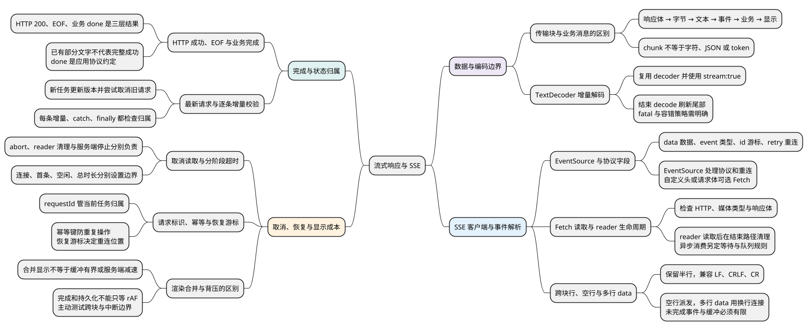

# 流式响应与 SSE

<!-- core-mindmap:start -->
[](examples/c28-mindmap.svg)

<details>
<summary>PlantUML 源码</summary>



</details>

<!-- core-mindmap:end -->

**口述总览：** 流式响应让客户端在服务端全部处理完成前，就能逐步收到和展示数据。它适合持续日志、进度事件和增量文本；代价是客户端必须管理尚未完成的数据、消息边界和中断状态。

**记忆线：** 字节解码 → 事件分帧 → 业务完成 → 状态归属 → 取消、恢复与显示成本。

本篇归纳 10 个知识点：[自查问题](#self-check) · [口述与答案](#interview)。先尝试回答，再用正文例子核对；文末完整列出每点回答与记忆提示，也可直接顺序阅读。

本篇先讲字节怎样变成事件，再讲完成、取消与渲染。普通 Fetch、AbortController 和最新请求控制器见[Fetch、请求取消与竞态](../05_模块化与浏览器实践/04_Fetch、请求取消与竞态.md)。

## 为什么流式需要一层层处理

**口述：** 一次普通 JSON 请求常在响应体读完后统一解析；流式请求在响应体还没结束时就消费部分数据。每次读取拿到的是传输片段，不保证是一条完整业务消息。

假设服务端依次写入“开始”“进度 50%”“完成”。客户端不一定恰好读取三次：网络和缓冲可能把它们合并，也可能把一条消息拆开。

```text
响应体 → 字节块 → 连续文本 → 完整事件 → 业务状态 → 页面显示
```

每一层只解决自己的边界：

- 字节解码：把 UTF-8 等编码转换为 JavaScript 字符串。
- 文本分帧：确定一条 SSE 事件或其他协议消息在哪里结束。
- 数据解析：把事件里的 JSON 转为对象并检查字段。
- 状态更新：确认事件属于当前请求，决定追加文本还是结束任务。
- 渲染：把状态变化呈现给用户。

所以一个 chunk 既不必等于一个字符，也不必等于一个事件、JSON 对象或模型 token。直接对每个 chunk 做 JSON.parse，是把传输边界误当成业务边界。

<a id="k02"></a>

## 字节跨块时，TextDecoder 怎样保留半个字符

**口述：** UTF-8 的一个字符可能跨多个字节，流读取可能把这些字节拆到不同块。持续复用同一个 TextDecoder，并用 stream: true 解码，才能保留暂时不完整的编码片段。

以下示例可在现代浏览器或 Node.js 中独立运行。

<!-- example: sse-decoder -->
```js
const bytes = new TextEncoder().encode('中');
const decoder = new TextDecoder('utf-8', { fatal: true });

console.log(bytes.length); // 3
console.log(JSON.stringify(decoder.decode(bytes.slice(0, 2), { stream: true })));
// ""
console.log(JSON.stringify(decoder.decode(bytes.slice(2), { stream: true })));
// "中"
console.log(JSON.stringify(decoder.decode())); // ""
```

第一块只有前两个字节，decoder 暂时保留它们；第二块补齐最后一个字节，才能输出“中”。结束时不传字节的 decode() 用来刷新最后残留的数据。

fatal: true 表示编码非法或最后仍有不完整编码时抛错；默认替换策略可能插入替换字符。选择取决于协议是否允许容错，不能在数据损坏后仍默默报告完整成功。

TextDecoder 只恢复连续文本，不认识 SSE 的 data 字段和空行。一条事件跨两个字符串片段时，仍需要下层分帧缓冲。

<a id="k03"></a>

## SSE 协议与浏览器 EventSource

**口述：** SSE 是一种服务端向客户端持续发送文本事件的格式。每个字段占一行，空行结束一个事件；EventSource 是浏览器内置的 SSE 客户端，帮我们完成连接、解析和符合规则的重连。

SSE 响应通常使用 text/event-stream，按 UTF-8 解码。常见字段包括：

- data：事件数据，多条 data 行以换行符连接。
- event：事件类型，省略时通常按 message 派发。
- id：用于事件标识和后续重连的 Last-Event-ID。
- retry：符合规定格式的重连等待时间。
- 冒号开头的行：注释，常用于心跳。

规范允许 LF、CRLF 和单独 CR 三种换行。换行符可能跨 chunk；空行是协议边界，网络块结束不是事件结束。

例如服务端发送 data: hello，接着 data: world，再发送空行，客户端得到的数据是 hello 换行 world。没有 data 的空块不作为普通数据消息派发。

### 使用原生 EventSource

下面是浏览器页面中的订阅函数。url 必须是实际可用的 SSE 接口；页面创建订阅，离开时调用返回的停止函数。

<!-- example: sse-eventsource -->
```js
function subscribeSse(url, onText) {
  const source = new EventSource(url);
  source.onmessage = event => onText(event.data);

  return function stop() {
    source.close();
  };
}
// 页面启动：subscribeSse('/api/updates', appendText)
// 页面卸载：调用保存的 stop()
```

onmessage 接收默认 message 事件。服务器若发送 event: progress，客户端应使用 addEventListener('progress', handler) 监听该类型。

连接失败时的 error 事件不一定表示业务永久失败：浏览器可能处于等待重连状态，也可能已关闭。结合 readyState、应用协议和界面需求处理；完成任务后应主动 close，避免把正常完成变成继续重连。

### 什么时候改用 Fetch 读取

原生 EventSource 通常使用 GET，构造选项可以配置 withCredentials，但不能像 Fetch 一样任意设置 Authorization 请求头或发送 POST JSON。

需要自定义请求体、请求头或更细的读取控制时，可以用 Fetch 消费 SSE 响应体。这时解析、取消、重连和恢复游标都需要自己处理或交给合适的库。

原生重连也不保证业务事件恰好执行一次。服务端如何使用事件 ID 恢复、客户端怎样去重，需要协议支持。

## Fetch 读取后，怎样识别完整 SSE 数据

**口述：** Fetch 的 reader 每次给出字节块；解码后必须继续积累文本行。读到空行时，才把这一组 data 行作为完整事件交付，不能读到一行就当整条消息结束。

下面的解析器只处理 SSE 的 data 载荷：支持 LF、CRLF、单独 CR、注释、多行 data 和跨块换行，忽略 event、id、retry。它不处理事件类型派发、重连或恢复，因此仍是有明确范围的教学子集。

输入是已由持续使用的 TextDecoder 解码的文本；UTF-8 BOM 处理由解码层负责。maxChars 限制未完成行和事件的 UTF-16 码元数量，不是字节上限。

<!-- example: sse-data-parser -->
```js
function createDataParser(onData, maxChars = 65536) {
  if (typeof onData !== 'function' ||
      !Number.isSafeInteger(maxChars) || maxChars < 1) {
    throw new TypeError('invalid parser options');
  }
  let line = '';
  let data = [];
  let size = 0;
  let skipLF = false;

  function consumeLine() {
    const current = line;
    line = '';
    if (current === '') {
      const payload = data.join('\n');
      const present = data.length > 0;
      data = [];
      size = 0;
      if (present) onData(payload);
      return;
    }
    if (current.startsWith(':')) return;
    const colon = current.indexOf(':');
    const field = colon < 0 ? current : current.slice(0, colon);
    let value = colon < 0 ? '' : current.slice(colon + 1);
    if (value.startsWith(' ')) value = value.slice(1);
    if (field === 'data') {
      size += value.length + 1;
      if (size > maxChars) throw new Error('event too large');
      data.push(value);
    }
  }

  return {
    push(text) {
      for (const char of text) {
        if (skipLF) {
          skipLF = false;
          if (char === '\n') continue;
        }
        if (char === '\r' || char === '\n') {
          consumeLine();
          skipLF = char === '\r';
        } else {
          line += char;
          if (line.length > maxChars) throw new Error('line too large');
        }
      }
    },
    finish() {
      line = '';
      data = [];
      size = 0;
      skipLF = false;
    }
  };
}

const output = [];
const parser = createDataParser(value => output.push(value));
parser.push('data: hello\r');
parser.push('\ndata: world\r\n\r');
parser.push('\ndata: next\r\r');
parser.finish();
console.log(JSON.stringify(output)); // ["hello\nworld","next"]
```

第一块结束在 CR；解析器已经结束这一行，并记住下一块若以 LF 开头，要把它作为同一个 CRLF 的后半部分跳过。

两条 data 行都只加入当前事件；遇到空行才派发 hello 换行 world。后面的两个 CR 分别结束 data 行和空行，因此 next 也被派发。

finish 不会把尚未以空行结束的 data 强行派发。流结束前缺少事件边界时，应丢弃未完成事件，再由业务层判断是否缺少完成消息。

生产项目若需要完整 SSE 行为，应采用经过协议测试的实现，并验证库的支持范围与资源限制；不能把本例忽略的字段当成规范不存在。

<a id="k04"></a>

## HTTP 成功、流结束与业务完成为什么不同

**口述：** HTTP 200 表示拿到了成功响应；EOF 表示字节流结束；业务 done 表示应用确认工作完成。对于要求完成事件的协议，只有收到合法 done 才能报告成功。

下面约定每个 SSE data 都是 JSON：delta 带 text，done 表示完成，error 带 message。这是本例的应用协议，不是 SSE 规定必须有这些类型。

代码依赖上一例的 createDataParser。可将两段代码保存在同一个 .mjs 文件中，用现代 Node.js 运行；演示使用内存 Response，无需外部服务。

<!-- example: sse-consumer -->
```js
async function consumeSse(response, onDelta) {
  if (!response.ok) throw new Error('HTTP ' + response.status);
  const mediaType = response.headers.get('content-type')?.split(';')[0].trim();
  if (mediaType?.toLowerCase() !== 'text/event-stream' || !response.body) {
    throw new Error('expected SSE');
  }
  const reader = response.body.getReader();
  const decoder = new TextDecoder('utf-8', { fatal: true });
  let completed = false;
  const parser = createDataParser(payload => {
    if (completed) return;
    const event = JSON.parse(payload);
    if (event === null || typeof event !== 'object' || Array.isArray(event)) {
      throw new Error('invalid event');
    }
    if (event.type === 'delta' && typeof event.text === 'string') {
      onDelta(event.text);
    } else if (event.type === 'done') {
      completed = true;
    } else if (event.type === 'error' && typeof event.message === 'string') {
      throw new Error(event.message);
    } else {
      throw new Error('invalid event schema');
    }
  });

  try {
    while (!completed) {
      const { value, done } = await reader.read();
      if (done) {
        parser.push(decoder.decode());
        break;
      }
      parser.push(decoder.decode(value, { stream: true }));
    }
    parser.finish();
    if (!completed) throw new Error('stream ended before done');
  } finally {
    try {
      await reader.cancel();
    } catch {
      // 本例约定清理失败不覆盖先前业务错误。
    }
    reader.releaseLock();
  }
}

const response = new Response(
  'data: {"type":"delta","text":"你好"}\n\n' +
  'data: {"type":"done"}\n\n',
  { headers: { 'Content-Type': 'text/event-stream' } }
);
const pieces = [];
await consumeSse(response, text => pieces.push(text));
console.log(pieces.join('')); // 你好
```

推导消费过程：检查 HTTP 与响应格式 → 取得 reader → 增量解码 → 空行完成事件 → 解析并检查 JSON → 交付 delta 或记录 done → 取消剩余读取并释放锁。

本例收到 done 后停止，不等待服务端继续保持的连接。onDelta 约定同步处理；如果需要异步业务消费，必须另外设计等待和队列语义，不能忽略回调返回的 Promise。

如果删除演示中的 done 事件，正文虽然已展示“你好”，最终仍会抛出 stream ended before done。界面可以保留部分结果并提示中断，不能把“已经看到文字”当作完整成功。

网络中断、非法 UTF-8、非法 JSON、字段不合规和服务端 error 都是不同失败层次。日志应带请求或任务标识，保留这些区别，才能定位发生在哪一步。

<a id="k01"></a>
<a id="k05"></a>

## 取消、版本检查与渲染怎样配合

**口述：** 取消减少无用工作，版本检查保护状态归属，渲染合并控制视觉更新频率。它们分别解决资源、正确性和显示成本，缺少其中一个，另外两个不能自动补齐。

每次开始新请求保存自己的版本；每条 delta 提交前检查版本是否仍有效。不能等整个流结束才检查，因为旧流的增量已经可能混进新内容。

新请求可以 abort 旧请求，但旧任务可能已拿到一块数据并开始解析。旧任务的 catch 和 finally 同样要检查归属，不能把新请求的 loading 清掉。完整控制器及竞态验证见[请求取消与竞态](../05_模块化与浏览器实践/04_Fetch、请求取消与竞态.md)。

### 取消与恢复的责任

调用 Fetch 时传入 AbortSignal，页面退出或用户停止时取消；读取流程在 finally 释放 reader。前端停止等待不保证服务端任务立即停止，涉及耗时任务时还需服务端取消和任务状态协议。

连接等待、首条数据等待、数据空闲和任务总时长是不同超时。收到响应头后就清除所有超时，会漏掉“连接成功但后续一直没数据”的情况。

重试可能重新执行服务端操作。版本或 requestId 保护客户端归属，服务端幂等键限制重复操作，恢复游标决定从哪里继续；不能把这三个职责合并为一个“取消开关”。

### 为什么 rAF 合并不等于背压

接收和业务状态可以持续推进，页面显示按 requestAnimationFrame 或节流合并，减少每个小片段都触发渲染的开销。用户已向上滚动时，也不应每次新增都强行滚到底部。

但延迟渲染没有限制网络接收量，也不保证服务端减速。还要限制未完成事件、累计内容和待处理队列；端到端背压需要生产端与消费端共同配合。

后台页面的 rAF 可能暂停，所以完成标记、错误处理和持久化不能只依赖绘制回调。渲染可以稍后发生，业务生命周期必须及时结束。

<a id="summary"></a>

完整流式链路要分别验证编码、事件边界、业务完成和状态归属。最有效的测试不是依赖一次真实网络请求碰运气，而是主动把中文、CRLF 和事件边界切到不同块，再模拟缺少 done、取消和旧请求迟到。

<a id="self-check"></a>

## 自查问题

问题顺序与后面的知识点归纳一致；先说结论，再解释边界或给出例子。

1. [一次 reader.read 拿到的 chunk 就是一条完整消息或模型 token 吗？完整处理链路有哪些层？](#recall-01)
2. [中文字符跨 chunk 时怎样解码？为什么需要复用 decoder 并在结束时刷新？](#recall-02)
3. [SSE 与 EventSource 有什么关系？data、event、id、retry 分别做什么，何时改用 Fetch？](#recall-03)
4. [用 Fetch 消费 SSE 前后分别要检查、清理什么？onDelta 可以随意改成异步回调吗？](#recall-04)
5. [SSE 怎样处理跨 chunk 的换行、多行 data 和未结束事件？教学解析器覆盖哪些范围？](#recall-05)
6. [HTTP 200 后断流能报告成功吗？已经显示部分文字意味着什么？](#recall-06)
7. [怎样让流式请求只提交最新任务的结果？只在最终返回时检查版本够吗？](#recall-07)
8. [abort 能保证服务端任务停止吗？连接、首条数据、空闲和总时长需要区分吗？](#recall-08)
9. [requestId、幂等键和恢复游标有什么区别？自动重连能保证业务只执行一次吗？](#recall-09)
10. [rAF 合并显示能限制网络流量或保证内存有界吗？后台暂停绘制时业务怎样结束？](#recall-10)

<a id="interview"></a>

## 试题与答案

以下按 10 个知识点完整归纳，保留原有分级题号。

<a id="recall-01"></a>

### 传输块与业务消息的区别

**自查：** 一次 reader.read 拿到的 chunk 就是一条完整消息或模型 token 吗？完整处理链路有哪些层？

**回答：** 不一定。网络和缓冲可能把一条消息拆成多个块，也可能把多条消息合并。流式链路需要把字节块增量解码成连续文本，再按协议分帧、解析并校验数据、检查状态归属，最后渲染。chunk 不等于字符、事件、JSON 对象或模型 token，不能直接逐块 JSON.parse。

**记忆：** 传输边界不是消息边界，先解码再分帧再解析。

<a id="recall-02"></a>

### TextDecoder 增量解码

**自查：** 中文字符跨 chunk 时怎样解码？为什么需要复用 decoder 并在结束时刷新？

**回答：** 持续使用同一个 TextDecoder，带 stream: true 解码，可以保留尚未完整的字节序列，等待后续块补齐。流结束时再调用不带输入的 decode 刷新残留。fatal: true 会对非法编码或最后不完整的编码抛错；默认容错可能产生替换字符。解码器只负责文本，不识别 SSE 事件边界。

**记忆：** 复用 decoder 保留半个字符，结束刷新，分帧另做。

<a id="recall-03"></a>

### EventSource 与协议字段

**自查：** SSE 与 EventSource 有什么关系？data、event、id、retry 分别做什么，何时改用 Fetch？

**回答：** SSE 是 UTF-8 文本事件格式，空行完成事件；data 多行连接为数据，event 指定事件类型，id 与重连游标有关，retry 指定符合格式的重连等待。EventSource 是浏览器客户端，负责连接、解析及相应重连，默认 message 与自定义事件需分别监听。原生构造接口不能任意配置 POST 请求体或 Authorization 头，需要这些能力时可改用 Fetch，并自行处理协议与恢复。

**记忆：** SSE 规定事件格式，EventSource 提供客户端，Fetch 提供更灵活的请求入口。

<a id="recall-04"></a>

### Fetch 读取与 reader 生命周期

**自查：** 用 Fetch 消费 SSE 前后分别要检查、清理什么？onDelta 可以随意改成异步回调吗？

**回答：** 先检查 HTTP 状态、媒体类型和响应体，再取得 reader，逐块读取并交给解码、分帧和业务处理。无论成功、失败还是取消，都要按职责停止剩余读取并释放 reader 锁，清理错误是否覆盖业务错误也要明确。本文 onDelta 约定同步处理；异步消费需额外设计等待和队列，不能忽略返回的 Promise。

**记忆：** 先检查响应，再连续读取；结束释放资源，消费方式要有约定。

<a id="recall-05"></a>

<a id="c28-02"></a>

### C28-02 [P1·编码] 怎样处理SSE事件跨chunk与多行data？

**自查：** SSE 怎样处理跨 chunk 的换行、多行 data 和未结束事件？教学解析器覆盖哪些范围？

**回答：** 增量解码后保留未完成行和当前事件，多条 data 用换行连接，遇到空行才派发。SSE 支持 LF、CRLF 和 CR，需要正确处理跨块 CRLF。本文教学解析器只处理 data 载荷及相关边界，忽略 event、id、retry，不实现完整重连；EOF 时不会强行派发尚未以空行结束的事件，并对未完成行和事件设置大小上限。

**记忆：** 行可以跨块，空行才结束事件，多行 data 合并交付。

<a id="recall-06"></a>

<a id="c28-03"></a>

### C28-03 [P1·编码] HTTP200后断流，怎样确认成功？

**自查：** HTTP 200 后断流能报告成功吗？已经显示部分文字意味着什么？

**回答：** HTTP 成功只说明取得成功响应，EOF 说明字节流结束，业务完成由应用协议决定。本文要求收到合法 done 事件才算完成，缺少 done 就判中断，即使已有部分内容。done、delta、error 是本文应用约定，不是 SSE 强制字段；还需分别识别读取失败、编码错误、JSON 和结构校验失败。

**记忆：** HTTP 看响应，EOF 看字节结束，done 看业务完成。

<a id="recall-07"></a>

<a id="c28-01"></a>

### C28-01 [P0·编码] 实现只允许最新请求提交的控制器。

**自查：** 怎样让流式请求只提交最新任务的结果？只在最终返回时检查版本够吗？

**回答：** 新任务递增版本并保存自己的版本，同时尝试取消旧任务。每条增量提交前都要检查是否仍属当前任务，不能只检查最终结果，因为旧内容可能已经混入新界面。旧任务的 catch、finally 也要检查归属，避免错误提示和 loading 清理覆盖新状态。控制器代码见本系列 Fetch 篇。

**记忆：** 每条增量都验归属，错误和清理也不能越权写新状态。

<a id="recall-08"></a>

### 取消读取与分阶段超时

**自查：** abort 能保证服务端任务停止吗？连接、首条数据、空闲和总时长需要区分吗？

**回答：** AbortSignal 可以参与 Fetch 的取消，读取流程还需执行资源清理。前端停止等待不保证服务端任务立即停止，耗时业务需要服务端取消和状态协议。连接等待、首条数据等待、数据空闲和任务总时长是不同超时；响应头到达就清除所有超时，会漏掉后续长期没有数据的情况。

**记忆：** 前端取消与服务端停止分开，超时按阶段覆盖。

<a id="recall-09"></a>

<a id="c28-05"></a>

### C28-05 [P1·工程取舍] 停止旧请求为何还需requestId和幂等键？

**自查：** requestId、幂等键和恢复游标有什么区别？自动重连能保证业务只执行一次吗？

**回答：** requestId 或版本确认客户端状态归属，幂等键由服务端限制重复操作，恢复游标决定重连后从哪里继续。取消不能撤销已提交的副作用，自动重连也不保证业务恰好执行一次，需要服务端恢复协议与客户端去重共同配合。

**记忆：** 版本管归属，幂等管重复，游标管恢复位置。

<a id="recall-10"></a>

<a id="c28-04"></a>

### C28-04 [P1·工程取舍] rAF合并显示能解决流式背压吗？

**自查：** rAF 合并显示能限制网络流量或保证内存有界吗？后台暂停绘制时业务怎样结束？

**回答：** 不能。按帧或节流合并可以降低显示更新频率，但不会自动限制接收量、队列长度或让服务端减速。应限制未完成事件、累计内容和待处理队列，端到端背压需要生产与消费协作。后台 rAF 可能暂停，完成、错误和持久化不能只依赖绘制回调；边界测试应主动拆分中文、换行和事件，并覆盖缺少 done 及旧请求迟到。

**记忆：** 减少绘制不等于限制积压，业务完成不能等下一帧。

参考：[MDN：使用可读流](https://developer.mozilla.org/zh-CN/docs/Web/API/Streams_API/Using_readable_streams)、[WHATWG：SSE 事件流解析](https://html.spec.whatwg.org/multipage/server-sent-events.html#parsing-an-event-stream)。
