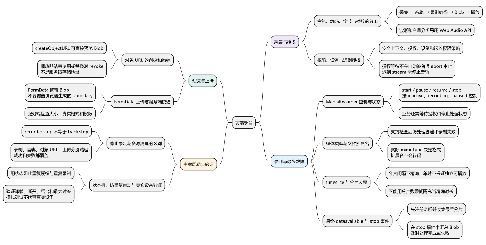
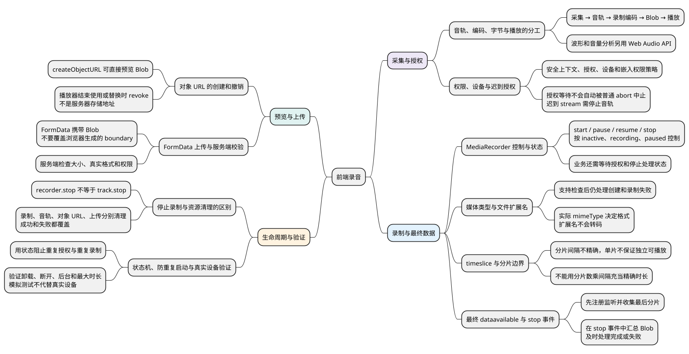

# 前端录音

<!-- core-mindmap:start -->

PlantUML 源码

<!-- core-mindmap:end -->

**口述总览：** 前端录音先通过 getUserMedia 获取麦克风音轨，再用 MediaRecorder 把音轨编码成音频数据，最后生成 Blob 用于播放或上传。权限、录音状态和资源清理需要分别处理；停止录音与关闭麦克风不是同一个操作。

**记忆线：** 取得音轨 → 编码与收片 → 等待最终数据 → 预览上传 → 按状态释放资源。

本篇归纳 10 个知识点：[自查问题](#self-check) · [口述与答案](#interview)。先尝试回答，再用正文例子核对；文末完整列出每点回答与记忆提示，也可直接顺序阅读。

## 基本用途：采集、编码、播放与上传

~~~text
用户开始 → 请求麦克风权限 → 获得 MediaStream
                                   ↓
                              MediaRecorder 编码
                                   ↓
                       dataavailable 产生 Blob 分片
                                   ↓
                       stop 后汇总 → 播放或上传
~~~

MediaStream 是音轨的容器；MediaRecorder 负责把音轨编码为媒体数据；Blob 保存编码后的字节。需要音量分析或波形时，再使用 Web Audio API，录音本身不要求先学习整套音频处理。

本篇属于浏览器项目专题。麦克风采集需要安全上下文（通常 HTTPS，localhost 可用于开发）、浏览器支持和用户授权。嵌入页面还可能受到 Permissions Policy 限制。

## 获取与关闭麦克风：getUserMedia()、getTracks()、stop()

navigator.mediaDevices.getUserMedia({ audio: true }) 返回 Promise<MediaStream>。用户授权和设备可用后得到音轨；拒绝权限、找不到设备或设备不可读等都可能失败。

<!-- example: c24-acquire -->
~~~js
async function withMicrophone(useStream) {
  const stream = await navigator.mediaDevices.getUserMedia({ audio: true });
  try {
    return await useStream(stream);
  } finally {
    stream.getTracks().forEach(track => track.stop());
  }
}
~~~

这个辅助函数适合把采集任务包在一个明确的生命周期中，useStream 应等到自己的任务真正结束后才返回。

**注意：** getUserMedia 不会因为普通 AbortController 被取消就自动结束授权等待。用户在等待期间离开页面时，要记录“已退出”；如果之后仍拿到了 stream，应立即停止音轨，避免迟到的授权结果启动录音。

## 创建与控制录音：MediaRecorder

- new MediaRecorder(stream, options)：根据音轨创建录制器，options 可指定 mimeType 等配置。
- MediaRecorder.isTypeSupported(type)：检查浏览器是否声称支持该类型，实际创建和录制仍可能失败。
- start(timeslice?)：开始录制，可请求按时间片交付数据。
- pause() / resume()：暂停与恢复录制。
- stop()：请求结束录制，最后的数据和 stop 事件随后到达。
- state：inactive、recording、paused。
- mimeType：实际使用的媒体类型。

不要仅根据文件扩展名假定浏览器输出 MP3。可以从支持的类型中选择，或让浏览器使用默认类型，并将实际 mimeType 传给播放器和服务端。

**注意：** timeslice 只是请求分片的时间间隔，不保证精确触发，也不保证每块都是能独立播放的完整文件。不要把分片数量乘以 timeslice 当作精确录音时长。

## 收集最终音频：dataavailable、stop、Blob

**口述：** dataavailable 可能触发多次，stop() 返回时最后一块数据还不一定已经交付。应先收集分片，在 stop 事件中生成最终 Blob，并清理音轨。

下面的函数负责单次录音。调用成功后马上监听 finished；结束时调用 stop()。它不包含界面按钮和上传业务。

<!-- example: c24-record -->
~~~js
async function startRecording() {
  if (!navigator.mediaDevices?.getUserMedia ||
      typeof MediaRecorder === 'undefined') {
    throw new Error('当前环境不支持录音');
  }

  const stream = await navigator.mediaDevices.getUserMedia({ audio: true });
  const stopTracks = () => stream.getTracks().forEach(track => track.stop());

  try {
    const recorder = new MediaRecorder(stream);
    const chunks = [];

    const finished = new Promise((resolve, reject) => {
      recorder.addEventListener('dataavailable', event => {
        if (event.data.size > 0) chunks.push(event.data);
      });
      recorder.addEventListener('stop', () => {
        const type = recorder.mimeType || chunks[0]?.type || '';
        try {
          resolve(new Blob(chunks, { type }));
        } catch (error) {
          reject(error);
        } finally {
          stopTracks();
        }
      }, { once: true });
      recorder.addEventListener('error', event => {
        stopTracks();
        reject(event.error || new Error('录音失败'));
      }, { once: true });
    });

    recorder.start();
    return {
      finished,
      stop() {
        if (recorder.state !== 'inactive') recorder.stop();
        return finished;
      }
    };
  } catch (error) {
    stopTracks();
    throw error;
  }
}
~~~

这段代码的执行顺序是：

- 先获得 stream，再创建 recorder；创建或启动失败时关闭音轨。
- 在 start 前注册监听，持续收集非空分片。
- stop() 请求结束，finished 等待最终 stop 事件。
- 成功或失败时清理音轨，调用方分别处理 Blob 或错误。

页面应避免连续点击创建多个录制器，录音期间保存同一个会话句柄。立即给 finished 添加成功和失败处理，也能避免录音中途失败成为未处理的 Promise 拒绝。

**注意：** 示例负责正常 API 生命周期。页面卸载、外部停止音轨、设备断开及后台限制还需要结合实际浏览器验证；业务上可以设置最大录音时长和大小限制。

## 预览与释放：URL.createObjectURL()、revokeObjectURL()

URL.createObjectURL(blob) 产生临时对象 URL，可赋给 audio.src。URL 不是上传后的服务器地址，也不需要把 Blob 转成 Base64 才能播放。

<!-- example: c24-preview -->
~~~js
function createAudioPreview(audio) {
  let currentUrl = null;
  return {
    show(blob) {
      this.clear();
      currentUrl = URL.createObjectURL(blob);
      audio.src = currentUrl;
      audio.controls = true;
    },
    clear() {
      audio.pause();
      audio.removeAttribute('src');
      audio.load();
      if (currentUrl !== null) {
        URL.revokeObjectURL(currentUrl);
        currentUrl = null;
      }
    }
  };
}
~~~

用 preview.show(blob) 显示新录音；替换旧音频或组件卸载时调用 preview.clear()。不要在播放器还需要读取 URL 时立即 revoke，也不要每次录音创建 URL 后永久保留。

## 上传音频：FormData 配合 fetch()

FormData 可以直接携带 Blob。服务端应根据实际媒体类型处理音频，必要时再转码。

<!-- example: c24-upload -->
~~~js
async function uploadAudio(blob, signal) {
  const form = new FormData();
  form.append('audio', blob, 'recording');
  const response = await fetch('/api/audio', {
    method: 'POST',
    body: form,
    signal
  });
  if (!response.ok) throw new Error('上传失败：HTTP ' + response.status);
  return response.json();
}
~~~

**注意：** 使用 FormData 时不要手动写 multipart/form-data 的 Content-Type，浏览器需要生成包含 boundary 的完整请求头。示例约定服务端返回 JSON；服务端还应检查大小、真实格式和访问权限。

## 注意：用状态描述录音生命周期

~~~text
空闲 → 等待授权 → 录音中 → 停止处理中 → 可预览
           ↓          ↓          ↓
         失败        失败       失败
~~~

等待授权时不要重复发起采集；录音中控制暂停、恢复和停止；停止处理中等待最后数据；功能结束时关闭音轨并释放对象 URL。

停止录制、停止音轨、撤销对象 URL、取消上传是不同的清理动作。它们由不同 API 控制，不能用一次 recorder.stop() 代替全部清理。

## 自查问题

问题顺序与后面的知识点归纳一致；先说结论，再解释边界或给出例子。

1. [getUserMedia、MediaStream、MediaRecorder、Blob 和播放器分别负责什么？](#recall-01)
2. [获取麦克风有哪些前提和失败情形？用户等待授权时退出，之后才得到 stream 怎样处理？](#recall-02)
3. [start、pause、resume、stop 分别做什么？录制器状态与业务界面状态一样吗？](#recall-03)
4. [把录音文件改成 mp3 后缀就完成转码了吗？isTypeSupported 返回 true 是否保证成功？](#recall-04)
5. [start 的 timeslice 能保证精确分片时刻和独立可播放文件吗？能据此算精确时长吗？](#recall-05)
6. [为什么调用 stop 后不能立即汇总当前分片？应在什么时机得到最终 Blob？](#recall-06)
7. [Blob 预览需要先转成 Base64 吗？对象 URL 是服务器地址吗，什么时候撤销？](#recall-07)
8. [怎样上传 Blob？为什么不手写 multipart/form-data 请求头，服务端还要检查什么？](#recall-08)
9. [为什么停止录制后麦克风仍可能被占用？会话结束还要分别清理哪些资源？](#recall-09)
10. [怎样避免多次点击同时创建录制器？模拟检查能证明权限、设备断开和后台行为正常吗？](#recall-10)

## 试题与答案

以下按 10 个知识点完整归纳，保留原有分级题号。

### C29-01 [P1·基础] getUserMedia 与 MediaRecorder 分别负责什么？

**自查：** getUserMedia、MediaStream、MediaRecorder、Blob 和播放器分别负责什么？

**回答：** getUserMedia 获取设备音轨，MediaStream 组织音轨，MediaRecorder 把音轨编码为媒体数据，Blob 保存编码后的字节，audio 等播放器负责播放。需要音量分析或波形时再使用 Web Audio API，录音本身不要求先实现整套音频处理。

**记忆：** 采集拿音轨，录制做编码，Blob 存字节，播放器负责播放。

### 权限、设备与迟到授权

**自查：** 获取麦克风有哪些前提和失败情形？用户等待授权时退出，之后才得到 stream 怎样处理？

**回答：** 麦克风采集需要安全上下文、浏览器支持和用户授权，嵌入页面还可能受权限策略限制。拒绝授权、没有设备或设备不可读都可能失败。普通 AbortController 不会自动取消 getUserMedia 授权等待；业务需要记录会话是否仍有效，迟到的 stream 应停止音轨，避免退出后启动录音。

**记忆：** 先确认权限和设备，迟到授权也要检查会话并清理。

### MediaRecorder 控制与状态

**自查：** start、pause、resume、stop 分别做什么？录制器状态与业务界面状态一样吗？

**回答：** 创建录制器后，start 开始录制，pause、resume 控制暂停和恢复，stop 请求结束，state 表示 inactive、recording 或 paused。调用要匹配合法状态，并在开始前注册数据和错误监听。录制器状态不足以表达等待授权、停止处理中或上传等业务状态，页面需要自己的会话状态。

**记忆：** API 控制录制过程，业务状态还要覆盖授权、停止处理和上传。

### C29-04 [P1·工程取舍] 为什么不能统一把录音命名成 mp3 就上传？

**自查：** 把录音文件改成 mp3 后缀就完成转码了吗？isTypeSupported 返回 true 是否保证成功？

**回答：** 扩展名不会改变编码格式。可以先检查候选类型支持情况，再读取录制器实际 mimeType，并让服务端按约定识别或转码。isTypeSupported 表示浏览器声称支持，实际创建和录制仍可能因资源或设备问题失败；不能统一假定所有浏览器输出 MP3。

**记忆：** 格式看实际媒体类型，改后缀不等于转码。

### timeslice 与分片边界

**自查：** start 的 timeslice 能保证精确分片时刻和独立可播放文件吗？能据此算精确时长吗？

**回答：** timeslice 请求按时间片交付数据，不保证精确触发，也不保证每块是可独立播放的完整文件。调度、设备和浏览器行为都可能影响交付，因此不能用分片数乘 timeslice 作为精确时长。分片上传或实时消费需要额外确认容器和服务端处理协议。

**记忆：** 时间片是交付请求，不是精确时钟或完整文件保证。

### C29-02 [P1·原理] 为什么 stop() 后不能立刻把当前分片当作完整录音？

**自查：** 为什么调用 stop 后不能立即汇总当前分片？应在什么时机得到最终 Blob？

**回答：** stop 请求结束录制，最后的 dataavailable 和 stop 事件随后到达。应先持续收集分片，在 stop 事件中汇总最终 Blob，避免遗漏末尾。调用方应及时处理代表录制完成的 Promise 的成功和失败，创建、启动或录制错误也需要结束会话并清理资源。

**记忆：** stop 先请求结束，等最终事件再汇总。

### 对象 URL 的创建和撤销

**自查：** Blob 预览需要先转成 Base64 吗？对象 URL 是服务器地址吗，什么时候撤销？

**回答：** 可以用 URL.createObjectURL 为 Blob 创建临时地址并交给播放器，不需要先转成 Base64，它也不是上传后的服务器地址。替换录音或组件结束使用时，应停止播放器读取并撤销旧 URL；过早撤销可能影响播放，永久保留又会延长资源占用。

**记忆：** 对象 URL 用于本地预览，用完撤销，别当服务器地址。

### FormData 上传与服务端校验

**自查：** 怎样上传 Blob？为什么不手写 multipart/form-data 请求头，服务端还要检查什么？

**回答：** FormData 可以直接携带 Blob，交给 fetch 上传；浏览器需要生成带 boundary 的 Content-Type，不应手动覆盖成缺少边界的值。客户端要检查 HTTP 和响应解析结果；服务端还需检查大小、真实格式和访问权限，必要时按媒体协议转码。上传取消使用请求自身的机制，不等于停止录制或撤销已发生的服务端业务。

**记忆：** FormData 直接带 Blob，boundary 交浏览器，真实格式由服务端校验。

### C29-03 [P1·工程取舍] 停止录音后麦克风为何仍可能被占用？

**自查：** 为什么停止录制后麦克风仍可能被占用？会话结束还要分别清理哪些资源？

**回答：** 录制器停止不等于音轨已经关闭。结束使用后，要对持有的 stream 音轨调用 stop，并检查其他采集会话是否仍占用设备。停止录制、停止音轨、撤销对象 URL、取消上传分别由不同 API 控制，不能用一次 recorder.stop 代替所有清理，也不能只覆盖成功路径。

**记忆：** 停录制、关音轨、撤销 URL、停上传，四类资源分别收尾。

### 状态机、防重复启动与真实设备验证

**自查：** 怎样避免多次点击同时创建录制器？模拟检查能证明权限、设备断开和后台行为正常吗？

**回答：** 用空闲、等待授权、录音中、停止处理中、可预览或失败等状态限制合法操作，并保存当前会话，避免重复采集和旧结果写入。应设置适当的时长与大小限制，处理卸载、设备断开和外部停止音轨。语言逻辑或模拟测试不能代替真实浏览器权限、设备和后台调度验证。

**记忆：** 按状态限制操作，按会话接收结果，真实设备验证边界。
