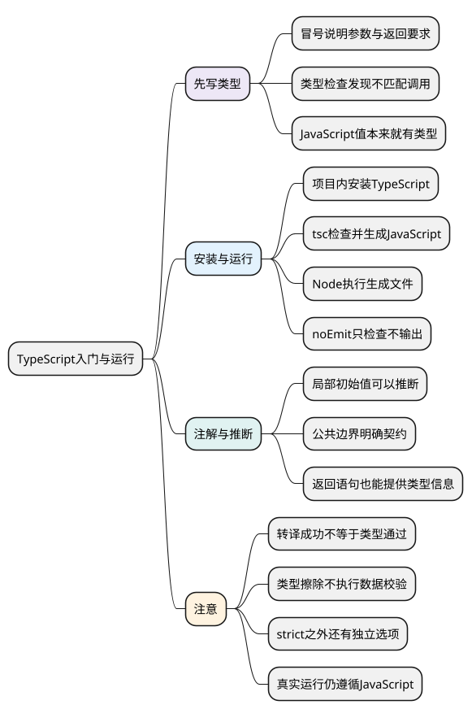

# TypeScript入门与运行

<!-- core-mindmap:start -->
[](examples/ts01-mindmap.svg)

<details>
<summary>PlantUML 源码</summary>



</details>

<!-- core-mindmap:end -->

**口述总览：** TypeScript 在 JavaScript 的写法上增加类型检查。你可以说明函数需要字符串、对象必须有哪些字段，编辑器和编译器据此提前发现不匹配的使用。程序运行时仍遵循 JavaScript 的规则；类型注解通常会被删除，不会自动把错误数据变正确。

先会写一个带类型的函数，再把它检查、转换并运行。本系列独立示例使用 TypeScript 5.9.3，开启 strict；涉及可选属性和索引时还开启 exactOptionalPropertyTypes、noUncheckedIndexedAccess。代码块各自是独立模块，不要直接拼成同一个文件。

<a id="k01"></a>

## 给 JavaScript 函数补上输入和输出要求

**口述：** 类型写在变量或参数名后面，前面加冒号；函数返回值的类型写在参数括号后面。下面的 string 表示字符串，描述允许使用什么值，不会在运行时执行一次转换。

<!-- example: ts01-first-function -->
```ts
export {};

function greet(name: string): string {
  return `你好，${name}`;
}
console.log(greet('Lin')); // 你好，Lin

if (false) {
  // @ts-expect-error greet要求字符串实参
  greet(123);
}
```

读这段代码：greet 接收一个名叫 name 的参数，参数类型是 string；它返回的结果也必须是 string。调用 greet('Lin') 满足要求；传数字会得到类型诊断。

export {} 表示本文件是模块，让顶层名字只属于当前模块；本例没有向其他文件公开内容。模块的完整导入导出规则见[工程配置篇](15_tsconfig、模块与声明文件.md)。

示例把故意错误的语句放在 if(false) 中，运行时不会执行，但类型检查仍会检查它。@ts-expect-error 表示“下一行应有类型错误”，错误消失时检查器反而会提醒；它只用于验证示例边界，不是业务代码的默认修复方式。

### 类型检查能发现什么

- 调用时参数种类不匹配，例如需要字符串却传了数字。
- 读取不存在的属性，或对象缺少约定的必填字段。
- 函数某条返回路径不满足声明的返回类型。
- 可能为空的值未经判断就调用方法。

JavaScript 本身有字符串、数字、对象等运行时类型；TypeScript 增加的是运行前的分析和使用约束，并不是让原本“没有类型”的值第一次获得类型。

<a id="k02"></a>

## 安装编译器，把一个文件检查并运行

**口述：** TypeScript 编译器 tsc 可以检查类型，也可以生成 JavaScript。这里先用一个独立练习目录演示完整流程，前提是已经安装 Node.js 和 npm。

在新建的练习目录运行：

```sh
npm init -y
npm install --save-dev typescript@5.9.3
npx tsc --version
```

npm init 生成 package.json，开发依赖保存项目使用的 TypeScript 版本。把上面的第一个 TypeScript 例子保存为 hello.ts，再执行：

```sh
npx tsc hello.ts --strict --target ES2022 --module NodeNext --outDir dist --noEmitOnError
node dist/hello.js
```

第一条命令检查 hello.ts，并把生成文件放进 dist；第二条让 Node 执行 JavaScript，输出“你好，Lin”。本流程使用 npm init 默认的包配置；已有项目应使用自己的模块配置，不能把这组命令无条件覆盖进去。

- strict 开启一组严格检查，包括隐式 any 和严格空值检查。
- target 决定生成的 JavaScript 语法目标；它不自动给旧环境安装缺失的 API。
- module NodeNext 按 Node 的模块规则组织输出，文件扩展名和 package.json 也会影响模块判定。
- noEmitOnError 表示出现类型诊断时不生成输出，避免把检查失败的结果当作本次有效产物。

只检查、不生成文件时使用：

```sh
npx tsc hello.ts --strict --target ES2022 --module NodeNext --noEmit
```

项目文件增加后，再把选项放进 tsconfig.json。配置入口与模块差异在[tsconfig、模块与声明文件](15_tsconfig、模块与声明文件.md)统一展开，不必先记完所有选项才开始写代码。

<a id="k03"></a>

## 类型注解与推断：能推出来的地方可以少写

**口述：** 手写 `: number` 叫类型注解；没有手写时，TypeScript 也会根据初始值、函数上下文和返回语句推断类型。省略注解不等于没有检查。

<!-- example: ts01-inference -->
```ts
export {};

let count = 1;
let title: string = '待办';
count += 1;
title = '已完成';
console.log(count, title); // 2 已完成

if (false) {
  // @ts-expect-error count从初始数字推断为number
  count = 'two';
}
```

count 后续可以换成别的数字，但不能因为省略了注解就随意换成字符串。title 的注解则把允许的类型明确写出来。

常见选择是：初始值清楚的局部变量用推断；函数参数、公共接口和需要稳定约束的返回值写清类型。不是每个变量都必须标注，也不是参数类型总能从别处自动猜出来。

<!-- example: ts01-return-inference -->
```ts
export {};

function double(value: number) {
  return value * 2;
}
const result: number = double(3);
console.log(result); // 6

if (false) {
  // @ts-expect-error double的返回值推断为number
  const text: string = double(3);
}
```

double 没写返回类型，但 return 的表达式是数字，因此返回类型可推断为 number。字面量何时保留为 'ready' 或 1，以及何时扩大为 string 或 number，后面在[类型推断篇](07_类型推断、断言与satisfies.md)详细说明。

<a id="k04"></a>

## 检查、转换和运行：三件相关但不同的事

**口述：** 类型检查回答“写法是否符合已知类型”；转换回答“生成什么 JavaScript”；运行回答“真实值和副作用是什么”。某个工具能删除类型语法，不代表它做了完整检查。

第一例中的 `name: string` 和返回类型 `: string` 通常不出现在输出 JavaScript 中，这叫类型擦除。它们不会在运行时为 name 插入字符串验证。

<!-- example: ts01-runtime-boundary -->
```ts
export {};

const source: unknown = JSON.parse('123');
if (typeof source === 'string') {
  console.log(source.toUpperCase());
} else {
  console.log('需要字符串'); // 需要字符串
}
```

unknown 暂时表示“还不知道具体类型”，下一篇会展开。这里真正拦住数字的，是运行时执行的 typeof 判断；JSON 字符串不会因为文件扩展名变成 .ts 就自动满足某个接口。

Vite 等构建工具通常侧重转译与打包，项目需要另设 tsc --noEmit；Vue 单文件组件通常用 vue-tsc 检查。不能把“开发服务器启动成功”或“产物生成成功”当成类型已检查。

也不能把 TypeScript 的所有写法都概括为“只删除文字”。JavaScript class 本身会保留运行时行为，普通 enum 等 TypeScript 写法还可能生成代码，见[类与枚举](08_类、接口实现与枚举.md)。

<a id="summary"></a>

复述时按“给函数写要求 → 运行检查 → 生成 JavaScript → 执行真实代码”展开。类型注解与推断共同提供静态约束；外部输入、权限和业务规则仍需要运行时处理。

<a id="interview"></a>

## 试题与答案

<a id="ts01-01"></a>

### TS01-01 [P0·基础] TypeScript解决什么问题，不能解决什么？

**回答：** 它通过静态分析明确参数、返回值和对象结构，辅助编辑、重构和发现不匹配的使用。普通类型会擦除，不能自动校验网络数据、保证权限或改变 JavaScript 的运行机制。检查和转译需要分别确认。

<a id="ts01-02"></a>

### TS01-02 [P1·工程取舍] 项目能构建，为什么类型仍然错？

**回答：** 构建器可能只删除类型并转换语法，没有做完整类型检查。应在开发和 CI 中明确执行 tsc 或 vue-tsc，使用一致配置；类型检查通过仍不等于外部数据经过运行时验证。

<a id="ts01-03"></a>

### TS01-03 [P0·基础] 类型注解与类型推断有什么区别？

**回答：** 注解是手写类型要求，推断是检查器根据初始值、上下文和返回语句得出类型。省略注解仍可有严格检查；局部值清楚时可用推断，公共边界通常明确写出契约。

<a id="ts01-04"></a>

### TS01-04 [P0·基础] tsc --noEmit做什么，会运行程序吗？

**回答：** 它检查类型但不生成输出文件，也不会执行程序。要运行此处示例，先生成 JavaScript，再交给 Node；类型检查通过与运行结果正确是不同的验证。

参考：[TypeScript Handbook](https://www.typescriptlang.org/docs/handbook/intro.html)。
