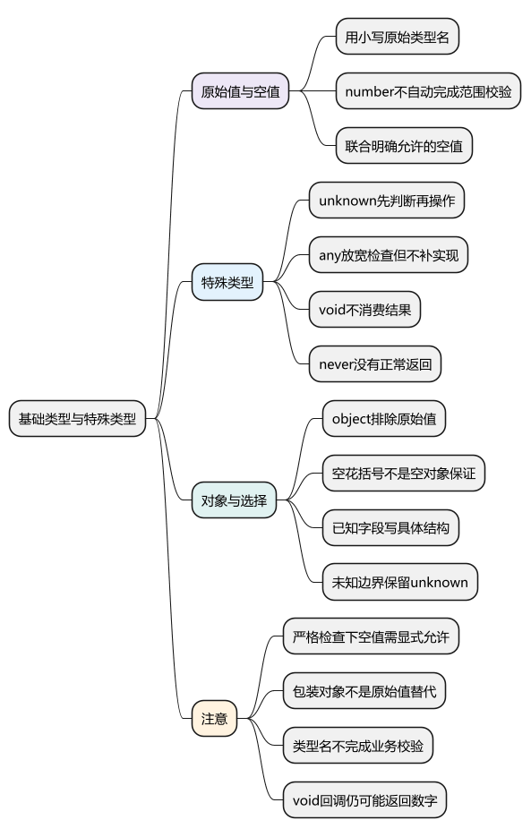
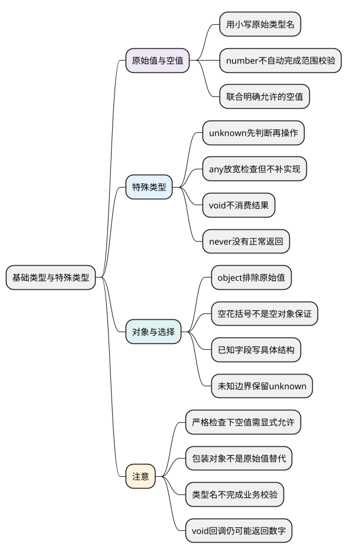

# 基础类型与特殊类型

<!-- core-mindmap:start -->
[](examples/ts02-mindmap.svg)

<details>
<summary>PlantUML 源码</summary>



</details>

<!-- core-mindmap:end -->

**口述总览：** 类型说明一个位置允许使用哪些值。字符串、数字和布尔值各有自己的类型；null 和 undefined 表示不同的空值。遇到未知输入，unknown 要求先判断再使用；any 会放宽许多检查。void 描述不使用返回值的契约，never 表示没有正常结果，不能把它们统称为“空”。

本篇在 strict 下讨论，尤其包含 strictNullChecks。每个 TypeScript 代码块独立运行。先会给真实值写类型，再讨论特殊类型的用途。

<a id="k01"></a>

## 原始类型与空值：先准确写出允许的值

**口述：** string 表示字符串，number 表示普通 JavaScript 数字，boolean 表示 true 或 false。bigint 用于大整数，symbol 用于符号值。写类型通常使用小写名称，不用 String、Number、Boolean 包装对象类型代替。

<!-- example: ts02-primitives -->
```ts
export {};

const title: string = '待办';
const count: number = 2;
const ready: boolean = true;
const largeId: bigint = 9007199254740993n;
const key: symbol = Symbol('id');
console.log(title, count, ready); // 待办 2 true
console.log(largeId.toString(), typeof key); // 9007199254740993 symbol

if (false) {
  // @ts-expect-error 包装对象不能当作字符串原始值使用
  const text: string = new String('A');
}
```

number 同时覆盖整数与小数，不会自动排除 NaN 或 Infinity；bigint 的精度和混合运算规则仍然来自 JavaScript。类型写成 number，也不等于完成了金额或范围校验。

### 用联合类型明确允许空值

`string | null` 表示“字符串或者 null”，竖线叫联合类型。先用它表达缺失或未设置的状态，完整的联合与收窄方法留到[第六篇](06_联合、交叉与类型收窄.md)。

<!-- example: ts02-nullable -->
```ts
export {};

function label(value: string | null): string {
  if (value === null) return '未设置';
  return value.toUpperCase();
}
console.log(label(null), label('Lin')); // 未设置 LIN

if (false) {
  // @ts-expect-error strictNullChecks下string不自动包含null
  const title: string = null;
  // @ts-expect-error string | null没有声明允许undefined
  label(undefined);
}
```

判断排除 null 后，剩余分支才可以调用字符串方法。undefined 也需要按实际契约加入类型；不能因为都被称为空值，就认为 null 和 undefined 总能互换。

读取可能缺失的对象属性或数组位置时，也会遇到 undefined。先反映真实的缺失情况，再决定默认值或报错，不要为消除错误强行假设数据存在。

<a id="k02"></a>

## any、unknown、void 与 never：分别表达不同的使用约束

**口述：** any 让检查器放宽许多操作限制；unknown 允许保存任意输入，但不允许在没有证据时随意使用。void 常用于不消费返回值的调用约定，never 用于不可能正常返回的结果。

### unknown 保留未知，使用前给出证据

<!-- example: ts02-unknown-any -->
```ts
export {};

function readText(value: unknown): string {
  if (typeof value === 'string') return value.toUpperCase();
  return '不是字符串';
}
const loose: any = 7;
console.log(readText('Lin'), readText(7)); // LIN 不是字符串

if (false) {
  loose.missing(); // any允许此调用，真实执行会失败
  const incoming: unknown = 7;
  // @ts-expect-error 未证明unknown上存在该方法
  incoming.toUpperCase();
}
```

两个类型都能接收不同种类的值，但允许的后续操作不同。unknown 的判断会引导你补上真实逻辑；把它改成 any 只是让检查器少管，并没有增加 missing 方法。

面对网络结果、JSON 或未确定的第三方输入，通常从 unknown 开始。不要因为数组里既有数字又有字符串就直接用 any[]，可以写 `(number | string)[]`，下一篇会解释数组括号。

### void 不消费返回值，never 没有正常返回

<!-- example: ts02-void-never -->
```ts
export {};

function notify(message: string): void {
  console.log(message);
}
const callback: () => void = () => 123;
function fail(message: string): never {
  throw new Error(message);
}
notify('已保存'); // 已保存
console.log(callback()); // 123
try { fail('failed'); }
catch (error) {
  if (error instanceof Error) console.log(error.message); // failed
}

if (false) {
  // @ts-expect-error strictNullChecks下null不能赋给void
  const empty: void = null;
}
```

notify 没写 return，真实调用返回 undefined。callback 却是另一个情况：`() => void` 表示调用契约不使用结果，允许赋入会返回数字的函数，运行时仍会返回 123。

因此 void 不是“强制所有函数都返回 undefined”。显式给函数实现标注 `: void` 时，也不能在实现里任意写 return 123；它与把返回数字的函数赋给 void 回调契约不同。

fail 标注 never，因为它总是抛错，没有正常返回。正常运行的空函数返回 undefined，应理解为 void 场景，不是 never。never 在穷尽分支中的用法见[类型收窄篇](06_联合、交叉与类型收窄.md#k04)。

<a id="k03"></a>

## object 与空花括号：都不等于具体业务结构

**口述：** object 表示非原始值，包括普通对象、数组和函数；`{}` 通常表示非 null、非 undefined 的值，数字和字符串也能满足。两者都没有说明业务需要哪些字段。

<!-- example: ts02-object-empty -->
```ts
export {};

const record: object = { name: 'Lin' };
const items: object = [1, 2];
const nonNull: {} = 'text';
console.log(typeof record, Array.isArray(items), nonNull); // object true text

if (false) {
  // @ts-expect-error object排除数字原始值
  const value: object = 1;
  // @ts-expect-error {}在严格空值检查下不接受null
  const empty: {} = null;
  // @ts-expect-error object没有声明name字段
  record.name;
}
```

record 运行时确实有 name，但当前 object 类型没有提供这个成员的使用契约。需要 name 时，写 `{ name: string }` 等具体结构；如何复用结构，见[对象类型、interface 与 type](04_对象类型、interface与type.md)。

大写 Object 也不建议作为业务数据的总称，它不能代替精确结构。`{}` 不是“只允许没有属性的普通对象”，更不能用于证明外部输入经过校验。

<a id="k04"></a>

## 选择类型：先写已知事实，不用宽泛类型隐藏问题

先问数据是否已经有明确形状：已知是字符串就用 string，已知有 name 字段就描述该字段；确实允许空值，就把空值写进联合类型。

来源尚不可信时用 unknown，之后根据运行时判断建立可用信息。只有明确接受失去检查的边界才考虑 any，并控制传播范围。

函数结果看调用约定：调用方无需结果时用 void；函数不可能正常完成时用 never。readonly、可选属性和数组不是新的运行时数据类型，接下来分别学习它们约束什么。

<a id="summary"></a>

原始类型描述已有的 JavaScript 值，联合明确允许的候选；unknown 要求证明，any 放宽检查。object 与 `{}` 都不是业务校验，void 与 never 也不能混成同一种空值。

<a id="interview"></a>

## 试题与答案

<a id="ts02-01"></a>

### TS02-01 [P0·原理] object、{}、unknown该怎么选？

**回答：** 已知业务结构用明确字段，未知边界用 unknown。object 排除原始值，`{}` 通常只排除 null/undefined，却允许其他原始值；两者均不能证明普通对象的业务结构合法。

<a id="ts02-02"></a>

### TS02-02 [P0·基础] unknown与any有什么本质差别？

**回答：** unknown 保留未知事实，操作前必须判断或校验；any 放宽许多检查，并可能把不安全使用传播给后续代码。改成 any 不会补齐运行时缺少的属性或方法。

<a id="ts02-03"></a>

### TS02-03 [P0·原理] never和void有什么区别？

**回答：** never 表示没有正常可用的结果，常见于总是抛错的函数；void 通常表示调用方不使用返回值。赋给 `() => void` 的函数运行时仍可能返回数字，不能据此断定它一定返回 undefined。

<a id="ts02-04"></a>

### TS02-04 [P0·基础] string类型默认允许null和undefined吗？

**回答：** 开启 strictNullChecks 后不允许；应按契约写 string | null 或 string | undefined 等联合，再在使用前判断。省略类型注解也不等于关闭空值检查。
