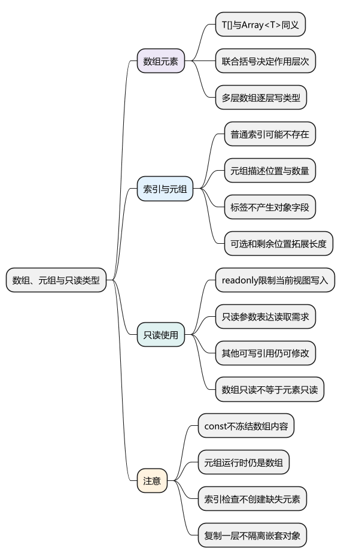
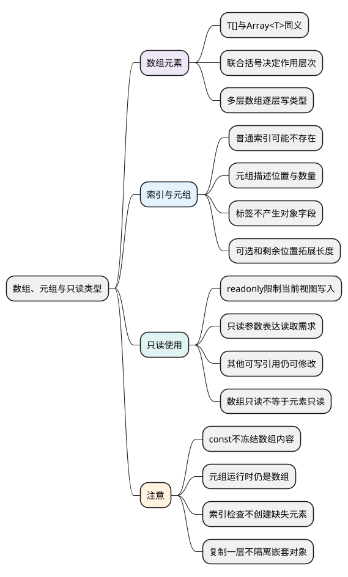

# 数组、元组与只读类型

<!-- core-mindmap:start -->
[](examples/ts03-mindmap.svg)

<details>
<summary>PlantUML 源码</summary>



</details>

<!-- core-mindmap:end -->

**口述总览：** 数组类型说明每项允许什么值，元组进一步说明位置和数量，例如第一项是名称、第二项是数量。readonly 限制通过当前类型修改数据，但不会在运行时冻结数组，也不会让所有嵌套对象都不可变。先看数据是同类列表，还是每个位置有明确含义，再选择写法。

本篇每个 TypeScript 示例独立运行，开启 strict、noUncheckedIndexedAccess 和 exactOptionalPropertyTypes。数组的真实运行行为仍是 JavaScript，方法用法见[Array](../01_JavaScript/01_数据类型、内建对象与内存管理/10_Array.md)。

<a id="k01"></a>

## 数组：描述元素类型，再考虑索引是否存在

**口述：** number[] 表示每项都是数字的数组；Array<number> 是同一要求的另一种写法。后者的尖括号把元素类型传给 Array，此处先把它当作固定写法，不必提前学习所有泛型规则。

<!-- example: ts03-array-elements -->
```ts
export {};

const scores: number[] = [80, 90];
const names: Array<string> = ['Lin', 'Bo'];
scores.push(100);
console.log(scores.join(','), names.join(',')); // 80,90,100 Lin,Bo

if (false) {
  // @ts-expect-error 数字数组不能加入字符串
  scores.push('100');
}
```

const 不允许把 scores 变量改指另一个数组，但仍允许 push 修改当前数组。限制变量重新赋值与限制数组内容，是不同问题。

### 多种元素与多层数组，括号位置要写对

<!-- example: ts03-union-matrix -->
```ts
export {};

const values: (string | number)[] = ['A', 1, 'B'];
const rows: number[][] = [[1, 2], [3, 4]];
console.log(values.join(',')); // A,1,B
console.log(rows.map(row => row.join(':')).join(';')); // 1:2;3:4
```

`(string | number)[]` 表示每项可以是字符串或数字；`string | number[]` 则表示整个值是字符串或数字数组，含义不同。混合元素不一定需要元组，也不需要直接放弃检查改成 any[]。

number[][] 表示数组的每一项又是数字数组，适合行列数据。若每个位置承担不同职责，再用元组表达位置关系。

### 索引读取：类型不会替你创建缺少的元素

<!-- example: ts03-index-access -->
```ts
export {};

function firstLabel(values: readonly string[]): string {
  const first = values[0];
  return first === undefined ? '空列表' : first.toUpperCase();
}
console.log(firstLabel([]), firstLabel(['Lin'])); // 空列表 LIN

if (false) {
  const names: string[] = [];
  // @ts-expect-error 索引读取可能得到undefined
  const first: string = names[0];
}
```

开启 noUncheckedIndexedAccess 后，普通 string[] 的未知位置读取会包含 undefined。它提醒你检查越界或空列表，但不会把运行时的 undefined 自动变成默认字符串。

参数中的 readonly 表示函数只需要读取列表；具体限制在后面说明。处理已有元素时用 for...of 或 map 等方法，通常比反复假设某个数字索引存在更直接。

<a id="k02"></a>

## 元组：位置本身就是数据含义的一部分

**口述：** `[string, number]` 说明第一项是字符串、第二项是数字；它适合一对固定配合的结果。元组运行时仍是数组，没有额外创建另一种容器。

<!-- example: ts03-tuple -->
```ts
export {};

const entry: [name: string, count: number] = ['Lin', 3];
const [name, count] = entry;
console.log(name.toUpperCase(), count + 1); // LIN 4

const point: [x: number, y: number, label?: string] = [10, 20];
console.log(point[2] ?? '未命名'); // 未命名

if (false) {
  // @ts-expect-error 元组的位置类型不能交换
  const wrong: [string, number] = [3, 'Lin'];
  // @ts-expect-error entry只声明了两个已知位置
  entry[2];
}
```

name、count 是元组位置标签，帮助阅读和编辑器提示，不会让 entry.name 成为可访问字段。解构时可以使用其他变量名；位置仍然决定取到什么值。

元组可以有可选位置，也可以有剩余部分，例如 `[string, ...number[]]` 表示一个字符串后跟任意多个数字。因此不能把所有元组都说成“长度绝对固定”。

普通可写元组在某些操作中仍可调用 push，运行时数组长度也能变化。元组约束不是运行时冻结；希望 API 不修改位置时，使用 readonly 元组，并保持实现和类型一致。

<a id="k03"></a>

## readonly：禁止当前视图写入，允许其他引用仍可变

**口述：** readonly number[] 与 ReadonlyArray<number> 都表示数字数组的只读使用方式。通过它不能 push、重写索引或修改 length，但原始数组不一定被冻结。

<!-- example: ts03-readonly-alias -->
```ts
export {};

const writable = [{ name: 'Lin' }];
const view: readonly { name: string }[] = writable;
writable.push({ name: 'Bo' });
for (const item of view) item.name = item.name.toUpperCase();
console.log(view.length, writable.map(item => item.name).join(',')); // 2 LIN,BO

const point: readonly [number, number] = [10, 20];
console.log(point[0] + point[1]); // 30

if (false) {
  // @ts-expect-error 不能通过只读数组添加元素
  view.push({ name: 'Mo' });
  // @ts-expect-error 不能修改只读元组位置
  point[0] = 30;
  // @ts-expect-error 只读视图不能承诺可写数组的能力
  const mutable: { name: string }[] = view;
}
```

view 与 writable 指向同一个数组，所以从可写引用添加元素后，view 也能看到。数组只读还不等于每个对象的 name 只读，因此循环可以修改成员对象。

复制一层数组可以得到另一个可写数组，但其中的对象引用通常仍共享；需要隔离到什么深度，要结合[浅拷贝与深拷贝](../01_JavaScript/01_数据类型、内建对象与内存管理/20_浅拷贝与深拷贝.md)判断。

<a id="k04"></a>

## 按用途选择：列表、位置结果与只读参数

多个结构相同、数量变化的数据，用数组表达，例如用户列表。少量位置各有含义的组合，用元组表达，例如坐标或返回的两项结果。

函数只读取输入数组时，优先考虑 readonly 参数。这样既能接收可写数组，也能接收只读数组，还会阻止函数体无意 push 或 sort；需要排序时可先复制再处理。

不要只因为变量用 const 就认为内容不会变化，也不要因为对象通过 readonly 暴露，就把它当成深层不可变数据或运行时安全边界。真正的运行行为仍取决于所有引用和实际代码。

<a id="summary"></a>

复述时先判断元素类型与位置含义，再检查索引是否存在，最后说明谁有修改能力。数组、元组与 readonly 都是对数据使用的描述，不会自动改变数组在 JavaScript 中的身份。

<a id="interview"></a>

## 试题与答案

<a id="ts03-01"></a>

### TS03-01 [P1·基础] readonly能防止对象被任何代码修改吗？

**回答：** 不能。它限制当前静态视图，通常还是浅层的；同一对象可能经可写引用或其他运行时代码修改。只读数组也不自动让元素对象只读，运行时不可变性要另外设计。

<a id="ts03-02"></a>

### TS03-02 [P0·基础] 数组与元组怎样选择？

**回答：** 数组描述元素的允许类型，适合数量可变的列表；元组还描述位置、数量及各位置的含义，适合固定配合的结果。元组也可有可选或剩余项，运行时仍是数组。

<a id="ts03-03"></a>

### TS03-03 [P0·原理] string[]取第一项为什么可能得到undefined？

**回答：** 普通数组可能为空，索引也可能不存在。开启 noUncheckedIndexedAccess 后检查器把这种情况反映到类型中，使用前应判断；它不会创建缺失元素。

<a id="ts03-04"></a>

### TS03-04 [P0·基础] (string | number)[]与string | number[]一样吗？

**回答：** 不一样。前者是每项允许字符串或数字的数组；后者是整个值允许为字符串或数字数组。括号决定联合作用在哪一层。
