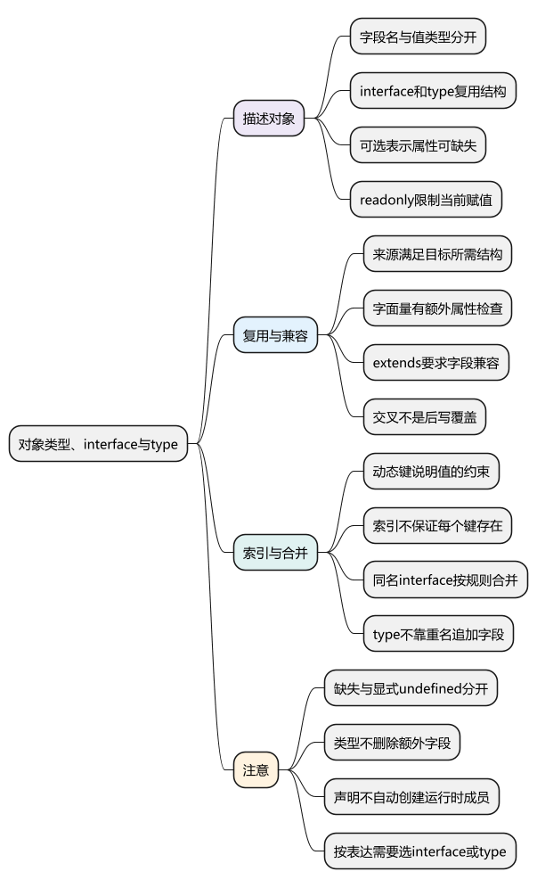
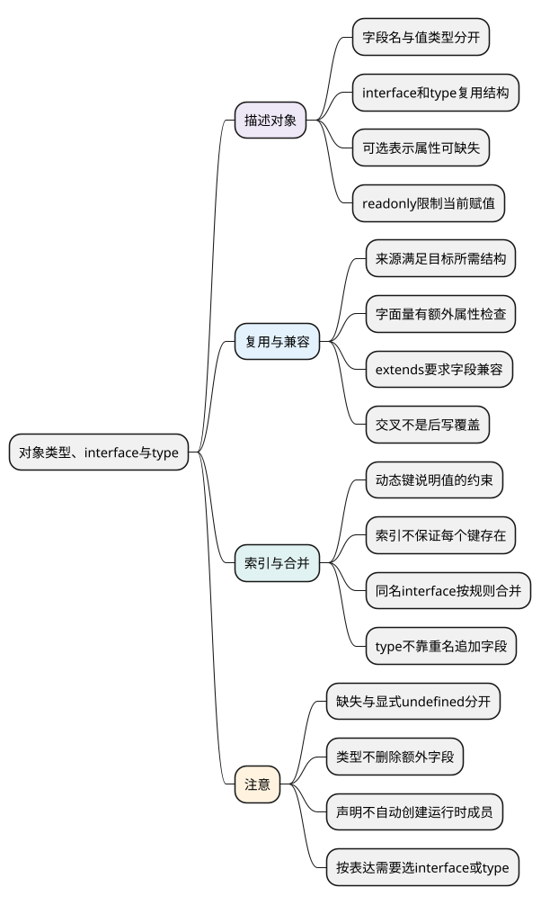

# 对象类型、interface与type

<!-- core-mindmap:start -->
[](examples/ts04-mindmap.svg)

<details>
<summary>PlantUML 源码</summary>



</details>

<!-- core-mindmap:end -->

**口述总览：** 描述对象类型，就是说明对象需要哪些字段、每个字段允许什么值。结构很短可以直接写在注解里；多个地方要复用时，再用 interface 或 type 命名。可选、只读、索引和扩展分别约束不同方面，它们不会创建对象，也不会在运行时删除多余字段。

本篇独立示例开启 strict、exactOptionalPropertyTypes 和 noUncheckedIndexedAccess。先写出具体对象，再理解复用与边界；高级类型变换留到后续篇章。

<a id="k01"></a>

## 从对象字段开始，再给结构起名字

**口述：** `{ name: string; age: number }` 描述一个具有 name 和 age 的对象。冒号右边是类型要求；实际字符串和数字仍写在对象值里，两层不要混在一起。

<!-- example: ts04-object-shapes -->
```ts
export {};

const person: { name: string; age: number } = { name: 'Lin', age: 18 };
interface User {
  name: string;
  age: number;
}
type UserAlias = { name: string; age: number };
const first: User = person;
const second: UserAlias = { name: 'Bo', age: 20 };
console.log(first.name, second.age); // Lin 20
```

interface User 把对象要求命名为 User；type UserAlias 则为类型表达式起别名。上例的两种命名方式描述相同结构，不要求值由某个构造函数创建，也不会自动填充 name 或 age。

type 还可以命名字符串、联合或元组，例如 `type Id = string | number`。interface 主要描述对象结构，也能包含方法；函数类型下一篇单独讲。

### 可选与只读：是否存在，和是否允许赋值

<!-- example: ts04-optional-readonly -->
```ts
export {};

interface User {
  readonly id: string;
  nickname?: string;
}
const user: User = { id: 'u1' };
console.log(user.nickname ?? '未设置'); // 未设置
user.nickname = 'Lin';
console.log(user.nickname); // Lin

if (false) {
  // @ts-expect-error readonly禁止通过user重写id
  user.id = 'u2';
  // @ts-expect-error 本配置下缺失不等于显式赋undefined
  user.nickname = undefined;
}
```

nickname? 表示可以不写该属性，读取时要考虑 undefined。开启 exactOptionalPropertyTypes 后，`nickname?: string` 不自动允许显式写入 undefined；若业务确实需要，声明为 `nickname?: string | undefined`。

readonly 限制通过此类型重新赋值，不是运行时冻结，也不自动限制嵌套对象。可选也不是“先把所有字段加问号就能兼容任何数据”，必需信息应继续必填。

### 结构兼容与额外属性检查不是一条规则

<!-- example: ts04-extra-properties -->
```ts
export {};

interface Named { name: string }
const source = { name: 'Lin', age: 18 };
const named: Named = source;
console.log(named.name, Object.hasOwn(named, 'age')); // Lin true

if (false) {
  // @ts-expect-error 直接字面量触发额外属性检查
  const direct: Named = { name: 'Lin', age: 18 };
}
```

source 提供了 Named 所需的字段，变量赋值可以成立。直接对象字面量则会触发额外属性检查，帮助发现误拼字段。两者不矛盾，也不能推导出“interface 只能接收字段数量完全一致的对象”。

named 的类型没有公开 age，但运行时对象仍有 age。类型赋值没有复制或清洗对象，外部数据仍需[运行时校验](16_接口类型与运行时校验.md)。

<a id="k02"></a>

## extends：复用已有字段，冲突需要真正解决

**口述：** interface 可以通过 extends 接着描述已有结构，例如用户既需要 id，也需要 name。这是静态结构的复用，不会像 class 的构造过程一样创建或初始化字段。

<!-- example: ts04-extends-conflict -->
```ts
export {};

interface Identified { id: string }
interface User extends Identified { name: string }
const user: User = { id: 'u1', name: 'Lin' };
console.log(user.id, user.name); // u1 Lin

type Conflicting = { value: string } & { value: number };
if (false) {
  // @ts-expect-error 子接口不能把id改成不兼容的number
  interface Invalid extends Identified { id: number }
  // @ts-expect-error value无法同时满足string与number
  const conflict: Conflicting = { value: 1 };
}
```

extends 要求继承字段兼容，冲突通常在声明处暴露。`A & B` 则要求同时满足两个类型，这叫交叉；这里 value 会形成无法满足的 never 类型，不是后一段 number 覆盖前面的 string。

交叉只写约束，不执行 Object.assign 或对象展开。完整的联合、交叉与冲突推导见[下一组类型关系](06_联合、交叉与类型收窄.md)，不要在基础对象声明中提前堆叠复杂工具类型。

<a id="k03"></a>

## 索引与声明合并：分别处理动态键和开放接口

**口述：** 键名不固定时，可以用索引签名说明相应键的值类型。接口声明合并则是把同名接口的要求合到一起，两者都不会让运行时对象自动多出数据。

### 索引签名约束值，但不保证每个键存在

<!-- example: ts04-index-signature -->
```ts
export {};

interface Scores {
  [name: string]: number;
}
const scores: Scores = { Lin: 90 };
scores.Bo = 80;
console.log(scores['Lin'], scores['missing']); // 90 undefined

if (false) {
  // @ts-expect-error 字符串索引对应的值必须是数字
  scores.Mo = 'high';
  // @ts-expect-error 未证明键存在，读取可能是undefined
  const missing: number = scores['missing'];
}
```

字符串索引签名覆盖这类键，因此同时声明的 name 等字符串键属性也要符合对应值约束，不能一边要求所有值是数字，一边声明 name 是字符串。

这里展示最常见的字符串索引；语言也支持数字、symbol 等索引形式，不应把索引签名记成只能使用字符串和数字。键的类型与具体字段之间的关系见[keyof 与索引访问](10_keyof、typeof与索引访问类型.md)。

### 同名 interface 可以合并，type 不这样扩展

<!-- example: ts04-interface-merge -->
```ts
export {};

interface Settings { theme: string }
interface Settings { theme: string; locale: string }
const settings: Settings = { theme: 'light', locale: 'zh-CN' };
console.log(settings.theme, settings.locale); // light zh-CN

if (false) {
  // @ts-expect-error 合并后locale也是必填字段
  const incomplete: Settings = { theme: 'light' };
}
```

同一声明空间中，两份 Settings 的要求合并；重复的非函数成员需保持相同类型和相应修饰约定，并非只要重复就一定报错。type 别名不能靠再次声明同名 type 追加字段。

合并适合开放接口，也可能无意扩大影响范围。为第三方模块补充声明还需要遵守模块增强规则，并保证运行时确实有相应实现，详见[声明文件篇](15_tsconfig、模块与声明文件.md#k03)。

<a id="k04"></a>

## interface 与 type 的选择：先看需要表达什么

公共对象契约需要开放扩展时，interface 往往直接；需要给联合、元组等类型表达式命名时，用 type。普通业务对象两者通常都能表达，项目可以选一个默认风格，而不强迫所有场景只用一种。

对象中方法可以写 `read(): string`，也可以写 `read: () => string`。先把它理解为“这个属性能调用并返回字符串”；二者在进阶函数兼容性中有差别，不能只凭外观认定永远完全等价，见[函数类型与重载](05_函数类型与重载.md)。

选择的目标是让结构可读、错误容易定位，并与真实实现一致。不要用宽泛索引签名和 any 来绕过所有拼写或字段错误。

<a id="summary"></a>

先写对象实际需要的字段，再决定是否可选、只读或允许动态键。interface/type 复用类型描述，extends 和合并扩展要求；这些操作都不代替运行时创建、复制和校验。

<a id="interview"></a>

## 试题与答案

<a id="ts04-01"></a>

### TS04-01 [P0·原理] 为什么多一个字段的变量能赋给interface，直接字面量却报错？

**回答：** 结构兼容允许来源提供额外字段，但直接对象字面量还有额外属性检查，用于发现拼写等问题。interface 不是精确字段数量约束，赋值也不会在运行时删除多余字段。

<a id="ts04-02"></a>

### TS04-02 [P0·基础] interface和type的主要区别是什么？

**回答：** 对象结构中两者通常都能用；interface 支持 extends 和声明合并，type 可以命名联合、元组等更广的类型表达式。两者主要服务静态检查，都不会自动生成对象。

<a id="ts04-03"></a>

### TS04-03 [P1·原理] extends和交叉遇到同名冲突时一样吗？

**回答：** 不完全一样。interface 继承要求兼容，冲突常在声明处暴露；交叉要求同时满足，冲突字段可能成为 never。交叉不执行运行时覆盖，不能依靠书写顺序消除冲突。

<a id="ts04-04"></a>

### TS04-04 [P0·工程取舍] 项目是否必须统一只用interface？

**回答：** 可以约定对象类型的默认写法，但不宜一刀切。开放对象契约适合 interface，联合状态等表达需要 type；可读性、错误定位和实际契约比名称偏好更重要。

<a id="ts04-05"></a>

### TS04-05 [P0·基础] 可选属性能否直接赋undefined？

**回答：** 取决于声明与配置。开启 exactOptionalPropertyTypes 后，name?: string 允许属性缺失，但不自动允许显式写入 undefined；若需要后者，应把 undefined 明确加入值类型。读取可选属性仍需考虑 undefined。
