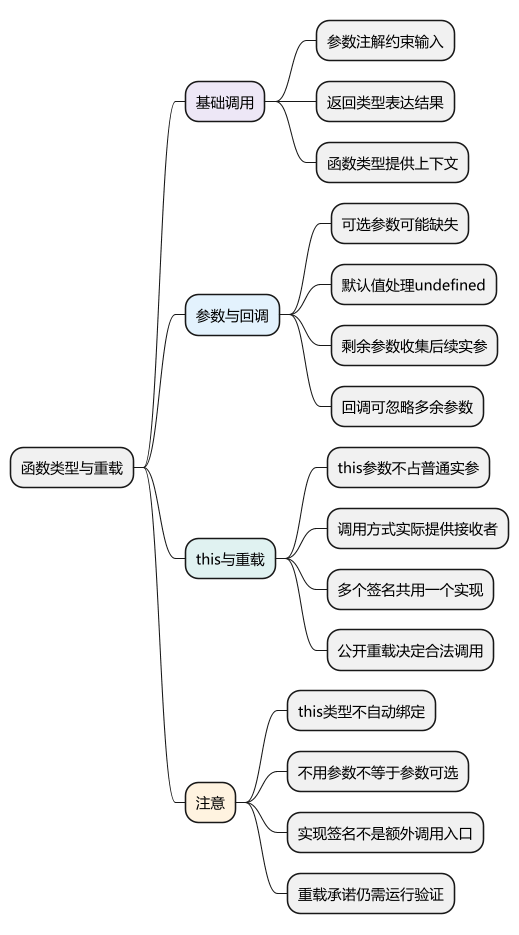
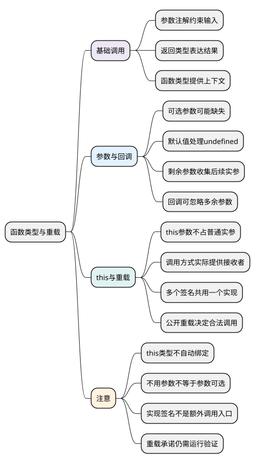

# 函数类型与重载

<!-- core-mindmap:start -->
[](examples/ts05-mindmap.svg)

<details>
<summary>PlantUML 源码</summary>



</details>

<!-- core-mindmap:end -->

**口述总览：** 函数类型说明调用方可以传什么参数、得到什么结果。先写普通参数和返回值，再描述可选项、默认值、剩余参数与回调。this 参数只提供静态接收者要求，不会自动绑定函数；重载用多个对外签名表达不同调用形式，实际仍由一个函数体处理。

本篇每个 TypeScript 示例独立运行，开启 strict、exactOptionalPropertyTypes 和 noUncheckedIndexedAccess。函数的实际执行、参数传递和 this 仍遵循 JavaScript，见[函数](../01_JavaScript/02_运行基础/03_函数.md)与[this 指向](../01_JavaScript/02_运行基础/06_this指向.md)。

<a id="k01"></a>

## 参数与返回值：描述一次合法调用

**口述：** 参数名后的类型说明允许传入的值，参数括号后的类型说明正常返回的结果。函数类型也可以先写在变量声明上，让实现从上下文获得参数类型。

<!-- example: ts05-signatures -->
```ts
export {};

function add(left: number, right: number): number {
  return left + right;
}
const multiply: (left: number, right: number) => number = (left, right) => {
  return left * right;
};
console.log(add(2, 3), multiply(2, 3)); // 5 6

if (false) {
  // @ts-expect-error 缺少必填参数right
  add(2);
  // @ts-expect-error right必须是数字
  multiply(2, '3');
}
```

`(left: number, right: number) => number` 是函数类型，箭头右边表示返回类型；后面 `(left, right) => { ... }` 才是实际函数。前者不会执行计算，后者运行时才做乘法。

multiply 的两个实现参数不用重复注解，是因为左侧函数类型已提供上下文。普通独立函数的参数则不能总指望从未来调用处反推；strict 下没有可用信息会提示隐式 any。

返回类型有时也能从 return 推断。明确写出公共函数的返回类型，可以让实现遗漏或返回不匹配时更早暴露。没有消费结果的回调契约使用 void，具体含义见[基础类型](02_基础类型与特殊类型.md#k02)。

### 可选、默认与剩余参数各自解决什么问题

<!-- example: ts05-parameter-options -->
```ts
export {};

function greet(name: string, suffix?: string): string {
  return name + (suffix ?? '!');
}
function total(price: number, quantity = 1): number {
  return price * quantity;
}
function joinName(first: string, ...rest: string[]): string {
  return [first, ...rest].join(' ');
}
console.log(greet('Lin'), greet('Lin', '?')); // Lin! Lin?
console.log(total(10), total(10, undefined)); // 10 10
console.log(joinName('Lin', 'Bo', 'Mo')); // Lin Bo Mo

if (false) {
  // @ts-expect-error 默认值不会让null自动变成合法数字
  total(10, null);
}
```

suffix? 允许省略，函数体读取时要考虑 undefined；这里用 ?? 决定缺少时的字符。quantity 有默认值，省略或传 undefined 都使用 1，传 null 不会触发默认值。

rest 收集后续实参，类型 string[] 说明每一项必须是字符串。它不是把任意数组自动转换成字符串，也不要求调用方把后续参数预先包成数组。

普通可选参数放在必填参数后。默认参数可以出现在必填参数前，但调用时仍要占住这个位置，例如 `function label(prefix = '用户', name: string)` 可以用 label(undefined, 'Lin') 采用默认 prefix。

<a id="k02"></a>

## 回调与 this：明确对方怎样使用函数

**口述：** 回调是交给别处调用的函数。它的类型应由调用方实际会提供什么参数、是否消费结果决定，不能只凭实现目前用不用某个参数就把参数标成可选。

<!-- example: ts05-callback-contract -->
```ts
export {};

function visit(values: readonly string[], callback: (value: string, index: number) => void): void {
  values.forEach((value, index) => callback(value, index));
}
visit(['Lin', 'Bo'], value => console.log(value.toUpperCase()));
// LIN
// BO

const save: (value: string) => void = value => value.length;
save('Lin');
```

visit 保证每次提供字符串和数字索引，但调用方的回调可以只声明 value，忽略多余的 index。没有必要为了支持这个回调，把类型写成 index?: number；那会表示调用方可能真的不提供索引。

save 的契约不使用返回值，因此实现可以返回 length。运行时数字仍然产生，但上层不能根据 void 契约依赖这个数字。函数是否返回值，与调用方是否使用它要分开。

### this 参数只检查接收者，不替你绑定

<!-- example: ts05-this-parameter -->
```ts
export {};

interface Counter { value: number }
function increment(this: Counter, step: number): number {
  this.value += step;
  return this.value;
}
const counter = { value: 1, increment };
console.log(counter.increment(2)); // 3
console.log(increment.call(counter, 3)); // 6

if (false) {
  // @ts-expect-error 独立调用没有提供Counter接收者
  increment(1);
}
```

this: Counter 是 TypeScript 的特殊参数声明，生成 JavaScript 时会被删除；调用 counter.increment(2) 只有一个普通实参，不需要额外把 counter 当第一个参数传入。

类型声明不会固定 this。counter.increment(...) 和 increment.call(...) 在运行时确实提供了接收者，检查因此成立；把函数取出直接调用仍要看实际规则。需要固定回调接收者时，使用 bind 或包装函数，而不是只补一条类型注解。

<a id="k03"></a>

## 重载：多种调用签名，共用一个实际实现

**口述：** 重载在函数体前列出允许的调用形式，例如传字符串就返回字符串，传数字就返回数字。真正执行的仍是一个函数体，它要识别输入并实现这些约定。

<!-- example: ts05-overload -->
```ts
export {};

function normalize(value: string): string;
function normalize(value: number): number;
function normalize(value: string | number): string | number {
  return typeof value === 'string' ? value.trim() : value;
}
const text: string = normalize(' Lin ');
const count: number = normalize(3);
console.log(text, count); // Lin 3

function inspect(value: string | number): void {
  if (false) {
    // @ts-expect-error 对外两个重载没有接收联合参数的签名
    normalize(value);
  }
}
inspect('A');
```

前两行是对外重载签名，没有函数体；第三行是实现签名，负责容纳两种输入并执行逻辑。不能因为实现参数写了 string | number，就认定调用方也自动得到一个“接收联合参数”的公开签名。

若确实需要支持联合参数，可以明确补相应重载，或者调整调用处的判断。若输入和结果始终可以用一个清楚的联合签名表达，也不必为形式而写多条重载。

重载的类型检查不是实现正确性的完整证明。函数体必须真的兑现每条签名承诺的对应关系，因此仍要验证不同输入的输出和失败路径。

<a id="k04"></a>

## 选择契约：先表达真实关系，再考虑高级写法

普通参数类型已能说清要求时，先用最简单的签名。仅在输入形式与返回结果存在明确对应关系时，再考虑重载；要把调用方的具体类型传递到返回值时，后续学习[泛型](09_泛型与类型关系.md)。

回调能否替换现有函数，还要看它是否接受调用方可能传来的全部值，以及返回结果是否满足使用方要求。不要因为函数“差不多”就用 any 绕过检查。strictFunctionTypes 下，普通函数类型和方法签名存在检查差别，进阶类型关系再展开。

所有函数类型最终都需要真实实现。类型不会自动补参数、绑定 this、校验服务端结果，也不会替你实现重载中的分支逻辑。

<a id="summary"></a>

阅读函数类型时依次问：参数必须提供什么，哪些能省略，结果是什么，回调由谁调用，this 怎样取得。重载最后看公开签名和实际实现是否一致，不把实现签名当额外公开入口。

<a id="interview"></a>

## 试题与答案

<a id="ts05-01"></a>

### TS05-01 [P1·原理] 重载实现签名为什么不能随便调用？

**回答：** 对外公开的是重载列表，实现签名用来容纳并实现这些情况，不自动增加调用契约。若需要接收一个联合参数，应明确增加相应签名，或使用更清楚的联合、泛型设计。

<a id="ts05-02"></a>

### TS05-02 [P0·基础] 可选参数和默认参数有什么区别？

**回答：** 可选参数允许省略，函数内读取可能是 undefined，需要自行处理；默认参数会在省略或传 undefined 时采用默认值。null 不触发默认值，剩余参数则把后续实参收集成数组。

<a id="ts05-03"></a>

### TS05-03 [P0·原理] 回调不用index，就应把index声明成可选吗？

**回答：** 不应。可选表示调用方可能不提供这个参数；如果调用方保证提供索引，就应保留必填。使用者可以写只接收前几个参数的函数，忽略不需要的额外参数。

<a id="ts05-04"></a>

### TS05-04 [P0·原理] this类型参数会自动绑定接收者吗？

**回答：** 不会。它只描述接收者要求，输出 JavaScript 时会被擦除，也不占一个普通实参位置。运行时仍要通过方法调用、call、bind 或包装函数等正确提供 this。
