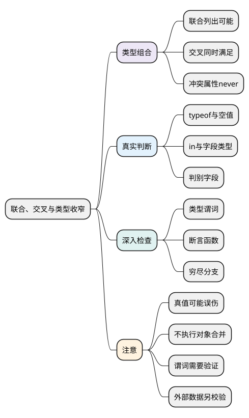

# 联合、交叉与类型收窄

<!-- core-mindmap:start -->
[](examples/ts06-mindmap.svg)

<details>
<summary>PlantUML 源码</summary>



</details>

<!-- core-mindmap:end -->

**口述总览：** 联合描述“可能是哪一种”，交叉描述“必须同时满足什么”。拿到联合值时，先做真实判断，TypeScript 才能在对应分支中允许更具体的操作；这个过程叫类型收窄。

先会写联合和交叉，再用 typeof、in 与判别字段处理分支，最后学习自定义检查与遗漏检查。各 TypeScript 示例独立运行，采用本系列的严格检查配置。

<a id="k01"></a>

## 联合与交叉：表示选择，或者同时满足约束

**口述：** `A | B` 接受符合 A 或 B 的值，使用时不能假定一定是其中一种；`A & B` 要求同一个值同时符合两边的结构。

### 联合：先判断是哪种值，再使用它

<!-- example: ts06-union -->
```ts
export {};
function format(value: string | number): string {
  if (typeof value === 'string') return value.toUpperCase();
  return value.toFixed(1);
}
console.log(format('Lin')); // LIN
console.log(format(7)); // 7.0
if (false) {
  // @ts-expect-error 布尔值不属于参数允许的类型。
  format(true);
}
```

进入字符串分支后，value 只剩 string；该分支已经返回，后续代码中的 value 就只剩 number。类型检查顺着条件和返回路径推理，不需要用断言强行告诉它结果。

对象联合也不是“两个结构只能选其一”的运行时限制。结构兼容下，一个对象可能同时满足两边；需要互斥状态时，给成员增加不同的判别字段。

### 交叉：组合要求，不执行对象合并

<!-- example: ts06-intersection -->
```ts
export {};
type Named = { name: string };
type Identified = { id: number };
const user: Named & Identified = { name: 'Lin', id: 7 };
console.log(user.name, user.id); // Lin 7
type Conflict = { value: string } & { value: number };
if (false) {
  // @ts-expect-error value 无法同时是 string 和 number。
  const impossible: Conflict = { value: 'x' };
}
```

user 的对象是代码自己创建的，交叉类型没有调用 Object.assign。同名属性要求冲突时，对应属性可能成为没有正常值的 never，不会按书写顺序覆盖。接口 extends 的区别见[对象类型](04_对象类型、interface与type.md#k02)。

<a id="k02"></a>

## 内建判断：从值的实际特征获得信息

**口述：** typeof 判断类别，in 判断属性是否存在，Array.isArray 判断数组，instanceof 检查实例关系。它们既执行 JavaScript 判断，也为后续类型检查提供信息。

<!-- example: ts06-built-in-guards -->
```ts
export {};
function readId(value: unknown): string {
  if (value === null || typeof value !== 'object') return 'missing';
  if ('id' in value && typeof value.id === 'string') return value.id;
  return 'missing';
}
console.log(readId({ id: 'u1' })); // u1
console.log(readId({ id: 7 }), readId(null)); // missing missing
function showCount(value: number | null): string {
  return value === null ? 'missing' : String(value);
}
console.log(showCount(0)); // 0
```

先排除 null，因为 `typeof null` 也是 object；再检查 id 存在且为字符串，才安全地返回它。in 也可能找到继承属性，不等于只检查自有属性，更不等于验证完整业务对象。

不要把 `if (value)` 当作通用空值判断：它也会排除合法的 0、空字符串等值。要排除 null/undefined，可以写明确比较；要识别某一种状态，比较对应判别字段。

收窄只对当前控制流有效。重新赋值或未来才执行的回调可能改变判断条件，需要时保存稳定的局部值，或者在使用处重新检查。

<a id="k03"></a>

## 自定义检查：布尔结果怎样关联到类型

**口述：** 多处需要同一种结构检查时，可以封装函数。`value is User` 声明“返回 true 时，把 value 看作 User”，这种返回类型叫类型谓词；检查逻辑仍由开发者负责。

<!-- example: ts06-type-predicate -->
```ts
export {};
type User = { id: string; name: string };
function isUser(value: unknown): value is User {
  return value !== null && typeof value === 'object' &&
    'id' in value && typeof value.id === 'string' &&
    'name' in value && typeof value.name === 'string';
}
function assertUser(value: unknown): asserts value is User {
  if (!isUser(value)) throw new TypeError('invalid user');
}
const incoming: unknown = { id: 'u1', name: 'Lin' };
assertUser(incoming);
console.log(incoming.name); // Lin
console.log(isUser({ id: 'u1' }), isUser({ id: 7, name: 'Lin' })); // false false
```

isUser 用真假结果让调用处选择分支；assertUser 在不符合要求时抛错，正常返回后建立类型保证，这叫断言函数。它与直接写 `as User` 不同，这个实现确实执行了检查。

但编译器不会完整证明谓词或断言函数的实现正确，写错检查条件仍可能通过编译。至少验证合法、缺字段、字段类型错误和空值；复杂外部数据的检查见[接口类型与运行时校验](16_接口类型与运行时校验.md)。

<a id="k04"></a>

## 判别字段与 never：让遗漏分支暴露出来

**口述：** 给每种状态放一个固定的标签，程序就能按标签选择相应数据。处理完所有成员后，剩余类型是 never；把它作为默认分支的要求，可以在新增成员时发现遗漏。

<!-- example: ts06-exhaustive -->
```ts
export {};
type State = { kind: 'idle' } | { kind: 'success'; value: string };
function assertNever(value: never): never {
  throw new Error('unexpected state: ' + JSON.stringify(value));
}
function render(state: State): string {
  switch (state.kind) {
    case 'idle': return 'waiting';
    case 'success': return state.value;
    default: return assertNever(state);
  }
}
console.log(render({ kind: 'idle' })); // waiting
console.log(render({ kind: 'success', value: 'ready' })); // ready
```

若给 State 增加 error 成员却没有增加 case，default 的 state 就不再是 never，调用 assertNever 会出现类型错误。它检查的是已声明的状态集合，不能代替对外部 JSON 的验证。

不要用 `as never` 压掉遗漏提示。更完整的加载、失败、重试状态设计放在[判别联合与状态建模](14_判别联合与状态建模.md)，本篇先掌握判断与分支的关系。

<a id="summary"></a>

联合列出可能性，交叉叠加要求；收窄通过真实条件减少可能性。先用内建判断，再按需要封装谓词，最后用判别字段和 never 检查是否漏掉状态。

<a id="interview"></a>

## 试题与答案

<a id="ts06-01"></a>

### TS06-01 [P0·基础] union和intersection的本质区别是什么？

**回答：** 联合只需满足候选之一，未收窄前使用共同安全操作；交叉要求同时满足各约束，冲突属性可能成为 never。交叉不执行运行时合并，也不按书写顺序覆盖。

<a id="ts06-02"></a>

### TS06-02 [P1·原理] 自定义value is User就一定验证正确吗？

**回答：** 不一定。谓词是给编译器的承诺，实际条件可能漏字段或判断错误。需要验证正常值、缺字段、错误类型和空值；复杂数据可使用经过验证的 schema 方案。

<a id="ts06-03"></a>

### TS06-03 [P0·编码] 如何让新增联合状态触发遗漏检查？

**回答：** 根据判别字段 switch，在 default 把剩余值交给接收 never 的 assertNever。新增成员未处理时会出现类型错误；外部输入仍需运行时验证。

<a id="ts06-04"></a>

### TS06-04 [P0·原理] 真值判断收窄为什么可能误伤合法数据？

**回答：** 真值判断同时排除 0、空字符串等假值。应根据业务明确判断 null、undefined、实际类型或判别字段，不能把类型收窄成功当成业务条件正确。

参考：[TypeScript：Narrowing](https://www.typescriptlang.org/docs/handbook/2/narrowing.html)。
