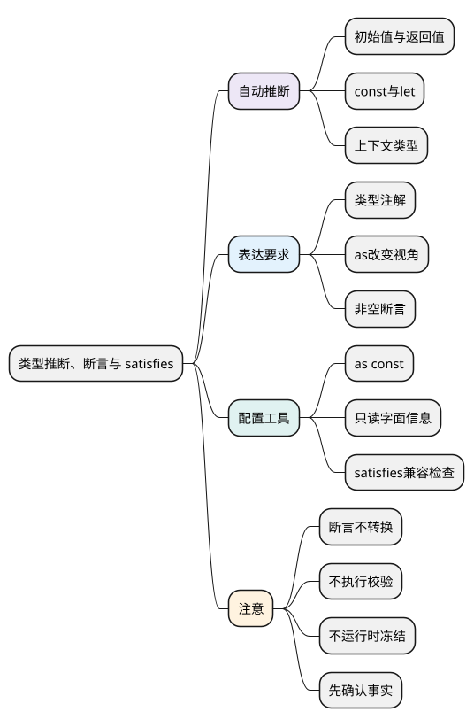

# 类型推断、断言与 satisfies

<!-- core-mindmap:start -->
[](examples/ts07-mindmap.svg)

<details>
<summary>PlantUML 源码</summary>



</details>

<!-- core-mindmap:end -->

**口述总览：** 类型推断让编译器根据已有代码得出类型；类型注解写明要求；类型断言改变检查器看待一个值的方式。as const 保留字面量与只读信息，satisfies 检查表达式是否符合契约；它们都不能替代运行时数据检查。

先观察变量和函数怎样被推断，再区分断言、转换与校验。各示例独立运行，采用本系列的严格配置；类型写法本身不会在控制台自动打印类型。

<a id="k01"></a>

## 类型推断：不写注解，不代表没有类型

**口述：** 初始值、函数返回语句和所在位置都能提供类型信息。信息足够时可以省略注解；需要表达公共契约或允许更广范围时，再显式写出类型。

<!-- example: ts07-inference -->
```ts
export {};
let count = 1;
const fixed = 1;
const settings = { retries: 1 };
settings.retries = 2;
function double(value: number) { return value * 2; }
const labels = [1, 2].map(value => value.toFixed(1));
console.log(double(count), fixed, settings.retries); // 2 1 2
console.log(labels.join(',')); // 1.0,2.0
if (false) {
  // @ts-expect-error count 的类型是 number，不保证只能为 1。
  const onlyOne: 1 = count;
}
```

count 可以重新赋值，因此通常推断为 number；fixed 是不可重新赋值的基础常量，保留字面量类型 1。settings 的绑定虽然是 const，它的可写属性仍被推断为 number。

double 的返回类型从乘法结果推断为 number。map 已经知道数组元素是 number，因此回调的 value 也能得到类型；这种由所在位置提供信息的方式叫上下文类型推断。

### 注解可以表达允许范围

例如 `let selected: string | null = null` 明确允许后续放入字符串。函数参数通常需要注解，公开接口与复杂返回也适合写清契约；局部变量则不必把编译器已经知道的类型重复写一遍。

<a id="k02"></a>

## 类型断言：改变静态视角，不转换实际值

**口述：** `value as T` 表示由开发者承担“这个值可以按 T 使用”的判断。它不调用构造函数、不补字段、不解析数字，也不会执行验证。

<!-- example: ts07-assertion-vs-conversion -->
```ts
export {};
const incoming: unknown = '7';
const asserted = incoming as number;
console.log(typeof asserted, asserted + 1); // string 71
const converted = Number(incoming);
console.log(typeof converted, converted + 1); // number 8
```

检查器把 asserted 看成 number，但运行时它仍是字符串，所以加法得到 71。Number 才执行数值转换；转换也可能得到 NaN，是否为业务允许的数字仍需检查。

普通 as 并非任意类型都能直接互相断言；双重断言 `as unknown as T` 能绕过更多限制，却不会增加事实依据。使用 JSX/TSX 时采用 as 写法，避免尖括号断言与标签语法冲突。

<a id="k03"></a>

## as const 与 satisfies：保留具体信息，再检查契约

**口述：** as const 用于字面量表达式，让值尽量保留具体字面量，并形成只读属性或只读元组视图。satisfies 用于检查表达式能否满足给定类型，同时保留较具体的信息；二者任务不同，可以组合使用。

### as const 不等于 Object.freeze

<!-- example: ts07-as-const -->
```ts
export {};
const shared = { retries: 1 };
const config = { mode: 'production', shared } as const;
shared.retries = 2;
console.log(config.mode, config.shared.retries); // production 2
console.log(Object.isFrozen(config)); // false
if (false) {
  // @ts-expect-error 字面量属性被推断为只读。
  config.mode = 'development';
}
```

mode 保留 production 字面量且是只读属性，但运行时并没有冻结 config。shared 是已有的可变对象引用，as const 不会把它变成不可修改的对象；对象内部状态依旧可以通过 shared 改变。

直接写在 as const 字面量里的嵌套属性也会获得相应只读推断，但这仍然是静态视图，不是运行时深冻结。数组只读与别名关系见[数组、元组与只读类型](03_数组、元组与只读类型.md)。

### satisfies 检查结构，并保留可用信息

<!-- example: ts07-satisfies -->
```ts
export {};
type Palette = { primary: string | readonly [number, number, number] };
const palette = { primary: 'blue' } satisfies Palette;
console.log(palette.primary.toUpperCase()); // BLUE
if (false) {
  // @ts-expect-error 数字不是这里允许的颜色表示。
  const invalid = { primary: 42 } satisfies Palette;
}
```

Palette 允许字符串或三个数的元组；这个表达式提供的是字符串，检查通过后仍可直接使用字符串方法。把整个变量注解成更宽的 Palette，则应按它允许的范围处理字段。

satisfies 可能参与上下文推断，不能概括成“完全不影响表达式类型”。它不生成校验代码；静态配置适合使用，未知网络数据仍需运行时验证。

<a id="k04"></a>

## 使用断言前，先确认缺少的是信息还是检查

**口述：** 有时开发者拥有检查器无法获知的事实，可以使用断言；但如果事实本身没有成立，应补判断、调整生命周期或修正契约。

<!-- example: ts07-null-check -->
```ts
export {};
function upper(value: string | null): string {
  if (value === null) return 'missing';
  return value.toUpperCase();
}
console.log(upper(null), upper('Lin')); // missing LIN
```

这里真实判断排除了 null。若改为 `value!.toUpperCase()`，感叹号只让检查器忽略空值，不能阻止运行时传入 null，也不会等某个 DOM 元素挂载完成。

接口数据、DOM 查询、数组索引等边界，应优先表达可能不存在的情况。断言函数若真正检查并在失败时抛错，可以同时建立运行时和静态保证，见[类型收窄](06_联合、交叉与类型收窄.md#k03)。

<a id="summary"></a>

推断从代码获取信息，注解声明要求，as 改变静态视角。as const 保留字面量与只读视图，satisfies 检查静态兼容；转换、校验和冻结仍是另外的运行时操作。

<a id="interview"></a>

## 试题与答案

<a id="ts07-01"></a>

### TS07-01 [P0·原理] const count=1推断为number还是1？

**回答：** 基础 const 字面量通常保留类型 1，let 通常拓宽为 number；const 对象的可写属性仍可能拓宽。as const 可以保留更具体的信息，但不执行运行时冻结。

<a id="ts07-02"></a>

### TS07-02 [P1·工程取舍] satisfies比as好在哪里？

**回答：** satisfies 会检查静态兼容性并保留表达式较具体的信息，as 主要改变检查器视角，可能掩盖错误。两者都不校验运行时数据；satisfies 也可能影响上下文推断。

<a id="ts07-03"></a>

### TS07-03 [P0·基础] as number会把字符串变成数字吗？

**回答：** 不会。类型断言会被擦除，原值仍是字符串。需要转换时使用 Number 等运行时操作，再检查 NaN、范围以及业务要求；非空断言也同样不会执行空值检查。

参考：[TypeScript：Everyday Types](https://www.typescriptlang.org/docs/handbook/2/everyday-types.html)。
