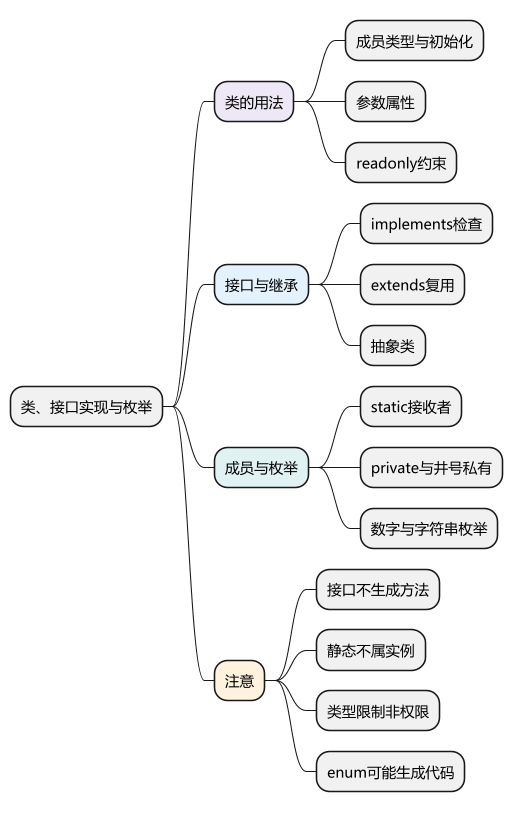
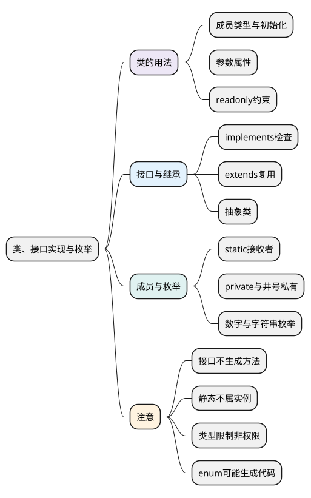

# 类、接口实现与枚举

<!-- core-mindmap:start -->
[](examples/ts08-mindmap.svg)

<details>
<summary>PlantUML 源码</summary>



</details>

<!-- core-mindmap:end -->

**口述总览：** TypeScript 在 JavaScript 类的基础上增加成员类型、初始化检查和访问约束；implements 检查类实例是否符合接口，不负责生成成员。枚举则不同于普通类型别名，常规 enum 会生成可以在运行时使用的对象。

本篇先会声明类成员、实现接口和使用枚举，再看静态成员与访问边界。new、原型、super 和私有字段的 JavaScript 机制见[class 与私有成员](../01_JavaScript/03_对象机制/05_class与私有成员.md)，这里不重复展开。

<a id="k01"></a>

## 类成员与初始化：类型要求要由实际代码完成

**口述：** 属性注解描述实例应该保存什么；初始值或构造器赋值负责把数据真正写进去。严格配置会提醒没有初始化、使用时却要求存在的字段。

<!-- example: ts08-class-fields -->
```ts
export {};
class User {
  visits = 0;
  constructor(public readonly name: string) {}
  visit(): number {
    return ++this.visits;
  }
}
const user = new User('Lin');
console.log(user.name, user.visit()); // Lin 1
if (false) {
  // @ts-expect-error readonly 属性不能在普通调用处重新赋值。
  user.name = 'Kai';
}
```

构造参数前的 public readonly 是**参数属性**写法：同时声明实例字段，并用传入参数初始化。普通的 `constructor(name: string)` 只声明参数，不会自动生成同名实例属性。

public 是默认公开访问；readonly 限制当前类型视角下的重新赋值，不会冻结整个实例。字段也可声明为可选，但在 exactOptionalPropertyTypes 下，“字段缺失”与“允许显式赋 undefined”应按类型分别表达。

未初始化字段后加 `!` 只是向检查器承诺以后会初始化，不会自动填值。只有明确掌握框架注入等初始化时机时才使用，不能用它隐藏缺少赋值。

<a id="k02"></a>

## implements：检查实例契约，不继承接口代码

**口述：** 接口声明调用者需要哪些公开成员，类通过 implements 接受这份检查。方法体、属性初始化仍由类自己实现，方法参数也不会仅因 implements 就自动获得类型注解。

<!-- example: ts08-implements -->
```ts
export {};
interface Named {
  name: string;
  greet(prefix: string): string;
}
class Person implements Named {
  constructor(public name: string) {}
  greet(prefix: string): string {
    return prefix + this.name;
  }
}
const person: Named = new Person('Lin');
console.log(person.greet('Hi ')); // Hi Lin
if (false) {
  // @ts-expect-error 只有 name，没有接口要求的 greet。
  class Incomplete implements Named { name = 'Lin'; }
}
```

Person 自己提供了 name 和 greet，接口在输出 JavaScript 时被擦除。`extends Parent` 才是继承父类实现；implements 可以列出多个接口，但不会替你执行构造、混入方法或检查静态成员。

### 抽象类可以提供实现，同时要求子类补齐部分行为

<!-- example: ts08-abstract-class -->
```ts
export {};
abstract class Formatter {
  abstract format(value: string): string;
  print(value: string): void { console.log(this.format(value)); }
}
class UpperFormatter extends Formatter {
  format(value: string): string { return value.toUpperCase(); }
}
new UpperFormatter().print('Lin'); // LIN
if (false) {
  // @ts-expect-error 抽象类不能直接作为可实例化类使用。
  new Formatter();
}
```

抽象类与接口不是同一个工具：抽象类可以包含运行时代码和共享实现，接口主要描述类型契约。abstract 约束由 TypeScript 检查，不是额外的 JavaScript 运行时访问屏障。

<a id="k03"></a>

## 静态成员与访问限定：分清类对象和实例

**口述：** static 成员属于类对象，普通成员属于实例或实例使用的原型。静态方法可以使用 this，调用 `Child.method()` 时通常由 Child 作为接收者，不会自动指向某个实例。

<!-- example: ts08-static-this -->
```ts
export {};
class Base {
  static label = 'base';
  static read(): string { return this.label; }
}
class Child extends Base {
  static override label = 'child';
}
console.log(Base.read(), Child.read()); // base child
if (false) {
  // @ts-expect-error 静态字段不属于实例。
  console.log(new Base().label);
}
```

Base.read 读取 Base.label，Child.read 读取 Child.label。取出方法后直接调用时仍需考虑接收者，这与 JavaScript 的 this 规则一致。

### private、protected 与 #成员承担不同约束

<!-- example: ts08-private-boundary -->
```ts
export {};
class Vault {
  private label = 'internal';
  #code = 7;
  read(): number { return this.#code; }
}
const vault = new Vault();
console.log(vault.read()); // 7
console.log(Object.hasOwn(vault, 'label'), Object.hasOwn(vault, '#code')); // true false
if (false) {
  // @ts-expect-error TypeScript 不允许在类外这样访问 private 成员。
  console.log(vault.label);
}
```

private 限制 TypeScript 中的访问，但 label 仍是运行时普通属性；protected 允许当前类及子类访问。`#code` 则受 JavaScript 私有语法与接收者检查保护，不是名为 '#code' 的字符串属性。

带 private/protected 成员的类型兼容还会考虑成员来源。接口继承类的实例类型时，也不能把继承来的私有约束简单改写成同名公开属性。

<a id="k04"></a>

## 枚举：给一组值命名，并理解输出对象

**口述：** enum 把成员名称与值放在一起。数字枚举通常还提供由值查名称的反向映射；字符串枚举提供名称到值的映射，不自动生成反向关系。

<!-- example: ts08-enum-runtime -->
```ts
export {};
enum Level { Low, High }
enum Direction { Up = 'up', Down = 'down' }
console.log(Level.Low, Level.High, Level[1]); // 0 1 High
console.log(Direction.Up); // up
console.log(Object.hasOwn(Direction, 'up')); // false
```

没有显式数值的首个成员从 0 开始，后续可从前一个常量值递增。字符串成员通常明确赋值；数字和字符串可以混用，但容易增加理解成本，普通业务宜保持一致。

普通 enum 会输出 JavaScript 对象，不能把所有 TS 声明都视为纯粹擦除。重复数值会让反向映射发生覆盖；不要依靠它表示一对一业务关系。

只需要限制几个允许的字符串时，可以用 `'up' | 'down'`，不一定要生成枚举对象。const enum 的内联与保留行为受编译选项和工具影响，发布库时尤其要核对消费方式；见[配置与模块](15_tsconfig、模块与声明文件.md)。

<a id="summary"></a>

类用实际代码建立实例，接口检查公开契约，静态成员在类对象上；private/protected 是类型访问约束，#成员有运行时私有机制。枚举使用前，先决定是否需要一个运行时名称和值的集合。

<a id="interview"></a>

## 试题与答案

<a id="ts08-01"></a>

### TS08-01 [P0·基础] implements会自动生成接口要求的属性和方法吗？

**回答：** 不会。它检查类实例是否满足接口公开契约，属性初始化和方法体仍由类提供，也不会自动给方法参数补类型。继承父类实现用 extends。

<a id="ts08-02"></a>

### TS08-02 [P0·原理] static方法里能使用this吗？

**回答：** 能。通过类调用时，this 通常是点号左侧的类对象，例如 Child.read() 中是 Child；它不指向某个实例。静态字段不能因此当作实例字段访问。

<a id="ts08-03"></a>

### TS08-03 [P0·原理] TypeScript的private与JavaScript的#私有成员一样吗？

**回答：** 不一样。private 主要提供静态访问限制，运行时仍可能是普通属性；#成员还有 JavaScript 的私有语法及接收者检查。两者都不能用来代替服务器权限验证。

<a id="ts08-04"></a>

### TS08-04 [P0·基础] 数字枚举与字符串枚举的运行时映射有什么区别？

**回答：** 常规数字枚举既有名称到数字，也有数字到名称的反向映射；字符串枚举不自动生成值到名称的映射。常规 enum 会产生运行时代码，字符串联合类型则主要被擦除。

参考：[TypeScript：Classes](https://www.typescriptlang.org/docs/handbook/2/classes.html)、[Enums](https://www.typescriptlang.org/docs/handbook/enums.html)。
