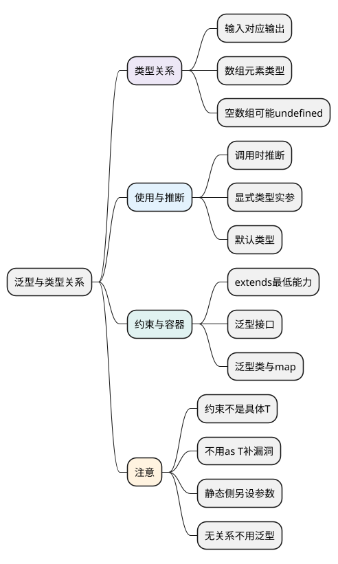

# 泛型与类型关系

<!-- core-mindmap:start -->
[](examples/ts09-mindmap.svg)

<details>
<summary>PlantUML 源码</summary>



</details>

<!-- core-mindmap:end -->

**口述总览：** 泛型把类型当作参数，让同一份实现适用于多种类型，同时保留参数、返回值与成员之间的关系。它的价值是“传入什么类型，相关结果仍知道是什么”，不是允许函数随意操作所有类型。

本篇从返回原值和读取数组开始，再增加约束、默认类型与容器。先学会表达关系，组合 keyof 的安全取属性函数留到[下一篇](10_keyof、typeof与索引访问类型.md#k03)。各例都是独立模块。

<a id="k01"></a>

## 泛型函数：把输入的类型传到返回值

**口述：** 类型参数是定义时留下的位置，调用时可以推断或明确指定。相同的 T 出现在输入与输出上，表示它们之间有需要保留的关系。

<!-- example: ts09-identity -->
```ts
export {};
function identity<T>(value: T): T {
  return value;
}
const name = identity('Lin');
const count = identity<number>(7);
console.log(name.toUpperCase(), count.toFixed(1)); // LIN 7.0
if (false) {
  // @ts-expect-error 显式指定 number 后，不能传字符串。
  identity<number>('7');
}
```

第一次调用从输入推断类型，第二次通过尖括号写出类型实参。T 是常用名字，不是语言关键字，改成 Value 也可以。返回 any 会丢失这条保证，返回 string | number 又不能精确关联每次调用。

### 数组：元素类型与空数组结果都要保留

<!-- example: ts09-first -->
```ts
export {};
function first<T>(values: readonly T[]): T | undefined {
  return values[0];
}
console.log(first([1, 2])); // 1
console.log(first(['A', 'B'])); // A
console.log(first<number>([])); // undefined
```

T 表示数组元素类型，而不是整个数组类型。只读取数组时允许 readonly 输入，调用方既可传普通数组，也可传只读数组；返回 undefined 描述空数组的真实情况，不能为了返回 T 而强行断言。

<a id="k02"></a>

## extends 约束：保证最低能力，不指定唯一类型

**口述：** 泛型没有保证某个属性存在时，函数不能随便访问。通过 extends 写出最低要求后，可以使用被保证的属性，同时保留调用者传入的更具体类型。

<!-- example: ts09-length-constraint -->
```ts
export {};
function keepLengthy<T extends { length: number }>(value: T): T {
  console.log(value.length);
  return value;
}
const text = keepLengthy('hello'); // 5
const item = keepLengthy({ length: 2, label: 'items' }); // 2
console.log(text.toUpperCase(), item.label); // HELLO items
if (false) {
  // @ts-expect-error 数字没有约束要求的 length。
  keepLengthy(7);
}
```

约束不是让 T“变成只有 length 的对象”。字符串符合要求，带 label 的对象也符合；返回 T 能让 item 继续保有 label 的类型信息。

### 满足约束的另一个值，不一定满足调用者的 T

<!-- example: ts09-constraint-limit -->
```ts
export {};
if (false) {
  function invalid<T extends { length: number }>(): T {
    // @ts-expect-error T 还可能要求 label 等字段或特定的 length 值。
    return { length: 0 };
  }
}
```

这个例子仅检查类型，不运行。若承诺返回 T，就必须真的能提供调用者选择的具体类型；如果只承诺返回长度信息，应直接声明 `{ length: number }`，而不是用 `as T` 掩盖关系不成立。

<a id="k03"></a>

## 推断、显式指定与默认类型：按调用需求选择

**口述：** 通常先让输入推断类型；当你希望允许更宽的范围，或没有足够输入信息时，再指定类型实参。默认类型是无法从使用处得到更合适类型时的选择，不是运行时默认值。

<!-- example: ts09-defaults -->
```ts
export {};
function wrap<T>(value: T): { data: T } {
  return { data: value };
}
interface Page<T = unknown> {
  items: T[];
  total: number;
}
const inferred = wrap({ id: 'u1' });
const explicit = wrap<string | null>(null);
const names: Page<string> = { items: ['Lin'], total: 1 };
const pending: Page = { items: [], total: 0 };
console.log(inferred.data.id, explicit.data); // u1 null
console.log(names.total, pending.total); // 1 0
```

inferred 根据对象得到具体结构；explicit 明确允许 string 或 null；Page<string> 的元素是 string，省略实参的 Page 则采用 unknown。多个类型参数中，有默认值的参数应放在必填参数之后；有约束时默认类型也必须满足约束。

不要为每个函数都增加泛型。例如只读取 length 并返回 number 的函数，直接接受 `{ length: number }` 往往足够；需要把原类型传给结果、另一个参数或回调时，泛型才提供额外价值。

<a id="k04"></a>

## 泛型接口与类：让容器保存具体类型

**口述：** 泛型接口描述带某种数据的结构，泛型类让每个实例拥有自己的类型约定。类的静态部分不能直接使用实例的 T，静态方法可以声明自己的类型参数。

<!-- example: ts09-generic-class -->
```ts
export {};
class Box<T> {
  constructor(public value: T) {}
  map<U>(convert: (value: T) => U): Box<U> {
    return new Box(convert(this.value));
  }
  static from<U>(value: U): Box<U> {
    return new Box(value);
  }
}
const box = Box.from(7).map(value => String(value));
console.log(box.value, typeof box.value); // 7 string
if (false) {
  class Invalid<T> {
    // @ts-expect-error 静态成员不属于某个实例 T。
    static shared: T;
  }
}
```

map 的输入是当前 Box 的 T，输出是由转换函数决定的 U。静态 from 自己声明 U，因为调用它时没有某个实例可提供 T。

`interface Box<T>` 是使用接口时确定 T；接口里声明 `<T>(value: T): T` 的调用签名，则让每次函数调用分别确定 T。先看类型参数写在哪一层，再判断谁选择它。

深入比较函数能否替换时，要看参数能接受的范围和返回值的保证。严格函数参数检查、方法签名的兼容例外以及可变容器的读写关系，不能简化成“里面的值兼容，整个容器就随意兼容”；函数契约先见[函数类型](05_函数类型与重载.md)。

<a id="summary"></a>

先找要保留的关系，再选择 T：原值返回、数组元素、容器成员或转换结果。约束只保证最低能力，默认类型补足使用信息，任何泛型都不能自动保证运行时数据正确。

<a id="interview"></a>

## 试题与答案

<a id="ts09-01"></a>

### TS09-01 [P0·原理] 为什么不用any代替泛型？

**回答：** any 会丢失关联并放宽很多检查；泛型保留调用时的具体类型，例如 identity 的输入 T 对应返回 T。需要的不是接受任意数据，而是保留相关位置之间的保证。

<a id="ts09-02"></a>

### TS09-02 [P1·原理] T extends {length:number}能直接返回{length:0}作为T吗？

**回答：** 通常不能。T 可能还要求 label 等字段或特定长度值。约束是最低能力，不能把一个仅满足约束的值当成所有可能的 T。

<a id="ts09-03"></a>

### TS09-03 [P1·工程取舍] 什么时候不该引入泛型？

**回答：** 没有需要保留的类型关系时，明确接口或联合通常更直接。只读取 length 可以接受具有 length 的结构；若还要返回原来的具体类型，泛型才提供额外价值。

<a id="ts09-04"></a>

### TS09-04 [P1·原理] 泛型类的静态成员能直接使用实例类型参数吗？

**回答：** 不能直接使用。静态侧不属于某个实例 T，需要静态方法自己的类型参数或独立类型；实例成员可以使用 T，转换方法还可以增加 U 表达输出类型。

参考：[TypeScript：Generics](https://www.typescriptlang.org/docs/handbook/2/generics.html)。
